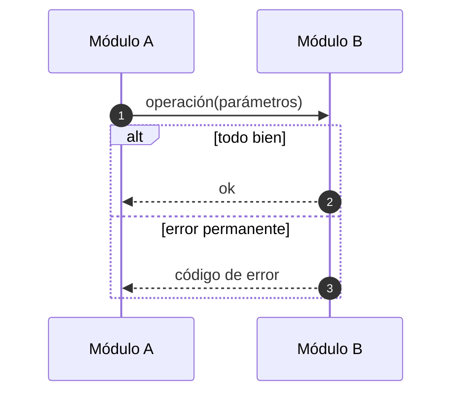
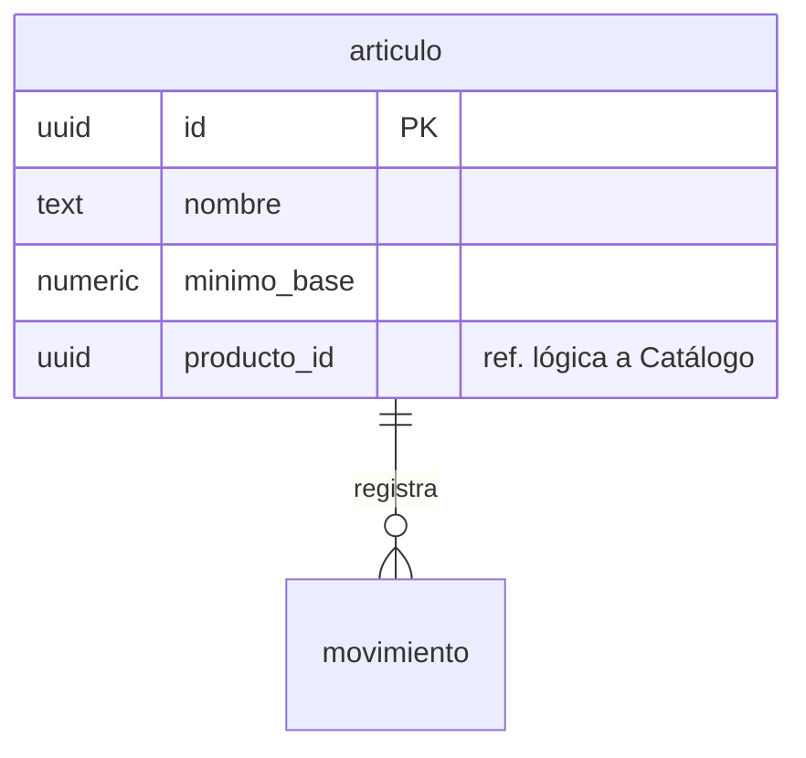

# Diagramas con Mermaid

> Complementa `negocio360-reglas`. Si chocan, gana esa skill.

## Qué diagrama para qué

| Quiero mostrar... | Tipo |
|---|---|
| Quién habla con quién en un caso concreto, en orden | `sequenceDiagram` |
| Cómo se relacionan los módulos entre sí | `flowchart LR` |
| Cómo se encadenan eventos o causas | `flowchart TB` |
| El ciclo de vida de algo (un evento, un lote, una serie) | `stateDiagram-v2` |
| Las tablas y sus relaciones | `erDiagram` |

**Un diagrama, una idea.** Si pasa de unos 25 mensajes o mezcla dos flujos, divídelo. Cada diagrama lleva debajo una frase de «Qué mirar».

## Convenciones del proyecto
- Participantes con alias legible: `participant R as Restaurantes`. Los sistemas externos y los módulos con su nombre del diseño.
- Una flecha sólida (`->>`) es una llamada; una punteada (`-->>`) es una respuesta.
- Marca lo asíncrono en el texto: «(asíncrono)». Lo que pasa por el bus no espera respuesta.
- Usa `autonumber` para poder citar «el paso 9».
- Usa `alt` / `else` para finales distintos, `opt` para lo opcional y `loop` para repeticiones.
- Una `Note over A,B` marca un límite importante (por ejemplo, «una sola transacción»).
- Los ejemplos usan **datos inventados** (5 kg de carne, lote L-0412). Los negocios son ficticios.
- Incluye los casos raros: evento duplicado, fuera de orden, error permanente y reintentable.
- Texto en español de México.

## Errores de sintaxis que ya nos pasaron o que son comunes

**En `sequenceDiagram`:**
- El punto y coma `;` termina la instrucción. No lo uses dentro de un mensaje.
- Evita `#` y `%` en los mensajes.
- Dos puntos extra dentro de un mensaje pueden romper algunos renderizadores. Evítalos.
- Si el diagrama va dentro de HTML (`<pre class="mermaid">`), no uses `<br/>` ni `<` sueltos. Usa «·» o una coma.
- Los alias no llevan espacios.

**En `flowchart`:**
- Si la etiqueta tiene paréntesis, comas o signos, ponla entre comillas: `A["texto (con paréntesis)"]`.
- Las etiquetas de flecha con espacios también van entre comillas: `A -- "venta.*" --> B`.

**En `erDiagram`:**
- El tipo de cada atributo es **una sola palabra**. No escribas `numeric(14,4)`: la coma lo rompe. Pon `numeric` y detalla la escala en la tabla de texto.
- Las claves son `PK`, `FK` o `UK`. Para evitar problemas entre versiones, usa una sola por atributo.
- La etiqueta de una relación con espacios va entre comillas.
- Una referencia lógica (sin llave foránea) se dibuja con `..` en vez de `--`.
- Cardinalidades: `||--o{` (uno a muchos), `||--||` (uno a uno), `|o--o|` (opcional a opcional).

**En `stateDiagram-v2`:**
- Los nombres de estado van en una palabra (`EnEntrega`), y la descripción va en la transición.

## Plantillas mínimas

````markdown

````

````markdown

````

## Verificación
No des por bueno un diagrama que no viste dibujado. Si no pudiste renderizarlo, **dilo** en el reporte y en la Bitácora, y revisa primero las reglas de sintaxis de arriba si alguien reporta que no se ve.

## Consistencia
Si un diagrama cambia un contrato (un evento nuevo, una columna), actualiza también las tablas del documento donde aparece y cualquier página o mockup que lo muestre.
