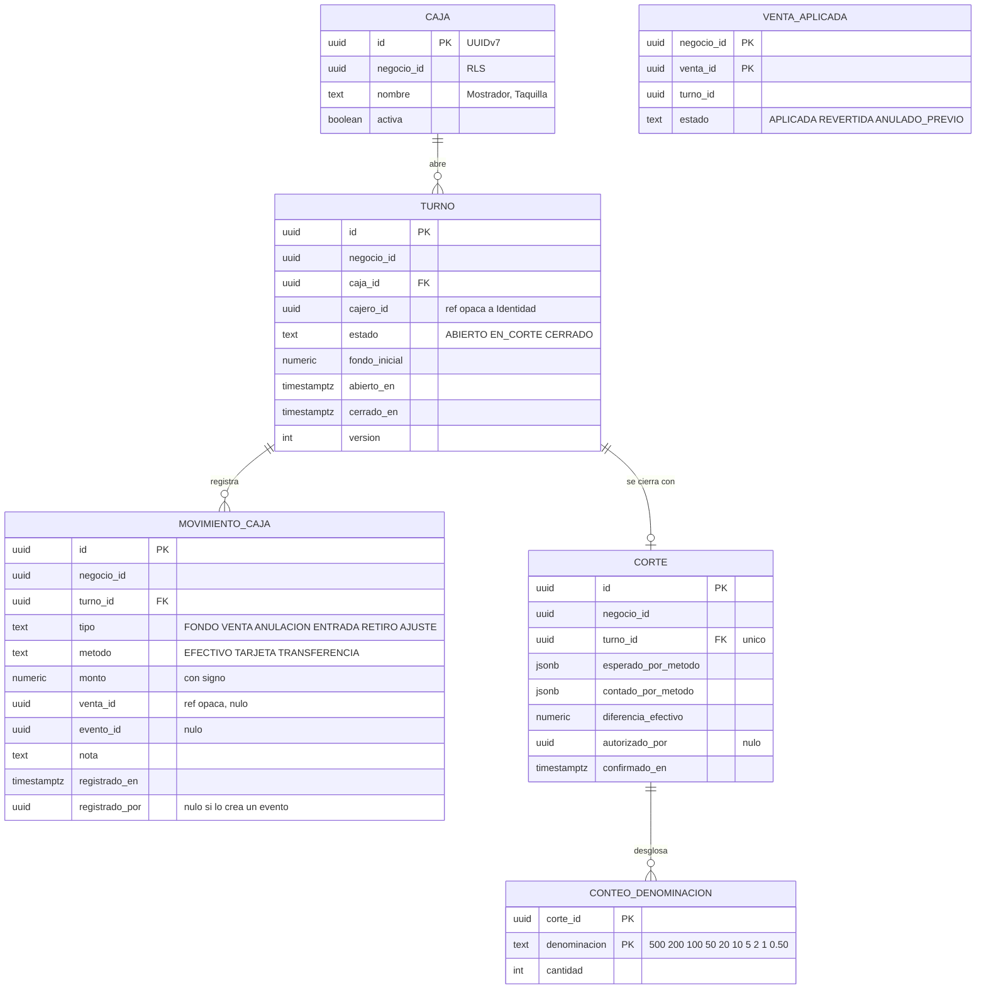
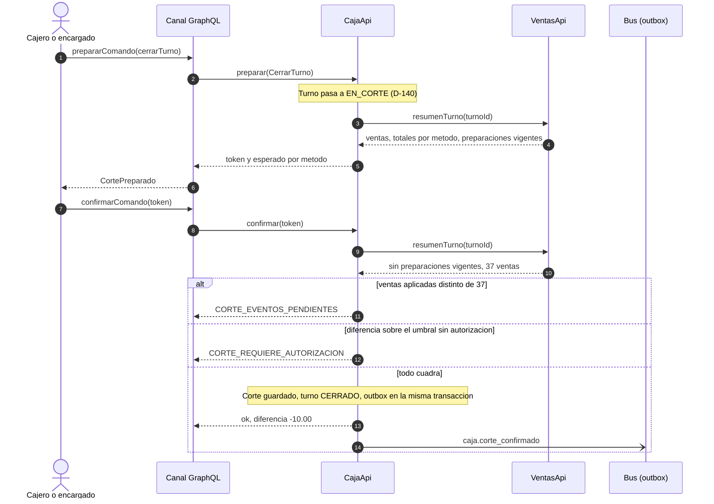
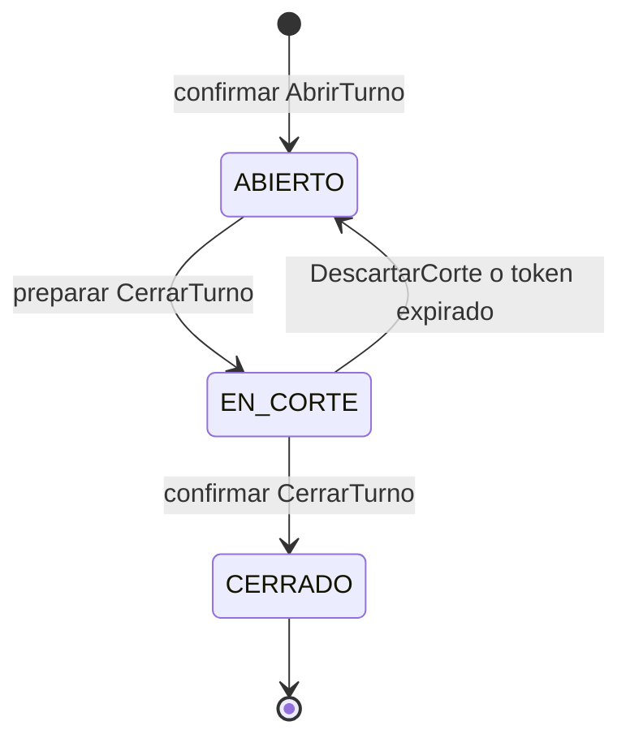

# Diseño del módulo de Caja

**Versión:** 0.1 (borrador para revisión del equipo)
**Fecha:** 2026-10-14
**Estado:** solo diseño. No hay autorización escrita para programar Caja. Nadie debe programar contra este documento hasta que el equipo lo apruebe (sección 12).
**Contexto de decisiones:** `docs/BITACORA.md`. Decisiones nuevas: D-135, D-136, D-140 y D-142.
**Módulo hermano:** `docs/diseno/ventas.md`. **Plan:** `docs/planes/ventas-caja-v1.md`.

Convención de estado: **[A]** aceptado, **[P]** propuesto, **[?]** abierto. Prioridades P1, P2, P3 como en Ventas. Datos de ejemplo **simulados**.

---

## 1. Qué es y para qué sirve

Caja es un módulo **horizontal**: controla el dinero de un punto de cobro durante un turno. Sabe cuánto debería haber por método de pago, registra entradas y retiros, y cierra el turno con un **corte** que compara lo esperado contra lo contado. Sirve igual a la taquilla de un museo, al mostrador de un misceláneo o a la caja de una fonda.

Qué **no** es de Caja: las ventas y sus líneas (Ventas), los asientos contables (Contabilidad), los cobros con tarjeta en sí (los hace la terminal del negocio; Caja solo registra el monto).

---

## 2. Arquitectura

### 2.1 Reglas R1 a R6 aplicadas a Caja

| Regla | Cómo se aplica |
|---|---|
| R1 | Caja es dueño del esquema `caja`. Otros entran por `CajaApi` o por sus eventos. |
| R2 y R6 | Caja escucha `venta.registrada` y `venta.anulada`, y llama a `VentasApi.resumenTurno` al hacer el corte. Ventas no conoce a Caja (D-135), así que no hay ciclo. |
| R3 | Listeners idempotentes por `evento_id` (`evento_procesado`) y por venta (`venta_aplicada`). |
| R4 | Horizontal. No conoce a ningún vertical. |
| R5 | Publica `caja.*` versionados y aditivos. |

### 2.2 Dependencias

| Módulo | Llama a la API de | Escucha eventos de | Publica |
|---|---|---|---|
| Caja (horizontal) | Ventas | `venta.registrada`, `venta.anulada` | `caja.turno_abierto`, `caja.corte_confirmado`, `caja.diferencia_detectada` |

`allowedDependencies = "compartido, ventas"`, verificado con `ApplicationModules.verify()`.

---

## 3. Modelo de datos

Mismas convenciones que Ventas: UUIDv7, `negocio_id` con RLS, dinero `NUMERIC(14,2)`, HALF_UP (D-20).

### 3.1 Diagrama entidad-relación



### 3.2 Tablas

| Tabla | Notas |
|---|---|
| `caja` | Único `(negocio_id, lower(nombre))` |
| `turno` | Índice único parcial: un solo turno `ABIERTO` o `EN_CORTE` por caja (CJ-01). Bloqueo optimista con `version` |
| `movimiento_caja` | **Solo inserción**. Único `(negocio_id, evento_id)` cuando `evento_id` no es nulo |
| `corte` | Uno por turno. Se escribe solo al confirmar |
| `conteo_denominacion` | Desglose de billetes y monedas (P2) |
| `venta_aplicada` | Idempotencia por venta y marca `ANULADO_PREVIO` (mismo patrón que D-19 y Clientes H-03) |
| `preparacion` | Igual que Ventas e Inventario |
| `evento_procesado` | `(consumidor, evento_id)`, purga a 90 días (pendiente A1 de la Bitácora) |

---

## 4. Reglas de dominio

| ID | Regla | Prioridad |
|---|---|---|
| CJ-01 | Una caja tiene a lo más un turno `ABIERTO` o `EN_CORTE`. Un cajero tiene a lo más un turno abierto [?]. | P1 |
| CJ-02 | Abrir turno pide `fondoInicial ≥ 0` y crea un movimiento `FONDO` en efectivo (si el fondo es 0.00 no se crea movimiento; precisado al programar). | P1 |
| CJ-03 | `venta.registrada` crea un movimiento `VENTA` por cada pago, con su método y monto. `venta.anulada` crea los mismos con signo negativo (`ANULACION`). | P1 |
| CJ-04 | Los listeners son idempotentes: el mismo evento dos veces deja un solo efecto (`evento_procesado` y `venta_aplicada`). Si `venta.anulada` llega antes, se guarda `ANULADO_PREVIO` y la venta tardía no suma. | P1 |
| CJ-05 | Un retiro no puede dejar el efectivo esperado por debajo de cero. | P1 |
| CJ-06 | `preparar` el corte pone el turno `EN_CORTE`; desde ahí el canal ya no deja preparar ventas en ese turno. Pide a `VentasApi.resumenTurno` los totales y las preparaciones vigentes. Descartar el corte regresa el turno a `ABIERTO`. | P1 |
| CJ-07 | `confirmar` el corte exige cero preparaciones de venta vigentes en el turno y que el número de ventas que Caja aplicó sea igual al que reporta Ventas. Si no cuadra, responde `CORTE_EVENTOS_PENDIENTES` y no cierra. | P1 |
| CJ-08 | Si la diferencia en efectivo supera el umbral del negocio, el corte pide `autorizadoPor` con permiso de encargado. El umbral es una regla versionada [?] (valor inicial propuesto: 50.00). | P1 |
| CJ-09 | Un corte confirmado es inmutable y cierra el turno. Una corrección posterior es un `AJUSTE` en un turno abierto, con nota. | P1 |
| CJ-10 | No hay movimientos manuales en un turno `EN_CORTE` o `CERRADO`. | P1 |
| CJ-11 | Si llega un evento de venta para un turno `CERRADO`, se registra como `AJUSTE` en el siguiente turno abierto de esa caja y se publica `caja.diferencia_detectada` [?]. | P2 |
| CJ-12 | Esperado por método = suma de los movimientos del turno en ese método. Diferencia = contado − esperado. Toda cifra la calcula el código. | P1 |

---

## 5. Contrato de la API pública (`CajaApi`)

Reglas generales iguales a Ventas: `negocio_id` del contexto, respuesta `{ ok, codigo, datos, mensaje_plantilla }`, records inmutables, paginación por cursor.

### 5.1 Consultas

| ID | Operación | Entrada | Salida | La usa | Prioridad |
|---|---|---|---|---|---|
| CF-01 | `turnoActivo` | `cajaId?` (si falta, el del actor) | `TurnoVista` o vacío, con el estado efectivo: un corte vencido sale `ABIERTO` (D-140) | Canal (VT-01), panel | P1 |
| CF-02 | `estadoTurno` | `turnoId` | esperado por método, movimientos, número de ventas aplicadas | Panel | P1 |
| CF-03 | `cortes` | rango de fechas, `cajaId?`, cursor | página de `CorteVista` con diferencias | Panel (dueño) | P1 |
| CF-04 | `cajas` | — | cajas del negocio | Panel | P1 |
| CF-05 | `VerificadorDeTurno.abierto` (implementa la interfaz de Ventas) | `turnoId` | verdadero solo si el turno es del negocio y su estado efectivo es `ABIERTO` | Ventas al preparar y al confirmar ([P] D-145) | P1 |

### 5.2 Comandos (preparar → confirmar, por `prepararComando` / `confirmarComando`, D-55)

| ID | Comando | Campos | Reglas | Eventos |
|---|---|---|---|---|
| CF-10 | `AbrirTurno` | `cajaId`, `fondoInicial` | CJ-01, CJ-02 | `caja.turno_abierto` |
| CF-11 | `RegistrarMovimientoCaja` | `turnoId`, `tipo` (`ENTRADA` o `RETIRO`), `monto`, `nota` | CJ-05, CJ-10 | Ninguno |
| CF-12 | `CerrarTurno` (el corte) | `turnoId`, `contadoPorMetodo`, `denominaciones[]?`, `autorizadoPor?` | CJ-06 a CJ-08, CJ-12 | `caja.corte_confirmado` y, si aplica, `caja.diferencia_detectada` |
| CF-13 | `DescartarCorte` | `turnoId` | CJ-06 | Ninguno |
| CF-14 | `CrearCaja` | `nombre` | — | Ninguno |

Para el corte, `preparar` es lo que pone el turno `EN_CORTE` y devuelve lo esperado. Es la única preparación que cambia un estado; se documenta como excepción [P] D-140 porque sin ella una venta podría entrar entre el conteo y la confirmación.

### 5.3 Escrituras del sistema (sin confirmación humana, como D-22)

| ID | Función | La dispara | Resultado |
|---|---|---|---|
| CF-20 | `aplicarVenta` | Listener de `venta.registrada` | `APLICADA`, `YA_APLICADA`, `OMITIDA_ANULADO_PREVIO` |
| CF-21 | `revertirVenta` | Listener de `venta.anulada` | `REVERTIDA`, `YA_REVERTIDA`, `MARCADA_ANULADO_PREVIO` |

Desde la revisión del 2026-10-15 ([P] D-147), las dos funciones también pueden responder `SIN_TURNO_ABIERTO` (el turno no existe en el negocio o ya cerró; CJ-11 sigue pendiente) o `DATOS_INVALIDOS` (el evento no lo publicó Ventas, le faltan datos, trae un método desconocido o montos no positivos, desmedidos o con más de 2 decimales). En esos dos casos el evento **no se marca como procesado**: no se pierde y el adaptador del bus no lo da por entregado (`ResultadoAplicacion.completado()` es falso). La anulación revierte los movimientos que Caja registró para la venta, no los montos que diga el evento.

### 5.4 Códigos de error

| Grupo | Códigos |
|---|---|
| Caja (agregados al programar, 2026-10-15) | `CAJA_DUPLICADA`, `NOMBRE_CAJA_INVALIDO`, `TURNO_NO_ENCONTRADO` (consulta de un turno que no existe en el negocio) |
| Turno | `CAJA_NO_ENCONTRADA`, `CAJA_INACTIVA`, `TURNO_YA_ABIERTO`, `TURNO_NO_ABIERTO`, `TURNO_EN_CORTE`, `FONDO_INVALIDO` |
| Movimientos | `MONTO_INVALIDO`, `RETIRO_MAYOR_AL_EFECTIVO`, `NOTA_REQUERIDA` |
| Corte | `CORTE_VENTAS_PENDIENTES`, `CORTE_EVENTOS_PENDIENTES`, `CORTE_REQUIERE_AUTORIZACION`, `CONTEO_INVALIDO` |
| Preparar y confirmar | `TOKEN_INVALIDO`, `TOKEN_EXPIRADO`, `TOKEN_USADO`, `COMANDO_CAMBIO` |
| Reintentables | `CONCURRENCIA`, `ERROR_TEMPORAL` |

---

## 6. Eventos

Sobre común de `compartido`, `origen = "caja"`, `correlacion_id = turno_id`.

### 6.1 Que publica

| Evento (v1) | Cuándo | Campos de `datos` | Consumidores |
|---|---|---|---|
| `caja.turno_abierto` | Al confirmar `AbrirTurno` | `turno_id`, `caja_id`, `fondo_inicial` | Panel (suscripción) |
| `caja.corte_confirmado` | Al confirmar `CerrarTurno` | `corte_id`, `turno_id`, `caja_id`, `esperado_por_metodo`, `contado_por_metodo`, `diferencia_efectivo`, `abierto_en`, `cerrado_en` | Contabilidad [?], panel |
| `caja.diferencia_detectada` | Diferencia sobre el umbral (CJ-08) o venta tardía (CJ-11) | `turno_id`, `caja_id`, `diferencia`, `umbral`, `motivo` | Panel del dueño |

Sin datos personales: `cajero_id` no va en los eventos.

### 6.2 Que consume

`venta.registrada` v1 y `venta.anulada` v1 (contrato en `ventas.md` §6). Lee `venta_id`, `turno_id` y `pagos[]`, con lector tolerante.

### 6.3 Ejemplo (datos simulados)

```json
{
  "id": "0192a6f2-9910-7c01-8d02-0a0b0c0d0e0f",
  "tipo": "caja.corte_confirmado",
  "version": 1,
  "negocio_id": "0191f0aa-11b2-7c3d-9e4f-a1b2c3d4e5f6",
  "origen": "caja",
  "ocurrido_en": "2026-10-16T02:05:44Z",
  "correlacion_id": "0192a39f-0c11-7d20-8e31-abcdefabcdef",
  "datos": {
    "corte_id": "0192a6f1-1201-7aa0-8bb0-ccddeeff0012",
    "turno_id": "0192a39f-0c11-7d20-8e31-abcdefabcdef",
    "caja_id": "0191f0ac-3333-7444-8555-666677778888",
    "esperado_por_metodo": { "EFECTIVO": "3185.50", "TARJETA": "2240.00", "TRANSFERENCIA": "390.00" },
    "contado_por_metodo":  { "EFECTIVO": "3175.50", "TARJETA": "2240.00", "TRANSFERENCIA": "390.00" },
    "diferencia_efectivo": "-10.00",
    "abierto_en": "2026-10-15T15:00:12Z",
    "cerrado_en": "2026-10-16T02:05:43Z"
  }
}
```

---

## 7. Comunicación con la API

| ID | Protocolo | Operación | Quién llama | Entrada → salida | Caso | Prioridad |
|---|---|---|---|---|---|---|
| G1 | GraphQL (consulta) | `turnoActivo(cajaId)` | Panel (cajero) | → turno o nulo | Saber al entrar si hay que abrir turno | P1 |
| G2 | GraphQL (mutación) | `prepararComando(input: {abrirTurno})` / `confirmarComando` | Panel (cajero) | caja y fondo → turno | Empezar el día | P1 |
| G3 | GraphQL (mutación) | `prepararComando(input: {registrarMovimientoCaja})` / `confirmarComando` | Panel (cajero, encargado) | tipo, monto, nota → movimiento | Retirar efectivo o meter cambio | P1 |
| G4 | GraphQL (mutación) | `prepararComando(input: {cerrarTurno})` / `confirmarComando` | Panel (cajero, encargado) | conteo → corte con diferencia | Cerrar el día | P1 |
| G5 | GraphQL (consulta) | `estadoTurno(turnoId)` | Panel | → esperado por método y movimientos | Ver cómo va la caja | P1 |
| G6 | GraphQL (consulta) | `cortes(desde, hasta, cajaId, primeros, despues)` | Panel (dueño) | → página de cortes | Auditar faltantes y sobrantes | P1 |
| W1 | GraphQL (suscripción, WebSocket) | `turnoEnVivo(turnoId)` | Panel (dueño) | → esperado por método cada vez que cambia | Ver la caja sin recargar | P2 |
| J1 | Java | `VentasApi.resumenTurno(turnoId)` | Caja | → totales y preparaciones vigentes | CJ-06, CJ-07 | P1 |
| B1 | Bus | `venta.registrada`, `venta.anulada` | Ventas → Caja | | CJ-03, CJ-04 | P1 |
| B2 | Bus | `caja.corte_confirmado` | Caja → Contabilidad | | | P1 |

Sin REST: no hay herramientas de IA ni bot para Caja en el MVP.

---

## 8. Flujos

### 8.1 Corte de caja



### 8.2 Estados del turno



Si el token del corte expira sin confirmar, una tarea regresa el turno a `ABIERTO` [P].

---

## 9. Seguridad

Se heredan SG-01 a SG-21 (D-45). Propias de Caja:
- Solo el cajero del turno, un encargado o el dueño ven y operan el turno [?] (permisos de Identidad).
- Retiros y autorizaciones de diferencia quedan con actor y fecha; los movimientos no se borran ni se editan.
- Los montos que manda el panel se validan como decimales positivos con 2 decimales.

---

## 10. Criterios de aceptación

| Prueba | Reglas |
|---|---|
| `ApplicationModules.verify()`: Caja solo depende de `compartido` y `ventas` | R1, D-135 |
| Segundo turno en la misma caja rechazado | CJ-01 |
| Fondo negativo rechazado; fondo crea movimiento | CJ-02 |
| Venta con pago mixto crea dos movimientos; anulación los compensa | CJ-03 |
| Mismo evento dos veces, un efecto; anulación antes de la venta | CJ-04 |
| Retiro mayor al efectivo rechazado | CJ-05 |
| Venta preparada en turno `EN_CORTE` rechazada por el canal | CJ-06 |
| Corte con eventos pendientes no cierra | CJ-07 |
| Diferencia sobre el umbral sin autorización rechazada | CJ-08 |
| Movimiento manual en turno cerrado rechazado | CJ-09, CJ-10 |
| Esperado y diferencia calculados a mano coinciden | CJ-12 |
| Aislamiento entre negocios (RLS) | §9 |

Cobertura mínima: 80 %.

---

## 11. Convención de documentación del código (D-142)

La misma de `ventas.md` §11: JavaDoc en todo tipo y método público, con su ID de función (`CF-12`), las reglas que aplica (`CJ-07`), un `@throws` o código de error por fallo, y escala y redondeo en todo monto. `mvn javadoc:javadoc` sin advertencias.

---

## 12. Pendientes para aprobar este documento

| # | Pregunta | Propuesta |
|---|---|---|
| 1 | ¿Aceptan que `preparar` el corte cambie el turno a `EN_CORTE` (D-140)? | Sí [P] |
| 2 | ¿Umbral de diferencia que pide autorización? | 50.00, como regla versionada [?] |
| 3 | ¿Quién puede retirar efectivo y autorizar diferencias? | Encargado y dueño [?] |
| 4 | ¿Un cajero puede tener dos turnos abiertos en cajas distintas? | No [?] |
| 5 | ¿Contabilidad consume `caja.corte_confirmado` en el MVP? | Abierta [?] |
