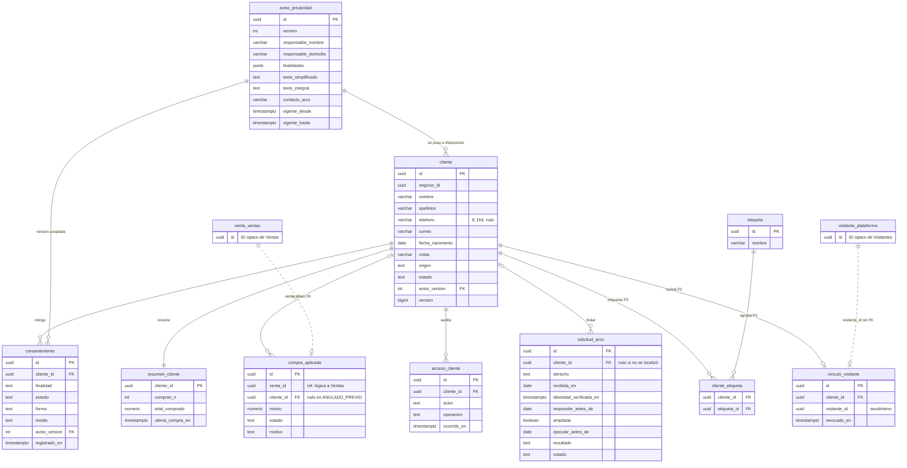
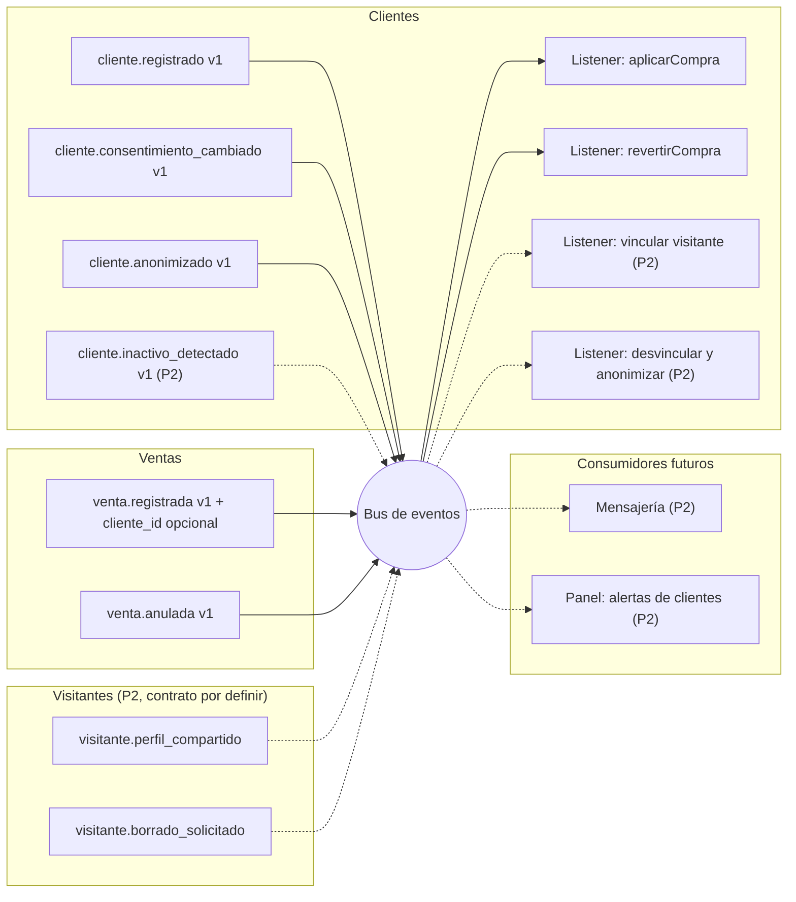
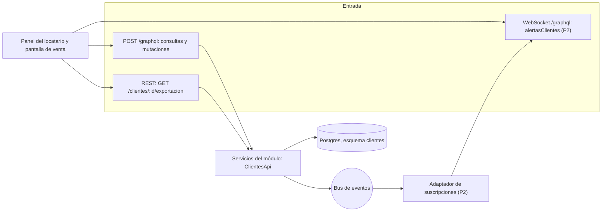
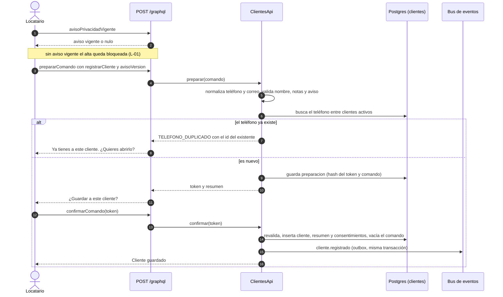
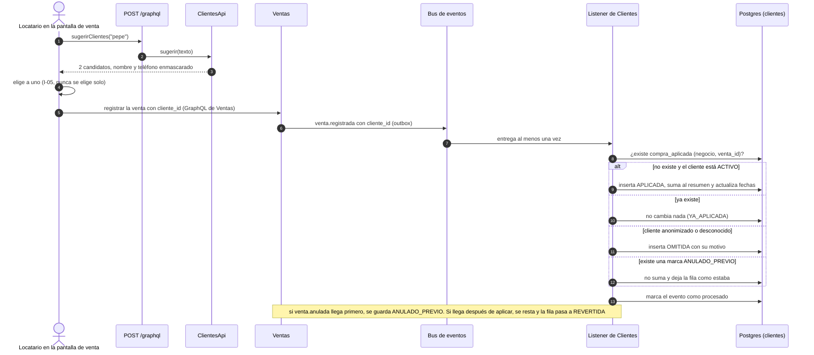
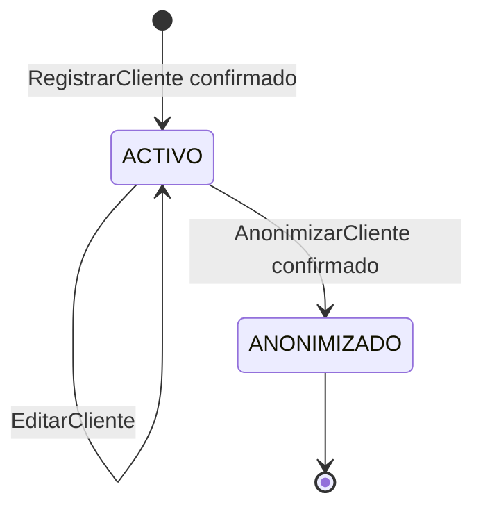
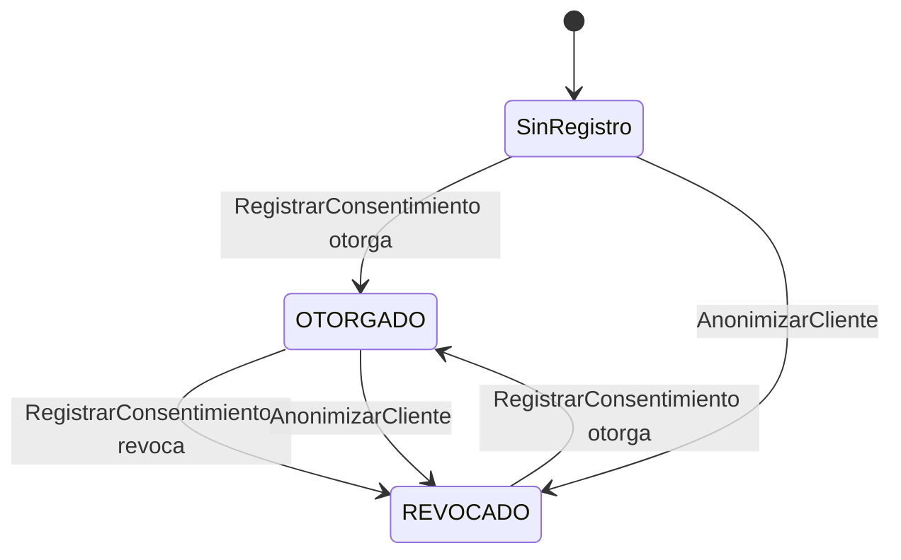
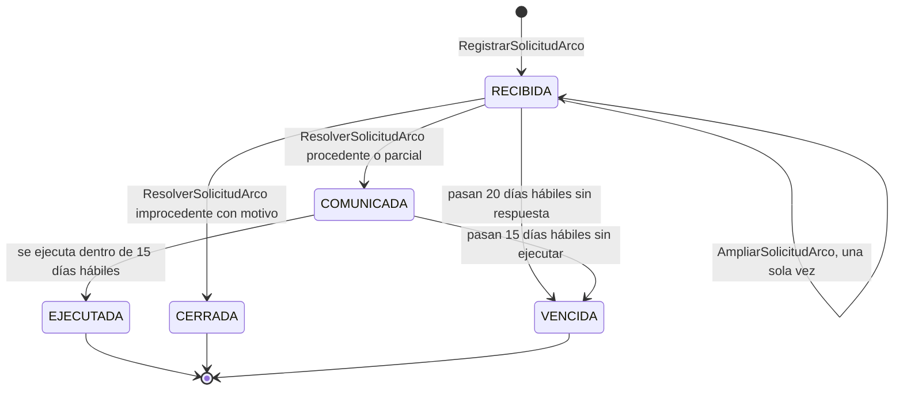

# Diseño del módulo de Clientes

**Versión:** 0.2
**Fecha:** 2026-10-13
**Estado:** diseño aprobado en lo esencial por el equipo (D-57, D-58, D-50, D-63, D-65). La etapa I0 (contratos y esquema GraphQL) ya está programada y probada. Las demás etapas esperan su turno (sección 16).
**Contexto de decisiones:** `docs/BITACORA.md` (los identificadores `D-xx` remiten a ahí).
**Diseño visual:** artefacto «Mapa de Clientes» (https://claude.ai/artifact/W6ubG316Laxipgbc4EqAV7). Este documento es la versión escrita y vive en el repositorio.
**Evidencia de la etapa I0:** `docs/pruebas/clientes-i0.tdd.md`.

Prioridades: **P1** = MVP y demo, **P2** = si alcanza el tiempo, **P3** = fuera del MVP.

> **Aviso.** La sección 12 resume lo que pide la Ley Federal de Protección de Datos Personales en Posesión de los Particulares (LFPDPPP) y cómo lo cubre el diseño. No es asesoría jurídica. Antes de un piloto con datos reales hay que revisarlo con una persona con formación jurídica.

---

## 1. Qué es y para qué sirve

Clientes es un módulo **horizontal**: guarda a las personas que le compran a un negocio, lo que se sabe de cada una, los permisos de contacto que dieron y lo que el negocio debe cumplir para tratar esos datos. Sirve igual a una fonda, a la tienda de un museo o a un puesto de artesanías. No sabe de platillos, entradas ni recetas.

Qué logra el negocio con él:

1. **Reconocer a su gente.** Alta rápida, búsqueda por nombre o teléfono y sugerencias mientras vende.
2. **Ver cuánto compra cada cliente.** Número de compras, total, ticket promedio y última compra, calculados solo por el código a partir de las ventas.
3. **Saber a quién puede escribirle.** Consentimiento por finalidad, con evidencia.
4. **Cumplir la ley desde el principio.** Aviso de privacidad por negocio, derechos ARCO con plazos y anonimización.

Qué **no** es: no guarda ventas (son de Ventas), cupones (Pasaporte), reseñas (Reseñas) ni el perfil o los intereses del turista (Visitantes). No es una herramienta de mercadotecnia masiva ni un sistema de fiado o cuentas por cobrar.

Una advertencia de producto (hallazgo C-6): la mayoría de los turistas compra una sola vez y no se registra. El valor de Clientes está en el cliente **local y recurrente**. Por eso el corte P1 es pequeño y no se presenta como pieza central del pitch.

---

## 2. Alcance

| Prioridad | Qué incluye | Decisión |
|---|---|---|
| **P1** (entra a la demo) | Alta, edición, búsqueda y sugerencias de clientes. Resumen de compras por eventos de Ventas. Consentimiento por finalidad. Anonimización. Aviso de privacidad por negocio. Solicitudes ARCO con plazos en días hábiles y exportación de datos. Auditoría de acceso a la ficha. | D-57 |
| **P2** (si alcanza) | Etiquetas de cliente. Vínculo con un turista que comparte su alias. Alerta de inactividad (WebSocket). `puedeContactar` para mensajería futura. | D-57 |
| **P3** (fuera del MVP) | Fusionar clientes duplicados. | D-57 |

**Fuera de alcance y por qué:**

| Cosa | Motivo |
|---|---|
| Domicilio y RFC del cliente | No tienen una finalidad en el aviso (art. 12). Quedan fuera hasta que el equipo defina para qué se piden (D-59). |
| Facturación, fiado, cuentas por cobrar | Fuera del MVP. |
| Datos sensibles (salud, alergias, religión, etc.) | Exigen consentimiento expreso y por escrito (art. 8). No se guardan. |
| Borrado físico de un cliente | Solo se anonimiza (D-50). |
| Canal de bot de chat | El bot no continúa por ahora (D-63). Se eliminaron las vías REST del bot y el origen `BOT`. |
| Menores de edad | Pendiente de definir con asesoría (hallazgo C-11, pregunta abierta 4). |

---

## 3. Arquitectura

### 3.1 Reglas R1 a R6 aplicadas a Clientes

| Regla | Cómo se aplica |
|---|---|
| R1 | Clientes es dueño de su esquema `clientes` en Postgres. Los demás módulos entran por `ClientesApi` (interfaz Java) o por el bus. Sin joins ni llaves foráneas hacia otros esquemas. |
| R2 y R6 | Clientes **no llama** a la API de ningún otro módulo. Escucha eventos de Ventas. Ventas tampoco llama a Clientes: guarda `cliente_id` como referencia opaca (D-48). |
| R3 | Todo evento lleva UUIDv7. Los listeners deduplican con `evento_procesado` y con la llave `(negocio_id, venta_id)`. |
| R4 | Clientes es horizontal. Ningún vertical es necesario para que funcione. |
| R5 | El único cambio a un contrato ajeno es agregar `cliente_id` **opcional** a `venta.registrada` v1. |

### 3.2 Dependencias entre módulos

| Módulo | Puede llamar a la API de | Escucha eventos de | Publica |
|---|---|---|---|
| Clientes (horizontal) | Ninguno | `venta.registrada`, `venta.anulada`; en P2, `visitante.*` | `cliente.*` |

En código, Spring Modulith lo verifica en cada corrida: el módulo `clientes` solo puede depender de `compartido` (`allowedDependencies = "compartido"`).

### 3.3 Estructura de paquetes (ya creada en la etapa I0)

```
backend/src/main/java/mx/negocio360/
  Negocio360Application.java
  compartido/                      (módulo abierto)
    eventos/    SobreEvento, MapeadorEventos
    dinero/     DecimalPlano
    graphql/    Escalares, DecimalCoercing, FechaCoercing, FechaHoraCoercing
  clientes/
    eventos/    ClienteRegistrado, ClienteConsentimientoCambiado, ClienteAnonimizado,
                enums Finalidad, EstadoConsentimiento, MedioConsentimiento, OrigenCliente
    contratos/  VentaRegistradaV1, VentaAnuladaV1  (lo que Clientes lee de Ventas)
    consultas/  LimitesDeConsulta
backend/src/main/resources/graphql/
  compartido.graphqls              (escalares, Query, Mutation, PageInfo, Preparacion, Resultado)
  clientes.graphqls                (consultas, tipos y ComandoInput de Clientes)
```

Capas que se agregarán en las siguientes etapas, dentro de `clientes/`: dominio (reglas puras), aplicación (casos de uso y `ClientesApi`), persistencia (repositorios y migraciones) y entrada (resolvedores GraphQL y controlador REST). Los resolvedores no tocan repositorios: llaman a `ClientesApi`.

### 3.4 Principio rector

**El modelo interpreta, el código decide.** En Clientes eso significa:

- Toda cifra (compras, total, ticket promedio, fechas) la calcula código determinista.
- El modelo de IA **nunca** ve la lista de clientes ni su historial (D-54, SC-07). Si el modelo extrae un nombre de un mensaje, el código busca y, si hay varios candidatos, **la persona elige** (I-05).
- Toda escritura que inicia una persona pasa por **preparar → confirmar** con token de un solo uso (D-55).

---

## 4. Dueño de cada dato

| Dato | Dueño | Qué ve Clientes |
|---|---|---|
| Nombre, apellidos, teléfono, correo, fecha de nacimiento y notas del cliente | Clientes | Propio |
| Consentimientos de contacto | Clientes | Propio |
| Aviso de privacidad del negocio y solicitudes ARCO | Clientes | Propio |
| Número de compras, total y fechas | Clientes (derivado) | Se calcula con eventos de Ventas. Nadie lo edita |
| La venta: líneas, total y medio de pago | Ventas | Solo `venta_id`, `cliente_id` y `total` del evento |
| Perfil e intereses del turista | Visitantes | Nada. Solo el alias, si el turista lo comparte (P2) |
| Cupones y sellos del pasaporte | Pasaporte | Nada |
| Reseñas | Reseñas | Nada |
| Domicilio, RFC, facturación, fiado y cuentas por cobrar | Fuera del MVP | No se guardan |

---

## 5. Modelo de datos

Doce tablas en el esquema `clientes`: nueve de P1 (siete de negocio más `preparacion` y `evento_procesado`, que son de soporte) y tres de P2 (`etiqueta`, `cliente_etiqueta` y `vinculo_visitante`). Todas llevan `negocio_id` con **seguridad por fila** (`app.negocio_id`). Los identificadores son UUIDv7.

### 5.1 Diagrama entidad-relación



Las tablas `preparacion` y `evento_procesado` son de soporte y no se relacionan con las demás por llave foránea.

### 5.2 Tablas, columna por columna

Notación: **NN** = no nulo, **PK** = llave primaria, **FK** = llave foránea.

#### `cliente` (P1)
La persona que le compra al negocio, con los datos que el aviso de privacidad declara.

| Columna | Tipo | Nota |
|---|---|---|
| `id` | uuid PK | UUIDv7 |
| `negocio_id` | uuid NN | Seguridad por fila |
| `nombre` | varchar(80) NN | I-01. Nombre o apodo |
| `apellidos` | varchar(80) | I-01. Opcional |
| `nombre_busqueda` | text generado | Nombre y apellidos en minúsculas y sin acentos. Índice trigram |
| `telefono` | varchar(16) | I-02. E.164 (+52 y 10 dígitos). Nulo si no lo dio |
| `correo` | varchar(120) | I-07. Opcional |
| `fecha_nacimiento` | date | I-08. Opcional. Sirve para felicitar, solo con consentimiento de PROMOCIONES |
| `notas` | varchar(500) | P-01. Texto libre. No debe llevar datos sensibles |
| `origen` | text NN | `PANEL` o `VISITANTE` |
| `estado` | text NN | `ACTIVO` o `ANONIMIZADO` |
| `aviso_version` | int NN FK | L-03. Versión del aviso que se puso a su disposición |
| `aviso_entregado_en` | timestamptz NN | L-03 |
| `anonimizado_en` | timestamptz | Nulo mientras esté ACTIVO |
| `version` | bigint NN | Bloqueo optimista (I-06) |
| `creado_en`, `actualizado_en` | timestamptz NN | |
| `creado_por` | text NN | Actor que lo dio de alta |

Único parcial `(negocio_id, telefono)` cuando `telefono` no es nulo y `estado = ACTIVO` (I-03). Índices: `(negocio_id, estado)` y trigram sobre `nombre_busqueda`.

#### `consentimiento` (P1)
Historial de permisos de contacto. Solo se inserta; el vigente es el más reciente por finalidad.

| Columna | Tipo | Nota |
|---|---|---|
| `id` | uuid PK | UUIDv7 |
| `negocio_id` | uuid NN | |
| `cliente_id` | uuid FK NN | Hacia `cliente` |
| `finalidad` | text NN | `CONTACTO_MENSAJERIA` o `PROMOCIONES` |
| `estado` | text NN | `OTORGADO` o `REVOCADO` |
| `forma` | text NN | `EXPRESO`. `TACITO` queda reservado (D-60) |
| `medio` | text NN | `VERBAL`, `PANEL` o `APP_TURISTA` |
| `aviso_version` | int NN FK | Versión del aviso bajo la que se dio |
| `registrado_por` | text NN | Actor |
| `registrado_en` | timestamptz NN | |

Sin `UPDATE` ni `DELETE`, revocado a nivel de base de datos (P-03). Revocar no tiene efectos retroactivos (art. 7). Índice `(cliente_id, finalidad, registrado_en desc)`.

#### `aviso_privacidad` (P1)
Aviso de cada negocio, por versión. Un negocio sin aviso vigente no puede registrar clientes.

| Columna | Tipo | Nota |
|---|---|---|
| `id` | uuid PK | UUIDv7 |
| `negocio_id` | uuid NN | |
| `version` | int NN | Única por negocio |
| `responsable_nombre` | varchar(120) NN | Art. 15 I. Identidad del responsable |
| `responsable_domicilio` | varchar(200) NN | Art. 15 I. Domicilio del responsable |
| `finalidades` | jsonb NN | Art. 15 III. Lista de `{codigo, requiere_consentimiento}` |
| `texto_simplificado` | text NN | Art. 16 II. Datos, finalidades, opciones para limitar el uso y dónde ver el integral |
| `texto_integral` | text NN | Art. 15 completo |
| `contacto_arco` | varchar(200) NN | Art. 15 V y 29. Persona o departamento de datos personales |
| `vigente_desde` | timestamptz NN | |
| `vigente_hasta` | timestamptz | Nulo mientras sea la versión vigente |
| `publicado_por` | text NN | |

El contenido no se edita: un cambio crea una versión nueva y cierra la anterior. El procedimiento para avisar los cambios debe estar en el propio aviso (art. 15 VI).

#### `solicitud_arco` (P1)
Cada solicitud de acceso, rectificación, cancelación u oposición, con plazos en días hábiles.

| Columna | Tipo | Nota |
|---|---|---|
| `id` | uuid PK | UUIDv7 |
| `negocio_id` | uuid NN | |
| `cliente_id` | uuid FK | Nulo si todavía no se localizó a la persona |
| `derecho` | text NN | `ACCESO`, `RECTIFICACION`, `CANCELACION` u `OPOSICION` |
| `recibida_en` | date NN | Fecha de recepción (L-05) |
| `medio_recepcion` | text NN | `PRESENCIAL`, `CORREO` u `OTRO` |
| `identidad_verificada_en` | timestamptz | L-06. Nulo hasta que se acredite |
| `responder_antes_de` | date NN | 20 días hábiles desde la recepción |
| `ampliada` | boolean NN | L-08. Solo una vez |
| `comunicada_en` | date | Cuando se informó la determinación |
| `ejecutar_antes_de` | date | 15 días hábiles desde que se comunicó |
| `ejecutada_en` | date | |
| `resultado` | text | `PROCEDENTE`, `PARCIAL` o `IMPROCEDENTE` |
| `motivo` | text | L-07. Obligatorio si hay negativa |
| `estado` | text NN | `RECIBIDA`, `COMUNICADA`, `EJECUTADA`, `CERRADA` o `VENCIDA` |
| `creado_por` | text NN | |

Los días son hábiles (art. 2 VIII), así que el cálculo necesita un calendario de días inhábiles como regla versionada (hallazgo C-10).

#### `resumen_cliente` (P1)
Totales de compra. Los calcula el código a partir de los eventos de Ventas; nadie los edita.

| Columna | Tipo | Nota |
|---|---|---|
| `cliente_id` | uuid PK FK | Uno por cliente |
| `negocio_id` | uuid NN | |
| `compras_n` | int NN | Mayor o igual a 0 |
| `total_comprado` | numeric(14,2) NN | HALF_UP a 2 decimales (H-04) |
| `primera_compra_en` | timestamptz | Nulo sin compras |
| `ultima_compra_en` | timestamptz | Nulo sin compras |
| `aviso_inactivo_en` | timestamptz | P2. Evita repetir el aviso de inactividad |
| `version` | bigint NN | Bloqueo optimista |
| `actualizado_en` | timestamptz NN | |

El ticket promedio no se guarda: se calcula como `total_comprado / compras_n`.

#### `compra_aplicada` (P1)
Registro de cada venta aplicada a un cliente. Da la idempotencia, la reversión y la marca de anulación previa.

| Columna | Tipo | Nota |
|---|---|---|
| `id` | uuid PK | UUIDv7 |
| `negocio_id` | uuid NN | |
| `venta_id` | uuid NN | Referencia lógica a Ventas, sin llave foránea |
| `cliente_id` | uuid FK | Nulo en `ANULADO_PREVIO`, porque la anulación no trae cliente |
| `monto` | numeric(14,2) | Total de la venta, neto de cupón cuando aplica (D-65) |
| `ocurrido_en` | timestamptz | Del sobre del evento |
| `estado` | text NN | `APLICADA`, `REVERTIDA`, `ANULADO_PREVIO` u `OMITIDA` |
| `motivo` | text | En `OMITIDA`: `CLIENTE_DESCONOCIDO` o `CLIENTE_ANONIMIZADO` |
| `creado_en` | timestamptz NN | |

Único `(negocio_id, venta_id)` (H-02). Índice `(cliente_id, ocurrido_en desc)`. Se purgan las marcas `ANULADO_PREVIO` con más de 30 días, como en Inventario (D-25).

#### `acceso_cliente` (P1)
Bitácora de quién abrió la ficha completa o exportó los datos de un cliente. Solo se inserta.

| Columna | Tipo | Nota |
|---|---|---|
| `id` | uuid PK | UUIDv7 |
| `negocio_id` | uuid NN | |
| `cliente_id` | uuid FK NN | |
| `actor` | text NN | Quién consultó |
| `operacion` | text NN | `DETALLE` o `EXPORTACION` |
| `ocurrido_en` | timestamptz NN | |

No guarda el contenido consultado ni el teléfono. El tiempo de retención está por definir.

#### `preparacion` (P1)
Token de un solo uso del paso preparar → confirmar. Mismo diseño que en Inventario.

| Columna | Tipo | Nota |
|---|---|---|
| `token_hash` | text PK | Solo el hash del token |
| `negocio_id` | uuid NN | |
| `actor` | text NN | |
| `comando_tipo` | text NN | |
| `comando_hash` | text NN | Liga el token a este comando |
| `comando` | jsonb NN | **Contiene datos personales.** Se vacía al confirmar |
| `resumen` | jsonb NN | Lo que se le muestra a la persona |
| `expira_en` | timestamptz NN | 5 minutos (D-23) |
| `usado_en` | timestamptz | |

Hallazgo C-3: aquí hay datos personales. Se vacía `comando` al confirmar y se purga la fila a las 24 horas (SC-10).

#### `evento_procesado` (P1)
Candado de idempotencia de los listeners.

| Columna | Tipo | Nota |
|---|---|---|
| `consumidor` | text PK | `clientes` |
| `evento_id` | uuid PK | |
| `procesado_en` | timestamptz NN | Se purga pasados 90 días, igual que en Inventario |

#### `etiqueta` (P2)
Catálogo de etiquetas del negocio, por ejemplo «proveedor de flores».

| Columna | Tipo | Nota |
|---|---|---|
| `id` | uuid PK | |
| `negocio_id` | uuid NN | |
| `nombre` | varchar(40) NN | Único `(negocio_id, lower(nombre))`. No deben describir datos sensibles (P-01) |

#### `cliente_etiqueta` (P2)
Etiquetas puestas a cada cliente. Se borran al anonimizar (B-01).

| Columna | Tipo | Nota |
|---|---|---|
| `cliente_id` | uuid PK FK | |
| `etiqueta_id` | uuid PK FK | |
| `negocio_id` | uuid NN | |

#### `vinculo_visitante` (P2)
Une un cliente con un turista que decidió compartir su alias con el negocio. Depende de Visitantes, cuyo contrato todavía no existe.

| Columna | Tipo | Nota |
|---|---|---|
| `id` | uuid PK | |
| `negocio_id` | uuid NN | |
| `cliente_id` | uuid FK NN | |
| `visitante_id` | uuid NN | Seudónimo de Visitantes, sin llave foránea |
| `compartido_en` | timestamptz NN | |
| `revocado_en` | timestamptz | Nulo mientras siga vigente. Único `(negocio_id, visitante_id)` mientras sea nulo |

---

## 6. Reglas de dominio

Cada regla tiene una prueba de aceptación asociada. La columna «Etapa» indica cuándo se programa (sección 16).

### 6.1 Identidad (I)

| ID | Regla | Prueba de aceptación | Etapa |
|---|---|---|---|
| I-01 | Todo cliente tiene nombre de 1 a 80 caracteres y, si da apellidos, hasta 80. Sin espacios sobrantes en los extremos. | Crear con «   » o con 81 caracteres falla con `NOMBRE_INVALIDO`. | I2 |
| I-02 | El teléfono es opcional. Se normaliza a E.164 (México por defecto, +52 y 10 dígitos) y se rechaza si no es válido. | «222 123 4567» se guarda como +522221234567. «123» falla con `TELEFONO_INVALIDO`. | I2 |
| I-03 | El teléfono es único por negocio entre clientes activos. | Dos altas con el mismo teléfono: la segunda falla con `TELEFONO_DUPLICADO` y devuelve el id del existente. | I2 |
| I-04 | La búsqueda ignora mayúsculas y acentos. Encuentra por parte del nombre o los apellidos, o por el teléfono completo. Nunca por teléfono parcial ni por correo parcial. | «jose» encuentra «José Pérez». «5678» solo, no devuelve nada. | I2 |
| I-05 | Si una búsqueda tiene más de un candidato, el sistema no elige: devuelve la lista y la persona decide. | Con dos «Don Pepe», registrar una venta pide elegir. Ninguna ruta elige sola. | I2 |
| I-06 | Dos ediciones simultáneas no se pisan: bloqueo optimista con `version`. | Editar con una `version` vieja falla con `CONCURRENCIA`, reintentable. | I2 |
| I-07 | El correo es opcional, con formato válido, y se guarda en minúsculas. | «ANA@Correo.com» se guarda como ana@correo.com. «ana@» falla con `CORREO_INVALIDO`. | I2 |
| I-08 | La fecha de nacimiento es opcional, no puede ser futura y se guarda sin hora. | Una fecha de mañana falla con `FECHA_NACIMIENTO_INVALIDA`. | I2 |

### 6.2 Privacidad (P)

| ID | Regla | Prueba de aceptación | Etapa |
|---|---|---|---|
| P-01 | Solo se guardan nombre, apellidos, teléfono, correo, fecha de nacimiento, notas y consentimientos. Cada dato corresponde a una finalidad del aviso (art. 12). No se guardan datos sensibles (art. 2 VI). | El esquema no tiene RFC, domicilio ni campos de salud. `notas` muestra la advertencia y rechaza más de 500 caracteres (`NOTAS_MUY_LARGAS`). | I0 (esquema) e I2 |
| P-02 | Un negocio contacta a un cliente por una finalidad solo si su último consentimiento de esa finalidad es `OTORGADO` y `EXPRESO`. | Sin consentimiento, `puedeContactar` devuelve falso. Tras revocar, también. | I4 |
| P-03 | Los consentimientos solo se insertan. Revocar agrega una fila `REVOCADO` y no tiene efectos retroactivos. | Un `UPDATE` o `DELETE` sobre `consentimiento` falla en la base de datos. | I1 e I4 |
| P-04 | Cada consentimiento guarda forma, medio, versión del aviso, quién lo registró y cuándo. | Sin medio o sin versión del aviso: `CONSENTIMIENTO_INCOMPLETO`. | I4 |
| P-05 | Las listas muestran el teléfono enmascarado (•••• 4567) y no muestran correo ni fecha de nacimiento. La ficha completa solo sale en `cliente(id)`, y cada consulta queda en `acceso_cliente`. | `clientes` no devuelve esos campos completos. `cliente(id)` crea una fila de acceso. | I0 (esquema) e I6 |
| P-06 | Ningún dato personal viaja en eventos, registros, mensajes de error ni en el tablero de gobierno. | Los contratos de eventos no tienen nombre ni teléfono. Los registros de una prueba no contienen el nombre sembrado. | I0 (eventos) y siguientes |

### 6.3 Historial de compras (H)

| ID | Regla | Prueba de aceptación | Etapa |
|---|---|---|---|
| H-01 | El resumen cambia solo por eventos de Ventas. No existe comando para editarlo. | La API no tiene operación que escriba `resumen_cliente`. | I3 |
| H-02 | Una venta se aplica una sola vez por negocio (llave `negocio_id`, `venta_id`). | El mismo `venta.registrada` entregado dos veces suma una compra, no dos. | I3 |
| H-03 | Una anulación revierte la compra. Si llega antes que la venta, queda `ANULADO_PREVIO` y la venta tardía se omite. | `anulada` y luego `registrada`: `compras_n` no cambia. | I3 |
| H-04 | Totales, ticket promedio y fechas los calcula el código. Dinero decimal con HALF_UP a 2 decimales. El monto es el total de la venta, neto de cupón cuando aplica (D-65). | Compras de 100.00, 50.50 y 0.01: total 150.51 y ticket promedio 50.17. | I3 |
| H-05 | Una venta sin `cliente_id` (de mostrador) no afecta a nadie. | `venta.registrada` sin `cliente_id` no crea fila en `compra_aplicada`. | I3 (contrato en I0) |
| H-06 | Estados derivados con reglas versionadas: inactivo = sin compras en `clientes.dias_inactividad` días (inicial 60). Frecuente = al menos `clientes.frecuente_min_compras` compras (inicial 3) en `clientes.frecuente_ventana_dias` días (inicial 90). | Última compra hace 61 días: `INACTIVO`. Con la regla en 90: ya no. Tres compras en 90 días: `FRECUENTE`. | I3 e I6 |

### 6.4 Borrado (B)

| ID | Regla | Prueba de aceptación | Etapa |
|---|---|---|---|
| B-01 | Anonimizar cambia el nombre a «Cliente anonimizado» y borra apellidos, teléfono, correo, fecha de nacimiento, notas, etiquetas y el vínculo con visitante. | Después de anonimizar, ninguna consulta devuelve esos datos originales. | I4 |
| B-02 | Anonimizar es irreversible y pasa por preparar y confirmar. No existe borrado físico del cliente (D-50). | Sin token falla con `TOKEN_INVALIDO`. No existe comando para restaurar ni para borrar. | I4 |
| B-03 | El resumen y las ventas históricas se conservan. Las compras nuevas de un cliente anonimizado se omiten. | `venta.registrada` para ese cliente queda `OMITIDA` con motivo `CLIENTE_ANONIMIZADO`. | I4 |
| B-04 | Los consentimientos de un cliente anonimizado quedan en `REVOCADO`. | `puedeContactar` devuelve falso tras anonimizar. | I4 |
| B-05 | Anonimizar publica `cliente.anonimizado` en la misma transacción. | Si falla el evento, el cliente sigue `ACTIVO`. | I4 |
| B-06 | Anonimizar por una solicitud de cancelación cierra esa solicitud y deja registrado que hay que avisar a la persona titular (art. 24). | `anonimizarCliente` con `solicitudArcoId` pone `ejecutada_en` y estado `EJECUTADA`. | I5 |

### 6.5 Turista como cliente (V), solo P2

| ID | Regla | Prueba de aceptación |
|---|---|---|
| V-01 | Un turista aparece como cliente de un negocio solo si lo autoriza de forma explícita para ese negocio. | Sin autorización, ninguna consulta del negocio devuelve su identidad. |
| V-02 | El negocio recibe solo el alias que el turista decide compartir, nunca su perfil ni sus intereses. | El evento de Visitantes y la ficha no traen intereses ni tipo de viaje. |
| V-03 | Si el turista revoca o pide borrar su cuenta, el vínculo se elimina y el cliente de origen `VISITANTE` se anonimiza. | `visitante.borrado_solicitado` deja el cliente `ANONIMIZADO` y sin vínculo. |

### 6.6 Cumplimiento de la LFPDPPP (L)

| ID | Regla | Prueba de aceptación | Etapa |
|---|---|---|---|
| L-01 | El negocio es el responsable y la plataforma es la persona encargada (art. 2). Para registrar clientes, el negocio debe tener un aviso vigente y una persona o departamento designado para datos personales (arts. 15 y 29). | Sin aviso vigente, `RegistrarCliente` falla con `AVISO_NO_VIGENTE`. | I2 |
| L-02 | El aviso lleva lo que pide el art. 15: identidad y domicilio del responsable, datos tratados, finalidades (distinguiendo las que requieren consentimiento), opciones para limitar el uso, mecanismo ARCO y procedimiento de cambios. | Publicar un aviso al que le falte algo falla con `AVISO_INCOMPLETO`. | I2 |
| L-03 | Al registrar un cliente se deja constancia de la versión del aviso que se puso a su disposición (art. 16). Por medios electrónicos va la modalidad simplificada. | `RegistrarCliente` sin `avisoVersion` falla con `AVISO_VERSION_REQUERIDA`. Con ella, se guardan `aviso_version` y `aviso_entregado_en`. | I2 |
| L-04 | Los datos solo se tratan para las finalidades del aviso. Una finalidad nueva exige un nuevo consentimiento (art. 11). | Con consentimiento de `CONTACTO_MENSAJERIA` pero no de `PROMOCIONES`, `puedeContactar(PROMOCIONES)` devuelve falso. | I4 |
| L-05 | Toda solicitud ARCO se registra con su fecha de recepción. El sistema calcula `responder_antes_de` a 20 días hábiles (el día de recepción no cuenta) y, al comunicar la determinación, `ejecutar_antes_de` a 15 días hábiles (arts. 31 y 2 VIII). | Recibida el lunes 2026-10-05, sin días inhábiles de por medio: `responder_antes_de` es 2026-11-02. | I5 |
| L-06 | El acceso se entrega solo con la identidad de la persona titular verificada (art. 31), es gratuito (art. 34) y se cumple con un archivo con sus datos, consentimientos, resumen e historial (art. 32). | Exportar sin identidad verificada falla con `IDENTIDAD_NO_VERIFICADA`. Con ella, deja una fila `EXPORTACION` en `acceso_cliente`. | I5 |
| L-07 | Una negativa, total o parcial, se comunica con su motivo y por el mismo medio de la solicitud (art. 33). | Resolver como `IMPROCEDENTE` o `PARCIAL` sin motivo falla con `MOTIVO_REQUERIDO`. | I5 |
| L-08 | Los plazos de una solicitud pueden ampliarse una sola vez, por un periodo igual, si lo justifican las circunstancias (art. 31). | La segunda ampliación falla con `PLAZO_YA_AMPLIADO`. | I5 |
| L-09 | Si una vulneración de seguridad afecta de forma significativa los derechos patrimoniales o morales de las personas, se les informa de forma inmediata (art. 19). Existe un procedimiento escrito y un registro de incidentes. | Documental: antes del piloto se hace un ejercicio de mesa con el procedimiento. | Fuera de código |

---

## 7. Funciones del módulo

Las funciones viven en `ClientesApi` (interfaz Java en el mismo proceso, vía J1 de la sección 9). Los resolvedores GraphQL y el controlador REST llaman a esa interfaz y nunca a los repositorios.

### 7.1 Consultas

| Función | Entrada | Salida | La usa | Prioridad |
|---|---|---|---|---|
| `cliente` | `clienteId` | `ClienteVista` con todos sus datos | Panel | P1 |
| `buscar` | texto, filtro, cursor | Página de `ClienteResumenVista`, con teléfono enmascarado | Panel | P1 |
| `sugerir` | texto (mínimo 2 caracteres) | Hasta 5 con id, nombre y teléfono enmascarado | Pantalla de venta | P1 |
| `resumenes` | ids (máximo 100) | Mapa id a resumen, con ticket promedio calculado | Resolvedores (DataLoader) | P1 |
| `historial` | `clienteId`, cursor | Página de `CompraVista`: `ventaId`, monto, fecha y estado | Panel | P1 |
| `consentimientos` | `clienteId` | Vigente por finalidad y el historial | Panel | P1 |
| `panorama` | ninguna | Total, nuevos en 30 días, frecuentes, inactivos, con consentimiento y solicitudes ARCO por vencer | Panel (inicio) | P1 |
| `avisoVigente` | ninguna | El aviso de privacidad vigente del negocio | Panel, pantalla de alta | P1 |
| `solicitudesArco` | estado, cursor | Página de solicitudes con sus fechas límite | Panel | P1 |
| `exportar` | `clienteId`, `solicitudId` | Archivo con los datos del cliente. Exige identidad verificada (L-06) | Controlador REST | P1 |
| `puedeContactar` | `clienteId`, finalidad | Verdadero o falso (P-02) | Mensajería futura (R6) | P2 |

### 7.2 Comandos (patrón preparar → confirmar)

| Comando | Entrada | Reglas | Eventos que publica | Prioridad |
|---|---|---|---|---|
| `RegistrarCliente` | nombre, apellidos?, teléfono?, correo?, fechaNacimiento?, notas?, avisoVersion, consentimientos?[] | I-01 a I-03, I-07, I-08, P-01, P-04, L-01, L-03 | `cliente.registrado` y, por cada consentimiento, `cliente.consentimiento_cambiado` | P1 |
| `EditarCliente` | clienteId, version, campos a cambiar, solicitudArcoId? | I-01 a I-03, I-06 a I-08. Un cliente anonimizado no se edita | Ninguno | P1 |
| `RegistrarConsentimiento` | clienteId, finalidad, estado, medio, avisoVersion | P-02 a P-04, L-04 | `cliente.consentimiento_cambiado` | P1 |
| `AnonimizarCliente` | clienteId, solicitudArcoId? | B-01 a B-06 | `cliente.anonimizado` | P1 |
| `PublicarAvisoPrivacidad` | responsable, domicilio, finalidades[], textoSimplificado, textoIntegral, contactoArco | L-01, L-02 | Ninguno | P1 |
| `RegistrarSolicitudArco` | derecho, clienteId?, recibidaEn, medio | L-05 | Ninguno | P1 |
| `AmpliarSolicitudArco` | solicitudId, justificacion | L-08 | Ninguno | P1 |
| `ResolverSolicitudArco` | solicitudId, resultado, motivo?, identidadVerificada | L-06, L-07 | Ninguno | P1 |
| `EtiquetarCliente` | clienteId, etiquetas[] | Etiquetas del negocio | Ninguno | P2 |
| `FusionarClientes` | origenId, destinoId | Reasigna compras y suma el resumen. Es delicada | Ninguno | P3 |

### 7.3 Escrituras del sistema (sin confirmación humana, D-22)

| Función | Entrada | Salida | La dispara | Prioridad |
|---|---|---|---|---|
| `aplicarCompra` | ventaId, clienteId, monto, ocurridoEn | `APLICADA`, `YA_APLICADA` u `OMITIDA` (con motivo) | Listener de `venta.registrada` | P1 |
| `revertirCompra` | ventaId | `REVERTIDA`, `YA_REVERTIDA` o `MARCADA_ANULADO_PREVIO` | Listener de `venta.anulada` | P1 |

### 7.4 Códigos de error

Estos códigos y su texto son fijos; no llevan datos personales (por ejemplo, `TELEFONO_DUPLICADO` no repite el teléfono).

| Grupo | Códigos |
|---|---|
| Datos del cliente | `NOMBRE_INVALIDO`, `TELEFONO_INVALIDO`, `TELEFONO_DUPLICADO`, `CORREO_INVALIDO`, `FECHA_NACIMIENTO_INVALIDA`, `NOTAS_MUY_LARGAS` |
| Existencia y estado | `CLIENTE_NO_ENCONTRADO`, `CLIENTE_ANONIMIZADO`, `SOLICITUD_NO_ENCONTRADA`, `SOLICITUD_CERRADA` |
| Consentimiento y aviso | `FINALIDAD_INVALIDA`, `CONSENTIMIENTO_INCOMPLETO`, `AVISO_NO_VIGENTE`, `AVISO_INCOMPLETO`, `AVISO_VERSION_REQUERIDA` |
| ARCO | `IDENTIDAD_NO_VERIFICADA`, `MOTIVO_REQUERIDO`, `PLAZO_YA_AMPLIADO` |
| Preparar y confirmar | `TOKEN_INVALIDO`, `TOKEN_EXPIRADO`, `TOKEN_USADO`, `COMANDO_CAMBIO` |
| Reintentables | `CONCURRENCIA`, `ERROR_TEMPORAL` |

---

## 8. Eventos

### 8.1 Diagrama



### 8.2 Sobre común (ya programado)

Todo evento viaja dentro de `SobreEvento`, en JSON con nombres en snake_case:

| Campo | Qué es |
|---|---|
| `id` | UUIDv7 (variante RFC 4122), único por evento |
| `tipo` | `entidad.hecho_en_pasado`, por ejemplo `cliente.registrado` |
| `version` | Versión del contrato de ese tipo, desde 1 |
| `negocio_id` | Negocio al que pertenece el hecho |
| `origen` | Módulo que publica, por ejemplo `clientes` |
| `ocurrido_en` | Momento del hecho, en UTC (ISO-8601) |
| `correlacion_id` | Hilo de negocio; en una venta, el `venta_id` |
| `causa_id` | Evento que lo provocó, o nulo explícito |
| `datos` | Carga del contrato |

Reglas de `datos`: solo cadenas, enteros, booleanos, listas y mapas, copiados de forma profunda e inmutable. El dinero y las cantidades van como **cadena decimal** (`"150.51"`), nunca como número. `Float`, `Double` y `BigDecimal` se rechazan, también anidados. Un campo opcional que no aplica se omite; no se escribe como `null`.

### 8.3 Eventos que Clientes publica

| Evento | Datos | Quién lo consume | Prioridad |
|---|---|---|---|
| `cliente.registrado` v1 | `cliente_id`, `origen` (`PANEL` o `VISITANTE`) | Ninguno en el MVP. Sirve de traza y del conteo agregado del tablero | P1 |
| `cliente.consentimiento_cambiado` v1 | `cliente_id`, `finalidad`, `estado`, `medio` | Mensajería futura (P2) | P1 |
| `cliente.anonimizado` v1 | `cliente_id` | Cualquier módulo que guarde `cliente_id`. Ventas lo conserva como referencia opaca y no hace nada | P1 |
| `cliente.inactivo_detectado` v1 | `cliente_id`, `dias_sin_comprar`, `ultima_compra_en` | Panel (alerta) y mensajería. Una sola vez por periodo gracias a `aviso_inactivo_en` | P2 |

**Ningún evento de Clientes lleva nombre, teléfono, correo ni fecha de nacimiento (P-06).** Una prueba automática lo verifica: cada componente de cada evento debe ser un UUID o un enum del paquete, y un campo nuevo de otro tipo hace fallar la suite.

### 8.4 Eventos que Clientes consume

| Evento | De | Datos que lee | Qué hace | Prioridad |
|---|---|---|---|---|
| `venta.registrada` v1 | Ventas | `venta_id`, `cliente_id` (campo nuevo, opcional), `total` (neto de cupón cuando aplica) | `aplicarCompra`. Sin `cliente_id` se ignora (H-05) | P1 |
| `venta.anulada` v1 | Ventas | `venta_id` | `revertirCompra` (H-03) | P1 |
| `visitante.perfil_compartido` v1 | Visitantes | `visitante_id`, `negocio_id`, `alias`. Contrato por definir | Crea el cliente (origen `VISITANTE`) y su vínculo (V-01, V-02) | P2 |
| `visitante.borrado_solicitado` v1 | Visitantes | `visitante_id` | Elimina el vínculo y anonimiza el cliente (V-03) | P2 |

Clientes es un **lector tolerante**: ignora los campos que no usa y los que Ventas agregue después (R5). El `total` debe llegar como cadena decimal plana; un número, un texto no decimal o la ausencia se rechazan. Un `total` negativo se rechaza; cero es válido (cupón del 100 %).

### 8.5 Garantías de entrega

- Entrega al menos una vez y sin orden global. Los listeners deduplican por `evento_procesado` y por `(negocio_id, venta_id)`.
- Si `venta.anulada` llega antes que `venta.registrada`, se guarda `ANULADO_PREVIO` y la venta tardía no suma (H-03).
- Los eventos de Clientes se publican por outbox transaccional, en la misma transacción que el cambio (B-05).

---

## 9. Comunicación con la API

Cuatro tipos de vía: GraphQL sobre HTTPS (consultas y mutaciones), un WebSocket para alertas (P2), un endpoint REST para la exportación de datos y llamadas Java entre módulos. Además, el bus de eventos.

### 9.1 Entradas al módulo



### 9.2 Tabla de comunicación

| ID | Protocolo | Operación | Dirección | Entrada → salida | Prioridad |
|---|---|---|---|---|---|
| G1 | GraphQL (consulta) | `clientes(texto, filtro, primeros, despues)` | Panel → Clientes | Filtro y página → lista de clientes con resumen y teléfono enmascarado | P1 |
| G2 | GraphQL (consulta) | `cliente(id)` | Panel → Clientes | id → ficha completa. Registra el acceso | P1 |
| G3 | GraphQL (consulta) | `historialCliente(clienteId, primeros, despues)` | Panel → Clientes | id y página → compras aplicadas (`ventaId`, monto, fecha, estado) | P1 |
| G4 | GraphQL (consulta) | `consentimientosCliente(clienteId)` | Panel → Clientes | id → consentimiento vigente por finalidad y su historial | P1 |
| G5 | GraphQL (consulta) | `sugerirClientes(texto)` | Pantalla de venta → Clientes | Al menos 2 caracteres → hasta 5 candidatos | P1 |
| G6 | GraphQL (consulta) | `panoramaClientes` | Panel → Clientes | Nada → conteos agregados, sin datos personales | P1 |
| G7 | GraphQL (consulta) | `avisoPrivacidadVigente` | Panel → Clientes | Nada → aviso vigente del negocio | P1 |
| G8 | GraphQL (consulta) | `solicitudesArco(estado, primeros, despues)` | Panel → Clientes | Estado y página → solicitudes con su fecha límite | P1 |
| G9 | GraphQL (mutación) | `prepararComando(input)` | Panel → Clientes | Un comando de cliente → token, resumen y advertencias | P1 |
| G10 | GraphQL (mutación) | `confirmarComando(token)` | Panel → Clientes | token → resultado (`ok`, `codigo`, `datos`, `mensajePlantilla`) | P1 |
| W1 | WebSocket | `alertasClientes` | Clientes → Panel | Suscripción → un aviso por `cliente.inactivo_detectado` del negocio | P2 |
| R1 | REST | `GET /clientes/:id/exportacion` | Panel → Clientes | id y solicitud → archivo JSON con los datos de ese cliente (acceso ARCO, art. 32) | P1 |
| J1 | Java | `ClientesApi` (consultas y comandos) | Resolvedores y controlador REST → Clientes | Llamada en el mismo proceso. Los resolvedores no tocan repositorios | P1 |
| J2 | Java | `aplicarCompra` y `revertirCompra` | Listeners de Clientes → Clientes | Escrituras del sistema, sin confirmación humana (D-22) | P1 |
| J3 | Java | `puedeContactar` | Mensajería futura → Clientes | `clienteId` y finalidad → verdadero o falso (R6) | P2 |
| B1 | Bus | `venta.registrada` | Ventas → Clientes | Evento entrante. Aplica la compra | P1 |
| B2 | Bus | `venta.anulada` | Ventas → Clientes | Evento entrante. Revierte la compra | P1 |
| B3 | Bus | `cliente.registrado` | Clientes → bus | Evento saliente | P1 |
| B4 | Bus | `cliente.consentimiento_cambiado` | Clientes → bus | Evento saliente | P1 |
| B5 | Bus | `cliente.anonimizado` | Clientes → bus | Evento saliente | P1 |
| B6 | Bus | `cliente.inactivo_detectado` | Clientes → bus | Evento saliente, desde una tarea diaria | P2 |
| B7 | Bus | `visitante.perfil_compartido` | Visitantes → Clientes | Evento entrante. Contrato por definir | P2 |
| B8 | Bus | `visitante.borrado_solicitado` | Visitantes → Clientes | Evento entrante | P2 |

Total: 23 vías (10 GraphQL, 1 WebSocket, 1 REST, 3 Java, 8 bus). Sin suscripciones WebSocket en P1 (D-56). No hay vías para el bot (D-63).

### 9.3 Plan de consultas GraphQL

| ID | Consulta | Entrada y límites | Salida | Llama a | Datos personales y seguridad |
|---|---|---|---|---|---|
| G1 | `clientes` | `texto?`, `filtro` (`TODOS`, `FRECUENTES`, `INACTIVOS`, `NUEVOS`, `CON_CONSENTIMIENTO`), `primeros` hasta 50 (por defecto 20), `despues` | `ClienteConexion` con nodos `ClienteResumen` y `pageInfo` | `buscar`, y `resumenes` con DataLoader | Teléfono enmascarado; sin correo ni fecha de nacimiento. Tope de 50 contra extracciones masivas (SC-03) |
| G2 | `cliente` | `id` | `Cliente` (ficha completa) o nulo | `cliente` y `resumenes` | Escribe una fila en `acceso_cliente`. Un id ajeno responde igual que uno inexistente (SG-03) |
| G3 | `historialCliente` | `clienteId`, `primeros` hasta 50, `despues` | `CompraConexion` | `historial` | Sin detalle de la venta: el panel pide las líneas a Ventas con el `ventaId` |
| G4 | `consentimientosCliente` | `clienteId` | Lista de `Consentimiento`, el vigente primero | `consentimientos` | Muestra forma, medio y versión del aviso. No muestra el teléfono |
| G5 | `sugerirClientes` | texto de 2 a 80 caracteres | Hasta 5 `ClienteSugerido` | `sugerir` | Tasa propia por usuario. El cliente web espera 250 ms antes de enviar |
| G6 | `panoramaClientes` | ninguna | `PanoramaClientes` | `panorama` | Solo conteos. Nada identifica a una persona |
| G7 | `avisoPrivacidadVigente` | ninguna | `AvisoPrivacidad` o nulo | `avisoVigente` | Si es nulo, el panel bloquea el alta (L-01) |
| G8 | `solicitudesArco` | `estado?`, `primeros` hasta 50, `despues` | `SolicitudArcoConexion` | `solicitudesArco` | Muestra nombre del cliente solo si la solicitud ya está ligada a uno. Ordena por fecha límite |
| G9 | `prepararComando` | `ComandoInput` con exactamente una de las 8 variantes de Clientes | `Preparacion` con token, resumen, `expiraEn` y advertencias | `preparar` | El token vale 5 minutos y es de un solo uso. Tope de preparaciones pendientes por negocio (SG-19) |
| G10 | `confirmarComando` | `token` | `Resultado { ok, codigo, datos, mensajePlantilla }` | `confirmar` | Revalida todo. Los errores salen como código y texto fijo, sin datos personales (SG-13) |

### 9.4 Esquema GraphQL (ya programado en la etapa I0)

El esquema real está en `backend/src/main/resources/graphql/clientes.graphqls`. Lo esencial:

- **Escalares propios:** `Decimal` (viaja como texto, nunca como número de punto flotante), `Date` y `DateTime` (ISO-8601, normalizados a UTC).
- **Sin `negocioId` en ningún tipo, campo ni argumento** (SG-02). El negocio sale del contexto autenticado.
- **Listas paginadas** con `primeros: Int! = 20` (tope de 50 que aplica el resolvedor, ver `LimitesDeConsulta`). Solo `consentimientosCliente` (acotada por las dos finalidades) y `sugerirClientes` (tope de 5) devuelven listas planas.
- **`ComandoInput` es `@oneOf`:** exactamente una de ocho variantes por solicitud (SG-17): `registrarCliente`, `editarCliente`, `registrarConsentimiento`, `anonimizarCliente`, `publicarAvisoPrivacidad`, `registrarSolicitudArco`, `ampliarSolicitudArco`, `resolverSolicitudArco`.
- **Enums:** `FiltroClientes`, `Finalidad`, `EstadoConsentimiento`, `FormaConsentimiento`, `MedioConsentimiento`, `OrigenCliente`, `EstadoCliente`, `EstadoActividad` (`RECIENTE`, `FRECUENTE`, `INACTIVO`), `EstadoCompra`, `DerechoArco`, `EstadoSolicitud`, `ResultadoSolicitud`, `MedioRecepcion`.
- **Separación de tipos por riesgo (P-05):** `ClienteResumen` y `ClienteSugerido` (para listas) solo traen el teléfono enmascarado. La ficha `Cliente` con teléfono, correo, fecha de nacimiento y notas solo sale en `cliente(id)`.
- **Superficie cerrada:** introspección desactivada, GraphiQL desactivado y `/graphql/schema` desactivado (404). Las consultas `__schema` y `__type` se rechazan.
- **Dueño de `ComandoInput`:** por ahora vive en `clientes.graphqls` porque Clientes es el primer módulo. Inventario y los demás lo amplían con `extend input ComandoInput` (D-55). Dos módulos no pueden definir una mutación con el mismo nombre en un esquema compuesto (hallazgo C-1).

### 9.5 Suscripción WebSocket (P2)

`alertasClientes` emite un aviso por cada `cliente.inactivo_detectado` del negocio. Es una suscripción en el mismo endpoint `/graphql`. La alimenta un adaptador que escucha el bus. Aplican las reglas SG-01 y SG-15: autenticación en `connection_init`, origen verificado y un tope de suscripciones por usuario.

### 9.6 Exportación REST

`GET /clientes/:id/exportacion` devuelve un archivo JSON con los datos de **un** cliente, sus consentimientos, su resumen y su historial (art. 32). Exige una solicitud ARCO de acceso con identidad verificada (L-06), deja una fila `EXPORTACION` en `acceso_cliente`, es gratuita (art. 34) y tiene tasa más baja que el resto de las operaciones (SG-10).

---

## 10. Flujos principales

### 10.1 Alta de un cliente (preparar → confirmar)



### 10.2 Una venta con cliente alimenta el resumen



### 10.3 Estados







---

## 11. Seguridad

### 11.1 Reglas heredadas de Inventario (D-45) y cómo cambian en Clientes

| ID | Regla | En Clientes |
|---|---|---|
| SG-01 | Autenticación en todo | Igual. También en `connection_init` del WebSocket |
| SG-02 | `negocio_id` solo del contexto | Igual. Ningún tipo de Clientes tiene `negocioId` |
| SG-03 | Autorización en cada resolvedor | Igual, y con prueba de dos negocios sobre cada tabla con datos personales |
| SG-04 | Autorización por función | En el MVP opera solo el dueño. Si se agregan empleados, ver la ficha completa, exportar y anonimizar serían permisos aparte |
| SG-05 | Esquema mínimo | Más estricto: teléfono, correo y fecha de nacimiento completos solo existen en `Cliente`, nunca en `ClienteResumen` |
| SG-06 | Profundidad y costo | Igual |
| SG-07 | Paginación y DataLoader | Más estricto: `primeros` hasta 50 en `clientes`, `historialCliente` y `solicitudesArco` |
| SG-08 | Alias y lotes | Igual. Los alias podrían usarse para barrer fichas, por eso cuentan por costo |
| SG-09 | Tiempos y tamaños | Igual. Además, texto de búsqueda de hasta 80 caracteres |
| SG-10 | Límite de tasa | Tasa más baja para `cliente(id)`, `sugerirClientes` y la exportación |
| SG-11 | Consultas permitidas | Igual, si Spring for GraphQL lo soporta sin mucho costo |
| SG-12 | Sin exposición del esquema | Igual (ya implementado en I0) |
| SG-13 | Errores enmascarados | Igual. Un `TELEFONO_DUPLICADO` no repite el teléfono en el texto |
| SG-14 | HTTP estricto | Igual. Aplica también al controlador REST de exportación |
| SG-15 | WebSocket seguro | Igual, si se activa `alertasClientes` (P2) |
| SG-16 | Aislamiento de eventos | Igual, y los eventos de cliente no llevan datos personales |
| SG-17 | Validación por lista permitida | Igual. Además nombre, apellidos, teléfono, correo y notas con longitudes y caracteres limitados |
| SG-18 | Sin salidas ni dependencias flojas | Igual |
| SG-19 | Operaciones sensibles | Anonimizar, exportar y resolver solicitudes ARCO entran como operaciones sensibles |
| SG-20 | Registro y auditoría | Igual, sin nombres ni teléfonos en el registro: solo `cliente_id` |
| SG-21 | Inventario de operaciones | La tabla de la sección 9 es el inventario de Clientes |

### 11.2 Reglas propias de Clientes (SC)

| ID | Regla | Qué significa | Prueba |
|---|---|---|---|
| SC-01 | Minimización | Solo los datos de P-01, cada uno ligado a una finalidad del aviso. Lo que no se guarda no se puede filtrar. | El esquema se revisa contra esta lista. |
| SC-02 | Datos enmascarados en listas | Listas y sugerencias muestran el teléfono como •••• y 4 dígitos, y no muestran correo ni fecha de nacimiento (P-05). | Ninguna consulta de lista devuelve esos campos completos. |
| SC-03 | Tope contra extracción | `clientes` devuelve hasta 50 por página y `sugerirClientes` hasta 5. La exportación es de un cliente a la vez y exige identidad verificada. La búsqueda por teléfono exige el número completo (I-04). | Pedir 500 fichas falla. «5678» no devuelve nada. |
| SC-04 | Aislamiento por negocio | Seguridad por fila en todas las tablas con datos personales. | Con dos negocios, el A no ve ni nombra a un cliente del B. |
| SC-05 | Sin datos personales fuera de la base | Ni en eventos, registros, errores, URLs ni en el tablero de gobierno (P-06). Se usan ids. | Una falla forzada y un evento de prueba no contienen el nombre sembrado. |
| SC-06 | Auditoría de lectura | Cada `cliente(id)` y cada exportación se registran en `acceso_cliente`. La alerta por muchas fichas abiertas en poco tiempo se define después. | Abrir una ficha crea una fila. |
| SC-07 | La IA no ve a los clientes | El modelo extrae el texto del nombre. El código busca y la persona elige (I-05). Nunca se envía la lista de clientes ni su historial a un modelo. | Las herramientas de IA no incluyen ninguna operación de Clientes. |
| SC-08 | Consentimiento con evidencia | Forma, medio, versión del aviso y quién lo registró (P-04). Un consentimiento `VERBAL` vale como expreso (art. 7) pero lo declara el locatario: es evidencia débil. | Sin esos campos, `CONSENTIMIENTO_INCOMPLETO`. |
| SC-09 | Borrado que se propaga | Anonimizar es irreversible y publica `cliente.anonimizado` (B-05). Los respaldos conservan los datos hasta que rotan: la retención se define. | Tras anonimizar, ninguna consulta devuelve datos originales. |
| SC-10 | Tokens sin datos personales vivos | `preparacion.comando` se vacía al confirmar y la fila se purga a las 24 horas. | Tras confirmar, `comando` es nulo. |
| SC-11 | Datos de prueba sintéticos | Las pruebas y la demo usan clientes inventados y rotulados. El piloto con negocios reales requiere aviso, consentimiento y contrato de encargo. | Ningún archivo del repositorio trae teléfonos ni correos reales. |
| SC-12 | Advertencia en notas | El campo `notas` avisa que no debe llevar salud, alergias, religión ni otros datos sensibles (art. 8). Es una ayuda: no se puede detectar todo. | La interfaz muestra la advertencia junto al campo. |

### 11.3 Pendiente de seguridad antes del primer resolvedor

En este momento `/graphql` responde sin autenticación ni límites de profundidad, alias, costo, tamaño o tasa. Es inocuo porque todavía no existe ningún resolvedor, pero **debe cerrarse antes del primero** (SG-01 a SG-10). También falta fijar el largo máximo de los textos libres del esquema (`notas`, `motivo`, `textoIntegral`).

---

## 12. Cumplimiento de la LFPDPPP

Fuente: texto consolidado de la Cámara de Diputados, última reforma DOF 14-11-2025. **No se revisó el Reglamento** y esto no es asesoría jurídica. El negocio es el **responsable** y la plataforma es la **persona encargada**. Los días de los plazos son **hábiles** (art. 2 VIII).

| Artículos | Qué exige | Cómo lo cubre el diseño | Estado |
|---|---|---|---|
| 2 y 29 | El negocio es el responsable. La plataforma que trata los datos por su cuenta es persona encargada. El responsable designa a una persona o departamento de datos personales. | L-01. Contrato de encargo y persona designada por negocio. | Falta el contrato (C-7) |
| 5 y 12 | Principios, entre ellos proporcionalidad: solo lo necesario, adecuado y relevante. | P-01 y L-02: cada dato ligado a una finalidad. | Diseñado |
| 7 | Consentimiento tácito por regla general, expreso cuando se manifiesta de palabra, por escrito o por medios electrónicos. Revocable sin efectos retroactivos. | P-02 a P-04 y D-60: contacto y promociones siempre con consentimiento expreso. | Diseñado |
| 2 VI y 8 | Datos sensibles: consentimiento expreso y por escrito, y solo si hay finalidad legítima. | P-01: no se guardan. Las alergias en notas serían sensibles (C-8). | Diseñado, con riesgo en notas |
| 10 y 24 | Supresión previo bloqueo. | B-01 a B-06: anonimizar. No hay periodo de bloqueo (C-9). | A validar con asesoría |
| 11 | Una finalidad distinta exige nuevo consentimiento. | L-04. | Diseñado |
| 14 a 16 | Aviso de privacidad con contenido mínimo; en medios electrónicos, la modalidad simplificada con el sitio del integral. | L-02, L-03 y la tabla `aviso_privacidad`. | Diseñado |
| 18 | Medidas de seguridad administrativas, técnicas y físicas acordes al riesgo. | SG-01 a SG-21 y SC-01 a SC-12. | Diseñado |
| 19 | Informar de forma inmediata a las personas afectadas por vulneraciones significativas. | L-09: procedimiento escrito y registro de incidentes. | Falta el procedimiento |
| 20 | Confidencialidad de quienes intervienen en el tratamiento. | Compromiso de confidencialidad del equipo y de los negocios. | Falta redactarlo |
| 22 a 26 | Derechos de acceso, rectificación, cancelación y oposición. | Acceso: exportar. Rectificación: `EditarCliente`. Cancelación: `AnonimizarCliente`. Oposición: revocar consentimiento o anonimizar. | Diseñado |
| 27 a 34 | Solicitud con identidad acreditada. Respuesta en 20 días hábiles y ejecución en 15 más, ampliables una vez. Negativa con motivo. Gratuito. | L-05 a L-08 y la tabla `solicitud_arco`. | Diseñado |
| 35 y 36 | Las transferencias a terceros exigen cláusula en el aviso. El encargado no es un tercero. | Clientes no transfiere datos. El proveedor de base de datos y el de IA serían encargados (C-7). | Falta contrato |
| 58 y 59 | Multas de 100 a 160,000 UMA y de 200 a 320,000 UMA según la infracción, más multa adicional si se reiteran y hasta el doble con datos sensibles. | Es el motivo de cumplirla desde el principio. | Riesgo |

**Documentos que el equipo debe producir antes de un piloto con datos reales** (no son código): aviso de privacidad de cada negocio (plantilla inicial que revise una persona con formación jurídica), contrato de encargo entre cada negocio y la plataforma, procedimiento de vulneraciones y registro de incidentes, compromiso de confidencialidad y designación de la persona de datos personales.

---

## 13. Decisiones

Estados: **A** = aceptada por el equipo, **AD** = aceptada delegada al asistente (el equipo dijo «como veas conveniente»), **P** = propuesta y vigente salvo objeción.

| ID | Decisión | Estado |
|---|---|---|
| D-47 | Clientes es un módulo horizontal con esquema `clientes`. Es dueño de los datos del cliente, sus consentimientos, el aviso de privacidad, las solicitudes ARCO y el resumen de compras. No guarda ventas, cupones, reseñas ni el perfil del turista. | P |
| D-48 | Ventas guarda `cliente_id` como referencia opaca y lo agrega como campo opcional a `venta.registrada` v1 (R5). Ventas no llama a Clientes (evita un ciclo). El canal valida el cliente con `sugerirClientes` antes de vender. | AD |
| D-49 | El resumen de compras se calcula solo con eventos de Ventas, con `compra_aplicada` para idempotencia y `ANULADO_PREVIO`. Mismo patrón que D-18 y D-19. | AD |
| D-50 | Solo se anonimiza, no se borra: irreversible, con preparar y confirmar, y publica `cliente.anonimizado`. | A |
| D-51 | Consentimiento solo de inserción, por finalidad, con forma, medio y versión del aviso. Contactar exige un consentimiento vigente. | P |
| D-52 | El teléfono, el correo y la fecha de nacimiento se enmascaran u ocultan en listas. La ficha completa se audita en `acceso_cliente`. | P |
| D-53 | Un turista solo es cliente de un negocio si lo autoriza de forma explícita (P2). El evento `visitante.perfil_compartido` está por definir con Visitantes. | AD |
| D-54 | La IA nunca recibe la lista de clientes. El modelo extrae el texto, el código busca y, si hay varios, la persona elige. | P |
| D-55 | `prepararComando` y `confirmarComando` son un par de plataforma. Clientes agrega ocho variantes a `ComandoInput`. | P |
| D-56 | Sin suscripciones WebSocket en P1. La candidata P2 es `alertasClientes`. | P |
| D-57 | Clientes entra a la demo. P1 es su corte. P2: etiquetas, vínculo con visitante, alerta de inactividad. P3: fusionar clientes. | A |
| D-58 | Clientes se diseña para cumplir la LFPDPPP desde el principio. El negocio es el responsable y la plataforma es persona encargada. | A |
| D-59 | Datos del cliente: nombre, apellidos, teléfono, correo, fecha de nacimiento y notas. Domicilio y RFC quedan fuera hasta que tengan una finalidad en el aviso. Sin datos sensibles. | P |
| D-60 | Contactar por mensajería y enviar promociones exige consentimiento expreso, aunque la ley (art. 7) admite el tácito por regla general. El consentimiento verbal cuenta como expreso, con constancia. | P |
| D-61 | Los derechos ARCO se atienden dentro del producto: tabla `solicitud_arco` con plazos en días hábiles. | P |
| D-62 | Cada negocio tiene un aviso de privacidad versionado, en modalidad simplificada e integral, y no puede registrar clientes sin uno vigente. | P |
| D-63 | El bot de chat no continúa por ahora. Se eliminan las vías REST del bot y el origen `BOT`. | A |
| D-64 | Umbrales iniciales: inactivo a los 60 días sin comprar y frecuente con 3 compras en 90 días. Son reglas versionadas, no constantes. | AD |
| D-65 | El total de `venta.registrada` es neto del cupón cuando aplica, y el total completo cuando no hay cupón. | A |

Respuestas del equipo que originaron estas decisiones: Clientes entra a la demo (D-57); Ventas guarda `cliente_id` opaco (D-48, D-49); el turista solo con autorización explícita (D-53); solo se anonimiza (D-50); «datos completos» (D-59); total neto de cupón solo cuando aplica (D-65); umbrales delegados (D-64); el bot no continúa (D-63); cumplir la LFPDPPP desde el principio (D-58).

---

## 14. Hallazgos que condicionan el diseño

| ID | Hallazgo | Qué se hace |
|---|---|---|
| C-1 | Dos módulos no pueden definir una mutación con el mismo nombre en un esquema compuesto. En el plan de Inventario (D-46) `prepararComando` y `confirmarComando` eran suyos. | Pasan a ser de la plataforma. Cada módulo agrega variantes a `ComandoInput` (D-55). Hay que actualizar el plan de Inventario. |
| C-2 | `venta.registrada` v1 hoy no lleva `cliente_id`. El total ya quedó definido como neto de cupón (D-65). | Agregar `cliente_id` opcional (D-48) y congelar ambos con el dueño de Ventas. |
| C-3 | `preparacion.comando` guarda datos personales mientras el token está vivo. | Vaciar el campo al confirmar y purgar la fila a las 24 horas (SC-10). |
| C-4 | Un consentimiento `VERBAL` vale como expreso (art. 7), pero lo declara el locatario y es evidencia débil. | Guardar quién, medio y versión del aviso (P-04). Para `PROMOCIONES`, preferir `PANEL` o `APP_TURISTA`. |
| C-5 | Dos fichas de la misma persona (mismo nombre, sin teléfono) no se detectan. | I-05 obliga a elegir al vender. La fusión queda en P3. |
| C-6 | La mayoría de los turistas compra una sola vez y no se registra. El valor está en el cliente local recurrente. | Mantener el corte P1 pequeño y no venderlo como pieza central del pitch. |
| C-7 | El negocio es el responsable y la plataforma es persona encargada. El proveedor de la base de datos (D-16) y, si se usa, el de IA, también tratan datos por cuenta del responsable. | Redactar el contrato de encargo y listar a los encargados antes del piloto con datos reales. |
| C-8 | Un restaurante puede anotar alergias o dietas en `notas`. Eso es estado de salud, un dato sensible (art. 8). | Advertir en el campo (SC-12). Si se quieren preferencias alimentarias, diseñarlas aparte como dato sensible, fuera del MVP. |
| C-9 | La ley prevé un periodo de bloqueo antes de suprimir (arts. 2 III y 24). Anonimizar de inmediato es una disociación (art. 2 IX), pero no deja ese periodo. | Validar con asesoría jurídica. Mientras, la venta y el resumen se conservan y la persona deja de ser identificable. |
| C-10 | Los plazos de ARCO son en días hábiles (art. 2 VIII), así que hace falta un calendario de días inhábiles. | Guardarlo como regla versionada y decidir quién lo mantiene. |
| C-11 | El texto de la ley que se leyó no menciona a los menores de edad ni la portabilidad. Una fuente secundaria afirma que hay obligaciones reforzadas para menores. | Verificar con asesoría y con el Reglamento antes de aceptar a menores como clientes. |

---

## 15. Estado de implementación

**Autorización:** el usuario autorizó por escrito programar el módulo de Clientes con `/ecc:tdd-workflow`, comenzando por la primera etapa. Quedó anotada en la Bitácora (2026-10-13). El alcance es solo Clientes.

**Rama:** `julio`. No hay commits ni push de este trabajo todavía.

### Etapa I0 (hecha): contratos y esquema GraphQL

| Pieza | Resultado |
|---|---|
| Proyecto Maven | Java 21, Spring Boot 3.5.0, Spring Modulith 1.4.0, Spring for GraphQL. JaCoCo exige 80 % de líneas en `mvn verify` |
| Estructura de módulos | `compartido` (abierto) y `clientes` (solo depende de `compartido`), verificada por Spring Modulith en cada corrida |
| Sobre de eventos | `SobreEvento` con UUIDv7 obligatorio, tipo `entidad.hecho_en_pasado`, datos inmutables y sin flotantes |
| Eventos de Clientes | `ClienteRegistrado`, `ClienteConsentimientoCambiado`, `ClienteAnonimizado`, sin datos personales |
| Lo que Clientes lee de Ventas | `VentaRegistradaV1` (con `cliente_id` opcional y total neto, no negativo) y `VentaAnuladaV1`, lectores tolerantes |
| Dinero | `DecimalPlano`: una sola gramática (hasta 14 enteros y 8 decimales, sin exponente ni signo más) para el escalar GraphQL y el lector JSON |
| Esquema GraphQL | 8 consultas, par `prepararComando`/`confirmarComando`, `ComandoInput @oneOf` con 8 variantes, sin `negocioId`, listas con tope |
| Superficie cerrada | Introspección, GraphiQL e impresión del esquema desactivados |
| Topes de consulta | `LimitesDeConsulta`: 20 por defecto, 50 por página, 5 sugerencias, texto de 2 a 80 caracteres |

**Pruebas y cobertura:** `mvn -B verify` → **143 de 143** pruebas, «All coverage checks have been met», **96.1 % de líneas** y **91.9 % de ramas**.

**Cómo se hizo (TDD):** primero RED con 16 errores de compilación (clases inexistentes), luego GREEN (62 pruebas), cobertura inicial 81 % de líneas, pruebas extra hasta 71 y 97.2 %. Una revisión de código (`ecc:java-reviewer`) halló 0 críticos, 1 alto (listas sin tope), 5 medios y 8 bajos; el segundo ciclo empezó en RED con 21 pruebas fallando, una por hallazgo, y terminó en GREEN. Se comprobó que la prueba de seguridad no es vacía: con la introspección abierta, falla.

**Limitación admitida:** las pruebas de `DecimalPlano` y de `LimitesDeConsulta` se escribieron antes de su código pero no se ejecutaron en RED.

El detalle completo está en `docs/pruebas/clientes-i0.tdd.md`.

---

## 16. Plan de lo que sigue

Cada etapa se trabaja con el flujo ECC: **RED** (pruebas primero, se ven fallar por el motivo correcto), **GREEN** (código mínimo), **refactor**, **revisión de código** (`ecc:java-reviewer`, y `ecc:security-reviewer` donde se tocan datos personales, autenticación o consultas), cobertura de al menos 80 % y un reporte de evidencia en `docs/pruebas/`. Cada etapa necesita que el equipo la autorice y se anota en la Bitácora.

| Etapa | Qué se hace | Prioridad | Días-persona (heurística) |
|---|---|---|---|
| **I0** | Contratos congelados con Ventas y esquema GraphQL | P1 | 0.25 (**hecha**) |
| **I1** | Migraciones Flyway, seguridad por fila y entidades | P1 | 0.5 |
| **I2** | Aviso de privacidad; registrar, editar, buscar y sugerir, con pruebas y Testcontainers | P1 | 1 |
| **I3** | Listeners de Ventas: aplicar, revertir, idempotencia y fuera de orden | P1 | 0.5 |
| **I4** | Consentimiento, anonimización y auditoría de acceso | P1 | 0.5 |
| **I5** | Solicitudes ARCO: plazos en días hábiles, resolución y exportación | P1 | 0.75 |
| **I6** | Resolvedores GraphQL, `ComandoInput` y reglas SG | P1 | 0.75 |
| **I7** | Etiquetas, vínculo con visitante, alerta de inactividad y WebSocket | P2 | 1 |

P1 suma **4.25 días-persona** (heurística) y quedan pocos días antes del 15 de octubre de 2026. Por eso la pregunta abierta 7 (qué corre en vivo y qué es mockup) debe resolverse pronto.

### 16.1 Qué cubre cada etapa y con qué se prueba

| Etapa | Entregables clave | Pruebas que la cierran | Requisitos previos |
|---|---|---|---|
| I1 | Migraciones del esquema `clientes` (las 9 tablas P1), políticas de seguridad por fila con `app.negocio_id`, bloqueo de `UPDATE` y `DELETE` en `consentimiento` y `acceso_cliente`, entidades y repositorios | Con Testcontainers: aislamiento entre dos negocios en cada tabla, único parcial de teléfono, inmutabilidad de consentimientos | Docker Desktop encendido (D-15). Decidir dónde vive la base (D-16) |
| I2 | `PublicarAvisoPrivacidad`, `RegistrarCliente`, `EditarCliente`, `buscar`, `sugerir`, patrón preparar → confirmar con `preparacion` | Reglas I-01 a I-08, P-01, L-01 a L-03; flujo de la sección 10.1 | I1 |
| I3 | Listeners de `venta.registrada` y `venta.anulada`, `compra_aplicada`, `resumen_cliente`, estados derivados | H-01 a H-06, incluyendo evento duplicado y anulación antes de la venta | I1. Congelar con el dueño de Ventas `cliente_id` y el total neto (D-48, D-65) |
| I4 | `RegistrarConsentimiento`, `AnonimizarCliente`, `acceso_cliente`, `puedeContactar` | P-02 a P-04, B-01 a B-05, L-04, SC-06, SC-09, SC-10 | I2 |
| I5 | `RegistrarSolicitudArco`, `AmpliarSolicitudArco`, `ResolverSolicitudArco`, cálculo de días hábiles, `exportar` y el endpoint REST | L-05 a L-08, B-06 | I4. Calendario de días inhábiles como regla versionada (C-10) |
| I6 | Resolvedores de las 8 consultas y las 2 mutaciones, DataLoader, autenticación, límites de profundidad, alias, costo, tamaño y tasa | P-05, SC-02 a SC-04, SG-01 a SG-14, pruebas de dos negocios | I2 a I5. **Cerrar `/graphql` antes del primer resolvedor** (sección 11.3) |
| I7 | Etiquetas, vínculo con visitante, alerta de inactividad, `alertasClientes` | V-01 a V-03, SG-15 | Contrato con Visitantes |

### 16.2 Qué corre en vivo en la demo

Está pendiente (pregunta 7). Propuesta del asistente, para que el equipo decida: en vivo, el camino **registrar cliente → sugerir en una venta → ver el resumen actualizarse → registrar consentimiento → anonimizar**, con datos sintéticos rotulados (SC-11). El aviso de privacidad y el flujo ARCO pueden mostrarse con los datos de ejemplo del piloto si no alcanza el tiempo de I5. Todo lo demás de P1 se presenta como diseño.

### 16.3 Trabajo en otros frentes que depende de Clientes

- **Ventas:** acordar con su dueño `cliente_id` opcional y el total neto de cupón antes de I3.
- **Inventario:** debe ampliar `ComandoInput` con `extend input ComandoInput` en lugar de definir otro, y actualizar su plan por D-55 y D-63 (sin REST del bot). Avisar para no duplicar la fase 0 del esqueleto Maven.
- **Plataforma:** `CLAUDE.md` todavía dice «Fase actual: diseño»; manda la Bitácora.

---

## 17. Riesgos

| Nivel | Riesgo | Detalle | Mitigación |
|---|---|---|---|
| ALTO | Calendario | El hackathon es el 15 de octubre. P1 suma más días-persona de los que quedan. | Decidir qué corre en vivo y qué es mockup. La demo usa datos sintéticos (SC-11), así que no trata datos reales. |
| ALTO | Cumplimiento legal | Con datos reales aplican la ley y sus multas (arts. 58 y 59). Faltan el aviso, el contrato de encargo y el procedimiento de vulneraciones. | Cerrar los documentos de la sección 12 y las preguntas 2, 3 y 5 antes del piloto con negocios reales. |
| MEDIO | Contrato con Ventas | Depende de agregar `cliente_id` y congelar el total neto. | Congelarlo antes de I3, igual que D-25 en Inventario. |
| MEDIO | Datos sensibles en `notas` | Alergias y dietas en texto libre (C-8). | Advertencia en el campo y capacitación del negocio. |
| MEDIO | Valor de producto | Parecer «otro CRM». El turista casi nunca repite (C-6). | Enfocarlo en el cliente local recurrente y en el vínculo con el pasaporte (P2). |
| BAJO | Duplicados | Dos fichas de la misma persona. | I-05 y fusión en P3. |

---

## 18. Preguntas abiertas para el equipo

| N.º | Pregunta | Relacionada con |
|---|---|---|
| 1 | ¿«Datos completos» incluye domicilio o RFC? Si sí, ¿para qué finalidad? Sin una finalidad en el aviso no se pueden pedir (art. 12). | D-59 |
| 2 | ¿Quién redacta el aviso de privacidad y el contrato de encargo? Se propone una plantilla inicial que revise alguien con formación jurídica. | L-02, C-7 |
| 3 | ¿Quién es la persona de datos personales de la plataforma y quién la de cada negocio piloto (art. 29)? | L-01 |
| 4 | ¿Se registran menores de edad como clientes? | C-11 |
| 5 | ¿Basta anonimizar de inmediato o se necesita un periodo de bloqueo antes (art. 24)? | C-9 |
| 6 | ¿Quién mantiene el calendario de días inhábiles para los plazos ARCO? | C-10, L-05 |
| 7 | ¿Qué parte de P1 corre en vivo en la demo y cuál se muestra como mockup? | Sección 16.2 |
| 8 | ¿Dónde vive la base de datos de la demo (D-16)? Quien la aloje es persona encargada y puede implicar un tratamiento fuera de México. | C-7 |

La pregunta de la autorización para programar ya está contestada (sección 15).

---

## 19. Cuándo se considera terminado el módulo (P1)

1. Las 9 tablas de P1 existen con migraciones, seguridad por fila y las restricciones de las secciones 5 y 6.
2. Cada regla de dominio de P1 (I, P, H, B, L) tiene su prueba de aceptación en verde.
3. Las 10 operaciones GraphQL y el endpoint de exportación responden con autenticación y los límites de la sección 11.
4. Los listeners de Ventas son idempotentes y toleran el desorden (H-02, H-03).
5. Ningún evento, registro ni error lleva datos personales (P-06, SC-05), comprobado con pruebas.
6. `mvn -B verify` pasa con al menos 80 % de cobertura de líneas, y existe un reporte de evidencia por etapa en `docs/pruebas/`.
7. Cada etapa tiene revisión de código y, donde corresponde, revisión de seguridad, con los hallazgos críticos y altos corregidos.
8. Los documentos legales (sección 12) existen antes de cualquier piloto con datos reales. La demo usa solo datos sintéticos.

---

## 20. Referencias

- `docs/BITACORA.md`: decisiones D-47 a D-65, entrada de sesión de 2026-10-13 y autorización para programar Clientes.
- `docs/pruebas/clientes-i0.tdd.md`: evidencia RED → GREEN de la etapa I0.
- `docs/diseno/inventario.md` y `inventario-diagramas.md`: diseño de Inventario, del que Clientes hereda el patrón preparar → confirmar, la idempotencia de listeners y las reglas SG.
- Mapa de Clientes (artefacto): https://claude.ai/artifact/W6ubG316Laxipgbc4EqAV7
- LFPDPPP, texto consolidado de la Cámara de Diputados (última reforma DOF 14-11-2025).
