# Contabilidad: diagramas, interacciones y modelo de datos

**Versión:** 0.2
**Fecha:** 2026-10-15
**Estado:** PROPUESTA. Acompaña a `docs/diseno/contabilidad.md`; las reglas (`A-01`, `E-02`...) y decisiones (`D-xx`) remiten a ese documento y a la Bitácora.
**Diseño visual:** artefacto «Mapa de Contabilidad» (https://claude.ai/artifact/CYLdtRhkzV2o1wRZsCphmh). Los diagramas de aquí son los mismos.

Todos los montos de los diagramas son datos simulados.

---

## 1. Mapa de comunicación

Contabilidad tiene cinco puertas de entrada y todas llaman a `ContabilidadApi`.

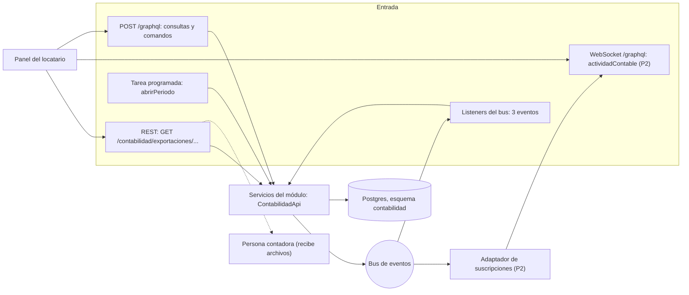

Qué mirar: la suscripción (P2) se alimenta del bus, no de la base. La persona contadora no entra al sistema: recibe el archivo que el locatario descarga.

---

## 2. Interacciones síncronas y asíncronas

| Id | Tipo | Operación o evento | Dirección | Función | P |
|---|---|---|---|---|---|
| G1–G12 | GraphQL (síncrono) | Consultas del panel | Panel → Contabilidad | Leer catálogo, pólizas, mayor, balanza, resultados, periodos, cortes, pendientes, reglas y panorama | P1 (G12 P2) |
| G13–G14 | GraphQL (síncrono) | `prepararComando`, `confirmarComando` | Panel → Contabilidad | Los diez comandos contables | P1 |
| W1 | WebSocket (asíncrono) | `actividadContable` | Contabilidad → Panel | Avisos de pólizas, descuadres y pendientes | P2 |
| R1–R3 | REST (síncrono) | `GET /contabilidad/exportaciones/...` | Panel → Contabilidad | Archivos para la persona contadora | P1 / P2 / P3 |
| J1 | Java (mismo proceso) | `ContabilidadApi` | Resolvedores y REST → Contabilidad | Única puerta de los adaptadores | P1 |
| J2 | Java (mismo proceso) | `contabilizarVenta`, `contabilizarCanje`, `contabilizarCorte` | Listeners → Contabilidad | Escrituras del sistema (D-22) | P1 |
| J3 | Java (mismo proceso) | `abrirPeriodo` | Tarea programada → Contabilidad | Día 1, 00:00 `America/Mexico_City` (ver K-12) | P1 |
| B1 | Bus (asíncrono) | `venta.registrada` | Ventas → Contabilidad | Póliza de ingreso | P1 |
| B2 | Bus (asíncrono) | `cupon.canjeado` | Pasaporte → Contabilidad | Reclasificación del descuento | P1 |
| B3 | Bus (asíncrono) | `caja.cerrada` | Caja → Contabilidad | Corte y conciliación | P1 |
| B4 | Bus (asíncrono) | `poliza.registrada` | Contabilidad → bus | Traza | P1 |
| B5 | Bus (asíncrono) | `periodo.cerrado` | Contabilidad → bus | Traza | P1 |
| B6 | Bus (asíncrono) | `contabilidad.descuadre_detectado` | Contabilidad → bus | Alerta | P1 |
| B7 | Bus (asíncrono) | `contabilidad.pendiente_creado` | Contabilidad → bus | Alerta | P2 |

Total: 28 vías (14 GraphQL, 1 WebSocket, 3 REST, 3 Java, 7 bus).

---

## 3. Eventos

### 3.1 Diagrama de eventos

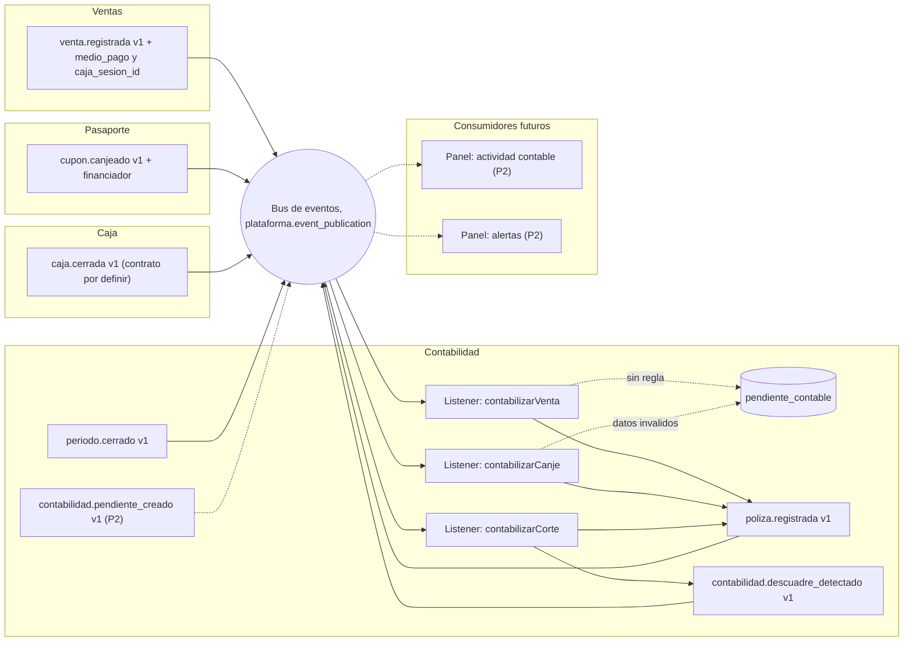

Qué mirar: entran exactamente tres flechas, una por evento permitido (D-77). Ningún productor escucha a Contabilidad.

### 3.2 Una venta entregada dos veces

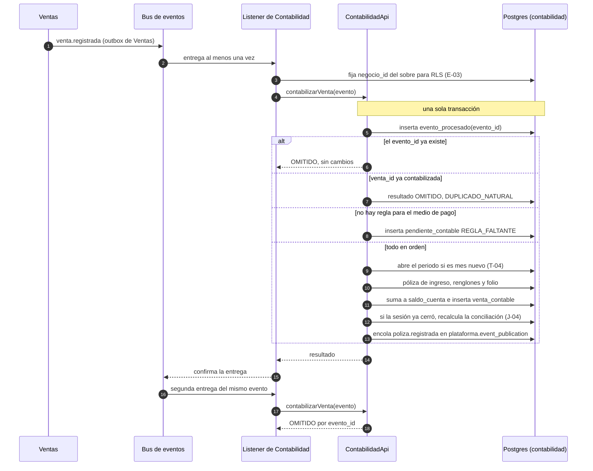

Qué mirar: `evento_procesado` se inserta primero, dentro de la misma transacción. Si algo falla, todo hace rollback y la reentrega empieza de cero.

---

## 4. Contratos de los eventos que consume

Base: `venta.registrada` en `inventario.md` §7.2; `cupon.canjeado` en el mockup de la app del turista (E-07); `caja.cerrada` no existe todavía porque Caja no tiene diseño.

```text
// Todos los campos nuevos son opcionales (R5, D-88). Datos de ejemplo inventados.

venta.registrada v1   (Ventas; base en inventario.md §7.2)
{
  "venta_id": "0192f3a0-6a00-7000-8000-00000000b002",
  "total": "232.00",                 // neto de cupón cuando aplica (D-65)
  "lineas": [ ... ],                 // Contabilidad no las usa
  "cliente_id": "...",               // de Clientes (D-48); Contabilidad lo ignora
  "medio_pago": "EFECTIVO",          // nuevo
  "caja_sesion_id": "0192f3a0-5f00-7000-8000-00000000c001",   // nuevo
  "propina": "0.00"                  // nuevo, por definir (K-6)
}

cupon.canjeado v1   (Pasaporte; base en el mockup de la app, E-07)
{
  "cupon_id": "0192f3a0-0a00-7000-8000-00000000e001",
  "visitante_id": "...",             // seudónimo; Contabilidad lo ignora
  "venta_id": "0192f3a0-6a00-7000-8000-00000000b002",   // puede faltar (U-03)
  "descuento": { "monto": "29.00", "moneda": "MXN" },
  "canjeado_en": "2026-10-15T18:40:12Z",
  "financiador": "NEGOCIO"           // nuevo: NEGOCIO o PLATAFORMA
}

caja.cerrada v1   (Caja; módulo sin diseño, todo es propuesta)
{
  "corte_id": "0192f3a0-9900-7000-8000-00000000f003",
  "caja_sesion_id": "0192f3a0-5f00-7000-8000-00000000c001",
  "efectivo_esperado": "1850.00",
  "efectivo_contado": "1834.50",
  "ventas_efectivo": "1350.00",      // nuevo, para J-03
  "retiros": []                      // nuevo, P2 (J-05)
}
```

---

## 5. Modelo de datos

### 5.1 Dominio

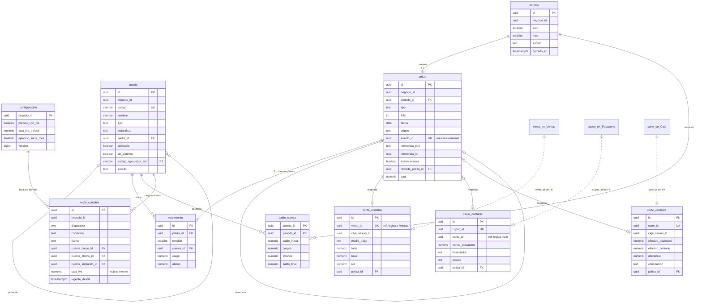

### 5.2 Control

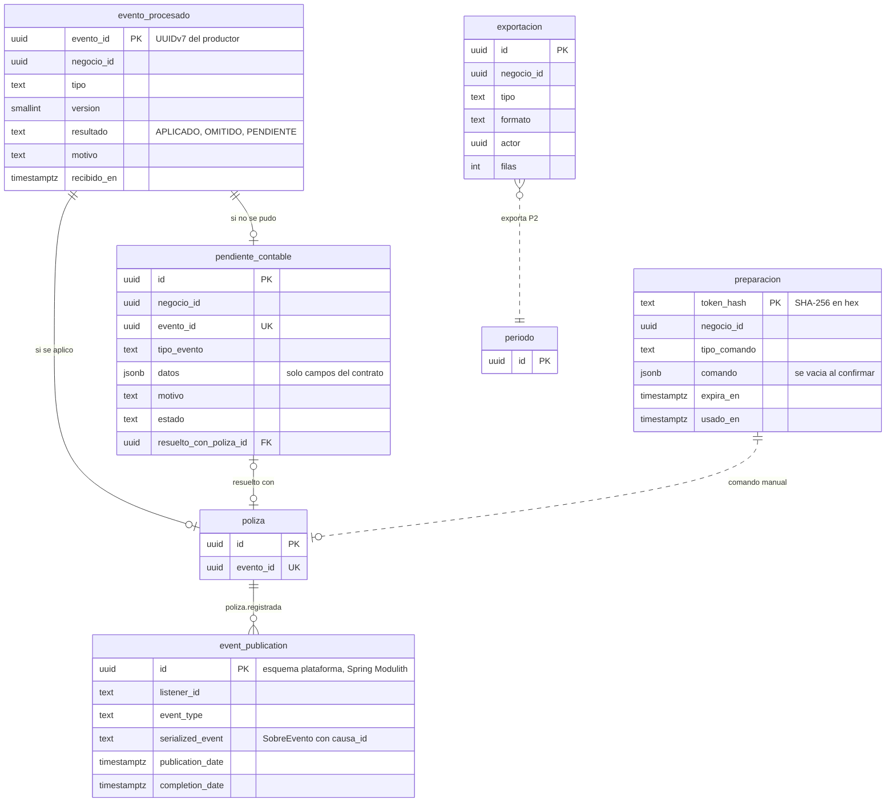

Qué mirar: las huellas (`venta_contable`, `canje_contable`, `corte_contable`) apuntan a otros módulos sin llave foránea. El outbox es `plataforma.event_publication` (V002); Contabilidad no tiene uno propio.

### 5.3 Columnas e índices

Todas las tablas viven en el esquema `contabilidad`, llevan `negocio_id uuid NOT NULL`, tienen seguridad por fila forzada con la política `aislamiento_por_negocio` (`negocio_id = plataforma.negocio_actual()`) y dan permisos solo a `rol_contabilidad`. Dinero `numeric(14,2)`, tasas `numeric(5,4)`, fechas y horas `timestamptz` en UTC.

#### `configuracion` (P1)
| Columna | Tipo | Notas |
|---|---|---|
| `negocio_id` | uuid PK | Una fila por negocio |
| `activada_en` | timestamptz | Cuándo se copió el catálogo base (C-01) |
| `precios_con_iva` | boolean | Por defecto verdadero (F-01) |
| `tasa_iva_default` | numeric(5,4) | Se usa en canjes que llegan antes que su venta (U-01). Valor por verificar |
| `propinas_en_total` | boolean | K-6 |
| `ejercicio_inicia_mes` | smallint | 1 = enero; CHECK 1–12 |
| `version` | bigint | Bloqueo optimista |

#### `cuenta` (P1)
| Columna | Tipo | Notas |
|---|---|---|
| `id` | uuid PK | UUIDv7 |
| `codigo` | varchar(20) | UNIQUE (`negocio_id`, `codigo`) (C-02) |
| `nombre` | varchar(120) | |
| `tipo` | text | CHECK: ACTIVO, PASIVO, CAPITAL, INGRESO, COSTO, GASTO |
| `naturaleza` | text | CHECK: DEUDORA, ACREEDORA |
| `padre_id` | uuid FK nulo | `cuenta(id)` |
| `afectable` | boolean | A-04 |
| `de_sistema` | boolean | C-04 |
| `codigo_agrupador_sat` | varchar(10) nulo | P2 (C-05) |
| `estado` | text | CHECK: ACTIVA, INACTIVA |
| `version` | bigint | |

Índices: `ux_cuenta_codigo (negocio_id, codigo)`, `ix_cuenta_padre (negocio_id, padre_id)`.

#### `regla_contable` (P1)
| Columna | Tipo | Notas |
|---|---|---|
| `id` | uuid PK | |
| `disparador` | text | CHECK: VENTA, CUPON, CORTE_FALTANTE, CORTE_SOBRANTE, CORTE_RETIRO |
| `condicion` | text nulo | Medio de pago o financiador |
| `cuenta_cargo_id`, `cuenta_abono_id` | uuid FK | |
| `cuenta_impuesto_id` | uuid FK nulo | 208.01 si se desglosa IVA |
| `tasa_iva` | numeric(5,4) nulo | Nulo = exento |
| `fuente` | text NOT NULL | De dónde salió y fecha de verificación (`CLAUDE.md`, reglas fiscales) |
| `vigente_desde` | timestamptz | |
| `vigente_hasta` | timestamptz nulo | |
| `version` | bigint | |

Índices: `ix_regla_vigente (negocio_id, disparador, condicion, vigente_desde DESC)`. Restricción de exclusión sobre el rango de vigencia por (`negocio_id`, `disparador`, `condicion`) para `REGLA_SUPERPUESTA`.

#### `periodo` (P1)
| Columna | Tipo | Notas |
|---|---|---|
| `id` | uuid PK | |
| `anio`, `mes` | smallint | UNIQUE (`negocio_id`, `anio`, `mes`) |
| `estado` | text | CHECK: ABIERTO, CERRADO |
| `abierto_en` | timestamptz | |
| `cerrado_en`, `cerrado_por` | timestamptz, uuid; nulos | CHECK: ambos nulos si está ABIERTO |
| `reaperturas` | smallint | T-06 |
| `version` | bigint | |

#### `poliza` (P1, solo inserción)
| Columna | Tipo | Notas |
|---|---|---|
| `id` | uuid PK | UUIDv7; cursor de paginación |
| `periodo_id` | uuid FK | |
| `tipo` | text | CHECK: INGRESO, EGRESO, DIARIO |
| `folio` | int | UNIQUE (`negocio_id`, `periodo_id`, `tipo`, `folio`) (A-05) |
| `fecha` | date | |
| `concepto` | varchar(200) | |
| `origen` | text | CHECK: AUTOMATICA, MANUAL, REVERSA |
| `evento_id` | uuid nulo | UNIQUE (`negocio_id`, `evento_id`) |
| `referencia_tipo`, `referencia_id` | text, uuid; nulos | VENTA, CANJE, CORTE, PENDIENTE |
| `extemporanea` | boolean | T-05 |
| `revierte_poliza_id` | uuid FK nulo | UNIQUE (A-06) |
| `total` | numeric(14,2) | CHECK > 0 |
| `creado_por` | text | |
| `creado_en` | timestamptz | |

Índices: `ix_poliza_periodo (negocio_id, periodo_id, tipo, id)`, `ix_poliza_referencia (negocio_id, referencia_tipo, referencia_id)`. Disparador `plataforma.rechazar_modificacion()` en UPDATE y DELETE (A-03, SK-01).

#### `movimiento` (P1, solo inserción)
| Columna | Tipo | Notas |
|---|---|---|
| `id` | uuid PK | |
| `poliza_id` | uuid FK | |
| `renglon` | smallint | UNIQUE (`poliza_id`, `renglon`); CHECK 1–50 |
| `cuenta_id` | uuid FK | |
| `cargo`, `abono` | numeric(14,2) | CHECK ≥ 0 y `(cargo > 0) <> (abono > 0)` (A-02) |
| `concepto` | varchar(120) nulo | |

Índices: `ix_movimiento_cuenta (negocio_id, cuenta_id, poliza_id)`. Mismo disparador que `poliza`. El cuadre (A-01) se valida en la aplicación y con un disparador diferido al confirmar la transacción.

#### `saldo_cuenta` (P1, derivado)
| Columna | Tipo | Notas |
|---|---|---|
| `cuenta_id`, `periodo_id` | uuid | PK compuesta con `negocio_id` |
| `saldo_inicial`, `cargos`, `abonos`, `saldo_final` | numeric(14,2) | A-08 |
| `version` | bigint | |

#### `venta_contable` (P1)
| Columna | Tipo | Notas |
|---|---|---|
| `id` | uuid PK | |
| `venta_id` | uuid | UNIQUE (`negocio_id`, `venta_id`) (E-02) |
| `caja_sesion_id` | uuid nulo | D-88 |
| `medio_pago` | text nulo | D-88 |
| `total`, `base`, `iva`, `propina` | numeric(14,2) | |
| `ocurrido_en` | timestamptz | |
| `poliza_id` | uuid FK | |
| `estado` | text | CHECK: CONTABILIZADA, REVERTIDA |

Índice: `ix_venta_sesion (negocio_id, caja_sesion_id) WHERE medio_pago = 'EFECTIVO'` para la conciliación (J-03).

#### `canje_contable` (P1)
| Columna | Tipo | Notas |
|---|---|---|
| `id` | uuid PK | |
| `cupon_id` | uuid | UNIQUE (`negocio_id`, `cupon_id`) (E-02) |
| `venta_id` | uuid nulo | |
| `monto_descuento`, `base_descuento` | numeric(14,2) | Viene en `descuento.monto` |
| `financiador` | text | CHECK: NEGOCIO, PLATAFORMA |
| `estado` | text | CHECK: CONTABILIZADO, SIN_EFECTO |
| `motivo` | text nulo | SIN_VENTA, MONTO_CERO |
| `poliza_id` | uuid FK nulo | CHECK: no nulo si CONTABILIZADO |

#### `corte_contable` (P1)
| Columna | Tipo | Notas |
|---|---|---|
| `id` | uuid PK | |
| `corte_id` | uuid | UNIQUE (`negocio_id`, `corte_id`) |
| `caja_sesion_id` | uuid | |
| `efectivo_esperado`, `efectivo_contado`, `diferencia` | numeric(14,2) | CHECK `diferencia = efectivo_contado - efectivo_esperado` |
| `ventas_efectivo_caja` | numeric(14,2) nulo | |
| `ventas_efectivo_contables` | numeric(14,2) | |
| `conciliacion` | text | CHECK: CUADRA, DIFERENCIA_CAJA, DESCUADRE_VENTAS |
| `descuadre_publicado_en` | timestamptz nulo | J-04 |
| `poliza_id` | uuid FK nulo | |
| `cerrada_en` | timestamptz | |

Índice: `ix_corte_sesion (negocio_id, caja_sesion_id)`.

#### `evento_procesado` (P1)
| Columna | Tipo | Notas |
|---|---|---|
| `evento_id` | uuid | PK con `negocio_id` |
| `tipo`, `version` | text, smallint | |
| `recibido_en` | timestamptz | |
| `resultado` | text | CHECK: APLICADO, OMITIDO, PENDIENTE |
| `motivo` | text nulo | |

#### `pendiente_contable` (P1)
| Columna | Tipo | Notas |
|---|---|---|
| `id` | uuid PK | |
| `evento_id` | uuid | UNIQUE (`negocio_id`, `evento_id`) |
| `tipo_evento` | text | |
| `datos` | jsonb | Solo los campos del contrato; sin datos personales |
| `motivo` | text | REGLA_FALTANTE, CUENTA_INACTIVA, DATOS_INVALIDOS, VERSION_NO_SOPORTADA |
| `estado` | text | ABIERTO, CONTABILIZADO, DESCARTADO |
| `resuelto_con_poliza_id` | uuid FK nulo | |
| `motivo_resolucion` | varchar(200) nulo | Obligatorio si DESCARTADO |
| `creado_en`, `resuelto_en` | timestamptz | |

Índice: `ix_pendiente_abierto (negocio_id, creado_en) WHERE estado = 'ABIERTO'`.

#### `preparacion` (P1)
Misma forma que `clientes.preparacion` (V020): `token_hash text PK` (SHA-256 en hex), `negocio_id`, `tipo_comando`, `comando jsonb` (se vacía al confirmar), `actor`, `expira_en` (5 minutos, D-23), `usado_en`. Purga a las 24 horas (depende de A1 de la Bitácora).

#### `exportacion` (P2)
`id`, `negocio_id`, `tipo` (POLIZAS, BALANZA, SAT), `periodo char(7)`, `formato` (CSV, XLSX, XML), `actor`, `filas`, `creado_en`.

---

## 6. Estados

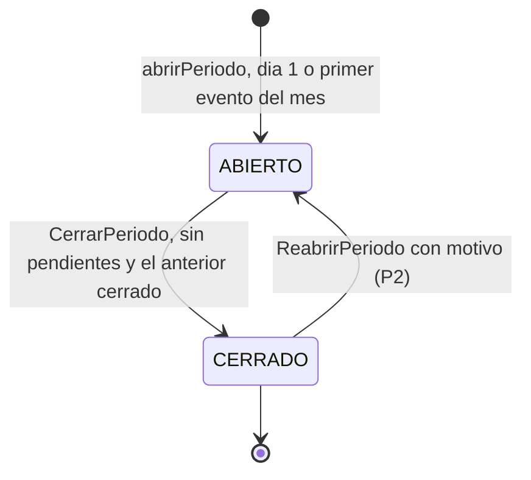

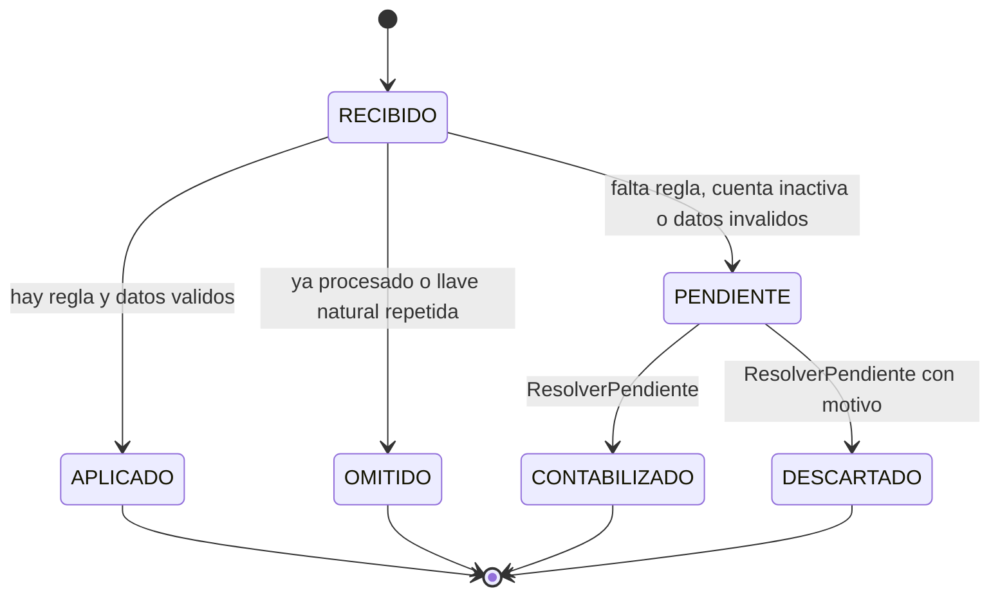

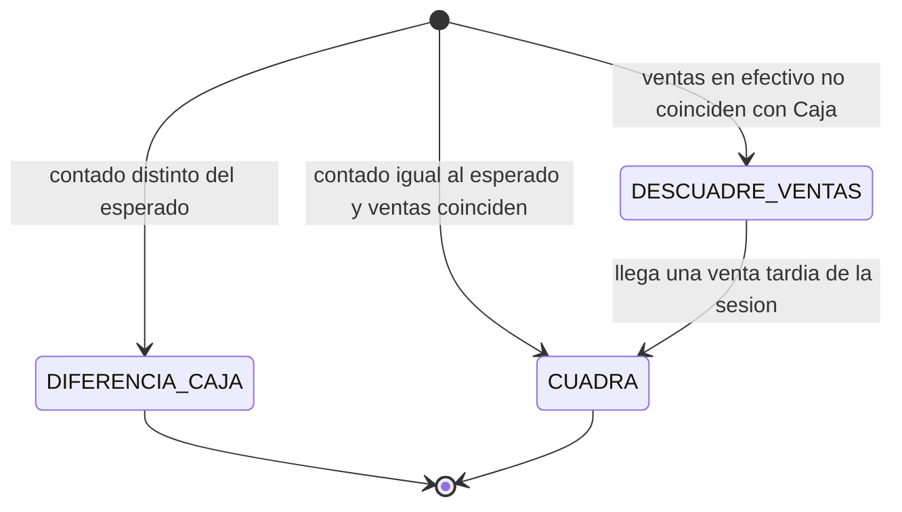

---

## 7. Flujos

### 7.1 Venta y cupón en cualquier orden

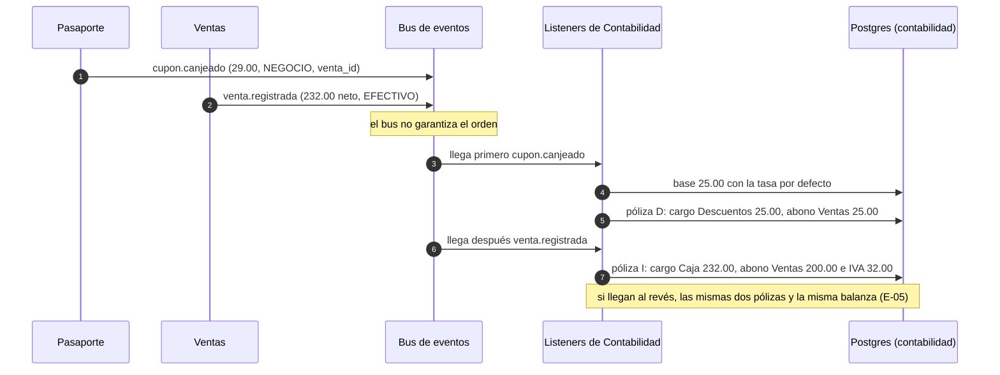

### 7.2 Cierre de caja y conciliación

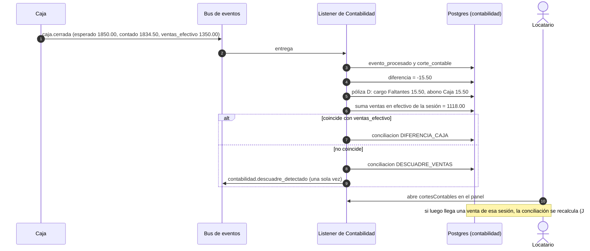

### 7.3 Cierre de mes

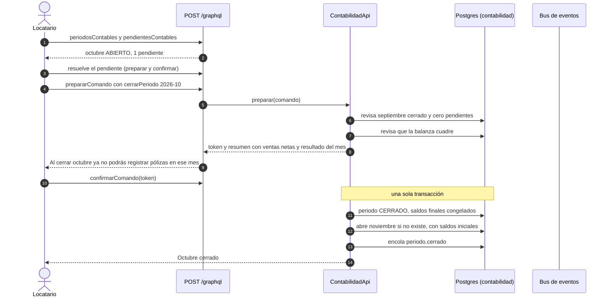

### 7.4 Corregir una venta anulada (mientras no se escuche `venta.anulada`)

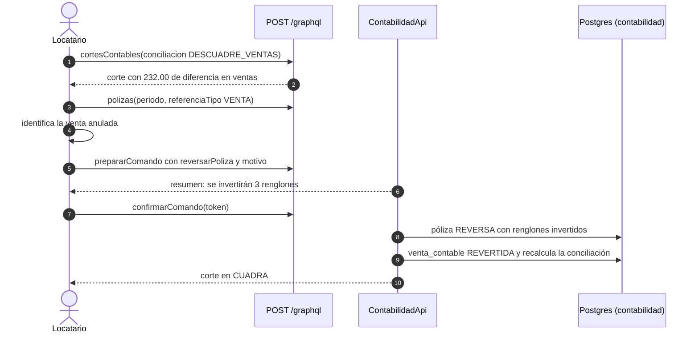

---

## 8. Hallazgos

Los hallazgos K-1 a K-12 están en `contabilidad.md` §15. Los que afectan a otros documentos:

- **K-10:** `inventario.md` §2 e `inventario-diagramas.md` (líneas del mapa y de eventos) asignan a Contabilidad `inventario.movimiento_registrado`. Si se confirma D-77 tal cual, hay que corregirlos.
- **K-12:** la tarea `abrirPeriodo` tiene el mismo problema que las purgas (A1, Bitácora 2026-10-14): sin `app.negocio_id` no ve filas.
