# Inventario: diagramas, interacciones y modelo de datos

**Versión:** 0.1 (borrador para revisión del equipo)
**Fecha:** 2026-10-08
**Estado:** solo diseño. No existe código.
**Documento base:** `docs/diseno/inventario.md` (reglas, contratos y criterios de aceptación). Este documento lo complementa con diagramas, la lista de interacciones y el modelo de datos completo.
**Decisiones:** `docs/BITACORA.md` (identificadores `D-xx`).
**Vista visual:** página publicada "Mapa de Inventario" (el enlace está en la bitácora).

Los diagramas usan Mermaid, que se ve en GitHub, VS Code (con la extensión de Mermaid) y en la página publicada. Todos los datos de los ejemplos son inventados.

---

## 1. Cómo leer los diagramas

| Trazo | Significa |
|---|---|
| Línea continua con flecha en un diagrama de comunicación | **Evento asíncrono** por el bus. Quien publica no espera respuesta |
| Línea punteada en un diagrama de comunicación | **Llamada síncrona** a la API pública de otro módulo, dentro del mismo proceso |
| `->>` en una secuencia | Llamada o mensaje |
| `-->>` en una secuencia | Respuesta |
| "(asíncrono)" en el texto de un mensaje | Entrega por el bus, después del commit de quien lo publicó |

Reglas que se repiten en todos los flujos (ver `inventario.md`, secciones 2 y 7):
- Todo listener fija el contexto del negocio con el `negocio_id` **del sobre del evento**, nunca con un dato de la carga.
- Todo evento se publica en la misma transacción que la escritura que lo origina (outbox).
- La entrega es al menos una vez y sin orden global, por lo que todo consumidor deduplica.

---

## 2. Mapa de comunicación

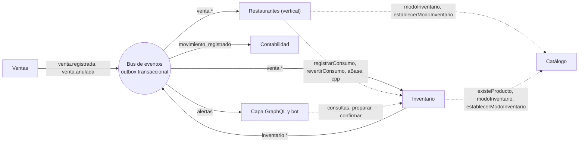

Lectura: Inventario no conoce a Restaurantes. Restaurantes lo llama por API y lo escucha por eventos. Ventas no conoce a Inventario: solo publica.

---

## 3. Interacciones síncronas (llamadas a la API pública)

Todas son llamadas en el mismo proceso. Las escrituras reciben el negocio de `ContextoNegocio`, nunca como parámetro.

### 3.1 Hacia Inventario (`InventarioApi`)

| # | Operación | Quién la llama | Función | Escribe |
|---|---|---|---|---|
| 1 | `articulo(id)` | Panel, Restaurantes | Ficha de un artículo: unidad base, rastreo, mínimo, vínculo | No |
| 2 | `articulos(filtro, cursor)` | Panel | Lista paginada, con filtro por texto, categoría y solo alertas | No |
| 3 | `saldo(id)` y `saldos(ids)` | Panel, resolvedores GraphQL | Existencia, CPP y valor. La versión en lote evita consultas repetidas (DataLoader) | No |
| 4 | `cpp(ids)` | Restaurantes | Costo promedio de cada insumo, para calcular el costo teórico de un platillo | No |
| 5 | `aBase(líneas)` | Restaurantes | Convierte cantidades de receta a unidad base, valida unidad y artículo, y devuelve también `rastreo` y `activo` (D-27) | No |
| 6 | `kardex(id, desde, hasta, cursor)` | Panel | Historial de movimientos de un artículo | No |
| 7 | `lotes(id)` y `porCaducar(dias)` | Panel | Lotes con saldo y lotes próximos a caducar | No |
| 8 | `series(id, estado)` y `tareasSerie()` | Panel | Números de serie y ventas pendientes de asignar serie | No |
| 9 | `politicas()` | Panel | Política de salida, de costeo y días de aviso del negocio | No |
| 10 | `preparar(comando)` | Panel, bot | Valida el comando, calcula el resumen y devuelve un token de un solo uso. No escribe en tablas de negocio | Solo `preparacion` |
| 11 | `confirmar(token)` | Panel, bot | Vuelve a validar, escribe y publica eventos en una transacción | Sí |
| 12 | `registrarConsumo(consumidor, causaId, ocurridoEn, líneas, eventoCausaId?)` | Restaurantes y el listener `vinculo` | Descuenta existencias por una venta. Idempotente por `(negocio, causaId, consumidor)` y atómico | Sí |
| 13 | `revertirConsumo(consumidor, causaId)` | Restaurantes y el listener `vinculo` | Revierte el consumo al costo original. Si el consumo aún no existe, deja una marca | Sí |

### 3.2 Desde Inventario y desde Restaurantes hacia Catálogo

| # | Operación | Quién la llama | Función |
|---|---|---|---|
| 14 | `existeProducto(productoId)` | Inventario | Valida que el producto que se vincula existe |
| 15 | `modoInventario(productoId)` | Inventario, Restaurantes | Dice si el producto descuenta por `VINCULO_DIRECTO`, por `RECETA` o por `NINGUNO`. Cada módulo procesa solo las líneas de su modo |
| 16 | `establecerModoInventario(productoId, modo)` | Inventario, Restaurantes | Cambia el modo. Catálogo rechaza el conflicto con `MODO_INVENTARIO_CONFLICTO` |

### 3.3 Hacia Restaurantes (`RestaurantesApi`)

| # | Operación | Quién la llama | Función |
|---|---|---|---|
| 17 | `receta(platilloId)` y `costoReceta(platilloId)` | Capa GraphQL | Receta vigente y su costo teórico (cantidad × merma × CPP) |
| 18 | `guardarReceta(input)` | Capa GraphQL | Valida insumos con `aBase`, fija el modo `RECETA` y guarda una versión nueva |

---

## 4. Interacciones asíncronas (eventos por el bus)

Todos los consumidores deduplican por `evento_id` en su propia tabla `evento_procesado`. Los contratos de los campos están en `inventario.md`, sección 7.

### 4.1 Eventos que Inventario consume

| Evento | Lo publica | Lo consume | Función | Respuesta de Inventario |
|---|---|---|---|---|
| `venta.registrada` v1 | Ventas | Listener `vinculo` de Inventario, Restaurantes, Contabilidad | Avisa que se confirmó una venta con sus líneas | Descuenta las líneas con modo `VINCULO_DIRECTO` llamando a `registrarConsumo` |
| `venta.anulada` v1 | Ventas | Los mismos | Avisa que la venta se anuló. Lleva las líneas (D-25) | Revierte con `revertirConsumo`, solo para las líneas que le corresponden |

### 4.2 Eventos que Inventario publica

| Evento | Se dispara cuando | Función | Quién reacciona |
|---|---|---|---|
| `inventario.movimiento_registrado` v1 | Se confirma cada movimiento | Reporta el hecho con cantidad, costo, CPP y saldo resultantes. Es la base del costo de ventas | Contabilidad |
| `inventario.bajo_minimo` v1 | El saldo cruza a ≤ mínimo | Avisa que hay que reponer | Capa GraphQL (`alertasNegocio`) |
| `inventario.repuesto` v1 | El saldo vuelve a estar por encima del mínimo | Cierra la alerta anterior | Capa GraphQL |
| `inventario.saldo_negativo` v1 | El saldo pasa de ≥ 0 a < 0 | Avisa que probablemente falta registrar una entrada o hacer un conteo | Capa GraphQL |
| `inventario.lote_por_caducar` v1 | Un lote con saldo entra en la ventana de aviso (una sola vez por lote) | Da tiempo de vender o usar el lote | Capa GraphQL |
| `inventario.lote_caducado` v1 | Un lote con saldo pasa su fecha de caducidad (una sola vez por lote) | Propone dar de baja el lote por merma | Capa GraphQL |
| `inventario.consumo_sin_lote` v1 | Una salida deja cantidad sin cubrir por ningún lote vigente | Pide conciliar el siguiente conteo | Capa GraphQL |
| `inventario.serie_sin_asignar` v1 | Se vendió un artículo serializado sin indicar serie | Crea la tarea de asignar serie | Capa GraphQL |
| `inventario.consumo_fallido` v1 (nuevo, D-24) | Un consumo por vínculo directo falla con un error permanente | Hace visible que una venta no descontó inventario | Capa GraphQL |

### 4.3 Disparadores por reloj (no son eventos ni API)

| Disparador | Frecuencia | Función |
|---|---|---|
| Revisión de caducidades | Una vez al día, hora local de México (hora exacta por definir) | Marca y publica los avisos de lotes por caducar y caducados |
| Purga de `evento_procesado` | Periódica | Borra registros con más de 90 días |
| Purga de `preparacion` | Periódica | Borra tokens vencidos o usados con más de un día |
| Purga de marcas `ANULADO_PREVIO` | Periódica | Borra marcas con más de 30 días (D-25) |

---

## 5. Diagramas de secuencia

Los ejemplos usan datos inventados.

### S1. Entrada de mercancía (preparar y confirmar)

Muestra el patrón de dos pasos, la conversión de unidades, el CPP, el lote, la transacción única y el evento hacia Contabilidad.

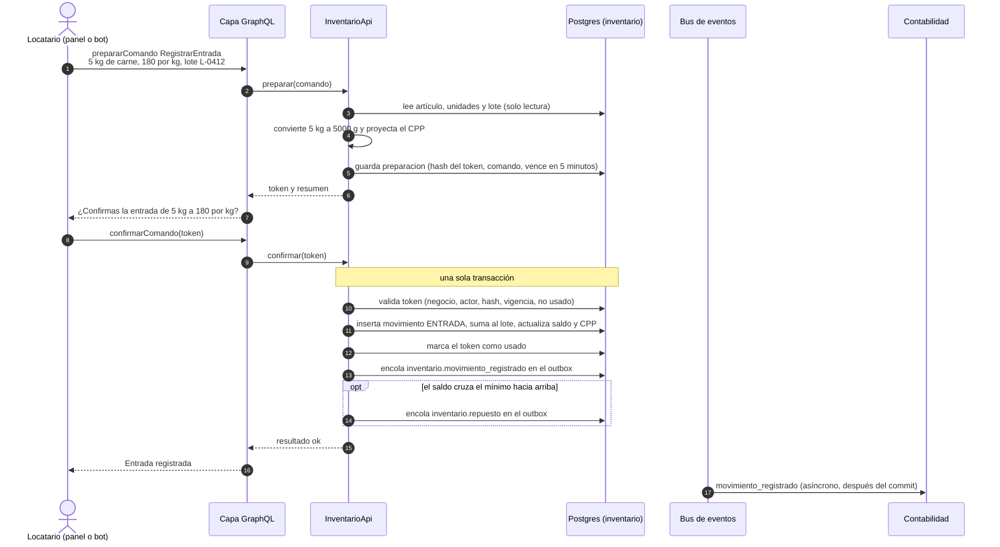

### S2. Venta de un platillo con receta

Muestra el camino principal del módulo: evento de Ventas, receta en Restaurantes, consumo idempotente en Inventario y los cuatro resultados posibles.

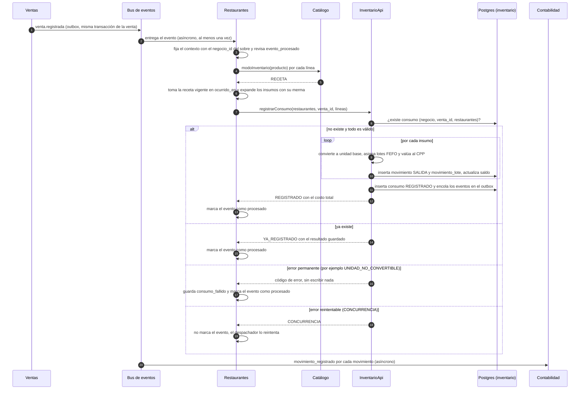

### S3. Venta de un artículo con vínculo directo y con serie

Muestra al listener propio de Inventario (`vinculo`) y los casos de rastreo por lote y por serie.

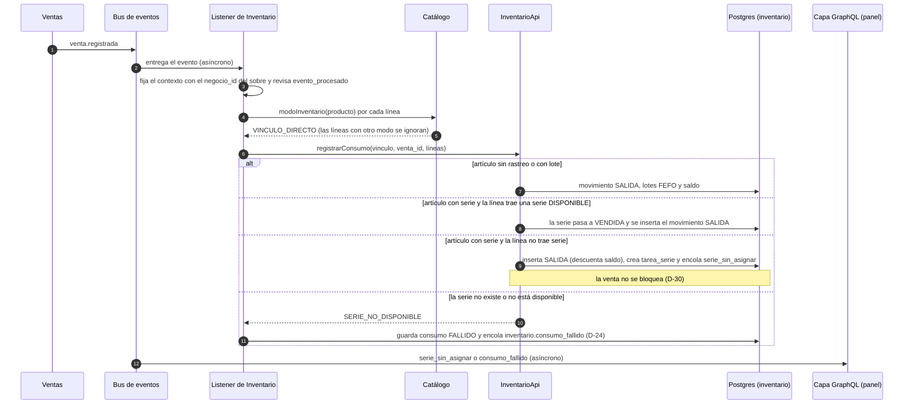

Más adelante, `AsignarSerie` (por preparar y confirmar) resuelve la tarea: marca la serie como `VENDIDA` y la enlaza a la tarea. No crea otro movimiento, porque la salida ya descontó el saldo.

### S4. Anulación de una venta, en orden y fuera de orden

Muestra la reversión al costo original y la marca para cuando `venta.anulada` llega antes que `venta.registrada`.

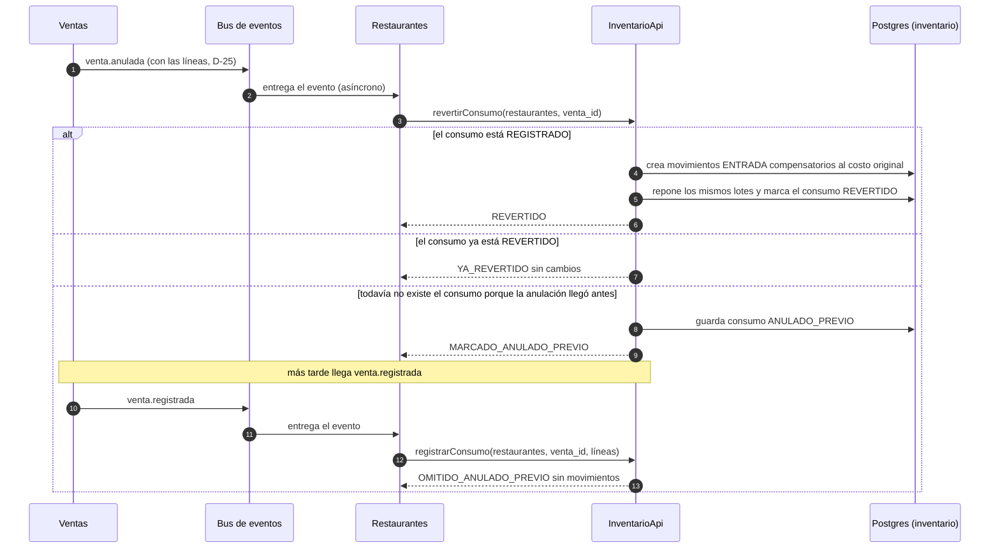

### S5. Entrega repetida de un evento (dos candados)

Muestra por qué se necesitan los dos niveles de idempotencia: `evento_procesado` en el consumidor y la llave del consumo en Inventario.

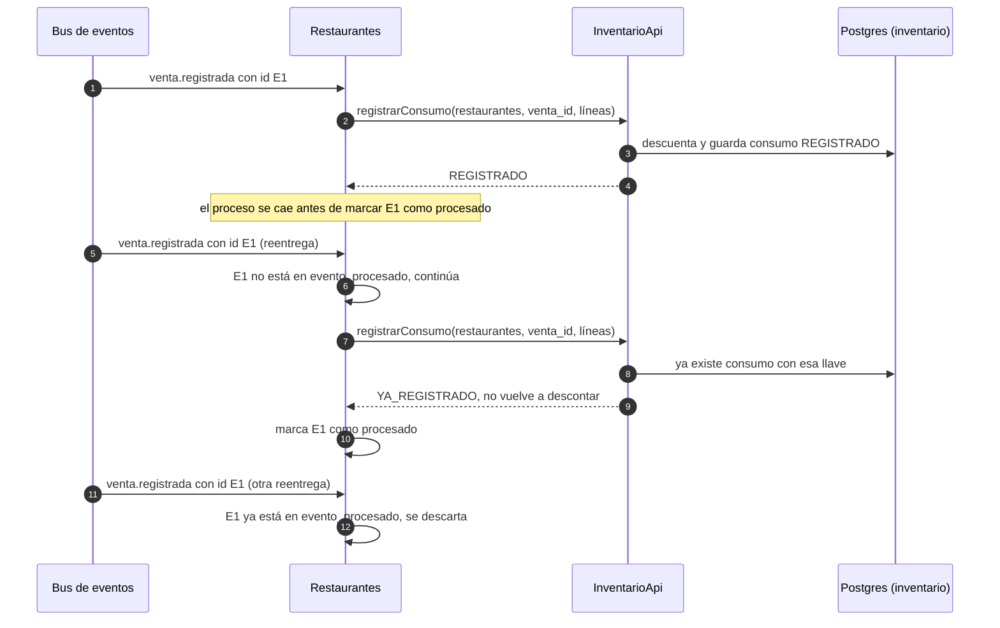

### S6. Revisión diaria de caducidades

Muestra el reloj, la marca que evita avisos repetidos (D-26) y que la baja por merma solo se propone.

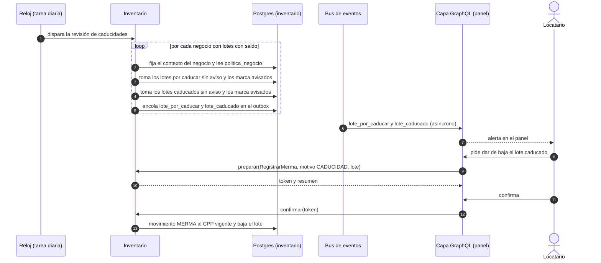

### S7. Alerta hasta la pantalla del panel

Muestra el último tramo: del commit al WebSocket, y qué hace el panel si se corta la conexión.

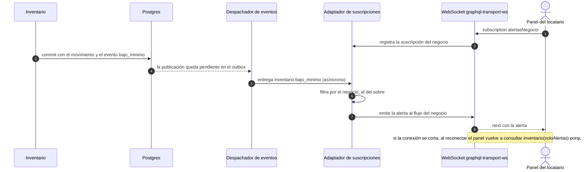

Con una sola instancia basta un flujo en memoria por negocio. Con varias instancias hace falta un canal compartido (Redis o `LISTEN/NOTIFY`).

### S8. Guardar una receta y exclusividad con el vínculo directo

Muestra la llamada síncrona de Restaurantes a Inventario y a Catálogo, y cómo se evita el doble descuento sin romper R4.

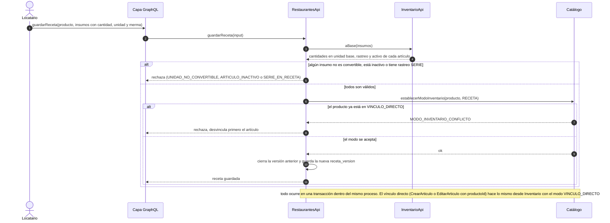

---

## 6. Diagramas de eventos

### E1. Ciclo de vida de un evento

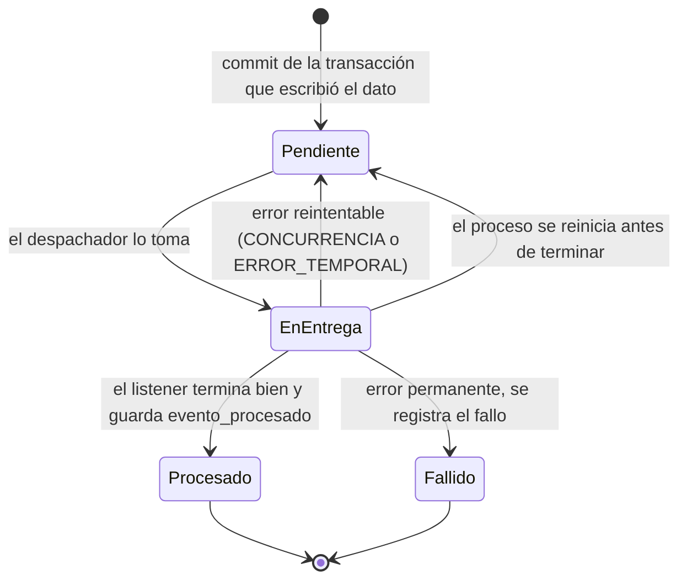

Un evento reentregado pasa otra vez por `EnEntrega`. Por eso el listener es idempotente (S5).

### E2. Cadena causal de una venta

Todos los eventos de una venta comparten `correlacion_id = venta_id`. `causa_id` apunta al evento que los provocó.

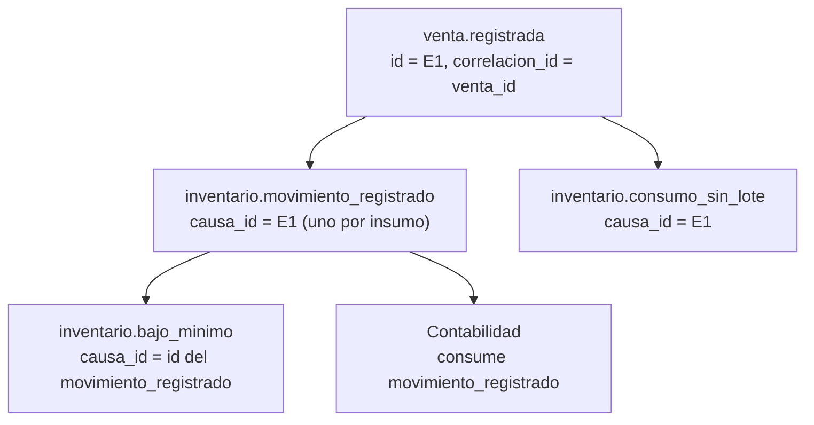

Para que Inventario conozca `E1` cuando lo llama Restaurantes, `registrarConsumo` acepta un `eventoCausaId` opcional (D-28). Los movimientos que inicia una persona (preparar y confirmar) llevan `causa_id` nulo.

---

## 7. Modelo de datos

Reglas generales (de `inventario.md`, sección 5): llaves UUIDv7, `negocio_id` en toda tabla con RLS por la variable de sesión `app.negocio_id`, Flyway con una carpeta por módulo, cantidades `numeric(14,4)`, dinero `numeric(14,2)`, costos unitarios `numeric(14,4)`, factores `numeric(18,8)`. Los valores enumerados se guardan como `text` con `CHECK`.

Una línea punteada en los diagramas de entidad-relación es una **referencia lógica**: no hay llave foránea porque cruza módulos (R1).

### 7.1 Núcleo: artículos, unidades, saldo y movimientos

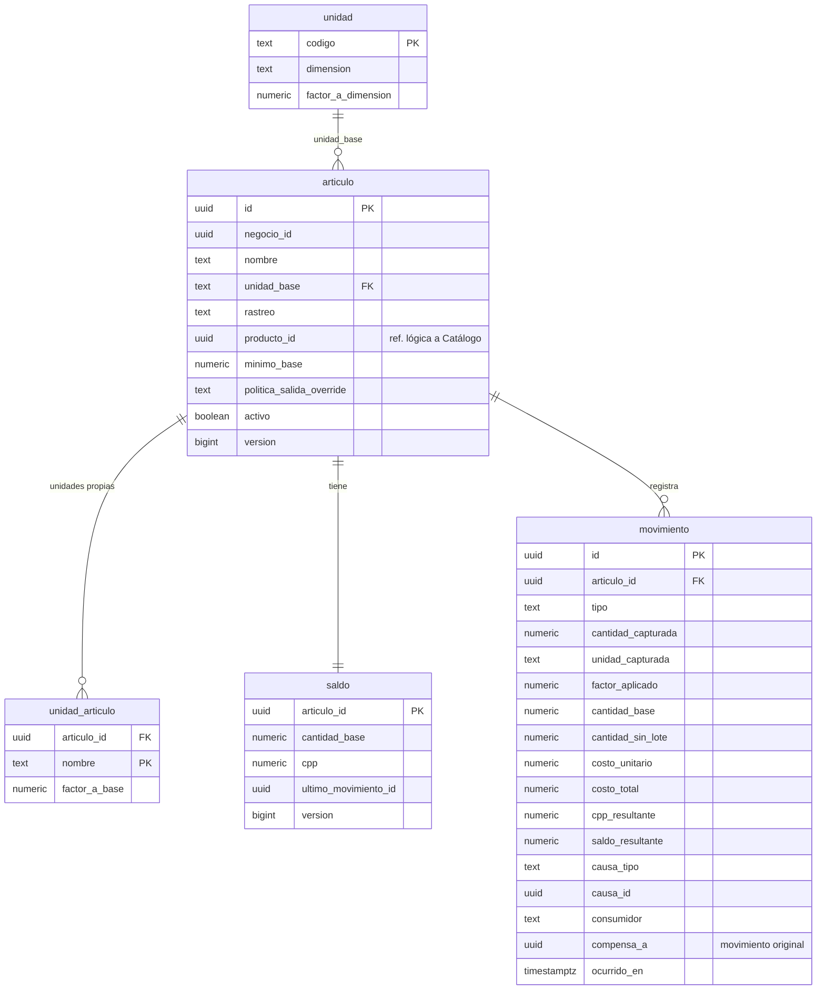

### 7.2 Lotes y números de serie

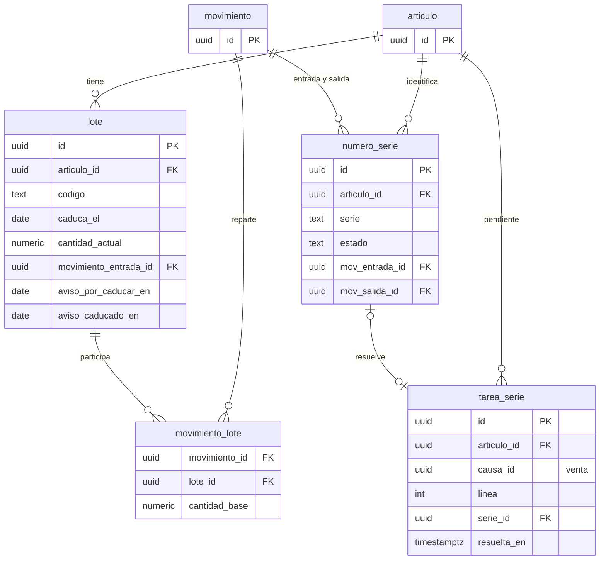

### 7.3 Control: consumo, preparación, políticas y eventos procesados

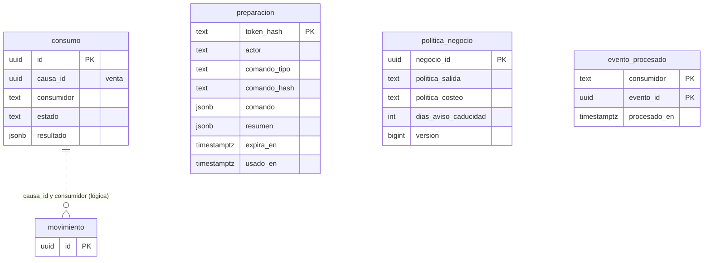

### 7.4 Esquema `restaurantes` (el contrato que consume Inventario)

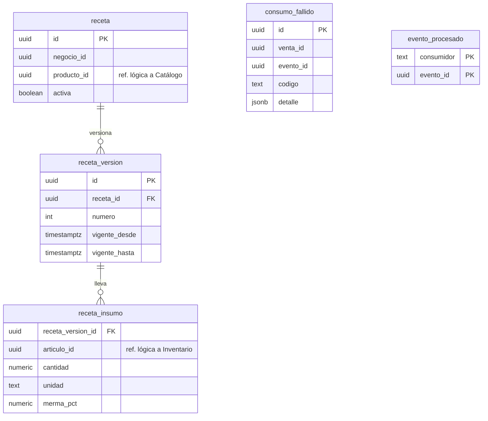

---

## 8. Tablas con todas sus columnas

Convención: **NN** = no nulo. Todas las tablas del esquema `inventario` (salvo `unidad`) llevan `negocio_id uuid NN` y RLS; no se repite en cada tabla.

### 8.1 Esquema `inventario`

**`unidad`** (global, sin RLS)
| Columna | Tipo | Nota |
|---|---|---|
| `codigo` | text PK | `g`, `kg`, `ml`, `l`, `pieza` |
| `dimension` | text NN | `MASA`, `VOLUMEN`, `CONTEO` |
| `factor_a_dimension` | numeric(18,8) NN | Mayor que 0. Respecto a la unidad base de la dimensión: g, ml, pieza |

**`articulo`**
| Columna | Tipo | Nota |
|---|---|---|
| `id` | uuid PK | |
| `negocio_id` | uuid NN | |
| `nombre` | text NN | |
| `categoria` | text | |
| `unidad_base` | text NN FK → `unidad` | |
| `rastreo` | text NN | `NINGUNO` (por defecto), `LOTE`, `SERIE`. Si es `SERIE`, `unidad_base` debe ser `pieza` (CHECK) |
| `producto_id` | uuid | Referencia lógica a Catálogo. Vínculo 1:1 |
| `minimo_base` | numeric(14,4) NN | Por defecto 0. No negativo |
| `politica_salida_override` | text | `FEFO`, `MANUAL` o nulo |
| `activo` | boolean NN | Por defecto verdadero |
| `version` | bigint NN | Bloqueo optimista |
| `creado_en`, `actualizado_en` | timestamptz NN | |

**`unidad_articulo`**
| Columna | Tipo | Nota |
|---|---|---|
| `articulo_id` | uuid NN FK | |
| `nombre` | text NN | PK compuesta con `articulo_id`. No puede coincidir con una unidad estándar |
| `factor_a_base` | numeric(18,8) NN | Mayor que 0 |

**`saldo`**
| Columna | Tipo | Nota |
|---|---|---|
| `articulo_id` | uuid PK FK | Uno por artículo |
| `cantidad_base` | numeric(14,4) NN | Puede ser negativa (A-01), salvo en artículos con serie |
| `cpp` | numeric(14,4) NN | No negativo |
| `ultimo_movimiento_id` | uuid FK | |
| `version` | bigint NN | |
| `actualizado_en` | timestamptz NN | |

**`movimiento`** (solo inserción)
| Columna | Tipo | Nota |
|---|---|---|
| `id` | uuid PK | |
| `articulo_id` | uuid NN FK | |
| `tipo` | text NN | `ENTRADA`, `SALIDA`, `MERMA`, `AJUSTE_POS`, `AJUSTE_NEG` |
| `cantidad_capturada` | numeric(14,4) NN | Mayor que 0 |
| `unidad_capturada` | text NN | |
| `factor_aplicado` | numeric(18,8) NN | |
| `cantidad_base` | numeric(14,4) NN | Con signo. Positiva en entradas |
| `cantidad_sin_lote` | numeric(14,4) NN | Por defecto 0. No negativa |
| `costo_unitario` | numeric(14,4) NN | Por unidad base. No negativo |
| `costo_total` | numeric(14,2) NN | Mismo signo que `cantidad_base` |
| `cpp_resultante` | numeric(14,4) NN | |
| `saldo_resultante` | numeric(14,4) NN | |
| `causa_tipo` | text NN | `VENTA`, `COMPRA`, `CONTEO`, `MERMA`, `MANUAL`, `REVERSION` |
| `causa_id` | uuid | Venta u otro origen |
| `consumidor` | text | `vinculo`, `restaurantes` o nulo |
| `compensa_a` | uuid FK → `movimiento` | Solo en reversiones |
| `ocurrido_en` | timestamptz NN | |
| `registrado_en` | timestamptz NN | Por defecto el momento actual |
| `registrado_por` | text NN | Persona, bot o sistema |

**`lote`**
| Columna | Tipo | Nota |
|---|---|---|
| `id` | uuid PK | |
| `articulo_id` | uuid NN FK | Solo artículos con rastreo `LOTE` |
| `codigo` | text NN | Único con `(negocio_id, articulo_id)` |
| `caduca_el` | date | Calendario local de México. Nulo si no caduca |
| `cantidad_actual` | numeric(14,4) NN | No negativa |
| `movimiento_entrada_id` | uuid NN FK | |
| `aviso_por_caducar_en` | date | Fecha en que se avisó. Nulo si no se ha avisado (D-26) |
| `aviso_caducado_en` | date | Igual, para el aviso de caducado (D-26) |
| `creado_en` | timestamptz NN | |

**`movimiento_lote`**
| Columna | Tipo | Nota |
|---|---|---|
| `movimiento_id` | uuid NN FK | PK compuesta con `lote_id` |
| `lote_id` | uuid NN FK | |
| `cantidad_base` | numeric(14,4) NN | Con signo. Distinta de 0 |

**`numero_serie`**
| Columna | Tipo | Nota |
|---|---|---|
| `id` | uuid PK | |
| `articulo_id` | uuid NN FK | |
| `serie` | text NN | Única con `(negocio_id, articulo_id)` |
| `estado` | text NN | `DISPONIBLE`, `VENDIDA`, `BAJA` |
| `mov_entrada_id` | uuid NN FK | |
| `mov_salida_id` | uuid FK | Nulo mientras esté `DISPONIBLE` (CHECK). Nulo también en una serie asignada después, porque la salida ya existía (D-30) |
| `actualizado_en` | timestamptz NN | |

**`tarea_serie`**
| Columna | Tipo | Nota |
|---|---|---|
| `id` | uuid PK | |
| `causa_id` | uuid NN | Venta. Único con `(negocio_id, linea)` |
| `linea` | int NN | |
| `articulo_id` | uuid NN FK | |
| `serie_id` | uuid FK → `numero_serie` | Se llena al asignar |
| `creada_en` | timestamptz NN | |
| `resuelta_en` | timestamptz | |

**`consumo`**
| Columna | Tipo | Nota |
|---|---|---|
| `id` | uuid PK | |
| `causa_id` | uuid NN | Venta |
| `consumidor` | text NN | `vinculo`, `restaurantes`. Único con `(negocio_id, causa_id)` |
| `estado` | text NN | `REGISTRADO`, `REVERTIDO`, `ANULADO_PREVIO`, `FALLIDO` (nuevo, D-24) |
| `resultado` | jsonb | Respuesta guardada para repetirla (idempotencia) |
| `creado_en`, `actualizado_en` | timestamptz NN | |

**`preparacion`**
| Columna | Tipo | Nota |
|---|---|---|
| `token_hash` | text PK | Solo el hash del token |
| `actor` | text NN | |
| `comando_tipo` | text NN | |
| `comando_hash` | text NN | Detecta cambios entre preparar y confirmar |
| `comando` | jsonb NN | El comando completo, para poder confirmarlo (D-29) |
| `resumen` | jsonb NN | Lo que se le mostró a la persona |
| `expira_en` | timestamptz NN | Cinco minutos después de preparar |
| `usado_en` | timestamptz | |

**`politica_negocio`**
| Columna | Tipo | Nota |
|---|---|---|
| `negocio_id` | uuid PK | |
| `politica_salida` | text NN | `FEFO` (por defecto) o `MANUAL` |
| `politica_costeo` | text NN | Solo `SIN_RECALCULO` en el MVP |
| `dias_aviso_caducidad` | int NN | Por defecto 3 (valor inicial sugerido). Entre 0 y 90 |
| `version` | bigint NN | |
| `actualizado_en` | timestamptz NN | |

**`evento_procesado`**
| Columna | Tipo | Nota |
|---|---|---|
| `consumidor` | text NN | PK compuesta con `evento_id` |
| `evento_id` | uuid NN | |
| `procesado_en` | timestamptz NN | |

### 8.2 Esquema `restaurantes`

**`receta`**: `id` uuid PK, `negocio_id` uuid NN, `producto_id` uuid NN (referencia lógica; único con `negocio_id`), `activa` boolean NN.

**`receta_version`**: `id` uuid PK, `receta_id` uuid NN FK, `numero` int NN (único con `receta_id`), `vigente_desde` timestamptz NN, `vigente_hasta` timestamptz (nulo = vigente), `creado_por` text NN. Las vigencias de una misma receta no se traslapan (restricción de exclusión sobre el rango de fechas).

**`receta_insumo`**: `receta_version_id` uuid NN FK y `articulo_id` uuid NN (referencia lógica a Inventario) como llave compuesta, `cantidad` numeric(14,4) NN mayor que 0, `unidad` text NN, `merma_pct` numeric(5,2) NN entre 0 y 100.

**`consumo_fallido`**: `id` uuid PK, `negocio_id` uuid NN, `venta_id` uuid NN, `evento_id` uuid NN, `codigo` text NN, `detalle` jsonb, `creado_en` timestamptz NN, `resuelto_en` timestamptz.

**`evento_procesado`**: igual que en Inventario.

### 8.3 Índices necesarios

| Tabla | Índice | Para qué |
|---|---|---|
| `movimiento` | `(negocio_id, articulo_id, ocurrido_en desc)` | Kardex paginado |
| `movimiento` | `(negocio_id, causa_id, consumidor)` | Localizar los movimientos de una venta al revertir |
| `lote` | `(negocio_id, articulo_id, caduca_el nulls last, creado_en)` donde `cantidad_actual > 0` | Asignación FEFO |
| `lote` | `(negocio_id, caduca_el)` donde `cantidad_actual > 0` | Revisión diaria de caducidades |
| `numero_serie` | `(negocio_id, articulo_id, estado)` | Series disponibles |
| `articulo` | `(negocio_id, activo)` | Lista del panel |
| `preparacion` | `(expira_en)` | Purga |
| `evento_procesado` | `(procesado_en)` | Purga |

Refuerzo recomendado: llaves foráneas compuestas con `negocio_id` (por ejemplo `(negocio_id, articulo_id)`) para que ni un error de código pueda enlazar datos de dos negocios.

---

## 9. Hallazgos al dibujar los diagramas: cambios propuestos a la v0.1

Al dibujar los flujos aparecieron huecos en `inventario.md`. Cada uno tiene una propuesta; todas están en estado **propuesta** hasta que el equipo las acepte.

| ID | Hallazgo | Propuesta |
|---|---|---|
| D-24 | Cuando el listener `vinculo` de Inventario falla con un error permanente (por ejemplo una serie no disponible), no hay dónde registrar el fallo. Restaurantes sí tiene `consumo_fallido` | Agregar el estado `FALLIDO` a `consumo` y el evento `inventario.consumo_fallido` v1 (queda un noveno evento publicado) |
| D-25 | `venta.anulada` solo lleva `venta_id`. Restaurantes e Inventario no saben a qué líneas aplica y tendrían que llamar a `revertirConsumo` en toda anulación, dejando marcas `ANULADO_PREVIO` inútiles | Que `venta.anulada` v1 incluya `lineas[]` con `linea` y `producto_id`. Además, purgar las marcas `ANULADO_PREVIO` con más de 30 días. Hay que congelarlo con el dueño de Ventas |
| D-26 | La regla L-07 pide avisos de caducidad idempotentes, pero no hay dónde guardar que ya se avisó | Dos columnas en `lote`: `aviso_por_caducar_en` y `aviso_caducado_en`. La tarea las marca en la misma consulta que selecciona los lotes, de modo que dos ejecuciones simultáneas no dupliquen avisos |
| D-27 | La regla S-05 (series no pueden ser insumo de receta) no se podía verificar con `aBase` | `aBase` devuelve `rastreo` y `activo` por artículo. Restaurantes rechaza con su propio código `SERIE_EN_RECETA` |
| D-28 | `registrarConsumo` no recibe el id del evento que lo provocó, así que `causa_id` no se podría llenar | Parámetro opcional `eventoCausaId` |
| D-29 | `preparacion` guardaba solo el resumen y el hash, pero `confirmar` necesita el comando completo | Columna `comando` (jsonb) en `preparacion` |
| D-30 | La regla S-04 no decía si una venta sin serie descuenta el saldo | La salida sí descuenta el saldo. `AsignarSerie` solo marca la serie como `VENDIDA` y la enlaza a la tarea |

Con esto el catálogo de eventos que publica Inventario pasa de 8 a 9, y `consumo.estado` pasa de 3 a 4 valores.

---

## 10. Pendientes

1. Que el equipo acepte o rechace D-24 a D-30.
2. Congelar con el dueño de Ventas el contenido de `venta.registrada` y `venta.anulada` (incluye D-25).
3. Definir con el dueño de Catálogo `existeProducto`, `modoInventario` y `establecerModoInventario`.
4. Definir la hora de la revisión diaria de caducidades.
5. Decidir si la base de datos de la demo vive en Supabase o en un contenedor (D-16).
6. Sigue vigente la aprobación de `inventario.md` (sección 13).
