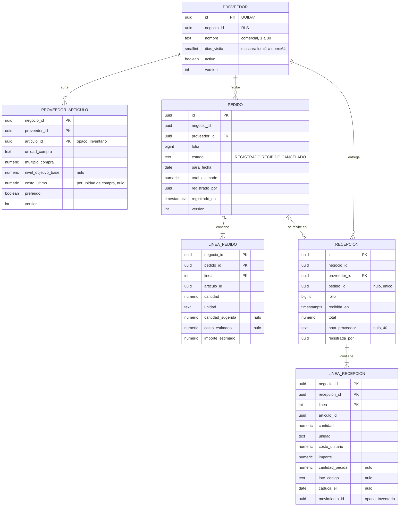
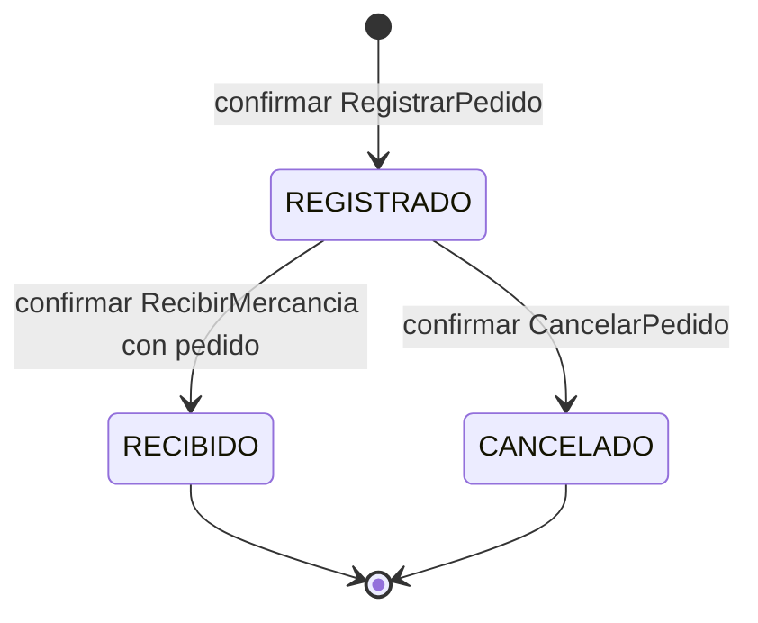
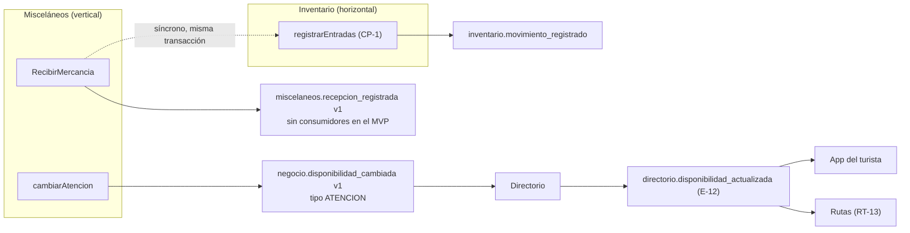
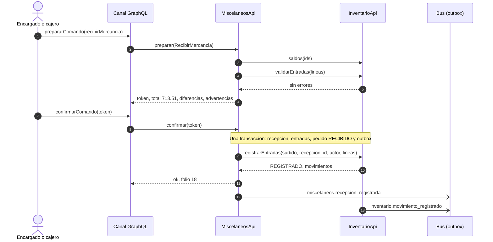
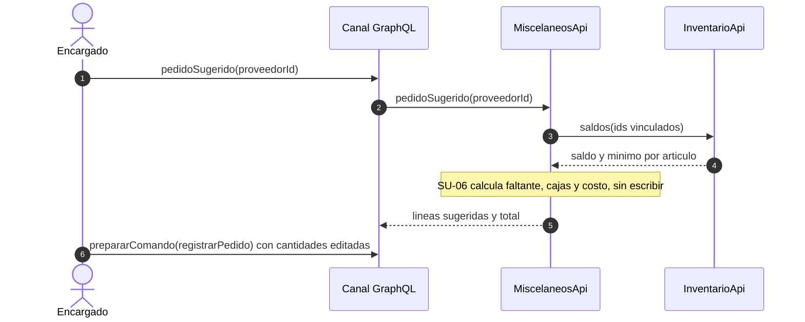

# Diseño del vertical Misceláneos (módulo `miscelaneos`)

**Versión:** 0.2 (aplica la revisión de `ecc:architect`, §18)
**Fecha:** 2026-10-16
**Estado:** PROPUESTA. Solo diseño. No hay autorización escrita para programar este módulo. Todas las decisiones nuevas (D-105 a D-119) están **propuestas**, no aceptadas.
**Contexto de decisiones:** `docs/BITACORA.md` (los identificadores `D-xx` remiten a ahí).
**Diseño visual:** artefacto «Mapa de Misceláneos» (enlace en la Bitácora).

Prioridades: **P1** = MVP (en la demo se muestra como mockup con datos simulados, D-105), **P2** = si alcanza, **P3** = fuera del MVP. Todos los datos de ejemplo son **simulados**.

---

## 1. Qué es y para qué sirve

Misceláneos es el primer módulo **vertical** de la plataforma: lo propio de una tienda de abarrotes que ningún horizontal cubre. Todo lo demás (vender, cobrar, granel, piezas sueltas, caducidad, merma, corte de caja, personal) lo hacen los horizontales y el vertical no lo duplica.

En P1 tiene dos capacidades:

1. **Surtido.** Proveedores que pasan cada semana, pedido sugerido según existencias y recepción de la mercancía, que se registra como entrada en Inventario con su costo, lote y caducidad.
2. **Disponibilidad.** La tienda dice si está abierta y cuánta espera hay; la app del turista lo ve en la ficha («Atención en vivo»), como pide D-33.

## 2. Mapa de cobertura (por qué existe cada capacidad)

| Necesidad de la miscelánea | La cubre | Lo que queda sin cubrir | Decisión |
|---|---|---|---|
| Vender en mostrador | Ventas + Catálogo | Código de barras (hueco de **Catálogo**) | Cubierto; Catálogo sin diseño |
| Cobrar (efectivo con cambio, tarjeta, transferencia, mixto) | Ventas VT-04 + Caja CJ-03 | — | Cubierto |
| Venta por peso o granel | Ventas VT-03 + Catálogo (D-80) + Inventario U-02 | Vender por importe («$10 de jamón»): el canal convierte a cantidad (pregunta 5) | Cubierto |
| Piezas sueltas | Inventario U-03 | — | Cubierto |
| Fiar o dar crédito | Nadie (Clientes lo excluye; Ventas no tiene método a crédito) | Todo | **Fuera del MVP** (D-106), ver §12 |
| Surtir | Inventario (entradas, `bajo_minimo`) | Proveedores, días de visita, pedido sugerido (Inventario dejó fuera proveedores y órdenes de compra) | **Vertical: Surtido, P1** |
| Controlar caducidad | Inventario L-01 a L-08 (P2 de Inventario) | — | Cubierto; dependencia |
| Merma y conteo | Inventario | — | Cubierto |
| Cerrar caja | Caja CJ-06 a CJ-12 | — | Cubierto |
| Saber cuánto ganó | Ventas + Contabilidad + Inventario | Utilidad bruta (costo de ventas, K-10) | **Horizontal** (D-107) |
| Gastos (luz, renta) | Caja (retiro) + Contabilidad | Retiros en Contabilidad (J-05, P2) | Hueco horizontal |
| Varias personas atendiendo | Identidad | — | Cubierto |
| Catálogo y «Atención en vivo» para el turista | Catálogo (`catalogoPublico`, D-42) + `negocio.disponibilidad_cambiada` (D-33) | D-33 dice que el vertical publica la disponibilidad | **Vertical: Disponibilidad, P1** |
| Envases retornables | Nadie | Depósito del envase | Datos de Catálogo, sin módulo (pregunta 4) |
| Precio de mayoreo | Catálogo | Precio por cantidad | Hueco de Catálogo, P2 |
| Recargas y pago de servicios | — | Integración externa | Fuera del MVP (P3) |

## 3. Arquitectura

### 3.1 Reglas R1 a R6 aplicadas

| Regla | Cómo se cumple |
|---|---|
| R1 | Misceláneos es dueño del esquema `miscelaneos`. A Inventario solo entra por `InventarioApi`. Nadie lee sus tablas. Las referencias a artículos son UUID opacos sin llave foránea |
| R2 | Síncrono: llama a `InventarioApi` (existencias, conversión, entradas). Asíncrono: publica eventos. Un evento no devuelve respuesta |
| R3 | Sus eventos llevan UUIDv7. No consume eventos en P1 (D-115); cuando consuma, deduplicará con `evento_procesado` |
| R4 | Depende solo de `compartido` e `inventario` (horizontal). Ningún horizontal conoce a Misceláneos: Inventario ofrece `registrarEntradas` genérico (el `consumidor` se valida por patrón, no por una lista de verticales) y nunca escucha eventos del vertical |
| R5 | Sus eventos son v1 y solo crecerán con campos opcionales. Los cambios a contratos ajenos (CP-1 a CP-3) son aditivos |
| R6 | No aplica (es vertical) |

### 3.2 Dependencias

| Módulo | Llama a la API de | Escucha | Publica |
|---|---|---|---|
| Misceláneos (vertical) | Inventario | Nada (P1) | `miscelaneos.recepcion_registrada`, `negocio.disponibilidad_cambiada` (ATENCION) |

Spring Modulith: `allowedDependencies = "compartido, inventario"`, verificado con `ApplicationModules.verify()`. Mientras Inventario no exista en código, el adaptador es un doble en las pruebas.

### 3.3 Capas (puertos y adaptadores)

```
mx.negocio360.miscelaneos
  MiscelaneosApi                    puerto de entrada (lo usa canal)
  surtido/dominio                   Proveedor, ProveedorArticulo, Pedido, Recepcion, CalculadoraSurtido
  surtido/aplicacion                manejadores de comando y consultas
  surtido/aplicacion/puertos        RepositorioProveedores, RepositorioPedidos, RepositorioRecepciones,
                                    ExistenciasPort, EntradasInventarioPort
  disponibilidad/dominio            EstadoAtencion
  disponibilidad/aplicacion         CambiarAtencion
  infraestructura                   JDBC, adaptador de InventarioApi, publicador (outbox)
```

El dominio no importa Spring. El preparar → confirmar viene de `compartido.comandos` (D-84). Los resolvedores viven en `canal` (D-55) y solo llaman a `MiscelaneosApi`.

## 4. Dueño de cada dato

| Dato | Dueño | Qué ve Misceláneos |
|---|---|---|
| Proveedores, vínculos artículo-proveedor, pedidos, recepciones, estado de atención | Misceláneos | Propio |
| Artículos, unidades, saldos, mínimos, lotes, CPP | Inventario | Lo que devuelven `saldos` (con los campos opcionales de CP-2) y `aBase` |
| Movimientos de entrada | Inventario | Solo el `movimiento_id` que devuelve `registrarEntradas` |
| Productos y precios de venta | Catálogo | Nada |
| Horario del negocio | Directorio | Nada |
| Personal y permisos | Identidad | Solo ids de actor y la respuesta de autorización |

## 5. Modelo de datos (esquema `miscelaneos`)

Convenciones: llaves UUIDv7 generadas en la aplicación; `negocio_id NOT NULL` en **toda** tabla; seguridad por fila `ENABLE` y `FORCE` con la política `aislamiento_por_negocio` (`negocio_id = plataforma.negocio_actual()` en `USING` y `WITH CHECK`), igual que V020 y V030; dinero `numeric(14,2)`, cantidades `numeric(14,4)`, costos unitarios `numeric(14,4)`; HALF_UP (D-20); llaves foráneas internas **compuestas** `(negocio_id, x_id)` para que ninguna fila apunte a otro negocio; rol de grupo `rol_miscelaneos`; migración `V040__miscelaneos_esquema.sql` cuando se autorice.

### 5.1 Diagrama entidad-relación



Tablas de control (sin relación en el diagrama): `folio_surtido`, `estado_atencion`, `preparacion`.

### 5.2 Tablas

| Tabla | Columnas | Restricciones e índices |
|---|---|---|
| `proveedor` | `id`, `negocio_id`, `nombre`, `dias_visita`, `activo`, `version`, `creado_en`, `actualizado_en` | `UNIQUE (negocio_id, id)` (destino de las FK compuestas, como V020 y V030). Único parcial `(negocio_id, lower(nombre))` donde `activo`. CHECK `dias_visita` entre 0 y 127. **Sin datos de contacto en P1** (D-116) |
| `proveedor_articulo` | `negocio_id`, `proveedor_id`, `articulo_id`, `unidad_compra`, `multiplo_compra` (≥ 1, por defecto 1), `nivel_objetivo_base`, `costo_ultimo`, `preferido`, `version` | PK `(negocio_id, proveedor_id, articulo_id)`. FK `(negocio_id, proveedor_id)` → `proveedor`. Único parcial `(negocio_id, articulo_id)` donde `preferido`. Índice `(negocio_id, articulo_id)` |
| `pedido` | `id`, `negocio_id`, `proveedor_id`, `folio`, `estado`, `para_fecha`, `total_estimado`, `registrado_por`, `registrado_en`, `cancelado_en`, `cancelado_por`, `motivo_cancelacion` (≤ 200), `version` | `UNIQUE (negocio_id, id)` y `UNIQUE (negocio_id, id, proveedor_id)`. FK `(negocio_id, proveedor_id)` → `proveedor`. Único `(negocio_id, folio)`. Índices `(negocio_id, registrado_en DESC, id)` y parcial `(negocio_id, proveedor_id)` donde `estado = 'REGISTRADO'`. `UPDATE` solo de estado, columnas de cancelación y `version` |
| `linea_pedido` | ver diagrama | PK `(negocio_id, pedido_id, linea)`. FK `(negocio_id, pedido_id)` → `pedido`. **Solo inserción** (disparadores `plataforma.rechazar_modificacion()` por fila y por sentencia, como V030) |
| `recepcion` | ver diagrama | `UNIQUE (negocio_id, id)`. FK `(negocio_id, proveedor_id)` → `proveedor`. FK `(negocio_id, pedido_id, proveedor_id)` → `pedido (negocio_id, id, proveedor_id)`: no se puede recibir el pedido de otro proveedor. Único `(negocio_id, folio)`. Único parcial `(negocio_id, pedido_id)` donde no es nulo. Índice `(negocio_id, recibida_en DESC, id)`. **Solo inserción** (disparadores) |
| `linea_recepcion` | ver diagrama | PK `(negocio_id, recepcion_id, linea)`. FK `(negocio_id, recepcion_id)` → `recepcion`. **Solo inserción** (disparadores) |
| `folio_surtido` | `negocio_id`, `tipo` (`PEDIDO`, `RECEPCION`), `ultimo` | PK `(negocio_id, tipo)`. Incremento con bloqueo de fila al confirmar |
| `estado_atencion` | `negocio_id` PK, `abierto`, `espera` (`SIN_ESPERA`, `POCA`, `MUCHA`), `vigente_hasta`, `actualizado_en`, `actualizado_por`, `ventana_inicio`, `cambios_en_ventana`, `version` | CHECK: `espera` es nula si `abierto` es falso. `ventana_inicio` y `cambios_en_ventana` sostienen el tope de DA-04 sin tabla de historial ni purga |
| `preparacion` | forma de `compartido.comandos` | Solo el hash del token; expira a los 5 min (D-23) |

Permisos de `rol_miscelaneos`: `SELECT, INSERT` en todas; `UPDATE` por columna en `pedido`, `proveedor` (nombre, días, activo, versión, `actualizado_en`), `proveedor_articulo` (unidad, múltiplo, objetivo, costo, preferido, versión), `folio_surtido` y `estado_atencion`; `UPDATE` y `DELETE` en `preparacion` (marcar usada, vaciar y purgar, como V020 y V030); `DELETE` también en `proveedor_articulo` (desvincular). Ninguno en las tablas de solo inserción. Paginación por cursor sin `OFFSET`: UUIDv7 donde se ordena por id y compuesto `(fecha, id)` donde se ordena por fecha.

### 5.3 Estados del pedido



## 6. Reglas de dominio

Prefijos nuevos: **SU** (Surtido) y **DA** (Disponibilidad). No chocan con los de otros módulos.

### 6.1 Surtido (SU)

| ID | Regla | Prueba de aceptación | P |
|---|---|---|---|
| SU-01 | El nombre del proveedor tiene de 1 a 80 caracteres y es único entre los activos del negocio, sin importar mayúsculas | «Refrescos del Valle» repetido falla con `PROVEEDOR_DUPLICADO` | P1 |
| SU-02 | Días de visita: subconjunto de lunes a domingo; vacío = sin día fijo. La agenda usa la fecha local de México | Proveedor de lunes y jueves aparece en la agenda del jueves 2026-10-15 | P1 |
| SU-03 | Contacto del proveedor (nombre y teléfono E.164) con aviso de privacidad | Pendiente de P2 (D-116) | P2 |
| SU-04 | Vincular un artículo exige que exista y esté activo en Inventario, sin rastreo `SERIE`, y que `unidad_compra` convierta a su unidad base (`aBase`). El nivel objetivo se captura con su unidad (`{cantidad, unidad}`) y se guarda convertido a unidad base | Inexistente: `ARTICULO_NO_ENCONTRADO`; inactivo: `ARTICULO_INACTIVO`; serializado: `ARTICULO_CON_SERIE_NO_SOPORTADO`; «caja» sin factor: `UNIDAD_NO_CONVERTIBLE` | P1 |
| SU-04b | Un proveedor inactivo no recibe vínculos, pedidos ni recepciones. No se desactiva un proveedor con pedidos `REGISTRADO`: primero se cancelan | Desactivar con un pedido pendiente: `PROVEEDOR_CON_PEDIDOS_PENDIENTES`; pedir a uno inactivo: `PROVEEDOR_INACTIVO` | P1 |
| SU-05 | Un artículo tiene a lo más un proveedor preferido | El segundo preferido falla con `PREFERIDO_DUPLICADO` | P1 |
| SU-06 | Pedido sugerido: objetivo = `nivel_objetivo_base` o, si falta, factor × mínimo (regla versionada, inicial 2, D-110). Faltante = objetivo − saldo (un saldo negativo cuenta tal cual, A-01). Si es ≤ 0 no aparece. Cantidad = faltante en unidad de compra **redondeado hacia arriba** al múltiplo (D-109). Importe = cantidad × `costo_ultimo`, HALF_UP a 2 | Mínimo 12, objetivo 48, saldo 7, caja = 24 piezas: faltan 41 → 2 cajas; a 312.00 por caja, 624.00 | P1 |
| SU-07 | La sugerencia es solo una propuesta; nada se pide solo | Consultar el sugerido no escribe filas ni publica eventos | P1 |
| SU-08 | `RegistrarPedido`: al menos una línea, cantidades > 0, máximo 200 líneas (regla versionada), artículos vinculados a ese proveedor. Los textos usan la lista de caracteres permitidos (SG-17) | Artículo sin vínculo: `ARTICULO_NO_VINCULADO`; cantidad 0: `CANTIDAD_INVALIDA`; caracteres prohibidos en el motivo: `TEXTO_NO_PERMITIDO` | P1 |
| SU-09 | Folios de pedido y de recepción consecutivos y sin huecos por negocio, asignados al confirmar (como D-79) | Dos confirmaciones simultáneas reciben n y n+1 | P1 |
| SU-10 | Solo un pedido `REGISTRADO` se cancela, con motivo. Un pedido no se edita: se cancela y se vuelve a pedir | Cancelar uno recibido: `PEDIDO_NO_CANCELABLE` | P1 |
| SU-11 | `RecibirMercancia`, con o sin pedido. Toda línea debe ser de un artículo **vinculado** a ese proveedor (así SU-14 y SU-17 siempre tienen contra qué comparar). Cantidad > 0, costo unitario ≥ 0 por unidad capturada (C-08), lote y caducidad según el rastreo del artículo (L-02). Inventario valida al preparar sin escribir (`validarEntradas`, CP-1); los rechazos salen como `ENTRADA_RECHAZADA` con el código de Inventario | Artículo con rastreo `LOTE` sin lote: `ENTRADA_RECHAZADA` (`LOTE_REQUERIDO`) desde la preparación; recibir un pedido `CANCELADO`: `PEDIDO_NO_RECIBIBLE`; el de otro proveedor: `PEDIDO_DE_OTRO_PROVEEDOR` | P1 |
| SU-12 | `recepcion_id` se genera al **preparar** y viaja en el comando guardado. Al confirmar, en **una transacción**: recepción, entradas en Inventario (`registrarEntradas`, idempotente por negocio, `recepcion_id` y consumidor `surtido`), pedido a `RECIBIDO` y evento `miscelaneos.recepcion_registrada`. Si algo cambió en Inventario entre preparar y confirmar, la respuesta es `COMANDO_CAMBIO` (D-85) y no se escribe nada. Un error reintentable (`CONCURRENCIA`, `ERROR_TEMPORAL`) gasta el token: reintentar es volver a preparar | Inventario simula un fallo: no hay recepción y el pedido sigue `REGISTRADO`; un artículo desactivado entre los dos pasos: `COMANDO_CAMBIO` | P1 |
| SU-13 | Un pedido se recibe una sola vez. La diferencia entre pedido y recibido se muestra y se guarda por línea, sin bloquear | Pedí 2 cajas, llegó 1: se guarda con `cantidad_pedida = 2`; recibir dos veces: `PEDIDO_YA_RECIBIDO` | P1 |
| SU-14 | Al recibir en la unidad de compra, `costo_ultimo` se actualiza en la misma transacción | Recibir a 318.00 deja `costo_ultimo = 318.0000` | P1 |
| SU-15 | La recepción no se edita ni se anula en P1; las correcciones van por Inventario (ajuste por conteo o salida) | No existe comando que modifique una recepción | P1 |
| SU-16 | Toda cifra la calcula el código. Total = Σ importes | 624.00 + 89.50 + 0.01 = 713.51 | P1 |
| SU-17 | Si un costo difiere más de 50 % de `costo_ultimo` (regla versionada), la preparación avisa `COSTO_ATIPICO`. Para quien tiene `costos_ver` es solo una advertencia. Para quien no lo tiene (cajero), **confirmar exige `autorizadoPor`** de alguien con `costos_ver` (como CJ-08), y el aviso no muestra la cifra anterior. Motivo: el CPP de Inventario no se recalcula hacia atrás (C-07) y la recepción no se anula (SU-15) | Cajero con 620.00 contra 312.00 sin autorización: `COSTO_REQUIERE_AUTORIZACION`; encargado: confirma con advertencia | P1 |

### 6.2 Disponibilidad (DA)

| ID | Regla | Prueba de aceptación | P |
|---|---|---|---|
| DA-01 | Un estado por negocio: abierto o cerrado, y espera solo si está abierto | Cerrado con `MUCHA`: `ESTADO_ATENCION_INVALIDO` | P1 |
| DA-02 | Se publica `negocio.disponibilidad_cambiada` (ATENCION), en la misma transacción, si el valor cambió **o** si el estado vigente ya venció o le quedan menos de 5 min (regla versionada); así reconfirmar la misma espera la renueva | Dos toques iguales a las 12:00 y 12:01: un evento. El mismo valor a las 12:40 (vencido a las 12:30): un evento nuevo | P1 |
| DA-03 | La espera vence: el evento lleva `vigente_hasta` = cambio + 30 min (regla versionada); después Directorio la trata como «sin dato» (CP-3). Sin tarea programada | `POCA` a las 12:00 trae `vigente_hasta` 12:30 | P1 |
| DA-04 | Máximo 6 cambios por minuto por negocio, contados con `ventana_inicio` y `cambios_en_ventana` de `estado_atencion` | El séptimo: `DEMASIADOS_CAMBIOS` | P1 |
| DA-05 | El evento no lleva datos personales; el actor queda en la tabla | El contrato no tiene campo de actor | P1 |
| DA-06 | `cambiarAtencion` no usa preparar → confirmar (D-114) pero exige sesión y el permiso `miscelaneos.atencion.cambiar` | Sin permiso: `SIN_PERMISO` | P1 |

## 7. API pública (`MiscelaneosApi`)

Reglas generales: `negocio_id` nunca es parámetro (sale de `ContextoNegocio`); respuesta `{ ok, codigo, datos, mensaje_plantilla }`; records inmutables; listas por cursor, 50 como máximo.

### 7.1 Consultas

| ID | Operación | Entrada | Salida | P |
|---|---|---|---|---|
| SF-01 | `proveedores` | texto?, soloActivos, cursor | página de `ProveedorVista` | P1 |
| SF-02 | `proveedor` | proveedorId | ficha; los vínculos van en una lista paginada aparte (`articulos(primeros ≤ 50, despues)`) | P1 |
| SF-03 | `visitasDeHoy` | fecha? | proveedores que pasan y si tienen pedido pendiente (≤ 100), con `truncado` si hay más | P1 |
| SF-04 | `pedidoSugerido` | proveedorId | líneas con saldo, objetivo, cantidad, unidad, costo e importe; total (≤ 200 artículos), con `truncado` si el proveedor tiene más vínculos | P1 |
| SF-05 | `pedidos` | estado?, proveedorId?, desde, hasta (por `registrado_en`, ≤ 366 días), cursor `(registrado_en, id)` | página | P1 |
| SF-06 | `pedido` | pedidoId | pedido con líneas | P1 |
| SF-07 | `recepciones` | desde, hasta (por `recibida_en`), proveedorId?, cursor `(recibida_en, id)` | página | P1 |
| SF-08 | `recepcion` | recepcionId | recepción con líneas y diferencias | P1 |
| DF-01 | `estadoAtencion` | — | estado y `vigente_hasta` | P1 |

### 7.2 Comandos (preparar → confirmar, variantes de `ComandoInput`, D-55)

| ID | Comando | Campos | Reglas | Evento | P |
|---|---|---|---|---|---|
| SF-10 | `CrearProveedor` | nombre, diasVisita | SU-01, SU-02 | — | P1 |
| SF-11 | `EditarProveedor` | proveedorId, version, nombre?, diasVisita? | SU-01, SU-02 | — | P1 |
| SF-12 | `DesactivarProveedor` | proveedorId, version | SU-04b | — | P1 |
| SF-13 | `VincularArticulo` | proveedorId, articuloId, unidadCompra, multiploCompra?, nivelObjetivo?{cantidad, unidad}, preferido? | SU-04, SU-04b, SU-05 | — | P1 |
| SF-14 | `DesvincularArticulo` | proveedorId, articuloId | — | — | P1 |
| SF-15 | `RegistrarPedido` | proveedorId, paraFecha, lineas[{articuloId, cantidad, unidad}] | SU-06 a SU-09 | — | P1 |
| SF-16 | `CancelarPedido` | pedidoId, motivo | SU-10 | — | P1 |
| SF-17 | `RecibirMercancia` | proveedorId, pedidoId?, notaProveedor?, autorizadoPor?, lineas[{articuloId, cantidad, unidad, costoUnitario, lote?{codigo, caducaEl?}}] | SU-09, SU-11 a SU-17 | `miscelaneos.recepcion_registrada` | P1 |

### 7.3 Escritura directa (excepción D-114)

| ID | Operación | Entrada | Reglas | Evento | P |
|---|---|---|---|---|---|
| DF-10 | `cambiarAtencion` | abierto, espera? | DA-01 a DA-06 | `negocio.disponibilidad_cambiada` | P1 |

### 7.4 Códigos de error

| Grupo | Códigos |
|---|---|
| Proveedor | `PROVEEDOR_DUPLICADO`, `PROVEEDOR_NO_ENCONTRADO`, `PROVEEDOR_INACTIVO`, `PROVEEDOR_CON_PEDIDOS_PENDIENTES`, `NOMBRE_INVALIDO` |
| Vínculo | `ARTICULO_NO_ENCONTRADO`, `ARTICULO_INACTIVO`, `ARTICULO_NO_VINCULADO`, `VINCULO_NO_ENCONTRADO`, `ARTICULO_CON_SERIE_NO_SOPORTADO`, `PREFERIDO_DUPLICADO`, `UNIDAD_NO_CONVERTIBLE` |
| Pedido | `PEDIDO_SIN_LINEAS`, `DEMASIADAS_LINEAS`, `CANTIDAD_INVALIDA`, `PEDIDO_NO_ENCONTRADO`, `PEDIDO_NO_CANCELABLE`, `PEDIDO_YA_RECIBIDO`, `PEDIDO_NO_RECIBIBLE`, `PEDIDO_DE_OTRO_PROVEEDOR`, `MOTIVO_REQUERIDO` |
| Recepción | `ENTRADA_RECHAZADA` al preparar (lleva el código de Inventario: `UNIDAD_NO_CONVERTIBLE`, `LOTE_REQUERIDO`, `FECHA_CADUCIDAD_INVALIDA`…), `COSTO_REQUIERE_AUTORIZACION`, advertencia `COSTO_ATIPICO` |
| Atención | `ESTADO_ATENCION_INVALIDO`, `DEMASIADOS_CAMBIOS` |
| Entrada | `TEXTO_NO_PERMITIDO`, `TEXTO_DEMASIADO_LARGO`, `RANGO_FECHAS_INVALIDO` |
| Permisos | `SIN_PERMISO` |
| Preparar y confirmar | `TOKEN_INVALIDO`, `TOKEN_EXPIRADO`, `TOKEN_USADO`, `COMANDO_CAMBIO` |
| Reintentables | `CONCURRENCIA`, `ERROR_TEMPORAL` |

Cada código tiene un texto fijo en español de México; ninguno repite datos de otro negocio.

## 8. Eventos

Sobre común de `compartido` (`SobreEvento`): `id` UUIDv7, `tipo`, `version`, `negocio_id`, `origen = "miscelaneos"`, `ocurrido_en` (UTC), `correlacion_id`, `causa_id`, `datos`. Dinero y cantidades como cadena decimal; un opcional que no aplica se omite. Outbox: `plataforma.event_publication`, en la misma transacción.

### 8.1 Diagrama



Las flechas continuas son eventos por el bus (outbox). `recepcion_registrada` lleva costos confidenciales y no tiene consumidor: nadie fuera del negocio lo lee.

### 8.2 Publica

| Evento | Cuándo | `datos` | Consumidores | P |
|---|---|---|---|---|
| `miscelaneos.recepcion_registrada` v1 | Al confirmar `RecibirMercancia` | `recepcion_id`, `folio`, `proveedor_id`, `pedido_id?`, `total`, `lineas[{linea, articulo_id, cantidad, unidad, costo_unitario, importe}]` | Ninguno en el MVP (traza; posible póliza de compras, que exigiría cambiar D-92) | P1 |
| `negocio.disponibilidad_cambiada` v1 (C-01, contrato de `compartido`) | Al cambiar la atención o renovarla (DA-02) | `tipo = "ATENCION"`, `abierto`, `espera?`, `vigente_hasta?`, `actualizado_en` | Directorio, que publica E-12; de E-12 dependen la app del turista y **Rutas** (RT-13), ver CP-3 | P1 |

`correlacion_id` = `recepcion_id` en la recepción y `negocio_id` en la atención. `causa_id` se omite (lo inicia una persona). No se publica un evento de pedido: no tendría consumidor (D-115).

```json
{
  "id": "0192b0a1-7e00-7a10-8b20-000000000001",
  "tipo": "miscelaneos.recepcion_registrada",
  "version": 1,
  "negocio_id": "0191f0aa-11b2-7c3d-9e4f-a1b2c3d4e5f6",
  "origen": "miscelaneos",
  "ocurrido_en": "2026-10-16T16:05:12Z",
  "correlacion_id": "0192b0a1-6d00-7000-8000-0000000000aa",
  "datos": {
    "recepcion_id": "0192b0a1-6d00-7000-8000-0000000000aa",
    "folio": 18,
    "proveedor_id": "0192b000-0001-7000-8000-000000000010",
    "pedido_id": "0192afff-0001-7000-8000-000000000020",
    "total": "713.51",
    "lineas": [
      { "linea": 1, "articulo_id": "0191f1b0-0003-7000-8000-000000000003",
        "cantidad": "2", "unidad": "caja", "costo_unitario": "312.0000", "importe": "624.00" }
    ]
  }
}
```

```json
{
  "id": "0192b0b5-1200-7c00-8d00-000000000002",
  "tipo": "negocio.disponibilidad_cambiada",
  "version": 1,
  "negocio_id": "0191f0aa-11b2-7c3d-9e4f-a1b2c3d4e5f6",
  "origen": "miscelaneos",
  "ocurrido_en": "2026-10-16T18:00:03Z",
  "correlacion_id": "0191f0aa-11b2-7c3d-9e4f-a1b2c3d4e5f6",
  "datos": {
    "tipo": "ATENCION",
    "abierto": true,
    "espera": "POCA",
    "vigente_hasta": "2026-10-16T18:30:03Z",
    "actualizado_en": "2026-10-16T18:00:03Z"
  }
}
```

### 8.3 Consume

Nada en P1 (D-115). El pedido sugerido consulta a Inventario en el momento.

## 9. Cambios propuestos a contratos ajenos (no aplicados)

| ID | Contrato | Cambio | Por qué | ¿Rompe? | Dueño |
|---|---|---|---|---|---|
| CP-1 | `InventarioApi` y esquema `inventario` | **API:** `validarEntradas(lineas)` → errores por línea, sin escribir. `registrarEntradas(consumidor, causaId, actor, ocurridoEn, lineas[{articuloId, cantidad, unidad, costoUnitario, lote?{codigo, caducaEl?}}])` → `{estado: REGISTRADO \| YA_REGISTRADO \| RECHAZADO, codigo?, movimientos[{linea, movimientoId}]}`. Escritura del sistema (como D-22), idempotente por `(negocio, causaId, consumidor)`, atómica. **Transacción:** se une a la de quien llama (`MANDATORY`); antes de escribir verifica que `current_setting('app.negocio_id')` sea igual a `ContextoNegocio` y falla cerrado si no. **Errores:** los permanentes (unidad, lote, artículo inactivo) se devuelven como `RECHAZADO` y **antes de escribir**, sin excepción, para no dejar la transacción en «solo rollback»; lo inesperado se propaga sin atraparse. Guarda `actor` en `movimiento.registrado_por` y genera movimientos `ENTRADA` con `causa_tipo = COMPRA`. **Esquema:** tabla nueva de idempotencia de entradas (p. ej. `inventario.entrada_sistema`), porque `consumo` y sus estados (REVERTIDO, ANULADO_PREVIO, FALLIDO) son de salidas; `consumidor` se valida por patrón (`^[a-z][a-z_]{2,39}$`), no por la lista `vinculo`/`restaurantes` | Recibir 15 líneas no puede costar 15 tokens; la persona ya confirmó en Misceláneos (D-111, D-119) | La API solo agrega; **el esquema de Inventario sí cambia** (tabla nueva y validación de `consumidor`) | Inventario |
| CP-2 | `InventarioApi.saldos` | Campos opcionales nuevos en `SaldoVista`: `minimoBase`, `rastreo`, `activo` y `nombre` | `SaldoVista` ya trae «bajo mínimo» pero no el mínimo; extenderla evita N llamadas y no mete un concepto del vertical en la API horizontal (D-112) | No, agrega | Inventario |
| CP-3 | `negocio.disponibilidad_cambiada` v1 (C-01), `directorio.disponibilidad_actualizada` (E-12) y Rutas RT-13 | En C-01 y E-12: opcionales `espera` y `vigente_hasta`; `libres` y `total` obligatorios solo con `MESAS` o `AFORO`. En Directorio: pasado `vigente_hasta`, la ficha muestra «sin dato». En Rutas: RT-13 solo decide con `MESAS` y `AFORO` e ignora `ATENCION` (o la usa solo como aviso informativo) | ATENCION no tiene mesas; la espera vence (D-113, HR-5). Sin esto, un evento sin `libres` llega a Rutas sin que nadie lo revisara | No mientras C-01 y E-12 solo existan en el mockup. Si alguno ya se programó con `libres` obligatorio, se necesita v2 | `compartido`, Directorio y Rutas (sin dueño) |

Sin cambios en Ventas, Caja, Clientes, Contabilidad ni Catálogo.

## 10. Comunicación con la API

| ID | Protocolo | Operación | Quién llama | Entrada → salida | P |
|---|---|---|---|---|---|
| G1 | GraphQL (consulta) | `proveedores(texto, soloActivos, primeros ≤ 50, despues)` | Panel | → página | P1 |
| G2 | GraphQL (consulta) | `proveedor(id)` | Panel | → ficha y vínculos paginados (DataLoader a `saldos`, CP-2) | P1 |
| G3 | GraphQL (consulta) | `visitasDeHoy(fecha)` | Panel (inicio) | → agenda de hoy | P1 |
| G4 | GraphQL (consulta) | `pedidoSugerido(proveedorId)` | Panel | → sugerencia, sin escribir | P1 |
| G5 | GraphQL (consulta) | `pedidos(estado, proveedorId, desde, hasta, primeros, despues)` | Panel | → página | P1 |
| G6 | GraphQL (consulta) | `pedido(id)` | Panel | → pedido | P1 |
| G7 | GraphQL (consulta) | `recepciones(desde, hasta, proveedorId, primeros, despues)` | Panel | → página | P1 |
| G8 | GraphQL (consulta) | `recepcion(id)` | Panel | → recepción con diferencias | P1 |
| G9 | GraphQL (consulta) | `estadoAtencion` | Panel | → estado | P1 |
| G10 | GraphQL (mutación) | `prepararComando` / `confirmarComando` con 8 variantes (`crearProveedor`, `editarProveedor`, `desactivarProveedor`, `vincularArticulo`, `desvincularArticulo`, `registrarPedido`, `cancelarPedido`, `recibirMercancia`) | Panel | → token y resumen; → `Resultado` | P1 |
| G11 | GraphQL (mutación directa) | `cambiarAtencion(abierto, espera)` | Panel | → estado (D-114) | P1 |
| W1 | GraphQL (suscripción, WebSocket) | `visitasEnVivo` | Panel | → aviso cuando toca la visita de un proveedor | P2 |
| J1 | Java | `MiscelaneosApi` | Resolvedores de `canal` | mismo proceso | P1 |
| J2 | Java | `InventarioApi.saldos` (con CP-2), `aBase`, `validarEntradas`, `registrarEntradas` | Misceláneos → Inventario | síncrono, vertical → horizontal | P1 |
| B1 | Bus | `miscelaneos.recepcion_registrada` | Misceláneos → bus | saliente | P1 |
| B2 | Bus | `negocio.disponibilidad_cambiada` (ATENCION) | Misceláneos → Directorio | saliente | P1 |

En P1: 15 vías (11 GraphQL, 2 Java, 2 bus), **sin WebSocket ni REST**. Las alertas de existencias ya las da `alertasNegocio` de Inventario; al turista la atención le llega por la suscripción de Directorio (E-12). No hay REST: sin herramientas de IA, sin bot (D-63) y sin exportaciones. Ningún tipo ni argumento lleva `negocioId` (SG-02).

### 10.1 Flujo: recibir un pedido



### 10.2 Flujo: pedido sugerido



## 11. Seguridad y datos personales

### 11.1 Datos personales

| Dato | ¿Personal? | Tratamiento |
|---|---|---|
| `proveedor.nombre` | A veces (persona física) | Se pide el nombre comercial |
| Contacto del proveedor | Sí | **No se guarda en P1** (D-116) |
| `registrado_por`, `cancelado_por`, `actualizado_por` | Indirecto (personal) | Solo en tablas; nunca en eventos ni registros del servidor |
| `motivo_cancelacion`, `nota_proveedor` | Riesgo de texto libre | Hasta 200 y 40, lista de caracteres permitidos (SG-17), nunca en eventos |
| Costos y totales de compra | No; confidencial del negocio | Permiso `costos_ver`; el tablero de gobierno solo agregados con mínimo por celda |

LFPDPPP (D-58): el negocio es responsable y la plataforma encargada. En P1 el módulo no guarda datos personales de terceros. Si en P2 entra el contacto del proveedor, hará falta una finalidad en el aviso de privacidad y atención ARCO (hoy viven en Clientes, solo para clientes). El artículo exacto de una posible excepción de consentimiento por relación comercial está **por verificar** en el texto reformado del 14-11-2025. No es asesoría jurídica.

### 11.2 Permisos por rol

| Permiso | Dueño | Encargado | Cajero |
|---|---|---|---|
| `miscelaneos.surtido.ver` | ✓ | ✓ | ✓ |
| `miscelaneos.surtido.costos_ver` | ✓ | ✓ | — |
| `miscelaneos.proveedores.gestionar` | ✓ | ✓ | — |
| `miscelaneos.pedidos.registrar` | ✓ | ✓ | — |
| `miscelaneos.pedidos.cancelar` | ✓ | ✓ | — |
| `miscelaneos.recepciones.registrar` | ✓ | ✓ | ✓ |
| `miscelaneos.atencion.cambiar` | ✓ | ✓ | ✓ |

Se niega por defecto. Se revisa en el resolvedor y otra vez en el manejador al preparar y al confirmar (como D-86). Los campos de costo se autorizan campo por campo: sin `costos_ver` salen `null`. El cajero captura el costo de la nota al recibir, pero no ve `costo_ultimo`, importes sugeridos ni totales históricos; si el costo es atípico, necesita la autorización de alguien con `costos_ver` (SU-17, D-117). Los nombres de roles y permisos deben alinearse con el Mapa de Identidad (pregunta 7).

### 11.3 Límites

Listas: cursor UUIDv7, 20 por defecto y 50 como máximo. `pedidoSugerido`: 200 artículos (consulta a Inventario en lotes de 100). `visitasDeHoy`: 100. Rangos de fechas: 366 días. Textos de búsqueda: 2 a 80. Comandos: 200 líneas; montos dentro de `numeric(14,2)`. `cambiarAtencion`: 6 por minuto. Tope de preparaciones vigentes (SG-19).

### 11.4 Amenazas propias

| ID | Amenaza | Control |
|---|---|---|
| H-S1 | Ids de proveedor, pedido o artículo de otro negocio | RLS en ambos esquemas dentro de la misma transacción; ajeno = inexistente (SG-03) |
| H-S2 | Recepción doble | Token de un solo uso, único `(negocio_id, pedido_id)` e idempotencia de `registrarEntradas` |
| H-S3 | `registrarEntradas` abre otra transacción, confía en un `app.negocio_id` ajeno o deja la transacción en «solo rollback» | CP-1: `MANDATORY`, verificación de `app.negocio_id` contra `ContextoNegocio`, rechazos como resultado antes de escribir; pruebas de ambos caminos |
| H-S4 | Un costo inflado altera el CPP de Inventario, que no se recalcula hacia atrás | SU-17: advertencia para quien ve costos y autorización obligatoria para el cajero; CP-1 guarda el actor en Inventario |
| H-S5 | `cambiarAtencion` sin token | Sesión Bearer y permiso; sin cookies no aplica CSRF |
| H-S6 | Publicar «cerrado» delata que la casa está sola (muchas misceláneas están en la casa del dueño) | Solo si la persona lo marca; sin «vuelvo a las…» en P1; riesgo para el equipo |
| H-S7 | Datos sensibles en errores o registros | Textos fijos por código; nunca tokens ni texto libre en registros |

Se heredan SG-01 a SG-21 (D-45). No hay componentes de IA en este módulo.

## 12. Fiado (roadmap, P3)

Necesidad real y propia de la miscelánea, fuera del MVP (D-106) porque `CLAUDE.md` deja fuera las cuentas por cobrar y Clientes excluye el fiado. Si se retoma, exigiría:

- **Ventas:** un método de pago `FIADO` (hoy VT-04 solo admite EFECTIVO, TARJETA y TRANSFERENCIA). Cambio a contrato ajeno.
- **Caja:** no sumar `FIADO` al efectivo esperado; hoy lo rechazaría con `DATOS_INVALIDOS` (D-88). Los abonos en efectivo sí entran a la caja.
- **Contabilidad:** una regla para ese método; mientras no exista, la venta queda pendiente con `REGLA_FALTANTE` (E-04).
- **Clientes:** el fiado guardaría solo `cliente_id`; los datos personales siguen en Clientes.
- **LFPDPPP:** las deudas son datos patrimoniales y piden consentimiento expreso (por verificar en el texto vigente).

## 13. Decisiones (todas PROPUESTA)

| ID | Decisión | Alternativa descartada y por qué |
|---|---|---|
| D-105 | Un solo módulo vertical `miscelaneos` con esquema propio; P1 = Surtido y Disponibilidad; en la demo se muestra como mockup | Módulos separados: más piezas sin necesidad. En vivo: Catálogo e Inventario no existen |
| D-106 | Fiado fuera del MVP (roadmap, §12) | Vertical o horizontal en P1: contradice el alcance original (cuentas por cobrar fuera) |
| D-107 | La utilidad bruta es responsabilidad horizontal (K-10); Misceláneos no la calcula | Vista en el vertical: duplicaría lógica que también necesitan los restaurantes |
| D-108 | El pedido sugerido es una consulta; solo se guarda el pedido confirmado | Guardar borradores: escribiría al preparar, contra el patrón de Ventas e Inventario |
| D-109 | La cantidad sugerida se redondea hacia arriba al múltiplo de compra (excepción a D-20 solo en sugerencias) | HALF_UP: sugeriría 1.7 cajas o se quedaría corto |
| D-110 | Si no hay nivel objetivo, objetivo = 2 × mínimo (regla versionada) | Sin objetivo no hay sugerencia; «reponer lo vendido» exige cruzar Ventas (producto) con Inventario (artículo) |
| D-111 | La recepción registra las entradas con `InventarioApi.registrarEntradas` (CP-1), síncrono y en la misma transacción, como escritura del sistema sin preparar → confirmar | Un token de Inventario por línea: impráctico. Que Inventario escuche un evento del vertical: rompe R4 |
| D-112 | Campos opcionales `minimoBase`, `rastreo`, `activo` y `nombre` en `SaldoVista` (CP-2) | Operación `existenciasParaSurtido`: metería un concepto del vertical en la API horizontal. Llamar `articulo` uno por uno: N llamadas |
| D-113 | ATENCION en `negocio.disponibilidad_cambiada` con `espera` y `vigente_hasta` (CP-3); el vencimiento no necesita tarea programada | Tarea que limpia estados viejos: choca con A1 (purgas bajo RLS) |
| D-114 | `cambiarAtencion` sin preparar → confirmar, con sesión y permiso | Dos pasos por cada toque; es reversible y no mueve dinero ni datos personales (como D-35) |
| D-115 | Misceláneos no consume eventos en P1; publica `miscelaneos.recepcion_registrada` y la atención; no publica un evento de pedido | Evento de pedido: no tiene consumidor |
| D-116 | Sin contacto del proveedor en P1 | Guardarlo: exige ampliar el aviso y ARCO de Clientes |
| D-117 | Siete permisos con matriz por rol; el cajero recibe sin ver historial de costos; autorización campo por campo; un costo atípico capturado por el cajero exige autorización de quien tenga `costos_ver` (SU-17) | Cajero sin recibir: en la tienda recibe quien está en el mostrador. Solo advertir: el cajero movería el CPP de Inventario sin permiso de Inventario y sin forma de anular |
| D-118 | Fuera de P1: pago al proveedor desde la caja, anular recepción, artículos con serie, contacto del proveedor | Incluirlos: exigen contratos nuevos con Caja e Inventario |
| D-119 | La transacción compartida de SU-12 es una **restricción** para el endurecimiento previsto en V001 (una conexión por módulo): mientras Misceláneos e Inventario compartan transacción, deben usar la misma conexión. Antes de separar conexiones hay que rediseñar CP-1 (por ejemplo, Inventario con su propia transacción y una compensación en Misceláneos) | Separar ya las transacciones: exige compensaciones y estados intermedios que no caben en P1 |

## 14. Preguntas abiertas

| # | Pregunta | Propuesta |
|---|---|---|
| 1 | ¿Quién es dueño de `compartido` y Directorio para aceptar CP-3? | Abierta |
| 2 | ¿El dueño de Inventario acepta CP-1 y CP-2? Inventario sigue sin autorización para programarse (HTC-19) | Abierta |
| 3 | ¿Quién diseña Catálogo? Bloquea granel, código de barras, envases y mayoreo | Abierta |
| 4 | ¿Los envases retornables se resuelven como un producto de Catálogo? | Sí, sin módulo |
| 5 | ¿El canal convierte «$10 de jamón» en cantidad (con riesgo de un centavo)? | Sí, en el canal |
| 6 | ¿El pago al proveedor desde la caja entra en P2? Requiere una escritura del sistema en `CajaApi` | P2 |
| 7 | Nombres exactos de roles y permisos: el Mapa de Identidad no se pudo leer en esta sesión | Alinear con ese mapa |
| 8 | ¿Se acepta el riesgo H-S6 (publicar «cerrado»)? | Sí, solo si la persona lo marca |
| 9 | ¿Contabilidad debería escuchar `miscelaneos.recepcion_registrada` para pólizas de compra? Choca con D-92 | No en el MVP |
| 10 | Valores iniciales: factor 2 (D-110), 50 % (SU-17), 30 min (DA-03), 200 líneas | Por calibrar con negocios reales |
| 11 | ¿Se aceptan fuera de P1 los artículos con serie y la exigencia de vínculo para pedir (SU-08)? | Sí |
| 12 | El artículo de la LFPDPPP para la relación comercial, verificado en el texto vigente | Por verificar con asesoría |
| 13 | ¿Se acepta D-119 (la transacción compartida condiciona separar conexiones por módulo)? | Sí, como restricción documentada |
| 14 | ¿Se acepta explícitamente la excepción D-114 a «toda escritura humana pasa por preparar → confirmar» (`CLAUDE.md`), como D-22 y D-35? | Sí, en la Bitácora sigue como PROPUESTA |
| 15 | ¿Los dueños de Directorio y Rutas aceptan el vencimiento de ATENCION y que RT-13 la ignore para decidir (CP-3)? | Abierta |

## 15. Riesgos

| Riesgo | Nivel | Mitigación |
|---|---|---|
| Catálogo e Inventario no existen en código; Inventario sin autorización | Alto | Puertos con dobles; demo como mockup (D-105) |
| CP-1 a CP-3 sin acordar; CP-3 sin dueño | Alto | No programar el adaptador real hasta congelarlos |
| La transacción que cruza dos módulos (SU-12) se rompe si Inventario cambia su propagación, si se separan las conexiones por módulo (V001) o si una excepción deja la transacción en «solo rollback» | Alto | CP-1 con `MANDATORY`, verificación de `app.negocio_id`, rechazos como resultado; D-119; pruebas de atomicidad y de los dos caminos de error |
| Como el rol de la aplicación es miembro de todos los roles de grupo (V001), R1 en la base solo se cumple por convención | Medio | Prueba de estructura (Spring Modulith) y revisión; se resuelve con el endurecimiento de V001 |
| Valores iniciales sin calibrar | Medio | Reglas versionadas, no constantes |
| H-S6, seguridad física del negocio | Medio | Publicar solo lo que la persona marca |
| El vertical aporta poco al pitch sin Fiado | Medio | Mostrar surtido + caducidad + atención como «la tienda que no se queda sin producto» |

## 16. Estimación (heurística, sin validar con el equipo)

| Fase | Entregable | Estimado |
|---|---|---|
| Diseño (hecho) | Este documento y el mapa | ≈ 1 día-persona |
| I0 | Contratos: records de eventos, esquema GraphQL, `extend input ComandoInput` | 0.5 d-p |
| I1 | `V040` con RLS forzada, permisos y pruebas de aislamiento | 0.75 d-p |
| I2 | Dominio de Surtido: proveedores, vínculos, calculadora y pedidos | 1 d-p |
| I3 | Recepción con puerto de Inventario (doble) y prueba de atomicidad | 1 d-p |
| I4 | Disponibilidad: estado, evento y tope de cambios | 0.5 d-p |
| I5 | Resolvedores en `canal` y autorización por campo | 1 d-p |
| I6 | Pantallas en Flutter con datos simulados | 0.75 d-p |
| **Total implementación** | | **≈ 5.5 d-p**, más ≈ 0.75 d-p del lado de Inventario (CP-1, CP-2) |

La demo (15 al 17 de octubre) ya está en curso: el módulo solo puede mostrarse como mockup (D-105).

## 17. Autocomprobación

| Comprobación | Resultado |
|---|---|
| Ningún módulo lee tablas de otro | Sí. Misceláneos solo usa `InventarioApi`; compartir la transacción no es leer tablas ajenas. Inventario no conoce a Misceláneos |
| Todos los eventos llevan UUIDv7 | Sí, por el sobre común (`SobreEvento` lo exige) |
| Listeners idempotentes | No hay listeners en P1. `registrarEntradas` es idempotente por `(negocio, recepcion_id, consumidor)`, y `recepcion_id` nace al preparar, así que un reintento del mismo comando no duplica. Los consumidores de nuestros eventos (Directorio) deben deduplicar por `evento_id` |
| `negocio_id` en toda tabla y RLS | Sí, en las 9 tablas, con `FORCE` |
| Dinero en `numeric(14,2)` | Sí: `total_estimado`, `importe_estimado`, `total`, `importe`. Costos unitarios en `numeric(14,4)`, como Inventario |
| Dependencias solo vertical → horizontal | Sí: `compartido, inventario` |

## 18. Revisión de arquitectura (`ecc:architect`, solo lectura, 2026-10-16)

La v0.1 se revisó contra `CLAUDE.md`, la Bitácora, los diseños de Inventario, Ventas, Caja, Clientes, Contabilidad y Rutas, las migraciones V001, V020 y V030, `SobreEvento` y `ServicioPreparacion`. Se confirmaron en el repositorio los hallazgos 3, 7, 8 y 9. Todos se aplicaron en esta v0.2.

| # | Severidad | Hallazgo | Qué cambió |
|---|---|---|---|
| 1 | Crítico | CP-3 no era aditivo de verdad: E-12 llega a la app y a Rutas (RT-13 decide con `libres`) | CP-3 incluye E-12, Directorio y Rutas; Rutas en la tabla de consumidores (§8.2, §9) |
| 2 | Alto | DA-02 contra DA-03: reconfirmar la misma espera tras vencer no publicaba nada | DA-02 publica también si el estado venció o está por vencer |
| 3 | Alto | La transacción compartida choca con separar conexiones por módulo (V001) y confía en un `app.negocio_id` ajeno | Verificación de `app.negocio_id` en CP-1; D-119; riesgo subido a Alto |
| 4 | Alto | Una excepción dentro de `MANDATORY` deja la transacción en «solo rollback» | Rechazos permanentes como resultado antes de escribir; lo inesperado se propaga |
| 5 | Alto | El cajero movía el CPP de Inventario sin permiso de Inventario | SU-17: autorización obligatoria para el cajero; CP-1 lleva el actor |
| 6 | Medio | CP-1 cambia el esquema de Inventario (`consumidor` cerrado, estados de salida) | Tabla de idempotencia de entradas y `consumidor` por patrón |
| 7 | Medio | Un error reintentable quema el token y `recepcion_id` nacía al confirmar | `recepcion_id` nace al preparar; reintentar es volver a preparar (SU-12) |
| 8 | Medio | Faltaban permisos de `preparacion` y `actualizado_en` | §5.2 |
| 9 | Medio | FK compuestas incompletas; se podía recibir el pedido de otro proveedor | `UNIQUE (negocio_id, id)`, FK `(negocio_id, pedido_id, proveedor_id)`, disparadores, PK coherentes |
| 10 | Medio | DA-04 no tenía dónde contar los cambios | `ventana_inicio` y `cambios_en_ventana` |
| 11 | Medio | Faltaban códigos y reglas (cantidad, artículo, proveedor inactivo, `COMANDO_CAMBIO`) | SU-04, SU-04b, SU-08, SU-11, SU-12 y §7.4 |
| 12 | Medio | Recibir sin vínculo dejaba indefinidos SU-14 y SU-17 | SU-11 exige vínculo |
| 13 | Medio | Paginación e índices | Vínculos paginados, `truncado`, cursores `(fecha, id)` e índice de `pedido` |
| 14 | Bajo | `existenciasParaSurtido` metía un concepto del vertical en la API horizontal | CP-2 extiende `SaldoVista` |
| 15 | Bajo | El diagrama mandaba `recepcion_registrada` a Directorio | Diagrama de §8.1 corregido |
| 16 | Bajo | D-114 necesita aceptación explícita | Pregunta 14 |
| 17 | Bajo | Unidad de `nivelObjetivo` sin definir | `{cantidad, unidad}`, guardado en unidad base |

Lo que la revisión no pudo verificar: el Mapa de Identidad (no se pudo leer), V030 nunca se aplicó contra PostgreSQL, y no hay código de Inventario ni del contrato C-01.
