# Diseño del módulo de Negocios

**Versión:** 0.3 (borrador)
**Fecha:** 2026-10-15
**Estado:** **propuesta, con las respuestas del equipo ya incorporadas** (secciones 12.2 y 12.3). El 2026-10-16 el equipo autorizó programar las etapas N0 a N3 y N6 de la sección 13 (ya hechas, ver la Bitácora); N4, N5 y N7 siguen siendo diseño sin autorización. De las decisiones D-87 a D-111 de la sección 12, las que el equipo dijo o delegó están aceptadas; el resto sigue en PROPUESTA.
**Contexto de decisiones:** `docs/BITACORA.md` (los identificadores `D-xx` remiten a ahí).
**Diseño visual y mockup móvil:** artefacto «Mapa de Negocios». Este documento es la versión escrita y vive en el repositorio.
**Se apoya en:** `docs/diseno/clientes.md` (formato y patrones), el código y la Bitácora de Identidad (D-66 a D-86), `docs/diseno/rutas.md` y el mockup de la app del turista (D-33 a D-44), el diseño de Inventario (D-45, D-46) y los módulos `clinerya-clinics` y `clinerya-staff` del repositorio Clinerya (referencia de cómo se modelan la clínica y su personal).

Prioridades: **P1** = MVP y demo, **P2** = si alcanza el tiempo, **P3** = fuera del MVP.

> **Aviso.** La sección 11 resume cómo trata el diseño los datos personales del personal y de quienes escriben reseñas. No es asesoría jurídica: la ficha de un empleado lleva nombre y contacto, y antes de un piloto con datos reales hay que revisarla con una persona con formación jurídica. El equipo dejó el texto legal para después, porque ahora solo importa la funcionalidad (D-111).

---

## 1. Qué es y para qué sirve

Negocios es un módulo **horizontal** y es **la fuente de todo lo que se sabe de un negocio**: quién es, de qué categoría y subcategorías es, dónde está, cuándo abre, cómo lo califican los turistas, en qué estado está y quién trabaja en él. Sirve igual a una fonda, a la tienda de un museo o a un puesto de artesanías. No sabe de platillos, entradas ni recetas: eso lo agregan los verticales colgándose del mismo `negocio_id`.

Qué logra:

1. **Dar de alta un negocio en minutos** desde el celular, a partir del registro del dueño (D-78, D-79). El dueño solo llena un formulario; Negocios hace el resto.
2. **Ser la única fuente del negocio** (D-98). El nombre, la categoría, las subcategorías, los atributos opcionales (dieta, accesibilidad, duración de la visita y costo medio), la ubicación, el horario, la disponibilidad, las reseñas y el estado salen de aquí. Identidad, Clientes, Inventario, Rutas y la app del turista leen de aquí; ninguno guarda su propia copia de lo público.
3. **Servir a la app del turista.** El Directorio es la cara para el turista: no es dueño de datos del negocio, los **consulta** a Negocios por una superficie pública de solo lectura (sección 9.7).
4. **Llevar al personal.** Quién trabaja en el negocio, en qué puesto, desde cuándo y si está activo, tenga o no acceso a la app (D-88). Es el equivalente de `ClinicStaff` en Clinerya, pero para comercios.
5. **Enlazar el personal con su acceso** sin duplicar a Identidad: Negocios sabe quién es el empleado; Identidad sabe quién puede entrar y con qué rol.

Qué **no** es: no guarda cuentas, sesiones, roles ni permisos (Identidad), clientes (Clientes), ventas, inventario, menú, catálogo de productos, mesas, atracciones ni recorridos (Ventas y los verticales), ni cupones, sellos o el pasaporte (Pasaporte), ni la cuenta ni el perfil del turista (Visitantes). Tampoco es un sistema de nómina ni de asistencia.

**Por qué horizontal y una sola entidad** (D-87). El `negocio_id` es la llave de todo: la seguridad por fila, los eventos, las membresías de Identidad y los módulos de Clientes e Inventario cuelgan de él. Con una entidad de negocio por vertical habría varios espacios de ids, la app del turista tendría que juntar tres catálogos y cada giro repetiría el alta. Para que no se vuelva una entidad gigante, **solo** lleva lo común a todos los giros; lo específico de cada giro vive en una extensión 1:1 dentro del vertical (sección 3.4).

---

## 2. Alcance

| Prioridad | Qué incluye | Decisión |
|---|---|---|
| **P1** (entra a la demo) | Alta automática del negocio al recibir `negocio.registro_solicitado`, con rechazo si no es válido. Perfil (nombre, descripción, contacto, logo). **Categoría principal y subcategorías.** Una sucursal principal con dirección y coordenadas. Horario semanal y excepciones. **Publicar el negocio en la app del turista.** Estados `ACTIVO`, `SUSPENDIDO` (pausa del dueño o suspensión de la plataforma) y `CERRADO`. Personal: ficha, puesto por giro, alta, edición, baja, suspensión y reactivación, con la responsabilidad del patrón aceptada. Enlace con el acceso por eventos de Identidad. Mi ficha. Cambiar de negocio. Aviso en vivo del alta (una suscripción WebSocket). **Superficie pública para la app del turista.** **Reseñas en modo demostración** (publicar sin cuenta ni sello, responder, resumen). **Negocios simulados** para el stand de la presentación. **Atributos opcionales** (dieta, accesibilidad, duración de la visita y costo medio) y **disponibilidad** declarada por el negocio. Catálogo de categorías y atributos, subida de logo y servir imágenes (REST); suspensión por la plataforma (REST que llamará el servicio de administración, que es aparte). | D-87 a D-111 |
| **P2** (si alcanza) | **Reseñas con identidad real:** habilitación por sello, editar y borrar la propia, y moderación con un modelo de IA y con moderadores desde el servicio de administración. Varias sucursales. Foto del empleado. Estado de acceso `INVITADO` (requiere un evento nuevo de Identidad). Suscripciones `equipoCambiado`, `negocioActualizado`, `resenaNueva` y `respuestaAMiResena`. Disponibilidad que publican los verticales (`negocio.disponibilidad_cambiada`). Retención de la ficha del ex-empleado. Consultas persistidas. Anonimizar ex-empleados. Cambio de giro con migración. | D-93, D-98, D-99 |
| **P3** (fuera del MVP) | Subcategorías que sí activen la extensión de otro vertical (un restaurante con módulo de museo). Reabrir un negocio cerrado. Transferencia de titularidad (ya es P2 en Identidad, D-74). Turnos y asistencia. Nómina y datos fiscales del empleado. | D-93, D-97 |

Las reseñas **entran a P1 en modo demostración** (D-104): en el stand los visitantes usarán la app con negocios simulados y tienen que poder reseñar. Como Visitantes y Pasaporte todavía no tienen contrato, el autor es un id de dispositivo y no hace falta un sello; es un modo apagado por omisión y que no puede estar encendido en producción (DM-03). La versión con identidad real, con habilitación por sello, sigue siendo P2.

**Fuera de alcance y por qué:**

| Cosa | Motivo |
|---|---|
| Nómina, sueldo, RFC, CURP, NSS y cuenta CLABE del empleado | Clinerya los guarda (`StaffCompensation`). Aquí quedan fuera: son datos de alto riesgo, `CLAUDE.md` deja la nómina fuera del MVP y la ficha mínima basta para operar (D-93). |
| Turnos, reloj checador y asistencia | Clinerya tiene `StaffAttendanceEntry`. Es útil pero no es lo que pide la demo (P3). |
| Cuentas, roles, permisos, invitaciones y sesiones | Son de Identidad (D-66 a D-86). Negocios solo refleja el resultado. |
| Menú, catálogo de productos, mesas, atracciones, recorridos | Son de Catálogo y de los verticales. La app del turista compone la ficha por giro (D-42). |
| Cupones, sellos y pasaporte | Son de Pasaporte. Negocios solo escucha `sello.otorgado` para habilitar reseñas (P2). |
| Cuenta y perfil del turista | Son de Visitantes. Negocios guarda solo el `visitante_id` seudónimo en las reseñas. |
| Cómo calcula cada vertical su disponibilidad (mesas libres, aforo) | Es de cada vertical. Negocios solo guarda y publica el **nivel** que le declaran (D-107). |
| Datos fiscales del negocio (razón social, RFC, régimen) | Pertenecen a la ruta de formalización, que todavía no está diseñada. La tabla `negocio` queda lista para recibirlos sin cambios de contrato. |

---

## 3. Arquitectura

### 3.1 Reglas R1 a R6 aplicadas a Negocios

| Regla | Cómo se aplica |
|---|---|
| R1 | Negocios es dueño de su esquema `negocios` en Postgres. Los demás módulos entran por `NegociosApi` (interfaz Java) o por el bus. Sin joins ni llaves foráneas hacia otros esquemas: `cuenta_id`, `visitante_id` y los ids de otros módulos son referencias opacas. |
| R2 y R6 | Negocios **no llama** a la API de ningún otro módulo. Escucha eventos de Identidad (y, en P2, de Pasaporte) y publica los suyos. Quien lo llama síncronamente es Rutas (`buscarPublicos`, `vistaDeNegocio`) y la superficie pública de la app del turista. |
| R3 | Todo evento lleva UUIDv7. Los listeners deduplican con `evento_procesado` y con llaves naturales (`negocio_id`, `cuenta_id`, `(negocio_id, visitante_id)`). |
| R4 | Negocios es horizontal. Ningún vertical es necesario para que funcione. Los verticales lo importan; él no los conoce. |
| R5 | Los contratos que Negocios **consume** ya existen y son v1 (`negocio.registro_solicitado`, `identidad.membresia_*`). Se le pide a Identidad un campo **opcional** nuevo (`referencia_externa`), que es aditivo. |

### 3.2 Dependencias entre módulos

| Módulo | Puede llamar a la API de | Escucha eventos de | Publica |
|---|---|---|---|
| Negocios (horizontal) | Ninguno. Solo depende de `compartido` | `negocio.registro_solicitado`, `identidad.membresia_agregada`, `identidad.membresia_cambiada`, `identidad.membresia_revocada` y, en P2, `sello.otorgado` y `negocio.disponibilidad_cambiada` | `negocio.*` |

En código, Spring Modulith lo verifica en cada corrida: el módulo `negocios` solo puede depender de `compartido` (`allowedDependencies = "compartido"`), igual que `clientes` e `identidad`. El actor y sus permisos llegan por `ContextoNegocio` y `Autorizacion`, que ya viven en `compartido`; no hace falta importar a Identidad (D-88).

### 3.3 Estructura de paquetes propuesta

```
backend/src/main/java/mx/negocio360/negocios/
  NegociosApi.java                 (API pública Java: consultas, comandos y búsqueda pública)
  package-info.java                (@ApplicationModule(allowedDependencies = "compartido"))
  dominio/        Negocio, Sucursal, Horario, Empleado, Puesto, Subcategoria, Resena, estados y errores
  aplicacion/     casos de uso, puertos y servicios; PermisosDeNegocios (CatalogoDePermisos)
                  puertos: AlmacenDeArchivos (disco en desarrollo, bucket en producción)
  contratos/      NegocioRegistroSolicitadoV1 (lo que lee), MembresiaAgregadaV1, SelloOtorgadoV1, etc.
  eventos/        NegocioRegistrado, NegocioActualizado, NegocioEstadoCambiado, ...
  infraestructura/ repositorios JDBC, escuchas del bus, adaptadores de archivos, adaptador de suscripciones
  web/            resolvedores GraphQL (panel y superficie pública) y controladores REST (catálogo, archivos, administración)
backend/src/main/resources/graphql/negocios.graphqls
backend/src/main/resources/db/migration/V0xx__negocios_*.sql
```

### 3.4 Cómo se cuelgan los verticales y qué son las subcategorías (D-87, D-97)

```
negocios.negocio (id = N)          <- lo común: nombre, categoría, subcategorías, ubicación, horario, reseñas, personal
      ^
      | negocio_id = N  (1:1, sin llave foránea entre esquemas)
restaurantes.restaurante (negocio_id = N)   <- mesas, recetas, menú
museos.museo           (negocio_id = N)     <- atracciones, recorridos, cupo
```

Reglas del reparto:

- Negocios **no** lleva campos de un giro. Si un campo solo tiene sentido en un giro, es del vertical.
- Cada vertical crea su extensión **al escuchar** `negocio.registrado` y filtrar por el giro principal (R2). Negocios no sabe que existen.
- **Categoría principal = giro.** Es la que la Bitácora llama «categoría» (restaurante, museo, miscelánea). Es un dato (tabla `giro`), no un `enum` en el código. Cada negocio tiene **una**.
- **Subcategorías = sus etiquetas, y también sus «capacidades».** Restaurante: sin gluten, verano, mixto, gastronomía típica, comida corrida, extranjera. Museo: historia, cultura, arte. Miscelánea: abarrotes, dulces típicos, artesanías, talavera y otras diez que se listan en la sección 5.2 (D-109). Un negocio elige hasta 8. Si elige una que pertenece a **otro** giro (un restaurante que también vende artesanías), la app la muestra como capacidad adicional.
- **Una subcategoría clasifica; no activa un vertical.** Elegir una subcategoría de otro giro cambia cómo se busca y se muestra el negocio, pero su extensión de vertical sigue siendo la del giro principal. Que una subcategoría active además otro vertical es P3.
- Las categorías y subcategorías son **catálogos de datos que mantiene la plataforma**; el negocio solo elige.

### 3.5 Qué se toma de Clinerya y qué no

| Clinerya | En Negocios | Nota |
|---|---|---|
| `Clinic` (nombre, dirección, teléfono, correo, logo, zona horaria, activa) | `negocio` y `sucursal` | Se separa la dirección en `sucursal` para poder tener varias. La razón social, el RFC y el régimen fiscal quedan fuera (D-93). |
| `ClinicRoom` y sus asignaciones | No aplica | Las mesas, salas o módulos son de cada vertical. |
| `ClinicStaff` (`userId`, rol, código de empleado, fechas de ingreso y baja, notas, activo) | `empleado` | Se agrega el puesto laboral, la sucursal y el estado de acceso (reflejo de Identidad). El rol de acceso **no** se edita aquí. |
| `ClinicStaffInvitation` | Vive en Identidad (D-83, IDN-3) | Negocios solo recibe el resultado por evento. |
| `StaffPermissionOverride` | No (P2 en Identidad, D-74) | Los roles base son fijos. |
| `StaffAttendanceEntry` y turnos | P3 | |
| `StaffCompensation`, nómina | Fuera (D-93) | |
| `DoctorProfile` | Extensión del vertical, si hace falta (por ejemplo, el guía certificado de Museos) | No es de Negocios. |
| `OnboardClinicService` + `UserEmailVerifiedEvent` | Escucha de `negocio.registro_solicitado` | El mismo patrón: la verificación del correo dispara el alta por evento. |

---

## 4. Dueño de cada dato

| Dato | Dueño | Qué ve Negocios |
|---|---|---|
| Nombre comercial, categoría, subcategorías, descripción, contacto, logo, estado y publicación del negocio | **Negocios** | Todo. |
| Ubicación (sucursal) y horario | **Negocios** | Todo. |
| Atributos opcionales (dieta, accesibilidad, duración de la visita, costo medio) y disponibilidad | **Negocios** (D-106, D-107) | Todo. Los verticales solo le avisan el nivel de disponibilidad (P2). |
| **Reseñas** del negocio, su respuesta y el resumen de calificaciones | **Negocios** (D-98) | Todo. El autor es solo un seudónimo (`visitante_id`; en P1, un id de dispositivo). |
| Ficha laboral del empleado (nombre, puesto, ingreso, baja, contacto, notas) | **Negocios** | Todo. El **patrón es el responsable** de estos datos (D-102). |
| Cuenta, teléfono verificado, sesión, código de acceso | **Identidad** | Solo el `cuenta_id`. |
| Membresía y **rol de acceso** de una persona en el negocio | **Identidad** | Una copia de solo lectura (`empleado.acceso` y `empleado.rol_acceso`), alimentada por eventos. |
| Qué permisos existen y qué concede cada rol | **Identidad** y cada módulo | Declara los suyos (`negocios.*`) por `CatalogoDePermisos`. |
| Referencia mínima del negocio (`negocio_ref`) | Copia en Identidad | Negocios la alimenta con `negocio.registrado`, `negocio.actualizado` y `negocio.estado_cambiado`. |
| Cuenta y perfil del turista | **Visitantes** | Solo el `visitante_id` seudónimo. |
| Sellos, cupones y pasaporte | **Pasaporte** | En P2, el evento `sello.otorgado` para habilitar una reseña. |
| Menú, catálogo de productos, atracciones y recorridos | **Catálogo y Museos** | Nada. La app compone la ficha. |
| Ventas, clientes, inventario | Sus módulos | Nada. |

**La frontera con Identidad en una frase (D-88):** Identidad responde «¿puede entrar y qué puede hacer?»; Negocios responde «¿quién trabaja aquí y en qué?». Una persona puede aparecer en Negocios sin tener acceso (el lavaplatos sin celular) y una cuenta puede tener acceso sin ficha completa (se crea una ficha `POR_COMPLETAR`).

---

## 5. Modelo de datos

Veinticuatro tablas en el esquema `negocios`: cuatro catálogos globales de solo lectura (`giro`, `puesto_plantilla`, `subcategoria`, `catalogo_atributo`), `alta_negocio` (la petición de quien pidió el alta, con seguridad por **cuenta**), `evento_procesado` (soporte, global) dos sin seguridad por fila por negocio porque no son datos de un negocio (`preparacion_resena`, que se busca por el hash de su token, y `demostracion_negocio`, la lista de negocios simulados) y dieciséis con **seguridad por fila** por negocio (`app.negocio_id`): `negocio` (por su `id`) y las quince que llevan `negocio_id`. Además, dos **vistas públicas** de solo lectura para la app del turista (sección 5.4). Los identificadores son UUIDv7, salvo `negocio.id`, que viene en el evento de alta (D-89).

### 5.1 Diagrama entidad-relación

<!-- fig: ER1 | Negocio, categorías, sucursal, horario y personal | El negocio es la raíz: todo lo demás cuelga de su id. Los catálogos de giro, subcategoría y puesto son datos. `cuenta_id`, `solicitado_por`, `visitante_id` y los `creado_por` son referencias a otros módulos, sin llave foránea. -->
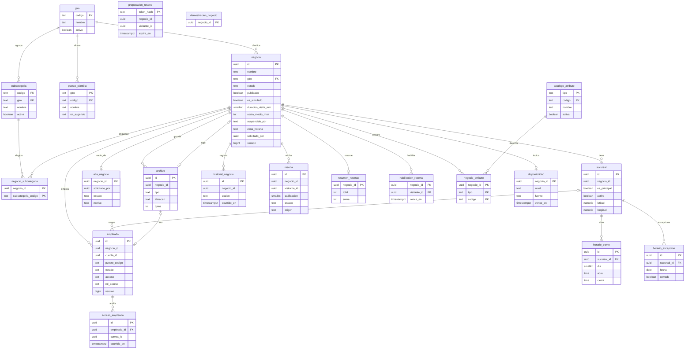

Las tablas `preparacion`, `evento_procesado` e `idempotencia` son de soporte y no se relacionan con las demás por llave foránea.

### 5.2 Tablas, columna por columna

#### `giro` (P1, global)
La **categoría principal** del negocio. Es un dato: agregar uno es una migración, no un cambio de código (D-94).

| Columna | Tipo | Nota |
|---|---|---|
| `codigo` | text PK | `RESTAURANTE`, `MISCELANEA`, `MUSEO` |
| `nombre` | text NN | Texto para la pantalla («Restaurante») |
| `activo` | boolean NN | Un giro inactivo no acepta altas nuevas |
| `orden` | int NN | Orden en el selector |

#### `subcategoria` (P1, global)
Las etiquetas del negocio. Pertenecen a un giro, pero un negocio puede elegir también las de otro (capacidad, D-97).

| Columna | Tipo | Nota |
|---|---|---|
| `codigo` | text PK | Único en todo el catálogo: `SIN_GLUTEN`, `HISTORIA`, ... |
| `giro` | text NN FK | Giro al que pertenece. Si no es el del negocio, se muestra como capacidad |
| `nombre` | text NN | «Sin gluten», «Gastronomía típica» |
| `orden` | int NN | |
| `activa` | boolean NN | Una subcategoría inactiva deja de poder elegirse; las ya elegidas se conservan |

Siembra inicial. **Restaurante** y **museo** vienen de `CLAUDE.md`: sin gluten, verano, mixto, gastronomía típica, comida corrida, extranjera; historia, cultura, arte. La de **miscelánea** la determinó el diseño (D-109), porque el equipo la dejó a su criterio:

| `codigo` | Nombre | Qué cubre | De dónde sale |
|---|---|---|---|
| `ABARROTES` | Abarrotes y bebidas | La miscelánea de barrio: abarrotes, bebidas y botanas envasadas | Grupo de abarrotes, alimentos, bebidas y tabaco del SCIAN (INEGI) |
| `DULCES_TIPICOS` | Dulces típicos | Camotes, borrachitos, alfeñique y similares | Dulcerías de la calle 6 Oriente; producto característico poblano |
| `ARTESANIAS` | Artesanías | Artesanía en general: barro, madera, papel amate, juguetes | Puestos de El Parián, el tianguis de Analco y el Mercado Hidalgo |
| `TALAVERA` | Talavera y cerámica | Loza y azulejo de talavera | Talleres y galerías de la calle 5 Oriente |
| `TEXTILES` | Textiles y bordados | Telas, rebozos y bordados a mano | Mercados de artesanías |
| `JOYERIA_PLATA` | Joyería, plata y bisutería | Joyería de plata y bisutería | Grupo de textiles, bisutería y accesorios del SCIAN |
| `ARTE_GALERIA` | Arte y galería | Obra de pintores y escultores | Talleres abiertos del Barrio del Artista |
| `ANTIGUEDADES` | Antigüedades y juguetes tradicionales | Antigüedades y juguetes de época | Callejón de los Sapos, en Analco |
| `PAPELERIA_REGALOS` | Papelería y regalos | Papelería, recuerdos y regalos | Grupo de papelería, esparcimiento y otros artículos del SCIAN |
| `ROPA_ACCESORIOS` | Ropa, calzado y accesorios | Ropa, calzado y accesorios | Grupo de textiles, bisutería y accesorios del SCIAN |

**Cómo se llegó a esta lista.** Se buscó (1) qué compra un turista en los lugares que nombra `CLAUDE.md` (mercado, Analco, Barrio del Artista) y en las guías de compras de Puebla, y (2) que cada subcategoría cuadre con un grupo de comercio al por menor del SCIAN, para poder cruzarla después con el DENUE. Se dejó en diez para no abrumar a quien elige. **Límite:** los grupos del SCIAN que se consultaron son los de la versión 2007 que cita un documento de INEGI; no se verificó su clave en la versión 2023 ni se cruzó con el DENUE. La lista es un dato (tabla), así que ajustarla es una migración y no un cambio de código.

#### `catalogo_atributo` (P1, global)
Las etiquetas que un negocio puede declarar de dieta y de accesibilidad (D-106). Las mantiene la plataforma.

| Columna | Tipo | Nota |
|---|---|---|
| `tipo` | text PK | `DIETA` o `ACCESIBILIDAD` |
| `codigo` | text PK | Único dentro de su tipo |
| `nombre` | text NN | «Vegana», «Acceso sin escalones» |
| `orden` | int NN | |
| `activa` | boolean NN | Una inactiva deja de ofrecerse; las ya declaradas se conservan |

Siembra inicial: **dieta:** `VEGETARIANA`, `VEGANA`, `SIN_GLUTEN`, `SIN_LACTOSA`, `SIN_FRUTOS_SECOS`. **Accesibilidad:** `ACCESO_SIN_ESCALONES`, `BANO_ACCESIBLE`, `ESTACIONAMIENTO_ACCESIBLE`, `SENALIZACION_BRAILLE`, `PERSONAL_LSM` (lengua de señas mexicana), `ACEPTA_PERROS_GUIA`. La lista es de diseño y el equipo no la ha visto (pregunta abierta 3).

#### `puesto_plantilla` (P1, global)
Puestos que ofrece cada giro. Un puesto es el cargo laboral; el **rol** de acceso es otra cosa y vive en Identidad (D-88, D-94).

| Columna | Tipo | Nota |
|---|---|---|
| `giro` | text PK FK | |
| `codigo` | text PK | Por ejemplo `COCINERO`, `TAQUILLERO` |
| `nombre` | text NN | |
| `rol_sugerido` | text | Código de rol de Identidad que se sugiere al dar acceso. Sin llave foránea. Nulo en `OTRO` |
| `orden` | int NN | |

Siembra inicial: los puestos de la plantilla de cada giro (D-69) más `OTRO` en todos, que pide `puesto_detalle`. Puestos propios de cada negocio llegan en P2.

#### `negocio` (P1)
El negocio. Su `id` lo asigna Identidad al pedir el alta y viaja en el sobre del evento (D-89).

| Columna | Tipo | Nota |
|---|---|---|
| `id` | uuid PK | UUIDv7. Viene de `negocio.registro_solicitado` |
| `nombre` | varchar(80) NN | 2 a 80 caracteres, sin caracteres de control (NG-01) |
| `giro` | text NN FK | No cambia en el MVP (NG-13) |
| `estado` | text NN | `ACTIVO`, `SUSPENDIDO` o `CERRADO` |
| `suspendido_por` | text | `DUENO` o `PLATAFORMA`. Nulo si no está suspendido (NG-14) |
| `publicado` | boolean NN | Si aparece en la app del turista. `false` por omisión (PU-01) |
| `descripcion` | varchar(280) | |
| `telefono_contacto` | varchar(16) | E.164. Es el del negocio, no el del dueño (NG-09) |
| `correo_contacto` | varchar(120) | En minúsculas |
| `contacto_publico` | boolean NN | Si el teléfono y el correo del negocio se muestran al turista. `false` por omisión (PU-04) |
| `duracion_visita_min` | smallint | Cuánto suele durar una visita, de 5 a 480 minutos. Opcional y declarada (AT-03) |
| `costo_medio_mxn` | int | Gasto medio por persona en pesos, de 0 a 100 000. Opcional y declarado (AT-03) |
| `es_simulado` | boolean NN | `true` en los negocios de demostración. Solo lo escribe la siembra: ninguna mutación lo acepta (DM-01) |
| `zona_horaria` | text NN | `America/Mexico_City` por omisión |
| `logo_archivo_id` | uuid FK | |
| `solicitado_por` | uuid NN | Cuenta que pidió el alta (el dueño inicial). Sin llave foránea |
| `responsabilidad_personal_aceptada_en` | timestamptz | Cuándo el dueño aceptó ser el responsable de los datos de su personal (EM-17, D-102) |
| `responsabilidad_personal_version` | int | Versión del texto que aceptó |
| `motivo_estado` | varchar(80) | Código del último cambio de estado |
| `creado_en`, `actualizado_en` | timestamptz NN | |
| `cerrado_en` | timestamptz | |
| `version` | bigint NN | Bloqueo optimista (NG-10) |

#### `negocio_subcategoria` (P1)
Las subcategorías que el negocio eligió. Hasta 8 (CA-01).

| Columna | Tipo | Nota |
|---|---|---|
| `negocio_id` | uuid PK FK | |
| `subcategoria_codigo` | text PK FK | |
| `creada_en` | timestamptz NN | |

#### `negocio_atributo` (P1)
Las etiquetas de dieta y accesibilidad que el negocio declaró (D-106). Hasta 10 por tipo (AT-02).

| Columna | Tipo | Nota |
|---|---|---|
| `negocio_id` | uuid PK FK | |
| `tipo` | text PK | `DIETA` o `ACCESIBILIDAD` |
| `codigo` | text PK FK | Con `tipo`, apunta a `catalogo_atributo` |
| `creada_en` | timestamptz NN | |

#### `disponibilidad` (P1)
El nivel de afluencia o de cupo que el negocio declara hoy (D-107). Una fila por negocio; se reemplaza.

| Columna | Tipo | Nota |
|---|---|---|
| `negocio_id` | uuid PK | |
| `nivel` | text NN | `LIBRE`, `MODERADA` o `LLENA` (DI-01) |
| `nota` | varchar(80) | Texto corto, por ejemplo «Mesas en la terraza» |
| `fuente` | text NN | `MANUAL` (P1) o `VERTICAL` (P2) |
| `declarada_por` | uuid | Cuenta que la declaró. Nulo si vino de un vertical |
| `declarada_en` | timestamptz NN | |
| `vence_en` | timestamptz NN | Tres horas después de declararse (DI-03) |
| `ocurrido_en_origen` | timestamptz | P2: la hora del evento del vertical, para ignorar eventos viejos (DI-06) |

#### `alta_negocio` (P1)
El resultado de cada petición de alta, para poder responderle a la persona aunque el negocio no haya nacido. **Su seguridad por fila es por cuenta** (`solicitado_por = plataforma.cuenta_actual()`), no por negocio, porque cuando se rechaza no hay negocio.

| Columna | Tipo | Nota |
|---|---|---|
| `negocio_id` | uuid PK | El id que trajo el evento. Hace idempotente el alta (NG-03) |
| `solicitado_por` | uuid NN | |
| `nombre` | varchar(80) NN | Lo que pidió, sin validar |
| `giro` | text NN | Lo que pidió. Sin llave foránea: puede ser inválido |
| `estado` | text NN | `REGISTRADO` o `RECHAZADO` |
| `motivo` | text | `GIRO_INVALIDO` o `NOMBRE_INVALIDO` cuando se rechaza |
| `evento_id` | uuid NN | Evento que la originó |
| `recibido_en`, `resuelto_en` | timestamptz NN | |

Se purga a los 90 días.

#### `sucursal` (P1)
Un local del negocio. En P1 hay **una**, la principal, que se crea sola con el alta (NG-08).

| Columna | Tipo | Nota |
|---|---|---|
| `id` | uuid PK | |
| `negocio_id` | uuid NN FK | |
| `nombre` | varchar(60) NN | «Principal» por omisión |
| `es_principal` | boolean NN | Único por negocio entre las activas (SU-01) |
| `activa` | boolean NN | |
| `calle`, `numero` | varchar(80), varchar(20) | |
| `colonia`, `municipio` | varchar(80) | |
| `entidad_federativa` | varchar(40) | |
| `codigo_postal` | char(5) | Cinco dígitos (SU-04) |
| `referencias` | varchar(200) | «Frente al mercado, local 12» |
| `latitud`, `longitud` | numeric(9,6) | Ambas o ninguna (SU-03) |
| `telefono` | varchar(16) | E.164 |
| `creada_en`, `actualizada_en` | timestamptz NN | |
| `version` | bigint NN | Bloqueo optimista de la dirección |
| `horario_version` | bigint NN | Bloqueo optimista del horario semanal, aparte del de la dirección (NG-10). Migración V031 |

#### `horario_tramo` (P1)
Un tramo de apertura de un día. Sin filas un día se entiende cerrado. Hasta tres tramos por día (HO-02), por ejemplo desayunos y cenas.

| Columna | Tipo | Nota |
|---|---|---|
| `id` | uuid PK | |
| `negocio_id` | uuid NN | |
| `sucursal_id` | uuid NN FK | |
| `dia` | smallint NN | 1 lunes a 7 domingo |
| `abre`, `cierra` | time NN | Si `cierra` es menor que `abre`, el tramo cruza la medianoche (HO-01) |

#### `horario_excepcion` (P1)
Un día distinto al horario semanal: un festivo cerrado o un horario especial.

| Columna | Tipo | Nota |
|---|---|---|
| `id` | uuid PK | |
| `negocio_id` | uuid NN | |
| `sucursal_id` | uuid NN FK | |
| `fecha` | date NN | Única por `(sucursal_id, fecha)` (HO-03) |
| `cerrado` | boolean NN | Si es verdadero, `abre` y `cierra` van nulos |
| `abre`, `cierra` | time | Obligatorios si no está cerrado |
| `motivo` | varchar(80) | |

#### `empleado` (P1)
La ficha laboral. Es el equivalente de `ClinicStaff`. **Nombre, apellidos y contacto son datos personales** (sección 11); el responsable es el patrón (D-102).

| Columna | Tipo | Nota |
|---|---|---|
| `id` | uuid PK | UUIDv7. Es la `referencia_externa` que se le da a Identidad (D-96) |
| `negocio_id` | uuid NN | |
| `cuenta_id` | uuid | Cuenta de Identidad ligada, si tiene acceso. Única por negocio entre las no nulas (EM-03). Sin llave foránea |
| `codigo_empleado` | varchar(12) NN | `E-0001`, consecutivo por negocio (EM-13) |
| `nombre`, `apellidos` | varchar(80) | Obligatorios salvo en `POR_COMPLETAR` (EM-01) |
| `puesto_codigo` | text NN | Debe existir en la plantilla del giro (EM-01) |
| `puesto_detalle` | varchar(60) | Solo con `OTRO` |
| `sucursal_id` | uuid FK | Nulo = todas |
| `telefono` | varchar(16) | E.164. Opcional |
| `correo` | varchar(120) | Opcional |
| `fecha_ingreso` | date NN | |
| `fecha_baja` | date | Posterior o igual al ingreso (EM-05) |
| `estado` | text NN | `POR_COMPLETAR`, `ACTIVO`, `SUSPENDIDO` o `BAJA` |
| `acceso` | text NN | `SIN_ACCESO`, `ACTIVO`, `SUSPENDIDO` o `REVOCADO` (`INVITADO` en P2). **Solo lectura**: lo escribe el listener de Identidad (EM-09) |
| `rol_acceso` | text | Código del rol en Identidad. Copia de solo lectura |
| `foto_archivo_id` | uuid FK | P2 |
| `notas` | varchar(500) | Sin datos sensibles (EM-11) |
| `creado_por` | uuid | Cuenta que la creó. Nulo si la creó el sistema |
| `creado_en`, `actualizado_en` | timestamptz NN | |
| `version` | bigint NN | |

#### `archivo` (P1 para el logo; P2 para fotos de empleados)
Los bytes no viven en la base: viven en el almacén de archivos (D-101).

| Columna | Tipo | Nota |
|---|---|---|
| `id` | uuid PK | |
| `negocio_id` | uuid NN | |
| `tipo` | text NN | `LOGO` o `FOTO_EMPLEADO` |
| `almacen` | text NN | `DISCO` (desarrollo) o `BUCKET` (producción) |
| `mime` | text NN | `image/jpeg`, `image/png` o `image/webp` |
| `bytes` | int NN | Hasta 2 MB (AR-02) |
| `ancho`, `alto` | int NN | |
| `sha256` | char(64) NN | |
| `ubicacion` | text NN | Clave del objeto en el almacén. Nunca una URL: la URL se firma al servirla |
| `creado_por` | uuid NN | |
| `creado_en` | timestamptz NN | Un archivo sin referencia se purga a las 24 horas |

#### `resena` (P1 en modo demostración)
Lo que un turista opina de un negocio. Pertenece al negocio (D-98). El autor es solo un seudónimo.

| Columna | Tipo | Nota |
|---|---|---|
| `id` | uuid PK | |
| `negocio_id` | uuid NN | |
| `visitante_id` | uuid NN | Seudónimo del autor, sin llave foránea. En P1 es el id de dispositivo que genera la app (RS-11); en P2, el de Visitantes. Único por `(negocio_id, visitante_id)` (RS-02) |
| `calificacion` | smallint NN | De 1 a 5 (RS-03) |
| `comentario` | varchar(1000) | Opcional. Texto libre: puede traer datos personales (SN-13) |
| `estado` | text NN | `PUBLICADA` u `OCULTA` (moderación de la plataforma) |
| `origen` | text NN | `DEMOSTRACION` (P1, sin cuenta y sin sello) o `VISITANTE` (P2). Las reseñas de demostración salen rotuladas (DM-05) |
| `respuesta` | varchar(500) | La del negocio. Una por reseña (RS-04) |
| `respondida_por` | uuid | Cuenta que respondió |
| `respondida_en` | timestamptz | |
| `creada_en`, `editada_en` | timestamptz | |
| `version` | bigint NN | |

#### `habilitacion_resena` (P2)
Quién puede reseñar a este negocio. Se llena al escuchar `sello.otorgado` (D-38, RS-01).

| Columna | Tipo | Nota |
|---|---|---|
| `negocio_id` | uuid PK | |
| `visitante_id` | uuid PK | |
| `evento_id` | uuid NN | El `sello.otorgado` que la originó. Hace idempotente la habilitación (RS-07) |
| `habilitada_en` | timestamptz NN | |
| `vence_en` | timestamptz NN | 30 días después. Se purga al vencer |
| `usada_en` | timestamptz | Cuándo escribió la reseña |

#### `resumen_resenas` (P1)
El resumen que ve el turista, siempre consistente con las reseñas (RS-06). El promedio lo calcula el código.

| Columna | Tipo | Nota |
|---|---|---|
| `negocio_id` | uuid PK | |
| `total` | int NN | Reseñas `PUBLICADA` |
| `suma` | int NN | Suma de calificaciones |
| `c1`, `c2`, `c3`, `c4`, `c5` | int NN | Cuántas reseñas hay de cada calificación |
| `actualizado_en` | timestamptz NN | |

#### `preparacion_resena` (P1, sin seguridad por negocio)
Una reseña preparada y aún sin confirmar (RS-09, D-23). **Como quedó programada (N6)** es una tabla propia y no la `preparacion` general de N4: el turista no tiene sesión ni negocio activo, así que el token se busca solo por su hash, de 256 bits. Se purgan las vencidas con dos horas de margen cada vez que alguien prepara una (el comentario a medias es de un tercero, SN-13).

| Columna | Tipo | Nota |
|---|---|---|
| `token_hash` | char(64) PK | Solo el hash |
| `negocio_id` | uuid NN | El negocio que se va a reseñar |
| `visitante_id` | uuid NN | El id de dispositivo que la pidió. Solo ese dispositivo la confirma |
| `calificacion` | smallint NN | De 1 a 5 |
| `comentario` | varchar(1000) | Se vacía al confirmar (SN-09): la base impone que una usada no lo conserve |
| `creada_en`, `expira_en` | timestamptz NN | 5 minutos (D-23). `creada_en` sirve al límite de 5 por hora (RS-11) |
| `usada_en` | timestamptz | |

#### `demostracion_negocio` (P1, sin seguridad por negocio)
Los ids de los negocios simulados de la demo, para poder restablecerlos sin leer ningún otro negocio (DM-04). Solo ids.

| Columna | Tipo | Nota |
|---|---|---|
| `negocio_id` | uuid PK FK | Lo anota la siembra junto con `negocio.es_simulado` |

#### `historial_negocio` (P1)
Quién cambió qué. **Solo inserción** (reutiliza `plataforma.rechazar_modificacion`). Guarda los **nombres de los campos** cambiados, nunca sus valores (SN-05).

| Columna | Tipo | Nota |
|---|---|---|
| `id` | uuid PK | |
| `negocio_id` | uuid NN | |
| `ocurrido_en` | timestamptz NN | |
| `cuenta_id` | uuid | Nulo si lo hizo el sistema o la plataforma |
| `accion` | text NN | `ALTA`, `EDICION_NEGOCIO`, `SUBCATEGORIAS`, `PUBLICACION`, `ESTADO`, `SUCURSAL`, `HORARIO`, `EMPLEADO_AGREGADO`, `EMPLEADO_EDITADO`, `EMPLEADO_BAJA`, `ACCESO_ENLAZADO`, `RESPONSABILIDAD_PERSONAL` |
| `entidad_id` | uuid | Sucursal o empleado afectado |
| `campos` | text[] | Nombres de campo |

#### `acceso_empleado` (P1)
Cada vez que alguien abre la ficha completa de un empleado, con su contacto (SN-04). Es la contraparte de `acceso_cliente` en Clientes.

| Columna | Tipo | Nota |
|---|---|---|
| `id` | uuid PK | |
| `negocio_id` | uuid NN | |
| `empleado_id` | uuid NN FK | |
| `cuenta_id` | uuid NN | Quién la abrió |
| `ocurrido_en` | timestamptz NN | |

#### `preparacion` (P1)
Soporte del patrón preparar → confirmar (D-55). Igual que en Clientes.

| Columna | Tipo | Nota |
|---|---|---|
| `token_hash` | text PK | Solo el hash |
| `negocio_id` | uuid NN | |
| `cuenta_id` | uuid NN | Quien preparó. Solo él confirma |
| `tipo` | text NN | `DAR_DE_BAJA_EMPLEADO`, `CERRAR_NEGOCIO` o `PUBLICAR_RESENA` (P2) |
| `comando` | jsonb | Se vacía al confirmar (SN-09) |
| `resumen` | text NN | Lo que se le mostró a la persona |
| `expira_en` | timestamptz NN | 5 minutos (D-23) |
| `usada_en` | timestamptz | |

#### `evento_procesado` (P1)

| Columna | Tipo | Nota |
|---|---|---|
| `consumidor` | text PK | `negocios` |
| `evento_id` | uuid PK | |
| `procesado_en` | timestamptz NN | Se purga pasados 90 días |

#### `idempotencia` (P1)
Una red móvil se corta a media petición y la app reintenta. Con una llave por operación, el reintento devuelve lo mismo y no crea otro empleado (AP-03).

| Columna | Tipo | Nota |
|---|---|---|
| `clave_hash` | text PK | Hash de `Idempotency-Key` más la cuenta |
| `negocio_id` | uuid NN | |
| `operacion` | text NN | `registrarEmpleado`, `agregarSucursal` |
| `resultado_id` | uuid NN | Id de lo que se creó |
| `creada_en` | timestamptz NN | Se purga a las 24 horas |

### 5.3 Ciclos de vida

<!-- fig: EST1 | Negocio | Un negocio nace activo cuando el módulo lo registra. El dueño lo puede pausar y reanudar; la plataforma lo puede suspender y solo ella lo reanuda. Un negocio cerrado no vuelve (NG-05). -->
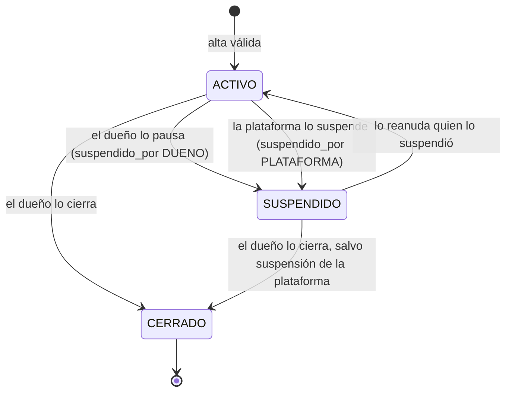

<!-- fig: EST2 | Empleado | `POR_COMPLETAR` es la ficha que se crea sola cuando alguien entra con acceso y no tenía ficha. La baja conserva el historial y se puede reactivar. -->
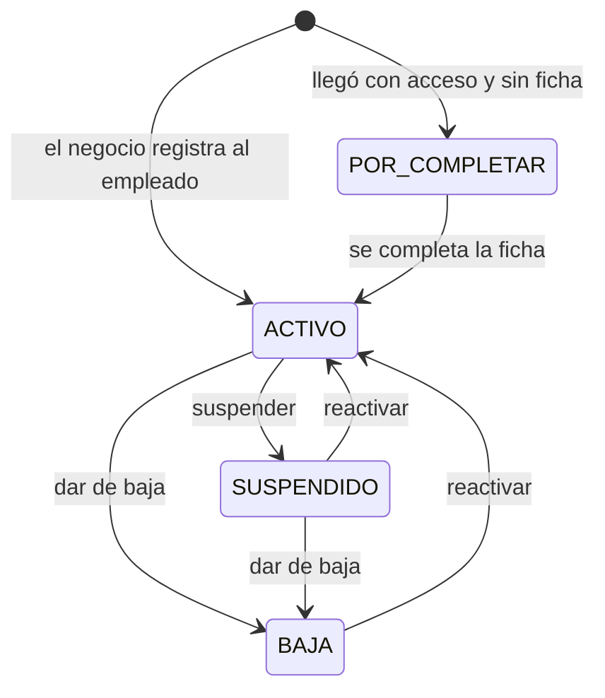

<!-- fig: EST3 | Acceso del empleado (reflejo de Identidad) | Negocios no decide estos estados: los copia de los eventos de membresía. Un empleado puede no tener acceso nunca (SIN_ACCESO es un estado normal). `INVITADO` es P2 y exige un evento nuevo de Identidad. -->
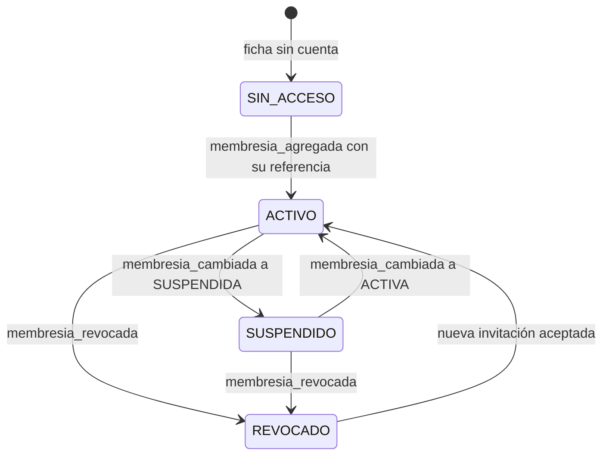

<!-- fig: EST4 | Alta del negocio | Lo que ve la persona que pidió el alta. El rechazo solo ocurre si el giro o el nombre no sirven. -->
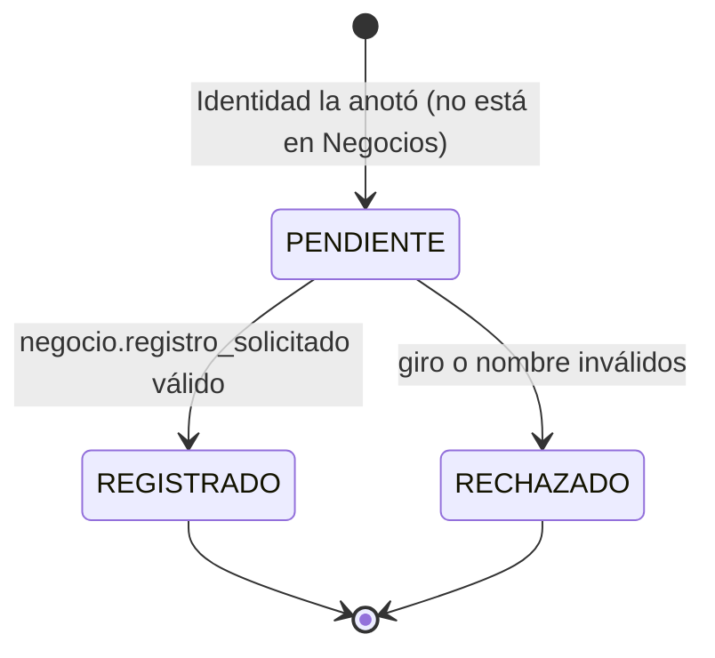

<!-- fig: EST5 | Reseña | En P1 (modo demostración) se publica sin habilitación; con Visitantes (P2) hace falta una habilitación vigente. El negocio responde, pero no puede editar ni borrar. Ocultar es de la plataforma. -->
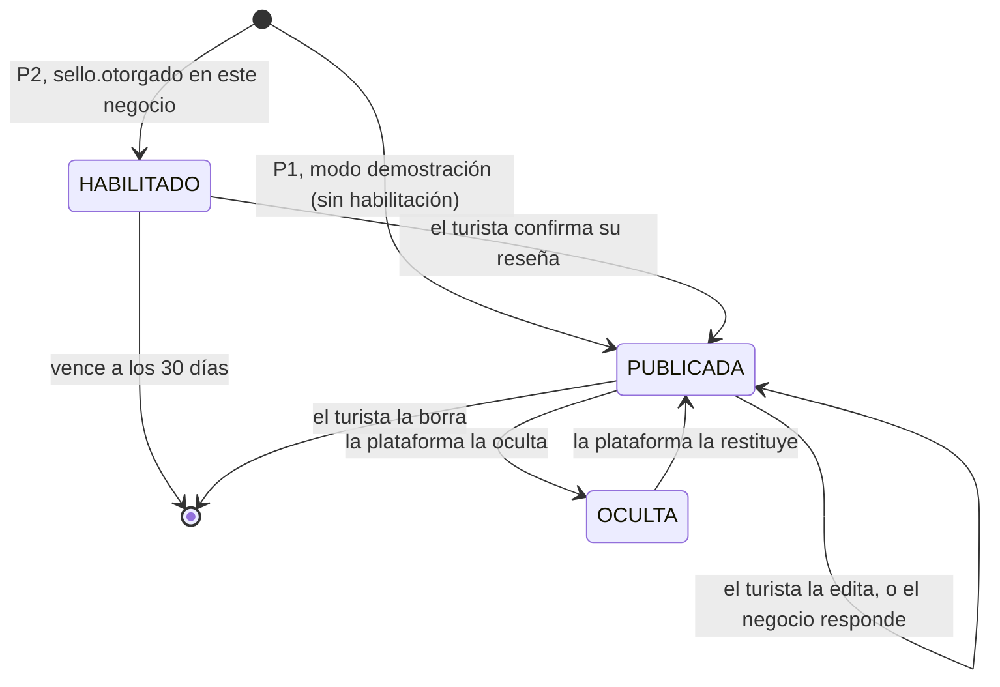

### 5.4 Vistas públicas

La app del turista no lee las tablas base: lee dos **vistas de solo lectura** que exponen solo columnas permitidas y solo filas visibles (PU-03). Las crea el dueño del esquema y la aplicación solo tiene `SELECT` sobre ellas en la ruta pública. **Como quedó programada (N3):** es una sola vista, `v_negocio_publico`, con las listas (subcategorías, atributos, horario y excepciones) como `jsonb`; la ruta pública hace `SET LOCAL ROLE rol_negocios_publico` dentro de su transacción y ese rol no tiene permiso sobre ninguna tabla base. Las tablas base tienen seguridad por fila forzada, y el dueño de la vista tiene una política de solo lectura para que la vista las lea (migración V032).

| Vista | Qué expone | Filas visibles |
|---|---|---|
| `v_negocio_publico` | `id`, `nombre`, `giro`, `descripcion`, logo, subcategorías, la sucursal principal (dirección, coordenadas), horario, zona horaria, `telefono` y `correo` solo si `contacto_publico`, los atributos declarados, la disponibilidad vigente, la marca `simulado` y el resumen de calificaciones | `estado = 'ACTIVO'` y `publicado = true` |
| `v_resena_publica` | `id`, `negocio_id`, `calificacion`, `comentario`, `creada_en`, la respuesta y su fecha. **Nunca** `visitante_id` ni `respondida_por` | Reseñas `PUBLICADA` de un negocio de la vista anterior |

---

## 6. Reglas de dominio

Cada regla tiene una prueba de aceptación (columna «Prueba»). La letra del identificador dice el grupo: **NG** negocio, **CA** categorías, **PU** publicación y superficie pública, **SU** sucursal, **HO** horario, **EM** empleado, **AL** alta, **RS** reseñas, **AT** atributos, **DI** disponibilidad, **DM** demostración, **EV** eventos, **AR** archivos.

### 6.1 Negocio (NG)

| ID | Regla | Prueba |
|---|---|---|
| NG-01 | El nombre tiene de 2 a 80 caracteres, sin caracteres de control ni de formato, y los espacios sobrantes se colapsan. Reutiliza la lógica de `NombreVisible`. | Nombres de 1 y 81 caracteres y uno con `\u0000` fallan con `NOMBRE_INVALIDO`. |
| NG-02 | El giro debe existir y estar activo en el catálogo. | `FARMACIA` falla con `GIRO_INVALIDO`. |
| NG-03 | Procesar dos veces el mismo `negocio.registro_solicitado` deja un solo negocio y no publica `negocio.registrado` por segunda vez. | Entregar el evento dos veces: una fila y un evento en el outbox. |
| NG-04 | Estados: `ACTIVO` a `SUSPENDIDO` y de vuelta; `ACTIVO` o `SUSPENDIDO` a `CERRADO`. Cada cambio publica `negocio.estado_cambiado` con quién lo originó. | Una transición no permitida falla con `ESTADO_INVALIDO`. |
| NG-05 | Un negocio `CERRADO` no se edita, no se reabre y no admite empleados nuevos. Se registra otro. | Editar uno cerrado falla con `NEGOCIO_CERRADO`. |
| NG-06 | Cerrar exige el permiso sensible `negocios.negocio.cerrar` (solo el dueño) y pasa por preparar → confirmar. | Un administrador recibe `PERMISO_DENEGADO`. Confirmar sin preparar falla. |
| NG-07 | Al cerrar, las sucursales y los horarios se conservan y los empleados no se dan de baja uno por uno: el estado del negocio manda y los demás módulos reaccionan al evento. | Tras cerrar, `miNegocio` devuelve `CERRADO` y los empleados siguen consultables. |
| NG-08 | Todo negocio nace con una sucursal principal llamada «Principal», sin dirección y con el horario vacío. | Tras el alta existe exactamente una sucursal con `es_principal = true`. |
| NG-09 | El teléfono y el correo de contacto, si vienen, tienen formato válido (E.164 mexicano y correo en minúsculas). Son los del negocio. | `123` y `a@` fallan con `CONTACTO_INVALIDO`. |
| NG-10 | Toda edición lleva la `version` que la persona vio. Si cambió mientras tanto, falla con `CONCURRENCIA` sin pisar nada. | Dos ediciones con la misma versión: la segunda falla. |
| NG-11 | La completitud del perfil (porcentaje y lista de faltantes) se calcula solo con código: nombre y giro (ya están), ubicación, horario, contacto y logo. | Un negocio recién dado de alta devuelve 40 % y los cuatro faltantes. |
| NG-12 | Un negocio no se borra. Se cierra. | No existe una función de borrado. |
| NG-13 | El **giro** no cambia en el MVP: determina los puestos, la plantilla de roles y la extensión del vertical. Cambiarlo es P2, con migración. Las subcategorías sí cambian (CA). | `actualizarNegocio` no acepta `giro`. |
| NG-14 | Hay dos formas de `SUSPENDIDO`: la **pausa del dueño** (`suspendido_por = DUENO`), que solo el dueño reanuda, y la **suspensión de la plataforma** (`PLATAFORMA`), que solo la plataforma levanta. Una suspensión de la plataforma no se puede cerrar ni reanudar desde el panel. Mientras está suspendido el negocio no se ve en la app y solo admite lectura y su reanudación. | El dueño no puede reanudar una suspensión de la plataforma: `SUSPENDIDO_POR_PLATAFORMA`. Escribir en un negocio suspendido falla con `NEGOCIO_SUSPENDIDO`. |
| NG-15 | Solo el dueño pausa o cierra (`negocios.negocio.pausar`, `negocios.negocio.cerrar`). La plataforma suspende por la vía de administración y deja `suspendido_por`, el motivo y quién lo hizo en `historial_negocio`. Ningún empleado puede hacerlo. | Un gerente recibe `PERMISO_DENEGADO`. |

### 6.2 Categorías y subcategorías (CA)

| ID | Regla | Prueba |
|---|---|---|
| CA-01 | Todo negocio tiene **un** giro principal (su categoría) y puede tener de cero a ocho subcategorías. | Elegir nueve falla con `SUBCATEGORIAS_EXCEDIDAS`. |
| CA-02 | Las subcategorías elegidas deben existir y estar activas, sin repetirse. | `INEXISTENTE` falla con `SUBCATEGORIA_INVALIDA`. |
| CA-03 | Un negocio puede elegir subcategorías de **otro** giro (capacidades). La respuesta marca `capacidad = true` cuando la subcategoría no es del giro principal. | Un restaurante con `ARTESANIAS` la devuelve con `capacidad = true`. |
| CA-04 | Una subcategoría **no activa** el vertical de otro giro: la extensión de vertical depende solo del giro principal. | Elegir una subcategoría de museo en un restaurante no crea una fila en `museos`. |
| CA-05 | Los catálogos de giros y subcategorías los mantiene la plataforma. El negocio no crea ni edita subcategorías. | No existe una mutación para crearlas. |
| CA-06 | Cambiar las subcategorías guarda el conjunto completo en una transacción y publica `negocio.actualizado` con el campo `subcategorias`. | Un conjunto con un código inválido no cambia nada. |
| CA-07 | Una subcategoría que se desactiva sigue en los negocios que ya la tenían, pero deja de ofrecerse para elegir y de usarse como filtro nuevo. | Desactivar una subcategoría no borra filas de `negocio_subcategoria`. |

### 6.3 Publicación y superficie pública (PU)

| ID | Regla | Prueba |
|---|---|---|
| PU-01 | El negocio aparece en la app del turista solo si el dueño lo **publicó**, está `ACTIVO`, su sucursal principal tiene coordenadas y su horario tiene al menos un tramo. Publicarlo sin eso falla con `PUBLICACION_INCOMPLETA`, que dice qué falta. | Publicar un negocio recién dado de alta falla y lista `UBICACION` y `HORARIO`. |
| PU-02 | Si el negocio pasa a `SUSPENDIDO` o `CERRADO` deja de verse en la app sin tocar su bandera `publicado`: al reanudarse vuelve solo. | Pausar y reanudar devuelve el negocio a la búsqueda pública. |
| PU-03 | La superficie pública lee solo las vistas públicas. Devuelve una lista **permitida** de campos y nunca empleados, notas, ids de cuenta, `visitante_id` ni datos del dueño. | Ninguna consulta pública devuelve esos campos, ni con alias. |
| PU-04 | El teléfono y el correo del negocio solo se muestran al turista si el dueño marcó `contacto_publico`. | Con `contacto_publico = false` ambos vienen nulos. |
| PU-05 | Las consultas públicas funcionan sin sesión, con tasa por IP, hasta 20 por página y búsqueda por cercanía de hasta 25 km. | Pedir 500 negocios devuelve 20; un radio de 100 km, un texto de 81 caracteres o un cursor roto fallan con `CONSULTA_INVALIDA`. |
| PU-06 | «Abierto ahora» es el de HO-04, calculado en el servidor. | Con reloj fijo, el mismo negocio sale abierto o cerrado según la hora. |

### 6.4 Sucursal (SU)

| ID | Regla | Prueba |
|---|---|---|
| SU-01 | Entre las sucursales activas hay **exactamente una** principal. | Desactivar la única principal falla con `SUCURSAL_UNICA`. |
| SU-02 | En P1 el negocio tiene una sola sucursal. El límite (`max_sucursales`) es una regla versionada, no una constante. | Agregar una segunda en P1 falla con `LIMITE_DE_SUCURSALES`. |
| SU-03 | Latitud entre −90 y 90 y longitud entre −180 y 180, ambas o ninguna. | Solo latitud, o latitud 91, falla con `COORDENADAS_INVALIDAS`. |
| SU-04 | El código postal, si viene, tiene cinco dígitos. | `7200` falla con `CODIGO_POSTAL_INVALIDO`. |

### 6.5 Horario (HO)

| ID | Regla | Prueba |
|---|---|---|
| HO-01 | Un tramo con `cierra` menor que `abre` cruza la medianoche. Dos tramos del mismo día no se traslapan, ni contando el que viene del día anterior. | 20:00–02:00 el sábado y 01:00–03:00 el domingo falla con `HORARIO_INVALIDO`. |
| HO-02 | Hasta tres tramos por día. | El cuarto falla con `TRAMOS_EXCEDIDOS`. |
| HO-03 | Una sola excepción por sucursal y fecha. Una excepción cerrada no lleva horas; una abierta las exige. | Duplicar la fecha falla con `EXCEPCION_DUPLICADA`. |
| HO-04 | «Abierto ahora» se calcula en el servidor con la zona horaria del negocio y la excepción del día si la hay. Nunca en el celular. | Con un reloj fijo, el mismo horario da distinto resultado en dos zonas. |
| HO-05 | Guardar el horario reemplaza la semana completa en una sola transacción: no queda a medias. | Una semana con un tramo inválido no cambia nada. |

### 6.6 Empleado (EM)

| ID | Regla | Prueba |
|---|---|---|
| EM-01 | Nombre y apellidos de 2 a 80 caracteres, obligatorios salvo en `POR_COMPLETAR`. El puesto debe existir en la plantilla del giro del negocio; `OTRO` exige `puesto_detalle`. | `COCINERO` en un museo falla con `PUESTO_INVALIDO`. |
| EM-02 | Una ficha pertenece a un solo negocio. Una cuenta puede tener una ficha en cada negocio donde trabaja. | La misma cuenta en dos negocios da dos fichas. |
| EM-03 | `cuenta_id` es único por negocio entre las fichas que lo tienen. | Enlazar dos fichas a la misma cuenta falla. |
| EM-04 | El teléfono y el correo del empleado son opcionales; si vienen, tienen formato válido. No son únicos. **Hay empleados con acceso a la plataforma y otros sin él**: `SIN_ACCESO` es un estado normal. | Una ficha sin contacto y sin cuenta se guarda y se lista. |
| EM-05 | `fecha_ingreso` no es futura. `fecha_baja` no es anterior al ingreso. | `FECHA_INVALIDA`. |
| EM-06 | Estados: `ACTIVO`, `SUSPENDIDO`, `BAJA` y `POR_COMPLETAR`. La baja conserva la ficha y se puede reactivar. Un empleado de baja no se edita. | Editar uno de baja falla con `EMPLEADO_DE_BAJA`. |
| EM-07 | No se da de baja ni se suspende al último dueño con acceso activo del negocio. | `ULTIMO_DUENO`. |
| EM-08 | Nadie se da de baja ni se suspende a sí mismo. | `OPERACION_SOBRE_SI_MISMO`. |
| EM-09 | El acceso y el rol de acceso **no se editan en Negocios**: los escribe el listener de los eventos de Identidad. | Ninguna mutación de Negocios acepta `acceso` ni `rol`. |
| EM-10 | La baja no borra: la ficha se conserva. El **patrón decide** cuándo anonimizarla (`anonimizarEmpleado`, P2); la plataforma no la borra por su cuenta. | Tras la baja la ficha sigue consultable. |
| EM-11 | Las notas tienen hasta 500 caracteres y la interfaz avisa que no deben llevar salud, religión ni otros datos sensibles. | `NOTAS_MUY_LARGAS`. |
| EM-12 | La foto del empleado es opcional y es un archivo propio del negocio (P2). | Una foto de otro negocio responde igual que una inexistente. |
| EM-13 | El `codigo_empleado` es consecutivo por negocio (`E-0001`) y no se reutiliza. | Dar de baja a `E-0002` y registrar otro da `E-0003`. |
| EM-14 | Las listas muestran nombre, puesto, estado y acceso. El teléfono, el correo y las notas solo salen en la ficha, a quien tenga `negocios.empleado.editar`, y cada apertura queda en `acceso_empleado`. | Ninguna consulta de lista devuelve contacto. Abrir una ficha crea una fila. |
| EM-15 | Al llegar `identidad.membresia_agregada`: si trae `referencia_externa`, se ata esa ficha a la cuenta; si no la trae y la cuenta no tiene ficha, se crea una `POR_COMPLETAR`. Es idempotente. | El mismo evento dos veces deja una ficha. |
| EM-16 | Cada persona puede completar **su** ficha (`completarMiFicha`): nombre, apellidos, teléfono, correo y foto. No puede cambiar su puesto, su estado ni su acceso. | Un cajero que intenta cambiar su puesto recibe `PERMISO_DENEGADO`. |
| EM-17 | **El patrón es el responsable** de los datos de su personal y la plataforma es la persona encargada (D-102). Antes de registrar a su primer empleado el dueño acepta esa responsabilidad (`aceptarResponsabilidadDePersonal`); queda la fecha y la versión del texto. | Registrar un empleado sin esa aceptación falla con `RESPONSABILIDAD_NO_ACEPTADA`. |
| EM-18 | La ficha del dueño, creada sola al alta (AL-03), no exige EM-17: registrar a otros sí. | El dueño completa su ficha sin haber aceptado; registrar a otro falla. |

### 6.7 Alta del negocio (AL)

| ID | Regla | Prueba |
|---|---|---|
| AL-01 | El alta es automática si el giro y el nombre son válidos: no hay aprobación humana en el MVP (D-90). | Un evento válido deja un negocio `ACTIVO` sin intervención. |
| AL-02 | Si el giro o el nombre no sirven, se registra `RECHAZADO` con su motivo y se publica `negocio.registro_rechazado`. No se crea el negocio. | Un evento con `FARMACIA` deja `alta_negocio` en `RECHAZADO` y un evento en el outbox. |
| AL-03 | El `solicitado_por` del evento es el dueño inicial: la ficha del dueño se crea al llegar `identidad.membresia_agregada` con origen `DUENO_INICIAL`, no antes. | Antes de la membresía no hay ficha. Después, una `POR_COMPLETAR` con puesto `DUENO`. |
| AL-04 | La persona solo ve sus propias altas (`alta_negocio` con seguridad por cuenta). Una alta ajena responde igual que una inexistente. | Con dos cuentas, la A no ve la alta de la B. |
| AL-05 | Un negocio nace **sin publicar**: el dueño decide cuándo aparece (PU-01). | Tras el alta, `publicado = false`. |

### 6.8 Reseñas (RS; P1 en modo demostración, lo demás P2)

| ID | Regla | Prueba |
|---|---|---|
| RS-01 | Quién puede reseñar lo manda la configuración `negocios.resenas.requiere_habilitacion`. En **P1 está apagada** y cualquier turista con su dispositivo puede reseñar (DM-03). En **P2** se enciende: solo reseña quien tiene una habilitación vigente en ese negocio, que nace de un sello (`sello.otorgado`, D-38) y vale 30 días. | Encendida y sin habilitación: `RESENA_NO_HABILITADA`. Apagada: se publica. |
| RS-02 | Hay una reseña por autor y negocio. Editarla o borrarla es P2. | Una segunda reseña del mismo autor falla con `RESENA_YA_EXISTE`. |
| RS-03 | La calificación es un entero de 1 a 5. El comentario es opcional, de hasta 1000 caracteres y sin caracteres de control. | 0, 6 y 2,5 fallan con `CALIFICACION_INVALIDA`. |
| RS-04 | El negocio responde **una** vez por reseña (hasta 500 caracteres), con `negocios.resena.responder`. No puede editarla, borrarla ni ocultar la reseña. | Una segunda respuesta falla con `RESENA_YA_RESPONDIDA`. |
| RS-05 | Solo la plataforma oculta una reseña (R6). Una reseña oculta no cuenta en el resumen ni se ve en la app. **En P1 nadie modera de forma activa** (D-110): la ruta existe para que el servicio de administración la use, y en el futuro lo hará con un modelo de IA y con moderadores. | Ocultarla baja el total y el promedio. |
| RS-06 | El resumen (`resumen_resenas`) se actualiza en la misma transacción que publicar, editar, ocultar o borrar. El promedio lo calcula el código. | Tras publicar 5 y 3, el total es 2 y el promedio 4,0. |
| RS-07 | (P2) Un `sello.otorgado` repetido no duplica la habilitación. | El mismo evento dos veces deja una fila. |
| RS-08 | La vista pública de una reseña no lleva al autor: ni nombre, ni `visitante_id`. | `v_resena_publica` no tiene esas columnas. |
| RS-09 | Publicar una reseña pasa por preparar → confirmar (D-35). En el celular son dos llamadas seguidas detrás de un solo botón. | Confirmar sin preparar falla. |
| RS-10 | No se aceptan reseñas de un negocio sin publicar, `SUSPENDIDO` o `CERRADO`; las ya publicadas no se ven mientras el negocio no es público (PU-02). Como la reseña es pública y sin sesión, no se dice por qué (PU-01). | Reseñar un negocio pausado, sin publicar o inexistente falla igual con `NEGOCIO_NO_DISPONIBLE`. |
| RS-11 | **En P1 el autor no es una cuenta:** es un UUID de dispositivo que la app genera y manda en una cabecera. El servidor lo trata como dato no confiable: lo valida, limita a 5 reseñas por hora por dispositivo y por IP, y marca la reseña con `origen = DEMOSTRACION`. No sirve para identificar a una persona. | Una cabecera que no es UUID falla con `DISPOSITIVO_INVALIDO`; la sexta preparación en una hora falla con `DEMASIADAS_SOLICITUDES`. El tope por IP llega con el filtro de entrada (IDN-4, SG-10). |

### 6.9 Eventos y archivos (EV, AR)

| ID | Regla | Prueba |
|---|---|---|
| EV-01 | Ningún evento lleva datos personales: ni nombre del empleado, ni teléfono, ni correo, ni el comentario de una reseña. Solo ids, códigos y datos del negocio. | Un evento de prueba no contiene el nombre sembrado. |
| EV-02 | Todo listener deduplica por `evento_procesado` y es idempotente. | Entregar cada evento dos veces no cambia el resultado. |
| EV-03 | Un evento que no se entiende (otro tipo, versión u origen, o datos mal formados) se descarta sin reintentar y queda en el registro sin datos personales. Es lector tolerante (R5). | Un evento con `version` 9 se descarta y no rompe el listener. |
| AR-01 | Solo se aceptan `image/jpeg`, `image/png` y `image/webp`, y se valida por contenido, no por la extensión. | Un `.jpg` que en realidad es otro formato falla con `ARCHIVO_INVALIDO`. |
| AR-02 | Hasta 2 MB y 4096 píxeles por lado. | `ARCHIVO_MUY_GRANDE`. |
| AR-03 | La URL de una imagen es firmada y vence a los 10 minutos. No hay imágenes públicas sin firma. | Una URL vencida responde 403. |
| AR-04 | El código no sabe dónde se guardan los bytes: usa el puerto `AlmacenDeArchivos`. En desarrollo guarda en disco local; en producción, en un bucket. La misma prueba de contrato corre contra los dos. | Guardar, leer y borrar dan lo mismo en ambos adaptadores. |

### 6.10 Atributos opcionales (AT, D-106)

| ID | Regla | Prueba |
|---|---|---|
| AT-01 | Todos los atributos son **opcionales**: no cuentan para la completitud (NG-11) ni para publicar (PU-01). | Un negocio sin atributos se publica. |
| AT-02 | La dieta y la accesibilidad salen del catálogo `catalogo_atributo`, hasta 10 por tipo y sin repetirse. | `INEXISTENTE` falla con `ATRIBUTO_INVALIDO`; once fallan con `ATRIBUTOS_EXCEDIDOS`. |
| AT-03 | La duración de la visita va de 5 a 480 minutos y el costo medio es un entero de 0 a 100 000 pesos por persona. Pueden quedar vacíos. | 4 minutos y -1 peso fallan con `ATRIBUTO_INVALIDO`. |
| AT-04 | Son **declarados por el negocio**, no verificados. La app los rotula «declarado por el negocio» y Rutas los usa para filtrar, nunca como garantía. | El tipo público los agrupa en `AtributosDeclarados`. |
| AT-05 | Cambiarlos guarda el conjunto completo en una transacción y publica `negocio.actualizado` con los campos opcionales `dieta[]`, `accesibilidad[]`, `duracion_visita_min` y `costo_medio_mxn` (R5). | Un conjunto con un código inválido no cambia nada. |
| AT-06 | `negociosPublicos` filtra por dieta y por accesibilidad: un negocio que no declaró el atributo **no** pasa el filtro, porque no declarar no es cumplir. | Filtrar por `VEGANA` no devuelve un negocio sin atributos. |

### 6.11 Disponibilidad (DI, D-107)

| ID | Regla | Prueba |
|---|---|---|
| DI-01 | La disponibilidad es un **nivel** (`LIBRE`, `MODERADA`, `LLENA`) con una nota de hasta 80 caracteres. Negocios no calcula ocupación: guarda lo que le declaran. | `PLENO` falla con `DISPONIBILIDAD_INVALIDA`. |
| DI-02 | En P1 la declara a mano el dueño, un administrador o un gerente (`negocios.disponibilidad.editar`). En P2 la declaran los verticales con `negocio.disponibilidad_cambiada`; gana la más reciente. | Un cajero recibe `PERMISO_DENEGADO`. |
| DI-03 | Vence a las 3 horas si no se renueva. Vencida se muestra como «sin dato», **nunca** como `LIBRE`. | Con reloj fijo, a las 3 h 1 min la consulta pública no trae nivel. |
| DI-04 | Solo se muestra de un negocio público y abierto ahora (PU-06). Pausado, cerrado o fuera de horario, va sin dato. | Un negocio pausado no muestra nivel aunque la fila esté vigente. |
| DI-05 | Publica `negocio.disponibilidad_actualizada` solo cuando **cambia el nivel**, no en cada renovación. | Declarar dos veces `LLENA` deja un evento. |
| DI-06 | (P2) Un `negocio.disponibilidad_cambiada` repetido o más viejo que lo guardado no lo pisa. | El mismo evento dos veces deja una fila y una publicación. |

### 6.12 Demostración (DM, D-104, D-105)

| ID | Regla | Prueba |
|---|---|---|
| DM-01 | Un negocio simulado lleva `es_simulado = true` y la app lo muestra siempre con la marca «Negocio de demostración». Ninguna mutación acepta ese campo. | Ninguna mutación del esquema lo expone. La ficha pública trae `simulado = true`. |
| DM-02 | Los negocios simulados nacen **por el mismo camino del alta** (un `negocio.registro_solicitado` sintético de una cuenta de demostración) y se completan con los casos de uso, no con SQL, para que la demo ejercite el código real. Los siembra un comando del perfil `demo`. | Tras sembrar, hay negocios publicados con ubicación, horario, subcategorías y atributos, y cada uno tiene su `alta_negocio`. |
| DM-03 | El modo demostración (`negocios.demo.activo`) permite reseñar sin cuenta (RS-01, RS-11). Está apagado por omisión y **la aplicación no arranca con el perfil de producción si está encendido**, igual que la prueba de perfil de Identidad. | Arrancar con perfil de producción y la bandera encendida falla. Con la bandera apagada, reseñar sin cuenta falla con `MODO_DEMOSTRACION_APAGADO`. |
| DM-04 | Un comando de restablecimiento del perfil `demo` borra las reseñas de dispositivo y las disponibilidades hechas en el stand, y deja la siembra como estaba. No toca negocios que no sean simulados. | Tras restablecer, quedan solo las reseñas sembradas; un negocio con `es_simulado = false` no cambia. |
| DM-05 | Las reseñas sembradas y las del stand llevan `origen = DEMOSTRACION` y salen rotuladas como simuladas, como cualquier dato simulado (`CLAUDE.md`). | La ficha pública distingue las reseñas de demostración. |

---

## 7. Funciones del módulo

Las funciones viven en `NegociosApi` (interfaz Java en el mismo proceso). Los resolvedores GraphQL y los controladores REST llaman a esa interfaz y nunca a los repositorios. Ninguna del panel recibe `negocioId` ni el actor: salen del contexto (SG-02). Las de la superficie pública no tienen contexto de negocio y reciben el id del negocio como **objeto consultado** (sección 9.7).

### 7.1 Consultas del panel

| Función | Entrada | Salida | La usa | Prioridad |
|---|---|---|---|---|
| `miNegocio` | ninguna | `NegocioVista` con categoría, subcategorías, atributos, disponibilidad, estado, publicación, completitud, sucursal principal, resumen del equipo y logo | App (inicio) | P1 |
| `sucursales` | ninguna | Sucursales activas | App | P1 |
| `horarioDeSucursal` | `sucursalId` | Semana, excepciones próximas y `abiertoAhora` | App | P1 |
| `empleados` | filtro, texto, cursor | Página de `EmpleadoResumenVista` sin contacto | App (equipo) | P1 |
| `empleado` | `empleadoId` | `EmpleadoVista` completa. Registra el acceso | App (ficha) | P1 |
| `miFicha` | ninguna | La ficha de quien consulta; si no existe la crea `POR_COMPLETAR` | App | P1 |
| `puestosDelGiro` | ninguna | Puestos del giro del negocio, con rol sugerido | App (alta de empleado) | P1 |
| `misAltasDeNegocio` | ninguna | Altas pedidas por la cuenta, con su estado. **Sin negocio activo** | App (después del registro) | P1 |
| `resenas` | filtro, cursor | Página de reseñas con su respuesta y el resumen | App (reseñas) | P1 |

### 7.2 Consultas públicas (la app del turista)

Sin sesión del locatario. Leen solo las vistas públicas (sección 5.4).

| Función | Entrada | Salida | La usa | Prioridad |
|---|---|---|---|---|
| `buscarPublicos` | texto, giro, subcategorías, dieta, accesibilidad, `abiertoAhora`, cercanía, orden, cursor | Página de `NegocioPublicoVista` con distancia y calificación | App del turista; Rutas (R6) | P1 |
| `negocioPublico` | `negocioId` | Ficha pública completa o nulo | App del turista | P1 |
| `resenasPublicas` | `negocioId`, cursor | Página de reseñas sin autor | App del turista | P1 |
| `vistaDeNegocio` | `negocioId` | Nombre, giro, estado, zona horaria y coordenadas de la principal | Otros horizontales (R6) | P1 |

### 7.3 Comandos directos (una sola llamada, con `version`)

Las ediciones de bajo riesgo y reversibles no pasan por preparar → confirmar: en un celular, dos viajes por cada cambio de horario se sienten lentos y la persona no tiene nada que «confirmar» más allá de lo que ya tocó (D-92, excepción propuesta a `CLAUDE.md`).

| Comando | Entrada | Reglas | Eventos que publica | Prioridad |
|---|---|---|---|---|
| `actualizarNegocio` | version, nombre?, descripcion?, telefonoContacto?, correoContacto?, contactoPublico? | NG-01, NG-05, NG-09, NG-10, NG-13 | `negocio.actualizado` | P1 |
| `definirSubcategorias` | version, subcategorias[] (conjunto completo) | CA-01 a CA-07 | `negocio.actualizado` | P1 |
| `definirAtributos` | version, dieta[], accesibilidad[], duracionVisitaMin?, costoMedioMxn? (conjunto completo) | AT-01 a AT-05 | `negocio.actualizado` | P1 |
| `definirDisponibilidad` | nivel, nota? | DI-01 a DI-05 | `negocio.disponibilidad_actualizada` | P1 |
| `publicarNegocio` | publicar (booleano) | PU-01, PU-02 | `negocio.actualizado` | P1 |
| `pausarNegocio` | motivo? | NG-14, NG-15 | `negocio.estado_cambiado` | P1 |
| `reanudarNegocio` | ninguna | NG-14 | `negocio.estado_cambiado` | P1 |
| `actualizarSucursal` | sucursalId, version, campos de dirección y coordenadas | SU-03, SU-04, NG-10 | `negocio.sucursal_cambiada` | P1 |
| `definirHorario` | sucursalId, version, semana[] | HO-01, HO-02, HO-05 | `negocio.horario_cambiado` | P1 |
| `agregarExcepcionHorario` | sucursalId, fecha, cerrado, abre?, cierra?, motivo? | HO-03 | `negocio.horario_cambiado` | P1 |
| `quitarExcepcionHorario` | excepcionId | HO-03 | `negocio.horario_cambiado` | P1 |
| `aceptarResponsabilidadDePersonal` | version del texto | EM-17 | Ninguno | P1 |
| `registrarEmpleado` | nombre, apellidos, puesto, puestoDetalle?, sucursalId?, telefono?, correo?, fechaIngreso?, notas?. Lleva `Idempotency-Key` | EM-01, EM-04, EM-05, EM-11, EM-13, EM-17 | `negocio.empleado_cambiado` (`AGREGADO`) | P1 |
| `actualizarEmpleado` | empleadoId, version, campos | EM-01, EM-04 a EM-06, EM-09, NG-10 | `negocio.empleado_cambiado` (`ACTUALIZADO`) | P1 |
| `completarMiFicha` | nombre, apellidos, telefono?, correo? | EM-16 | `negocio.empleado_cambiado` | P1 |
| `suspenderEmpleado` | empleadoId, motivo? | EM-06 a EM-08 | `negocio.empleado_cambiado` (`SUSPENDIDO`) | P1 |
| `reactivarEmpleado` | empleadoId | EM-06 | `negocio.empleado_cambiado` (`REACTIVADO`) | P1 |
| `establecerLogo` | archivoId | AR-01 a AR-03 | `negocio.actualizado` | P1 |
| `responderResena` | resenaId, texto | RS-04 | `negocio.resena_respondida` | P1 |
| `establecerFotoDeEmpleado` | empleadoId, archivoId | EM-12 | Ninguno | P2 |
| `anonimizarEmpleado` | empleadoId | EM-10 | `negocio.empleado_cambiado` | P2 |
| `agregarSucursal` | campos de sucursal. Lleva `Idempotency-Key` | SU-02 | `negocio.sucursal_cambiada` | P2 |

### 7.4 Comandos con confirmación (patrón preparar → confirmar)

Los que no se deshacen o afectan a otras personas. Son variantes de `ComandoInput` (D-55) sobre el par `prepararComando` y `confirmarComando`.

| Comando | Entrada | Quién | Reglas | Eventos que publica | Prioridad |
|---|---|---|---|---|---|
| `DarDeBajaEmpleado` | empleadoId, fechaBaja? | Locatario | EM-06 a EM-08 | `negocio.empleado_cambiado` (`BAJA`) | P1 |
| `CerrarNegocio` | motivo | Locatario (dueño) | NG-04 a NG-07 | `negocio.estado_cambiado` | P1 |
| `PublicarResena` | negocioId, calificacion, comentario? | Turista (con su id de dispositivo en P1, RS-11) | RS-01 a RS-03, RS-09 a RS-11 | `negocio.resena_publicada` | P1 |

El resumen que ve la persona antes de confirmar dice, por ejemplo: «Vas a dar de baja a Luis Pérez. También perderá el acceso a la app. Esta acción no se puede deshacer desde el celular.» (el nombre se arma en el servidor; no viaja por eventos).

### 7.5 Administración de la plataforma (REST)

Solo la plataforma puede suspender un negocio por su cuenta o ocultar una reseña. Es un REST de administración (`CLAUDE.md`), separado del panel. La plataforma se gestionará en **otro servicio aparte** que llamará a estas rutas; cómo se autentica ese operador se ignora por ahora (D-108).

| Función | Entrada | Reglas | Eventos que publica | Prioridad |
|---|---|---|---|---|
| `suspenderPorPlataforma` | negocioId, motivo (código) | NG-14, NG-15 | `negocio.estado_cambiado` (origen `PLATAFORMA`) | P1 |
| `levantarSuspensionDePlataforma` | negocioId | NG-14 | `negocio.estado_cambiado` | P1 |
| `ocultarResena` | resenaId, motivo | RS-05 | `negocio.resena_publicada` (`OCULTADA`) | P1 |

### 7.6 Escrituras del sistema (sin confirmación humana, D-22)

| Función | Entrada | Salida | La dispara | Prioridad |
|---|---|---|---|---|
| `registrarAlta` | `NegocioRegistroSolicitado` | `REGISTRADO`, `RECHAZADO` o `YA_PROCESADO` | Listener de `negocio.registro_solicitado` | P1 |
| `enlazarMembresia` | cuentaId, rol, origen, referenciaExterna? | `ENLAZADA`, `FICHA_CREADA` o `YA_PROCESADO` | Listener de `identidad.membresia_agregada` | P1 |
| `reflejarCambioDeMembresia` | cuentaId, rolNuevo, estado | `ACTUALIZADA` o `YA_PROCESADO` | Listener de `identidad.membresia_cambiada` | P1 |
| `reflejarRevocacion` | cuentaId, motivo | `REVOCADA` o `YA_PROCESADO` | Listener de `identidad.membresia_revocada` | P1 |
| `habilitarResena` | visitanteId, eventoId | `HABILITADA` o `YA_PROCESADO` | Listener de `sello.otorgado` | P2 |
| `registrarDisponibilidad` | negocioId, nivel, ocurridoEn | `ACTUALIZADA` o `YA_PROCESADO` | Listener de `negocio.disponibilidad_cambiada` | P2 |
| `sembrarDemostracion`, `restablecerDemostracion` | ninguna | Cuántos negocios y reseñas sembró o borró | Comando del perfil `demo` (DM-02, DM-04) | P1 |
| `purgar` | ninguna | Cuántas filas borró | Tarea diaria | P1 |

### 7.7 Permisos que declara el módulo

Negocios los declara como datos por `CatalogoDePermisos` (D-70). Con estos catorce, el catálogo pasa de 16 a **30 permisos**. Agregarlos a los roles base fue un cambio de Identidad (`RolesBase` y la migración `V034`), ya hecho.

| Permiso | Sensible | Para qué | DUENO | ADMINISTRADOR | GERENTE | Demás roles |
|---|---|---|---|---|---|---|
| `negocios.perfil.ver` | no | Ver el perfil, las categorías, la sucursal y el horario | sí | sí | sí | sí |
| `negocios.perfil.editar` | no | Editar nombre, descripción, contacto, logo y subcategorías | sí | sí | no | no |
| `negocios.sucursal.gestionar` | no | Editar la ubicación | sí | sí | no | no |
| `negocios.horario.editar` | no | Editar el horario y sus excepciones | sí | sí | sí | no |
| `negocios.negocio.publicar` | no | Aparecer u ocultarse en la app del turista | sí | sí | no | no |
| `negocios.negocio.pausar` | no | Pausar y reanudar el negocio | sí | no | no | no |
| `negocios.negocio.cerrar` | **sí** | Cerrar el negocio | sí | no | no | no |
| `negocios.empleado.ver` | no | Ver la lista y la ficha de empleados | sí | sí | sí | no |
| `negocios.empleado.registrar` | no | Registrar empleados | sí | sí | no | no |
| `negocios.empleado.editar` | no | Editar fichas y ver el contacto | sí | sí | no | no |
| `negocios.empleado.baja` | **sí** | Suspender, reactivar y dar de baja | sí | sí | no | no |
| `negocios.resena.ver` | no | Ver las reseñas del negocio | sí | sí | sí | no |
| `negocios.resena.responder` | no | Responder reseñas | sí | sí | sí | no |
| `negocios.disponibilidad.editar` | no | Declarar la disponibilidad del día | sí | sí | sí | no |

`completarMiFicha` y `miFicha` no piden permiso aparte: cualquier persona con sesión activa en el negocio puede ver y completar **su** ficha (EM-16). Suspender por cuenta de la plataforma no es un permiso del panel: es la vía de administración de la sección 7.5.

### 7.8 Códigos de error

Estos códigos y su texto son fijos; no llevan datos personales (por ejemplo, `PUESTO_INVALIDO` no repite el puesto).

| Grupo | Códigos |
|---|---|
| Negocio | `NOMBRE_INVALIDO`, `DESCRIPCION_INVALIDA`, `GIRO_INVALIDO`, `CONTACTO_INVALIDO`, `CONSULTA_INVALIDA`, `NEGOCIO_NO_DISPONIBLE`, `NEGOCIO_CERRADO`, `NEGOCIO_SUSPENDIDO`, `SUSPENDIDO_POR_PLATAFORMA`, `ESTADO_INVALIDO`, `PUBLICACION_INCOMPLETA` |
| Categorías | `SUBCATEGORIA_INVALIDA`, `SUBCATEGORIAS_EXCEDIDAS` |
| Sucursal y horario | `SUCURSAL_NO_ENCONTRADA`, `SUCURSAL_UNICA`, `LIMITE_DE_SUCURSALES`, `DIRECCION_INVALIDA`, `COORDENADAS_INVALIDAS`, `CODIGO_POSTAL_INVALIDO`, `HORARIO_INVALIDO`, `TRAMOS_EXCEDIDOS`, `EXCEPCION_DUPLICADA`, `EXCEPCION_NO_ENCONTRADA` |
| Empleado | `EMPLEADO_NO_ENCONTRADO`, `EMPLEADO_DE_BAJA`, `PUESTO_INVALIDO`, `FECHA_INVALIDA`, `NOTAS_MUY_LARGAS`, `ULTIMO_DUENO`, `OPERACION_SOBRE_SI_MISMO`, `RESPONSABILIDAD_NO_ACEPTADA` |
| Reseñas | `RESENA_YA_EXISTE`, `RESENA_YA_RESPONDIDA`, `RESENA_NO_ENCONTRADA`, `CALIFICACION_INVALIDA`, `COMENTARIO_INVALIDO`, `RESPUESTA_INVALIDA`, `DISPOSITIVO_INVALIDO`, `MODO_DEMOSTRACION_APAGADO`, `DEMASIADAS_SOLICITUDES` y, en P2, `RESENA_NO_HABILITADA` |
| Atributos y disponibilidad | `ATRIBUTO_INVALIDO`, `ATRIBUTOS_EXCEDIDOS`, `DISPONIBILIDAD_INVALIDA` |
| Archivos | `ARCHIVO_INVALIDO`, `ARCHIVO_MUY_GRANDE`, `ARCHIVO_NO_ENCONTRADO` |
| Permisos | `PERMISO_DENEGADO` (de `compartido`) |
| Preparar y confirmar | `TOKEN_INVALIDO` (también si es de otro dispositivo), `TOKEN_EXPIRADO`, `TOKEN_USADO`, `COMANDO_CAMBIO` |
| Reintentables | `CONCURRENCIA`, `ERROR_TEMPORAL` |

---

## 8. Eventos

### 8.1 Diagrama

<!-- fig: EVT | Qué publica y qué consume Negocios | Los trazos continuos son lo que Negocios publica; los punteados, lo que escucha. Identidad y Negocios se hablan solo por el bus: ninguno importa al otro. Lo que ve el turista no pasa por el bus: la app lo consulta a Negocios. -->
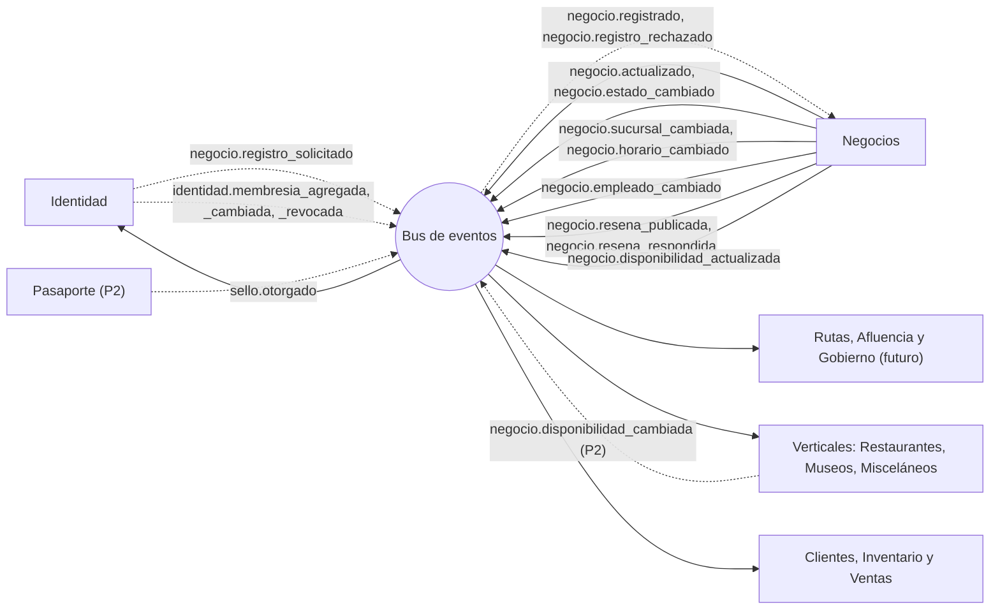

### 8.2 Sobre común (ya programado)

Todos los eventos usan `SobreEvento` de `compartido`: `id` (UUIDv7), `tipo` (`entidad.hecho_en_pasado`), `version`, `negocio_id`, `origen`, `ocurrido_en`, `correlacion_id`, `causa_id` y `datos`. Los `datos` llevan solo cadenas, enteros, booleanos, listas y mapas; un campo opcional que no aplica se omite. En JSON los nombres van en `snake_case`.

### 8.3 Eventos que Negocios publica

| ID | Evento | Cuándo | `datos` (v1) | Lo consumen |
|---|---|---|---|---|
| B6 | `negocio.registrado` | Se creó el negocio. El `negocio_id` del sobre es el que trajo la solicitud | `solicitado_por`, `nombre`, `giro` | Identidad (crea `negocio_ref` y la membresía `DUENO`), verticales, Rutas |
| B7 | `negocio.registro_rechazado` | El giro o el nombre no sirvieron | `solicitado_por`, `nombre`, `giro`, `motivo` | Identidad (retira el pendiente; resuelve P-17) |
| B8 | `negocio.actualizado` | Cambió el nombre, la descripción, el contacto, el logo, las subcategorías o la publicación | `campos[]`, `nombre`, `giro`, `subcategorias[]`, `publicado`, y opcionales `dieta[]`, `accesibilidad[]`, `duracion_visita_min`, `costo_medio_mxn` | Identidad (`negocio_ref.nombre`), Rutas, Afluencia |
| B9 | `negocio.estado_cambiado` | Cambió el estado | `estado_anterior`, `estado_nuevo`, `motivo`, `origen` (`DUENO`, `PLATAFORMA`) | Identidad (`negocio_ref.estado`), todos los demás |
| B10 | `negocio.sucursal_cambiada` | Se creó, cambió o desactivó una sucursal | `sucursal_id`, `accion`, `es_principal`, `activa`, `municipio`, `entidad_federativa`, `latitud?`, `longitud?` | Rutas, Afluencia |
| B11 | `negocio.horario_cambiado` | Cambió el horario semanal o una excepción | `sucursal_id`, `zona_horaria`, `semana[]` (día y tramos), `excepciones[]` próximas | Rutas, Afluencia |
| B12 | `negocio.empleado_cambiado` | Se agregó, cambió, suspendió, reactivó o dio de baja un empleado | `empleado_id`, `accion`, `puesto`, `estado`, `cuenta_id?` | Identidad (la baja revoca el acceso), Ventas y Caja (futuro) |
| B13 | `negocio.resena_publicada` | Se publicó, editó, ocultó o borró una reseña | `resena_id`, `visitante_id`, `accion`, `calificacion`, `tiene_comentario` | Gobierno (agregados), Rutas |
| B14 | `negocio.resena_respondida` | El negocio respondió una reseña | `resena_id`, `visitante_id` | La suscripción `respuestaAMiResena` de la app del turista (P2) |
| B15 | `negocio.disponibilidad_actualizada` | Cambió el nivel de disponibilidad | `nivel_anterior?`, `nivel_nuevo`, `fuente`, `vence_en` | Rutas (reemplaza `directorio.disponibilidad_actualizada`, E-12), Afluencia |

**Ninguno lleva el nombre, el teléfono ni el correo de un empleado, ni el comentario de una reseña** (EV-01). Para que Identidad pueda actuar con la baja, el evento lleva `cuenta_id`, que es un id; `visitante_id` es un seudónimo (D-37; en P1, un id de dispositivo).

Ejemplo de `negocio.registrado` v1:

```json
{
  "id": "0192f3a0-1c3e-7a10-8f4b-6b1d0c9e2a11",
  "tipo": "negocio.registrado",
  "version": 1,
  "negocio_id": "0192f39f-3333-7000-8000-00000000f002",
  "origen": "negocios",
  "ocurrido_en": "2026-10-16T16:03:41Z",
  "correlacion_id": "0192f39f-3333-7000-8000-00000000f003",
  "causa_id": "0192f39f-3333-7000-8000-00000000f004",
  "datos": {
    "solicitado_por": "0192f39f-3333-7000-8000-00000000f001",
    "nombre": "Fonda Doña Chela",
    "giro": "RESTAURANTE"
  }
}
```

Este es exactamente el contrato que Identidad ya lee (`NegocioRegistradoV1`), así que **no hay que cambiar nada del lado de Identidad para que el alta funcione**.

### 8.4 Eventos que Negocios consume

| ID | Evento | Qué hace |
|---|---|---|
| B1 | `negocio.registro_solicitado` v1 (Identidad) | `registrarAlta`: valida, crea el negocio con ese id, su sucursal principal y el registro `alta_negocio`, y publica `negocio.registrado` o `negocio.registro_rechazado`. |
| B2 | `identidad.membresia_agregada` v1 (Identidad) | `enlazarMembresia`: ata la ficha por `referencia_externa` o crea una `POR_COMPLETAR`. Con origen `DUENO_INICIAL` es la que avisa por WebSocket que el alta quedó lista. |
| B3 | `identidad.membresia_cambiada` v1 | `reflejarCambioDeMembresia`: copia el rol y el estado (`ACTIVA` o `SUSPENDIDA`) a `acceso` y `rol_acceso`. |
| B4 | `identidad.membresia_revocada` v1 | `reflejarRevocacion`: `acceso = REVOCADO`. |
| B5 | `sello.otorgado` v1 (Pasaporte, E-05) (P2) | `habilitarResena`: crea la habilitación del visitante en ese negocio por 30 días. El contrato lo define Pasaporte y hay que congelarlo con su dueño. |
| B16 | `negocio.disponibilidad_cambiada` (verticales, D-33) (P2) | `registrarDisponibilidad`: guarda el nivel que declara el vertical y gana el más reciente (DI-06). El contrato genérico vive en `compartido`. |

### 8.5 Cambios que pide este diseño a otros módulos

Ninguno está autorizado todavía; son los puntos de contacto que hay que acordar (D-96).

| # | Módulo | Cambio | Tipo | Por qué |
|---|---|---|---|---|
| 1 | Identidad | Consumir `negocio.registro_rechazado` y retirar el negocio pendiente de la persona | Escucha nueva | Cierra P-17: hoy un pedido sin respuesta queda pendiente para siempre |
| 2 | Identidad | Consumir `negocio.estado_cambiado` y `negocio.actualizado` para actualizar `negocio_ref` (nombre y estado). El `CHECK` de `estado` gana `SUSPENDIDO` | Escucha y migración | La tabla ya permite `UPDATE(estado)`. Una sesión de un negocio **cerrado** deja de servir (AM-06); en uno **suspendido** sigue, para que el dueño pueda reanudar |
| 3 | Identidad | Campo opcional `referencia_externa` en la invitación y en `identidad.membresia_agregada` | Campo aditivo (R5) | Es la forma de ligar la ficha con la cuenta sin mandar datos personales |
| 4 | Identidad | Consumir `negocio.empleado_cambiado` con `accion = BAJA` y revocar la membresía de `cuenta_id`, salvo que sea el último dueño | Escucha nueva | La baja laboral debe quitar el acceso; la confirmación humana ya ocurrió en Negocios |
| 5 | Identidad | Sumar los permisos `negocios.*` a `RolesBase` y a la migración de siembra | Datos | **Hecho el 2026-10-16** (migración `V034` y `RolesBase`), con la matriz de la sección 7.7: el DUENO tiene los catorce, el ADMINISTRADOR todos menos pausar y cerrar, el GERENTE seis, y los demás roles solo `negocios.perfil.ver`. Antes, un dueño real recibía `PERMISO_DENEGADO` en todo el panel (AZ-03 solo detecta permisos citados que no existen, no los que faltan). El DUENO pasa de 16 a 30 permisos |
| 6 | Identidad | (P2) Publicar `identidad.invitacion_emitida` para mostrar `INVITADO` | Evento nuevo | Sin él, la ficha pasa de `SIN_ACCESO` directo a `ACTIVO` |
| 7 | Rutas y app del turista | Leer la ficha pública de Negocios (`buscarPublicos`, `negocioPublico`) en vez de la de un Directorio dueño de datos | Cambio de fuente | D-98. `docs/diseno/rutas.md` y el mockup `app-turista.html` hablaban de «Directorio» como dueño |
| 8 | Pasaporte | Congelar `sello.otorgado` v1 con `visitante_id` y el negocio en el sobre | Contrato (P2) | Lo consume Negocios (RS-01). Reemplaza que Reseñas lo consuma (D-38) |
| 9 | Rutas | Leer dieta, accesibilidad, duración, costo y disponibilidad de Negocios y consumir `negocio.disponibilidad_actualizada` en vez de `directorio.disponibilidad_actualizada` (E-12) | Cambio de fuente | D-106, D-107. `rutas.md` decía que el Directorio declaraba esos atributos (HR-4) |
| 10 | Servicio de administración (otro proyecto) | Llamar a las rutas `/admin` de la sección 9.5 | Cliente nuevo | D-108. Su autenticación se ignora por ahora |

### 8.6 Garantías de entrega

- Entrega al menos una vez y sin orden global. Los listeners deduplican por `evento_procesado` y por llaves naturales (`negocio_id`, `cuenta_id`, `(negocio_id, visitante_id)`).
- **El orden causal sí está garantizado por la propia cadena:** `identidad.membresia_agregada(DUENO_INICIAL)` solo existe después de `negocio.registrado`, que solo existe después de `negocio.registro_solicitado`. Un evento de membresía de un negocio que Negocios todavía no conoce se reintenta; si agota los reintentos queda registrado sin datos personales.
- Con el bus real la entrega es asíncrona (Spring Modulith activa `@Async` por sí solo). La app debe tratar el alta como pendiente hasta que se lo avise (sección 9.4).

---

## 9. Comunicación con la API (móvil primero)

Hay dos audiencias y dos apps: el **locatario** (panel del negocio, con sesión de Identidad) y el **turista** (app pública, con o sin cuenta de Visitantes). Las dos son celulares: redes irregulares, pantallas chicas y la app en segundo plano la mayor parte del tiempo. De eso salen cinco principios (D-91):

1. **GraphQL para todo lo que usa la app**, con una consulta por pantalla (sin viajes en cascada) y paginación por cursor.
2. **REST solo donde GraphQL no encaja:** el catálogo de categorías antes de iniciar sesión (y para filtros, con caché), la subida de imágenes (`multipart`), servirlas con URL firmada y la administración de la plataforma.
3. **WebSocket solo para lo que no puede esperar:** una suscripción en P1 (el aviso del alta), con una consulta equivalente de respaldo. Un celular pierde el socket cuando la app pasa a segundo plano, así que **ninguna pantalla depende** de que llegue un mensaje.
4. **Reintentos seguros:** las creaciones llevan `Idempotency-Key` y las ediciones llevan `version`. Reintentar nunca duplica ni pisa.
5. **Respuestas pequeñas:** listas sin contacto, imágenes con ancho pedido (`?w=`) y, en P2, consultas persistidas por hash para no mandar el texto de la consulta en cada llamada.

### 9.1 Entradas al módulo

<!-- fig: ENT | Vías de entrada a Negocios | Casi todo entra por un solo POST /graphql, con dos audiencias. REST queda para lo que GraphQL no hace bien y el WebSocket para los avisos. -->
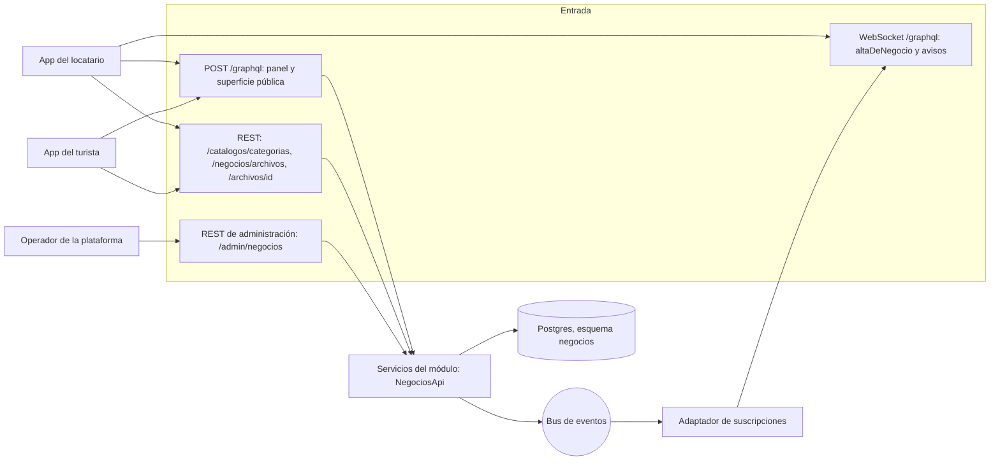

### 9.2 Tabla de comunicación

| ID | Protocolo | Operación | Dirección | Entrada → salida | Prioridad |
|---|---|---|---|---|---|
| G1 | GraphQL (consulta) | `miNegocio` | App → Negocios | Nada → negocio con completitud, categoría, subcategorías, principal y resumen del equipo | P1 |
| G2 | GraphQL (consulta) | `sucursales` | App → Negocios | Nada → sucursales activas | P1 |
| G3 | GraphQL (consulta) | `horarioDeSucursal(sucursalId)` | App → Negocios | id → semana, excepciones y `abiertoAhora` | P1 |
| G4 | GraphQL (consulta) | `empleados(filtro, texto, primeros, despues)` | App → Negocios | Filtro y página → lista sin contacto | P1 |
| G5 | GraphQL (consulta) | `empleado(id)` | App → Negocios | id → ficha completa. Registra el acceso | P1 |
| G6 | GraphQL (consulta) | `miFicha` | App → Negocios | Nada → mi ficha (la crea `POR_COMPLETAR` si falta) | P1 |
| G7 | GraphQL (consulta) | `puestosDelGiro` | App → Negocios | Nada → puestos con rol sugerido | P1 |
| G8 | GraphQL (consulta) | `misAltasDeNegocio` | App → Negocios | Nada → altas de mi cuenta. **Sin negocio activo** | P1 |
| G9 | GraphQL (consulta) | `resenas(filtro, primeros, despues)` | App → Negocios | Filtro y página → reseñas con respuesta y resumen | P1 |
| G10 | GraphQL (mutación) | `actualizarNegocio` | App → Negocios | version y campos → negocio | P1 |
| G11 | GraphQL (mutación) | `definirSubcategorias` | App → Negocios | version y conjunto → negocio | P1 |
| G12 | GraphQL (mutación) | `publicarNegocio(publicar)` | App → Negocios | booleano → negocio o `PUBLICACION_INCOMPLETA` con lo que falta | P1 |
| G13 | GraphQL (mutación) | `pausarNegocio`, `reanudarNegocio` | App → Negocios | motivo? → negocio | P1 |
| G14 | GraphQL (mutación) | `actualizarSucursal` | App → Negocios | version y campos → sucursal | P1 |
| G15 | GraphQL (mutación) | `definirHorario` | App → Negocios | version y semana → horario | P1 |
| G16 | GraphQL (mutación) | `agregarExcepcionHorario`, `quitarExcepcionHorario` | App → Negocios | excepción → horario | P1 |
| G17 | GraphQL (mutación) | `aceptarResponsabilidadDePersonal` | App → Negocios | versión del texto → negocio | P1 |
| G18 | GraphQL (mutación) | `registrarEmpleado` | App → Negocios | ficha → empleado. `Idempotency-Key` | P1 |
| G19 | GraphQL (mutación) | `actualizarEmpleado`, `completarMiFicha` | App → Negocios | version y campos → empleado | P1 |
| G20 | GraphQL (mutación) | `suspenderEmpleado`, `reactivarEmpleado` | App → Negocios | id → empleado | P1 |
| G21 | GraphQL (mutación) | `establecerLogo` | App → Negocios | archivoId → negocio | P1 |
| G22 | GraphQL (mutación) | `responderResena` | App → Negocios | resenaId y texto → reseña | P1 |
| G23 | GraphQL (mutación) | `prepararComando(input)` | App → Negocios | `DarDeBajaEmpleado` o `CerrarNegocio` → token, resumen y advertencias | P1 |
| G24 | GraphQL (mutación) | `confirmarComando(token)` | App → Negocios | token → resultado (`ok`, `codigo`, `datos`, `mensajePlantilla`) | P1 |
| G25 | GraphQL (mutación) | `definirAtributos` | App → Negocios | version, dieta, accesibilidad, duración y costo → negocio | P1 |
| G26 | GraphQL (mutación) | `definirDisponibilidad` | App → Negocios | nivel y nota → disponibilidad | P1 |
| T1 | GraphQL (consulta) | `negociosPublicos(filtro, primeros, despues)` | App del turista → Negocios | Texto, categoría, subcategorías, dieta, accesibilidad, cercanía y página → negocios públicos con distancia, calificación y disponibilidad. **Sin sesión** | P1 |
| T2 | GraphQL (consulta) | `negocioPublico(id)` | App del turista → Negocios | id → ficha pública o nulo. **Sin sesión** | P1 |
| T3 | GraphQL (consulta) | `resenasDeNegocio(negocioId, primeros, despues)` | App del turista → Negocios | id y página → reseñas sin autor. **Sin sesión** | P1 |
| T4 | GraphQL (mutación) | `prepararComando(PublicarResena)` y `confirmarComando` | App del turista → Negocios | Reseña → token y resultado. **P1: id de dispositivo en cabecera y modo demostración (RS-11, DM-03).** P2: sesión de Visitantes | P1 |
| W1 | WebSocket | `altaDeNegocio` | Negocios → App | Suscripción → un aviso cuando el alta queda `REGISTRADO` o `RECHAZADO`. **Sin negocio activo** | P1 |
| W2 | WebSocket | `equipoCambiado` | Negocios → App | Suscripción → un aviso por cada `negocio.empleado_cambiado` del negocio | P2 |
| W3 | WebSocket | `negocioActualizado` | Negocios → App | Suscripción → cambios hechos desde otro dispositivo | P2 |
| W4 | WebSocket | `resenaNueva` | Negocios → App | Suscripción → un aviso por cada reseña nueva del negocio | P2 |
| W5 | WebSocket | `respuestaAMiResena` | Negocios → App del turista | Suscripción → el negocio respondió una reseña mía. **Sesión de Visitantes** | P2 |
| R1 | REST | `GET /catalogos/categorias` | Ambas apps → Negocios | Nada → giros, subcategorías y atributos activos. **Público**, con `ETag` y `Cache-Control: public` | P1 |
| R2 | REST | `POST /negocios/archivos` | App → Negocios | imagen `multipart` → `archivoId` y URL firmada | P1 |
| R3 | REST | `GET /archivos/{id}?w=&firma=&expira=` | Ambas apps → Negocios | URL firmada → bytes de la imagen | P1 |
| R4 | REST (administración) | `POST /admin/negocios/{id}/suspension` | Plataforma → Negocios | motivo → negocio `SUSPENDIDO` por la plataforma | P1 |
| R5 | REST (administración) | `DELETE /admin/negocios/{id}/suspension` | Plataforma → Negocios | Nada → negocio `ACTIVO` | P1 |
| R6 | REST (administración) | `POST /admin/negocios/{negocioId}/resenas/{id}/ocultar` y `.../restituir` | Plataforma → Negocios | motivo (código) → reseña `OCULTA` o `PUBLICADA`. La ruta lleva el negocio porque la seguridad por fila no deja buscar una reseña sin él | P1 |
| J1 | Java | `NegociosApi` (consultas y comandos) | Resolvedores y controladores → Negocios | Llamada en el mismo proceso | P1 |
| J2 | Java | `vistaDeNegocio(negocioId)` | Otros horizontales → Negocios | id → nombre, giro, estado, zona horaria y coordenadas (R6) | P1 |
| J3 | Java | `buscarPublicos(criterios)` | Rutas → Negocios | Criterios → negocios candidatos, ya filtrados (R6) | P1 |
| J4 | Java | `registrarAlta`, `enlazarMembresia`, `reflejarCambioDeMembresia`, `reflejarRevocacion`, `habilitarResena` | Listeners → Negocios | Escrituras del sistema (D-22) | P1 |
| B1 a B5 y B16 | Bus | Eventos que consume (sección 8.4) | Identidad, Pasaporte y verticales → Negocios | | P1 (B1 a B4) y P2 (B5, B16) |
| B6 a B15 | Bus | Eventos que publica (sección 8.3) | Negocios → bus | | P1 |

Total P1: 26 vías GraphQL del panel y 4 de la superficie pública, 1 WebSocket, 6 REST (3 de la app y 3 de administración), 4 Java y 10 eventos publicados. En P2 se suman 4 suscripciones, editar y borrar la propia reseña, la habilitación por sello (B5) y la disponibilidad desde los verticales (B16).

### 9.3 Esquema GraphQL propuesto

Irá en `backend/src/main/resources/graphql/negocios.graphqls`. **El panel** no lleva `negocioId` en ningún tipo, campo ni argumento (SG-02): el negocio sale del contexto. **La superficie pública** sí recibe un id, pero como el objeto consultado, no como contexto (sección 9.7). Hereda los escalares `Decimal`, `Date` y `DateTime` de `compartido`; la hora del día (`abre`, `cierra`) viaja como texto `HH:mm` en la zona del negocio.

```graphql
# ---------- Panel del locatario ----------
type Query {
  miNegocio: Negocio!
  sucursales: [Sucursal!]!
  horarioDeSucursal(sucursalId: ID!): Horario!
  empleados(filtro: FiltroEmpleados = TODOS, texto: String, primeros: Int! = 20, despues: String): EmpleadoConexion!
  empleado(id: ID!): Empleado
  miFicha: Empleado!
  puestosDelGiro: [Puesto!]!
  misAltasDeNegocio: [AltaDeNegocio!]!      # permitida sin negocio activo
  resenas(filtro: FiltroResenas = TODAS, primeros: Int! = 20, despues: String): ResenaConexion!

  # ---------- Superficie pública (la app del turista) ----------
  negociosPublicos(filtro: FiltroPublico, primeros: Int! = 20, despues: String): NegocioPublicoConexion!
  negocioPublico(id: ID!): NegocioPublico
  resenasDeNegocio(negocioId: ID!, primeros: Int! = 10, despues: String): ResenaPublicaConexion!   # sin sesión
}

type Mutation {
  actualizarNegocio(input: ActualizarNegocioInput!): Negocio!
  definirSubcategorias(version: Int!, subcategorias: [String!]!): Negocio!
  publicarNegocio(publicar: Boolean!): Negocio!
  pausarNegocio(motivo: String): Negocio!
  reanudarNegocio: Negocio!
  actualizarSucursal(id: ID!, input: ActualizarSucursalInput!): Sucursal!
  definirHorario(sucursalId: ID!, version: Int!, semana: [DiaDeHorarioInput!]!): Horario!
  agregarExcepcionHorario(sucursalId: ID!, input: ExcepcionInput!): Horario!
  quitarExcepcionHorario(id: ID!): Horario!
  aceptarResponsabilidadDePersonal(version: Int!): Negocio!
  registrarEmpleado(input: RegistrarEmpleadoInput!): Empleado!   # cabecera Idempotency-Key
  actualizarEmpleado(id: ID!, input: ActualizarEmpleadoInput!): Empleado!
  completarMiFicha(input: CompletarMiFichaInput!): Empleado!
  suspenderEmpleado(id: ID!, motivo: String): Empleado!
  reactivarEmpleado(id: ID!): Empleado!
  establecerLogo(archivoId: ID!): Negocio!
  responderResena(id: ID!, texto: String!): Resena!
  definirAtributos(input: DefinirAtributosInput!): Negocio!
  definirDisponibilidad(nivel: NivelDisponibilidad!, nota: String): Disponibilidad!
  # prepararComando y confirmarComando son el par de plataforma (D-55);
  # este módulo agrega: extend input ComandoInput { darDeBajaEmpleado: ..., cerrarNegocio: ..., publicarResena: ... }
  # publicarResena la manda el turista con la cabecera X-Dispositivo-Id (RS-11, DM-03)
}

type Subscription {
  altaDeNegocio: AvisoDeAlta!               # permitida sin negocio activo
  # P2: equipoCambiado: AvisoDeEquipo!   negocioActualizado: Negocio!   resenaNueva: Resena!
  #     respuestaAMiResena: RespuestaARes!   (sesión de Visitantes)
}

type Negocio {
  id: ID!  nombre: String!  giro: Giro!  subcategorias: [SubcategoriaDelNegocio!]!
  estado: EstadoNegocio!  suspendidoPor: Origen  publicado: Boolean!  contactoPublico: Boolean!
  descripcion: String  telefonoContacto: String  correoContacto: String
  logoUrl: String  zonaHoraria: String!
  completitud: Completitud!  principal: Sucursal!  equipo: ResumenDeEquipo!
  responsabilidadDePersonalAceptada: Boolean!
  esSimulado: Boolean!  atributos: AtributosDeclarados!  disponibilidad: Disponibilidad
  version: Int!  actualizadoEn: DateTime!
}
type AtributosDeclarados { dieta: [Etiqueta!]!  accesibilidad: [Etiqueta!]!  duracionVisitaMin: Int  costoMedioMxn: Int }
type Etiqueta { codigo: String!  nombre: String! }
input DefinirAtributosInput { version: Int!  dieta: [String!]!  accesibilidad: [String!]!  duracionVisitaMin: Int  costoMedioMxn: Int }
enum NivelDisponibilidad { LIBRE MODERADA LLENA }
type Disponibilidad { nivel: NivelDisponibilidad!  nota: String  declaradaEn: DateTime!  venceEn: DateTime! }
type Giro { codigo: String!  nombre: String! }
type SubcategoriaDelNegocio { codigo: String!  nombre: String!  giro: String!  capacidad: Boolean! }
enum Origen { DUENO PLATAFORMA }
type Completitud { porcentaje: Int!  faltantes: [Faltante!]! }
enum Faltante { UBICACION HORARIO CONTACTO LOGO }
type ResumenDeEquipo { activos: Int!  conAcceso: Int!  sinAcceso: Int!  porCompletar: Int! }

type Sucursal {
  id: ID!  nombre: String!  esPrincipal: Boolean!  activa: Boolean!
  calle: String  numero: String  colonia: String  municipio: String  entidadFederativa: String
  codigoPostal: String  referencias: String  latitud: Float  longitud: Float  telefono: String
  version: Int!
}
type Horario { sucursalId: ID!  semana: [DiaDeHorario!]!  excepciones: [Excepcion!]!  abiertoAhora: Boolean!  version: Int! }
type DiaDeHorario { dia: Int!  tramos: [Tramo!]! }
type Tramo { abre: String!  cierra: String! }
type Excepcion { id: ID!  fecha: Date!  cerrado: Boolean!  abre: String  cierra: String  motivo: String }

# Lista: solo lo necesario para pintar la fila. Sin contacto ni notas (EM-14).
type EmpleadoResumen { id: ID!  codigo: String!  nombreCompleto: String!  puesto: String!
                       estado: EstadoEmpleado!  acceso: EstadoDeAcceso!  fotoUrl: String }
# Ficha completa: solo en empleado(id) y miFicha. Cada apertura se audita.
type Empleado { id: ID!  codigo: String!  nombre: String  apellidos: String  puesto: Puesto!  puestoDetalle: String
                sucursalId: ID  telefono: String  correo: String  fechaIngreso: Date!  fechaBaja: Date
                estado: EstadoEmpleado!  acceso: EstadoDeAcceso!  rolAcceso: String  fotoUrl: String
                notas: String  version: Int! }
type Puesto { codigo: String!  nombre: String!  rolSugerido: String }

type AltaDeNegocio { negocioId: ID!  estado: EstadoAlta!  motivo: String }
type AvisoDeAlta { negocioId: ID!  estado: EstadoAlta!  motivo: String }
enum EstadoAlta { REGISTRADO RECHAZADO }

enum EstadoNegocio { ACTIVO SUSPENDIDO CERRADO }
enum EstadoEmpleado { POR_COMPLETAR ACTIVO SUSPENDIDO BAJA }
enum EstadoDeAcceso { SIN_ACCESO ACTIVO SUSPENDIDO REVOCADO }
enum FiltroEmpleados { TODOS ACTIVOS SIN_ACCESO CON_ACCESO POR_COMPLETAR DE_BAJA }

# ---------- Tipos públicos: lista permitida de campos (PU-03) ----------
input FiltroPublico { texto: String  giro: String  subcategorias: [String!]  dieta: [String!]  accesibilidad: [String!]  abiertoAhora: Boolean
                      cerca: CercaDe  orden: OrdenPublico = RELEVANCIA }
input CercaDe { latitud: Float!  longitud: Float!  radioKm: Float! = 5 }     # tope de 25 km (PU-05)
enum OrdenPublico { RELEVANCIA DISTANCIA CALIFICACION }
type NegocioPublico {
  id: ID!  nombre: String!  giro: Giro!  subcategorias: [SubcategoriaDelNegocio!]!
  descripcion: String  logoUrl: String  ubicacion: UbicacionPublica!  horario: HorarioPublico!
  telefono: String  correo: String          # solo si el dueño marcó contactoPublico (PU-04)
  calificacion: CalificacionPublica!  distanciaKm: Float
  atributos: AtributosDeclarados!       # declarados por el negocio (AT-04)
  disponibilidad: Disponibilidad        # nulo si venció o el negocio está cerrado ahora (DI-03, DI-04)
  simulado: Boolean!                    # «Negocio de demostración» (DM-01)
}
type UbicacionPublica { calle: String  numero: String  colonia: String  municipio: String  entidadFederativa: String
                        codigoPostal: String  referencias: String  latitud: Float  longitud: Float }
type HorarioPublico { semana: [DiaDeHorario!]!  excepciones: [Excepcion!]!  abiertoAhora: Boolean!  zonaHoraria: String! }
type CalificacionPublica { promedio: Float  total: Int!  distribucion: [Int!]! }
type ResenaPublica { id: ID!  calificacion: Int!  comentario: String  creadaEn: DateTime!  respuesta: RespuestaPublica  demostracion: Boolean! }
type RespuestaPublica { texto: String!  respondidaEn: DateTime! }

# ---------- Reseñas en el panel ----------
enum FiltroResenas { TODAS SIN_RESPUESTA }
enum EstadoResena { PUBLICADA OCULTA }
type Resena { id: ID!  calificacion: Int!  comentario: String  creadaEn: DateTime!  estado: EstadoResena!  respuesta: RespuestaPublica  version: Int! }
```

Notas del esquema:

- **Dos tipos de empleado por riesgo** (como en Clientes, P-05): `EmpleadoResumen` para listas y `Empleado` para la ficha. El contacto solo sale en la ficha.
- **Tipos públicos aparte** (`NegocioPublico` y compañía): ninguno comparte campos con los del panel, para que agregar un campo al panel nunca lo publique por accidente.
- **`@oneOf`:** `ComandoInput` ya es de plataforma; Negocios agrega `darDeBajaEmpleado`, `cerrarNegocio` y `publicarResena` con `extend input ComandoInput` (D-55).
- **Superficie cerrada:** introspección, GraphiQL y `/graphql/schema` desactivados (SG-12).
- **Sin números de punto flotante para dinero:** Negocios no maneja dinero. Latitud, longitud y el promedio sí son `Float`.

### 9.4 WebSocket

Se documenta porque hay **una** suscripción en P1 y cuatro candidatas en P2. Van en el mismo endpoint `/graphql` (protocolo `graphql-transport-ws`).

| Aspecto | Regla |
|---|---|
| **Para qué (P1)** | `altaDeNegocio` avisa a quien pidió el alta cuando el negocio quedó listo o se rechazó. Evita que la app pregunte cada pocos segundos. |
| **Quién la alimenta** | Un adaptador que escucha el bus: emite `RECHAZADO` al publicar `negocio.registro_rechazado`, y `REGISTRADO` al consumir `identidad.membresia_agregada` con origen `DUENO_INICIAL`. Se emite **después** de aplicar la membresía, así que cuando la app llega a `GET /auth/yo` ya ve su negocio (no hay carrera). |
| **Autenticación** | El token va en `connection_init` (`{"authorization": "Bearer <token>"}`), nunca en la URL (SG-01, SG-15). Se verifica el origen. Un token inválido cierra con el código `4401`. |
| **Sesión sin negocio** | Excepción acotada a SG-02: justo después de registrarse la persona **no tiene negocio activo**. `altaDeNegocio` y `misAltasDeNegocio` se permiten con una sesión sin negocio y filtran por `cuenta_id` del token. Lo mismo vale para quien tiene dos negocios y todavía no eligió uno (D-68): puede pedir esas dos y cambiar de negocio con Identidad, nada más. |
| **Límites** | Una suscripción de este tipo por cuenta y 3 conexiones por cuenta. Sin actividad durante 5 minutos, el servidor cierra. `ping` cada 30 s. |
| **Entrega** | Al menos una vez y sin garantía de que el celular esté conectado. El aviso no se guarda: lo que se guarda es `alta_negocio`. |
| **Estado del transporte (IDN-4)** | El resolvedor de `altaDeNegocio` está programado y probado (un flujo por cuenta que se cierra solo). Sobre HTTP funciona como suscripción por SSE en el mismo `/graphql`, con la sesión del filtro de entrada. El **WebSocket** (`graphql-transport-ws`, token en `connection_init`, SG-15) no está activado: pide agregar `spring-boot-starter-websocket`, una dependencia que no estaba autorizada. |
| **Respaldo (obligatorio)** | La misma información sale de `misAltasDeNegocio`. La app, al abrirse o volver de segundo plano, consulta y, si sigue pendiente, vuelve a suscribirse. Si no hay socket, consulta cada 3 segundos durante 30 y luego cada 15 hasta un minuto, y muestra «seguimos registrando tu negocio». |
| **Cierre** | El servidor completa la suscripción en cuanto emite un estado final. |
| **Reseñas en P1** | No hay suscripción: el panel muestra las reseñas al abrirlo y con «tirar para actualizar». El aviso en vivo es P2. |
| **Candidatas P2** | `equipoCambiado` (alguien aceptó su invitación y aparece como `ACTIVO`), `negocioActualizado` (sincronizar dos celulares del mismo negocio), `resenaNueva` (el panel avisa de una reseña) y `respuestaAMiResena` (la app del turista se entera de que el negocio le respondió; sesión de Visitantes). Las cuatro con las reglas SG-01 y SG-15 de siempre y, como `altaDeNegocio`, con consulta de respaldo. |

### 9.5 REST (el mínimo)

| ID | Ruta | Por qué no es GraphQL | Reglas |
|---|---|---|---|
| R1 | `GET /catalogos/categorias` | La persona elige su giro **antes** de tener sesión, y GraphQL exige autenticación (SG-01). El turista usa la misma lista para filtrar. Es una lista de pocas cosas que casi nunca cambia, ideal para `ETag` y caché del celular. | Público. Sin datos de nadie. Tasa por IP. |
| R2 | `POST /negocios/archivos` | Subir bytes por GraphQL (`multipart` no estándar) complica los clientes móviles. | Requiere sesión y `negocios.perfil.editar` (o `negocios.empleado.editar` para fotos). AR-01 a AR-03. Tasa baja. Devuelve `archivoId`. Pasa por el servidor para validar el contenido y reencodificar la imagen (sin EXIF) antes de guardarla en el almacén (D-101). |
| R3 | `GET /archivos/{id}` | Es el origen de una `<Image>`: tiene que ser una URL. | Solo con la firma de la URL de GraphQL; vence a los 10 minutos. Soporta `?w=` (160, 320, 640). Con el bucket, la firma es la del propio bucket y el celular baja la imagen directo de ahí; en desarrollo la sirve este controlador desde el disco. |
| R4 y R5 | `POST` y `DELETE /admin/negocios/{id}/suspension` | Es administración de la plataforma, no una operación de la app. | Solo el servicio de administración, que es aparte (D-108): su autenticación se ignora por ahora y las rutas quedan apagadas en producción (SN-15). Deja `suspendido_por = PLATAFORMA` y el motivo en `historial_negocio`. |
| R6 | `POST /admin/negocios/{negocioId}/resenas/{id}/ocultar` y `.../restituir` | Ídem. | **Como quedó programada:** un token de servicio en la cabecera `X-Servicio-Admin`, comparado en tiempo constante; la ruta no existe si no hay token configurado (`negocios.admin.token`) ni con el perfil `produccion`. En P1 nadie la usa de forma activa (D-110). |

No hay REST para operaciones de negocio del panel: todo lo que modifica datos del negocio es GraphQL (D-91). Tampoco hay webhooks ni vías para un bot (D-63). `/salud` es de plataforma.

### 9.6 Pantallas y operaciones

El mockup del artefacto muestra estas pantallas. Cada una pide **una** consulta o mutación principal.

| Pantalla | Pide | Escribe | Tiempo real |
|---|---|---|---|
| Alta en curso («Estamos registrando tu negocio») | `misAltasDeNegocio` | Nada | `altaDeNegocio` (con respaldo) |
| Mis negocios (cambiar de negocio) | `GET /auth/yo` de Identidad | `PUT /auth/negocio-activo` de Identidad | Nada |
| Inicio, «Mi negocio» | `miNegocio` | `pausarNegocio`, `reanudarNegocio`, `definirDisponibilidad` | Nada |
| Perfil y contacto | `miNegocio` | `actualizarNegocio`, `establecerLogo`, R2 | Nada |
| Categorías, atributos y publicar | `miNegocio`, R1 | `definirSubcategorias`, `definirAtributos`, `publicarNegocio` | Nada |
| Ubicación | `sucursales` | `actualizarSucursal` | Nada |
| Horario | `horarioDeSucursal` | `definirHorario`, excepciones | Nada |
| Equipo (lista) | `empleados` | Nada | P2: `equipoCambiado` |
| Ficha del empleado | `empleado` | `actualizarEmpleado`, `suspenderEmpleado` | Nada |
| Agregar empleado | `puestosDelGiro` | `aceptarResponsabilidadDePersonal`, `registrarEmpleado` | Nada |
| Dar de baja / cerrar negocio | Nada | `prepararComando`, `confirmarComando` | Nada |
| Mi ficha | `miFicha` | `completarMiFicha` | Nada |
| Reseñas | `resenas` | `responderResena` | P2: `resenaNueva` |
| Vista del turista | `negocioPublico` | Nada | Nada |

### 9.7 Superficie pública para la app del turista (D-98, D-99)

El Directorio es la cara para el turista y **no guarda datos del negocio**: los consulta a Negocios. La superficie pública es la parte de la API que contesta esas consultas.

| Aspecto | Regla |
|---|---|
| **Qué es** | Tres consultas (`negociosPublicos`, `negocioPublico`, `resenasDeNegocio`) y una escritura (`PublicarResena`), todas P1. Es la misma ruta `/graphql`, con tipos propios. |
| **Sesión** | **No exige sesión**: el turista explora sin cuenta (D-81). Es la excepción acotada a SG-01. En P1 la única escritura es publicar una reseña en modo demostración, sin sesión, con un id de dispositivo y con tasa (RS-11, DM-03); con Visitantes (P2) exigirá su sesión. |
| **Contexto** | No hay negocio activo: el `id` identifica el **recurso consultado**, no el contexto del actor. Es la excepción acotada a SG-02, y solo existe en estas consultas. |
| **Qué ve** | Solo lo que dicen las vistas `v_negocio_publico` y `v_resena_publica` (sección 5.4): negocios publicados y activos, con una lista permitida de campos (PU-03). Un negocio no público responde igual que uno inexistente. |
| **Límites** | Tasa por IP y por dispositivo, hasta 20 por página, texto de búsqueda de hasta 80 caracteres y cercanía de hasta 25 km (PU-05). Sin alias ni lotes sin costo (SG-06 a SG-09). |
| **Búsqueda** | Por texto, categoría, subcategorías (y capacidades), `abiertoAhora` y cercanía. La cercanía usa las coordenadas de la sucursal principal. Calcula todo el servidor. |
| **Quién la usa** | La app del turista y, por la API Java (`buscarPublicos`, R6), Rutas para sus candidatos. Rutas deja de depender de un Directorio dueño de datos (D-41, `docs/diseno/rutas.md`). |
| **Lo que no está aquí** | El menú o catálogo, las atracciones y los recorridos (los sirven Catálogo y Museos y la app compone la ficha, D-42), y los cupones. La disponibilidad sí está, pero como un nivel declarado (D-107), no como mesas libres. |

---

## 10. Flujos principales

### 10.1 Alta del negocio con el registro del dueño

<!-- fig: S1 | Alta de un negocio por eventos | Identidad y Negocios solo se hablan por el bus. La app se entera por el WebSocket y confirma con GET /auth/yo. -->
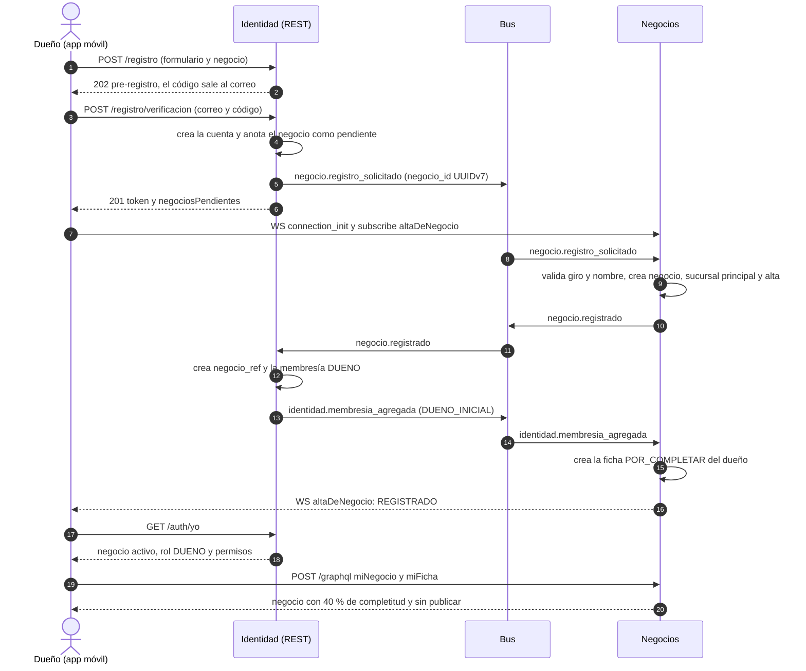

### 10.2 Alta rechazada

<!-- fig: S2 | Alta rechazada | El rechazo solo ocurre por un giro o un nombre inválidos. La persona puede corregirlo y volver a pedir con POST /registro/negocio. -->
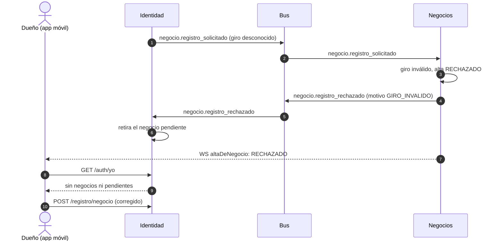

### 10.3 Registrar a un empleado y darle acceso

<!-- fig: S3 | Registrar un empleado y darle acceso a la app | Dos pasos separados a propósito: la ficha es de Negocios y el acceso es de Identidad. El vínculo es el empleado_id como referencia_externa, sin datos personales en el bus. Un empleado puede quedarse sin acceso. -->
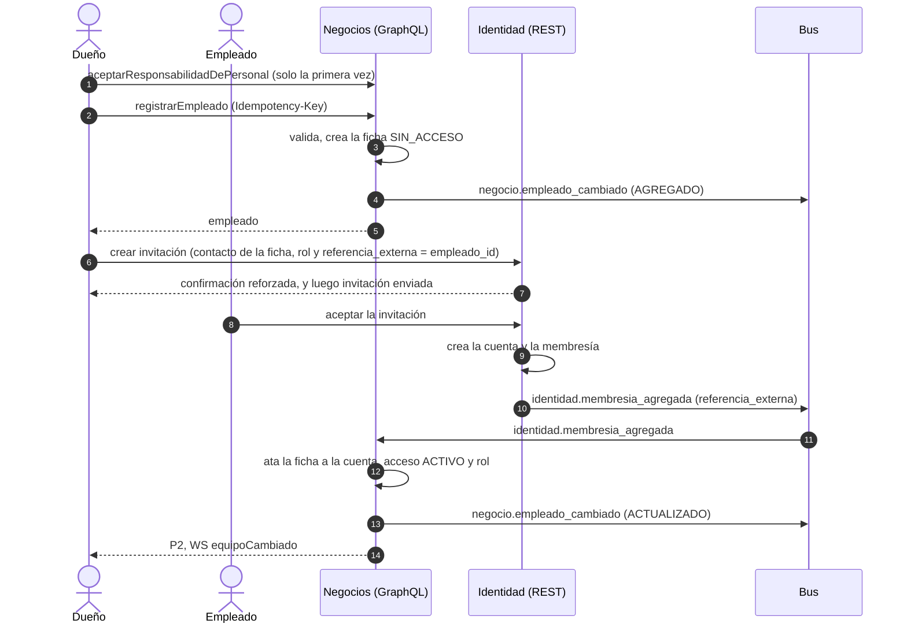

### 10.4 Editar el horario

<!-- fig: S4 | Cambiar el horario de la sucursal | Una sola llamada reemplaza la semana completa. Los demás módulos se enteran por el evento; la app no espera a nadie. -->
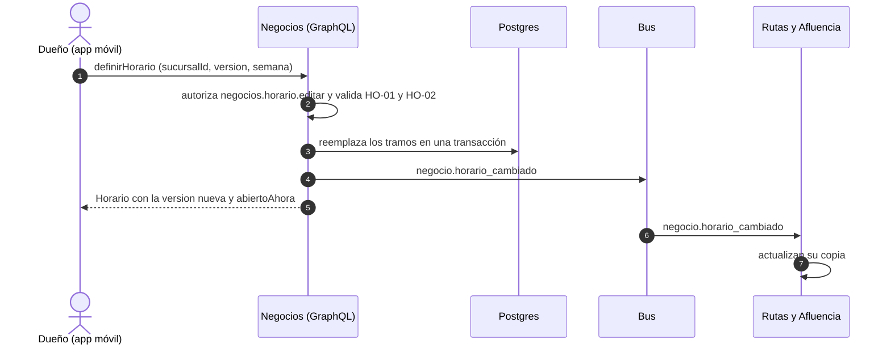

### 10.5 Dar de baja a un empleado

<!-- fig: S5 | Baja de un empleado con preparar y confirmar | Es irreversible desde el celular y quita el acceso, por eso pasa por el token de un solo uso de 5 minutos. Identidad revoca la membresía al escuchar el evento. -->
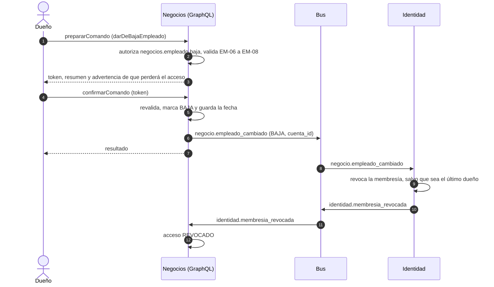

### 10.6 Pausar, suspender y cerrar el negocio

<!-- fig: S6 | Pausa del dueño, suspensión de la plataforma y cierre | Las tres terminan en el mismo evento. La pausa la levanta el dueño; la suspensión de la plataforma solo la levanta la plataforma; el cierre es definitivo y pasa por preparar y confirmar. -->
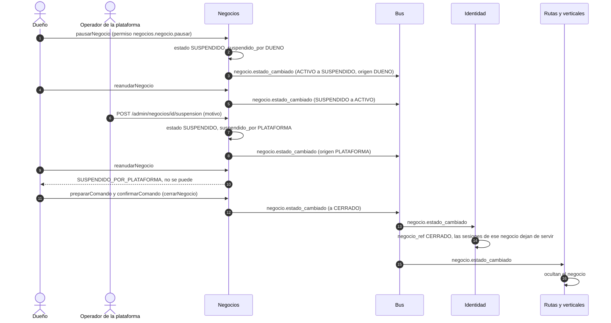

### 10.7 Ciclo de vida del WebSocket en el celular

<!-- fig: S7 | Suscripción y respaldo | El socket es un atajo, no una dependencia: si no llega, la consulta de respaldo da la misma respuesta. -->
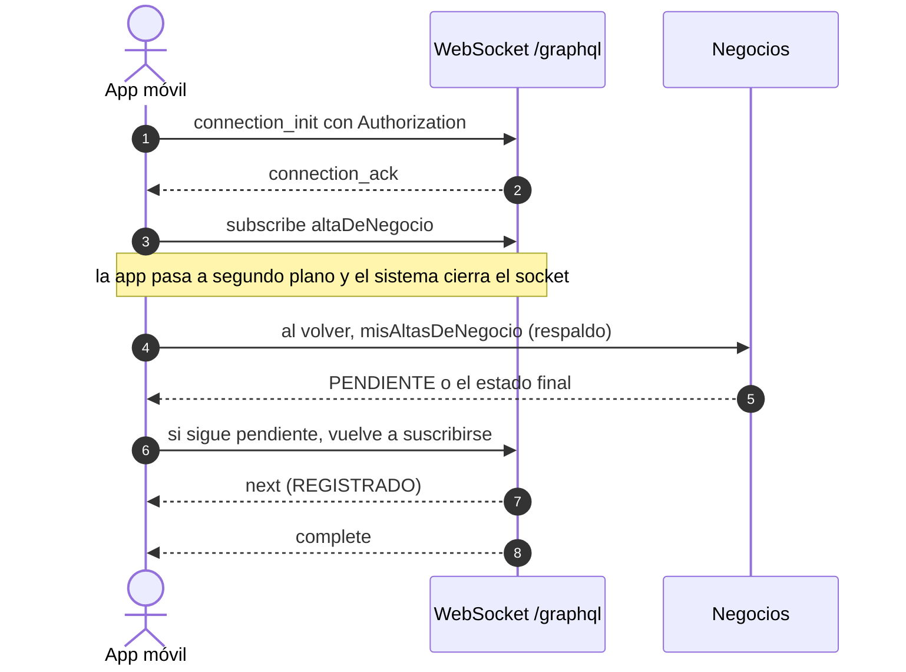

### 10.8 Primera apertura: completar mi ficha

<!-- fig: S8 | Mi ficha después del alta | La ficha del dueño nace vacía porque Identidad no manda su nombre por el bus. La app la rellena con lo que ya sabe de la sesión y la persona solo confirma. -->
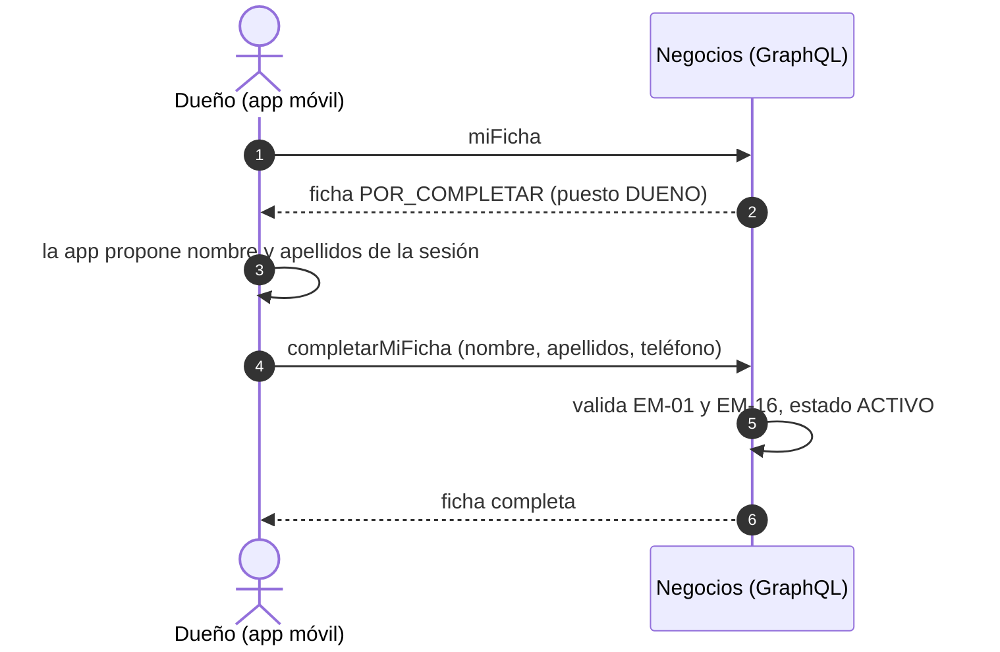

### 10.9 El turista explora el directorio

<!-- fig: S9 | Búsqueda y ficha pública | La app del turista no tiene copia de nada: pregunta a Negocios. Sin sesión. Solo salen negocios publicados y activos, con una lista permitida de campos. -->
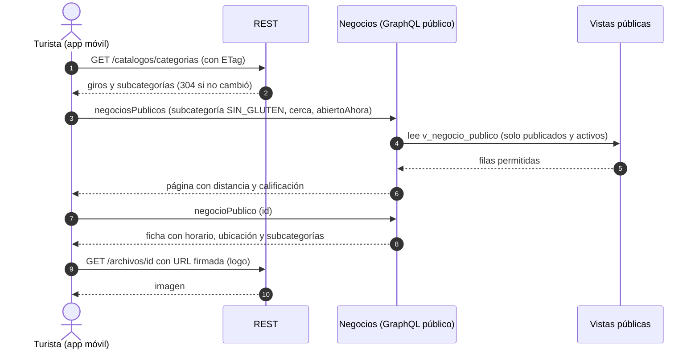

### 10.10 Una reseña, de principio a fin (P1 en demostración, completa en P2)

<!-- fig: S10 | Habilitar, publicar y responder una reseña | En P1 faltan los pasos 1 a 3 (no hay sello ni habilitación) y los dos avisos por socket. La habilitación nace de un sello. El turista confirma con preparar y confirmar. El negocio responde y el turista se entera por el socket, con respaldo por consulta. -->
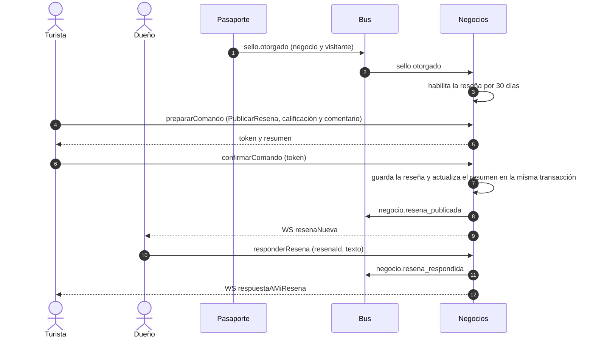

En P1 (modo demostración) el turista manda su id de dispositivo en la cabecera `X-Dispositivo-Id`, el dueño ve la reseña al abrir el panel y el turista ve la respuesta al volver a la ficha. Los pasos 1 a 3 y los dos avisos por WebSocket llegan en P2.

---

## 11. Seguridad y privacidad

### 11.1 Reglas heredadas de Inventario y Clientes (D-45) y cómo cambian en Negocios

| ID | Regla | En Negocios |
|---|---|---|
| SG-01 | Autenticación en todo | Igual, también en `connection_init`. **Excepciones acotadas:** `GET /catalogos/categorias` y la superficie pública (sección 9.7) no exigen sesión; en P1 tampoco `PublicarResena`, solo con el modo demostración encendido (DM-03). |
| SG-02 | `negocio_id` solo del contexto | Igual en el panel: ningún tipo ni argumento lo lleva. **Excepciones acotadas:** `altaDeNegocio` y `misAltasDeNegocio` usan el `cuenta_id` del token porque todavía no hay negocio; y las consultas públicas reciben el id del negocio como **objeto consultado**, no como contexto. |
| SG-03 | Autorización en cada resolvedor | Igual, con prueba de dos negocios sobre cada tabla. Un id ajeno responde igual que uno inexistente, y un negocio no público igual que uno inexistente. |
| SG-04 | Autorización por función | Resuelta: los catorce permisos `negocios.*` de la sección 7.7. |
| SG-05 | Esquema mínimo | Más estricto: el contacto y las notas del empleado solo existen en `Empleado`, nunca en `EmpleadoResumen`; y los tipos públicos no comparten campos con los del panel. |
| SG-06 a SG-09 | Profundidad, costo, paginación, alias y tamaños | Igual. `primeros` hasta 50 en `empleados` y hasta 20 en las consultas públicas. Los alias cuentan por costo: sin ellos se barrería el catálogo. |
| SG-10 | Límite de tasa | Más baja para `empleado(id)`, para `POST /negocios/archivos` y para el reintento de la suscripción. La superficie pública tiene tasa propia por IP y por dispositivo. |
| SG-12 | Sin exposición del esquema | Igual. |
| SG-13 | Errores enmascarados | Igual. `PUESTO_INVALIDO` no repite el puesto. |
| SG-15 | WebSocket seguro | Igual: token en `connection_init`, origen verificado y tope de suscripciones. |
| SG-16 | Aislamiento de eventos | Igual, y ningún evento lleva datos personales. |
| SG-19 | Operaciones sensibles | Baja de empleado y cierre de negocio son sensibles y pasan por preparar y confirmar. |
| SG-20 | Registro y auditoría | Sin nombres, teléfonos, correos ni comentarios en el registro: solo ids. |

**Estado de la entrada de `/graphql` (IDN-4, 2026-10-16).** El filtro de entrada ya existe (`FiltroDeEntrada`, en el paquete web de Identidad) y los resolvedores de Negocios pasan por él. Qué cubre de las reglas heredadas: **SG-01** (token en `Authorization: Bearer`; un token que no sirve es 401 y nunca se degrada a anónimo; sin token la petición es anónima y solo la superficie pública responde), **SG-02** (negocio, actor y permisos salen de la sesión), **SG-04** (cada resolvedor exige su permiso), **SG-06 y SG-08** (profundidad 10, 10 alias y 200 campos por consulta, medidos antes de ejecutar), **SG-07 y SG-09** (veinte por página, texto de 80, cuerpo de hasta 16 KB conocido de antemano: sin longitud, 411), **SG-10** (120 peticiones por minuto por IP, la de la conexión, y 60 por dispositivo; en memoria, de una sola instancia), **SG-12**, **SG-13** (códigos y textos fijos) y **SG-14** (solo POST con JSON; sin consultas por GET). **Sin cubrir:** SG-15 (el WebSocket: ver 9.4), el tiempo máximo de ejecución de una consulta (solo hay el de la base, 30 s), la tasa compartida entre varias instancias y el límite más bajo para operaciones sensibles. Los límites se ajustan con `plataforma.entrada.*` y `plataforma.graphql.*`.

### 11.2 Reglas propias de Negocios (SN)

| ID | Regla | Qué significa | Prueba |
|---|---|---|---|
| SN-01 | Minimización | La ficha guarda solo lo necesario para operar: nombre, puesto, fechas, contacto opcional y notas. Sin RFC, CURP, NSS, sueldo ni cuenta bancaria (D-93). | El esquema se revisa contra esta lista. |
| SN-02 | Aislamiento por negocio | Seguridad por fila en todas las tablas con `negocio_id`. `alta_negocio` se aísla por cuenta. | Con dos negocios, el A no ve ni nombra a un empleado del B. |
| SN-03 | Listas sin contacto | `empleados` devuelve nombre, puesto, estado y acceso. El teléfono y el correo solo salen en la ficha (EM-14). | Ninguna consulta de lista devuelve contacto. |
| SN-04 | Auditoría de lectura | Cada `empleado(id)` queda en `acceso_empleado`. Una alerta por muchas fichas abiertas en poco tiempo se define después. | Abrir una ficha crea una fila. |
| SN-05 | Historial sin valores | `historial_negocio` guarda el nombre de los campos que cambiaron, no el valor anterior ni el nuevo. | Editar el teléfono de un empleado deja `campos = {telefono}` y no el número. |
| SN-06 | Sin datos personales fuera de la base | Ni en eventos, registros, errores, URLs ni en el WebSocket. Se usan ids. | Una falla forzada y un evento de prueba no contienen el nombre sembrado. |
| SN-07 | El acceso no se edita aquí | `acceso` y `rol_acceso` solo los escribe el listener de Identidad. Ninguna mutación los acepta (EM-09). | La mutación con ese campo falla en el esquema. |
| SN-08 | Autoridad de baja | Dar de baja y suspender piden `negocios.empleado.baja` (sensible). Nadie se da de baja a sí mismo ni al último dueño. | EM-07 y EM-08. |
| SN-09 | Tokens sin datos personales vivos | `preparacion.comando` se vacía al confirmar y la fila se purga a las 24 horas. | Tras confirmar, `comando` es nulo. |
| SN-10 | Archivos | Tipo y tamaño por contenido, URL firmada con vencimiento, sin listado público, sin metadatos EXIF con ubicación (se reencodifica la imagen). El bucket no es público y sus credenciales vienen de la configuración, no del código. | Una foto con GPS se guarda sin él. |
| SN-11 | Datos de prueba sintéticos | Las pruebas y la demo usan empleados y negocios inventados y rotulados. | Ningún archivo del repositorio trae teléfonos ni correos reales. |
| SN-12 | Advertencia en notas | El campo `notas` avisa que no debe llevar datos sensibles. | La interfaz muestra la advertencia junto al campo. |
| SN-13 | Comentarios de reseñas | El comentario es texto libre de un tercero y puede traer datos personales o contenido indebido. Se avisa a quien escribe, solo la plataforma lo oculta (RS-05; en P1 nadie modera de forma activa, D-110) y nunca viaja por el bus ni se registra. | Ningún evento ni registro contiene un comentario sembrado. |
| SN-14 | Lectura pública por vistas | La ruta pública solo lee `v_negocio_publico` y `v_resena_publica` (sección 5.4); no tiene permiso sobre las tablas base. | Con el rol de la ruta pública, `SELECT` sobre `empleado` o `negocio` falla. |
| SN-15 | Administración separada | Las rutas `/admin` van en un controlador aparte, con su propia autenticación, su propia tasa y todo lo que hacen en `historial_negocio`. | Con un token del panel, `/admin` responde 401. |

### 11.3 Datos personales del personal (D-102)

La ficha del empleado guarda datos personales (nombre, apellidos, teléfono y correo opcionales, notas), que la persona **no** entrega directamente: los captura su empleador. Lo que el equipo definió y lo que hace el diseño:

- **El responsable es el patrón** (el negocio) y la plataforma es la persona encargada, igual que en Clientes (D-58). Por eso el dueño acepta explícitamente esa responsabilidad antes de registrar a su primer empleado (EM-17); queda la fecha y la versión del texto.
- **Por defecto:** minimizar, aislar por negocio, auditar la lectura, no moverlos por eventos y poder anonimizarlos cuando el patrón lo decida (P2, EM-10).
- **Lo que la plataforma le debe dar al patrón** y todavía no está escrito: el texto de la responsabilidad que acepta, una plantilla de aviso de privacidad para su personal, el contrato de encargo y una forma de atender los derechos ARCO de sus empleados (que los resuelve él). El equipo lo dejó para después (D-111): ahora solo importa la funcionalidad, y el texto que acepta el dueño es provisional. Hay que sustituirlo antes de un piloto con personal real.

Los **comentarios de reseñas** y el `visitante_id` son un caso aparte: el autor es un turista, la plataforma es la responsable de ese tratamiento junto con Visitantes, y la ficha pública nunca muestra al autor (RS-08).

---

## 12. Decisiones

### 12.1 Decisiones

Se numeran a partir de D-87, la siguiente libre en la Bitácora. **D-103** no es de este módulo (es la transacción por la infraestructura) y por eso no aparece aquí.

| ID | Decisión | Estado |
|---|---|---|
| D-87 | **Negocios es un módulo horizontal con una sola entidad de negocio.** Cada vertical agrega su extensión 1:1 por `negocio_id`, creada al escuchar `negocio.registrado`. El giro es un dato (tabla) y hay un giro principal por negocio | PROPUESTA |
| D-88 | **Reparto con Identidad:** Negocios lleva la ficha laboral del personal; Identidad lleva el acceso (cuenta, membresía, rol, permisos). Negocios copia el acceso en solo lectura desde los eventos. Ninguno llama al otro; ningún dato personal viaja por el bus. **Hay empleados con acceso y otros sin él** | ACEPTADA (lo último, dicho por el usuario); el resto PROPUESTA |
| D-89 | **El `negocio_id` lo sigue asignando Identidad** al pedir el alta (P-7) y Negocios lo adopta del sobre del evento. No cambia `SobreEvento` ni `negocio.registrado` v1. Razón: el id nace donde nace la petición, así un evento repetido da el mismo negocio y la lista de pendientes ya tiene su id | ACEPTADA (delegada) |
| D-90 | **Alta automática** si giro y nombre son válidos; si no, `negocio.registro_rechazado` (cierra P-17). La ficha del dueño nace `POR_COMPLETAR` al llegar su membresía. El negocio nace sin publicar | PROPUESTA |
| D-91 | **API móvil:** GraphQL para todo lo de las dos apps; REST solo para el catálogo público de categorías, la subida de imágenes, servirlas con URL firmada y la administración de la plataforma; una suscripción WebSocket en P1 (`altaDeNegocio`) con consulta de respaldo | PROPUESTA |
| D-92 | **Excepción a preparar → confirmar** (`CLAUDE.md`): las ediciones reversibles son mutaciones directas con `version`; baja de empleado y cierre del negocio sí pasan por preparar → confirmar. Las creaciones llevan `Idempotency-Key` | PROPUESTA |
| D-93 | **Ficha mínima:** sin nómina, sueldo, RFC, CURP, NSS ni cuenta bancaria del empleado; sin turnos ni asistencia. Los datos fiscales del negocio quedan para la ruta de formalización | PROPUESTA |
| D-94 | **`giro`, `subcategoria` y `puesto_plantilla` son tablas**, no `enum`. El puesto laboral y el rol de acceso son cosas distintas, con un rol sugerido por puesto. Los puestos salen de la plantilla del giro más «Otro»; los propios de cada negocio son P2 | ACEPTADA (delegada) |
| D-95 | **Sucursales:** el modelo admite varias, P1 trabaja con una (la principal, creada sola). El límite es una regla versionada | PROPUESTA |
| D-96 | **Cambios a otros módulos** (sección 8.5): Identidad (escuchar `negocio.registro_rechazado`, `negocio.estado_cambiado`, `negocio.actualizado` y la baja; `referencia_externa`; `SUSPENDIDO` en `negocio_ref`; permisos `negocios.*`), Rutas y la app del turista (leer de Negocios) y Pasaporte (`sello.otorgado`) | PROPUESTA |
| D-97 | **Giro principal más subcategorías como capacidades.** Un negocio tiene un giro (su categoría) y hasta 8 subcategorías; si elige una de otro giro se muestra como capacidad. Una subcategoría clasifica y no activa el vertical de otro giro (eso es P3) | ACEPTADA (dicho por el usuario) |
| D-98 | **La información pública del negocio vive en Negocios:** categorías, subcategorías, **reseñas**, ubicación, horario y estado. El Directorio, la app del turista y Rutas la **consultan** a este módulo y no guardan copia. Cambia lo dicho de Reseñas y Directorio en D-35, D-38 y D-42 | ACEPTADA (dicho por el usuario); el detalle PROPUESTA |
| D-99 | **Superficie pública** para la app del turista: sin sesión, solo sobre vistas de solo lectura, con tipos propios, lista permitida de campos, tasa y topes. Su única escritura es publicar una reseña en modo demostración (D-104) | PROPUESTA |
| D-100 | **Un negocio solo lo suspenden el dueño y la plataforma.** El dueño lo pausa y lo reanuda; la plataforma lo suspende por una ruta de administración y solo ella lo levanta. Hay un solo estado `SUSPENDIDO` con `suspendido_por` | ACEPTADA (dicho por el usuario); el detalle PROPUESTA |
| D-101 | **Las imágenes viven en un bucket** en producción y **en disco local** en desarrollo, detrás del puerto `AlmacenDeArchivos`. La base solo guarda la clave del objeto | ACEPTADA (dicho por el usuario) |
| D-102 | **El responsable de los datos del personal es el patrón;** la plataforma es la persona encargada. El dueño acepta esa responsabilidad antes de registrar a su primer empleado | ACEPTADA (dicho por el usuario); el mecanismo PROPUESTA |
| D-104 | **Reseñas en P1, en modo demostración.** Para que quien visite el stand pueda usar la app, las reseñas entran a P1 sin cuenta de Visitantes ni sello: el autor es un id de dispositivo, con tasa y marca `DEMOSTRACION`. Apagado por omisión y prohibido en producción. La versión con identidad real y habilitación por sello sigue en P2 | ACEPTADA (dicho por el usuario); el mecanismo PROPUESTA |
| D-105 | **Negocios simulados para la presentación:** `es_simulado`, rótulo «Negocio de demostración», siembra por el mismo camino del alta y comando de restablecimiento del perfil `demo` | ACEPTADA (dicho por el usuario); el mecanismo PROPUESTA |
| D-106 | **Dieta, accesibilidad, duración de la visita y costo medio son atributos opcionales del negocio desde P1,** declarados por él y no verificados. Rutas los lee de Negocios | ACEPTADA (dicho por el usuario); el catálogo PROPUESTA |
| D-107 | **Negocios absorbe la disponibilidad como un nivel** (`LIBRE`, `MODERADA`, `LLENA`) que vence a las 3 horas. P1 la declara el negocio a mano; P2 la declaran los verticales con `negocio.disponibilidad_cambiada`. Reemplaza `directorio.disponibilidad_actualizada` (E-12) | ACEPTADA (delegada) |
| D-108 | **La plataforma se gestiona en un servicio aparte.** Negocios solo ofrece las rutas `/admin`; la autenticación del operador se ignora por ahora y las rutas quedan apagadas en producción | ACEPTADA (dicho por el usuario) |
| D-109 | **Subcategorías de miscelánea:** abarrotes, dulces típicos, artesanías, talavera, textiles, joyería, arte y galería, antigüedades, papelería y regalos, ropa y accesorios | ACEPTADA (delegada) |
| D-110 | **Sin moderación de reseñas por ahora.** La ruta para ocultar existe; en el futuro la usarán un modelo de IA y moderadores desde el servicio de administración | ACEPTADA (dicho por el usuario) |
| D-111 | **El texto legal y la retención de la ficha del ex-empleado se ven después.** Ahora solo importa la funcionalidad: el texto de la responsabilidad del patrón es provisional y la retención es P2 | ACEPTADA (dicho por el usuario) |

### 12.2 Respuestas del equipo a las preguntas abiertas de la versión 0.1

| # | Pregunta | Respuesta | Qué cambió en el diseño |
|---|---|---|---|
| 1 | ¿Más de un giro por negocio? | Un giro principal más «capacidades», que son subcategorías. Reseñas, categorías y subcategorías pertenecen al negocio, y la app del turista las consulta a este módulo: toda la información del negocio vive en su módulo | D-97 y D-98. Tablas `subcategoria`, `negocio_subcategoria`, `resena`, `habilitacion_resena`, `resumen_resenas`. Superficie pública (9.7). Reglas CA, PU y RS |
| 2 | ¿Quién asigna el `negocio_id`? | «Lo que consideres mejor» | D-89: lo sigue asignando Identidad. No cambia ningún contrato |
| 3 | ¿Puesto y rol son lo mismo? | «Lo que consideres mejor» | D-94: se separan. Hay empleados sin acceso (sin rol) y accesos que no coinciden con el puesto; el rol sugerido evita la doble captura |
| 4 | ¿Empleados sin celular o sin acceso? | Sí: hay empleados que requieren acceso a la plataforma y otros que no | `SIN_ACCESO` es un estado normal (EM-04, D-88) |
| 5 | ¿Quién suspende un negocio? | Por el momento solo el dueño y la plataforma | D-100. `SUSPENDIDO` entra a P1 con pausa del dueño y suspensión de la plataforma (NG-14, NG-15, sección 7.5, R4 y R5) |
| 6 | ¿Dónde se guardan las imágenes? | En un bucket; en desarrollo, disco local | D-101. Puerto `AlmacenDeArchivos` con dos adaptadores (AR-04) |
| 7 | ¿Quién es el responsable de los datos del personal? | El patrón | D-102. Aceptación de responsabilidad (EM-17), sección 11.3 |
| 8 | ¿Un dueño con dos negocios desde el primer día? | Identidad ya lo permite, así que no es tan complicado | Pantalla «Mis negocios» en P1: usa `GET /auth/yo` y `PUT /auth/negocio-activo` de Identidad; Negocios no cambia |
| 9 | ¿Quién redacta los puestos de cada giro? | «Como veas más óptimo» | D-94: la siembra usa la plantilla de roles (D-69) más «Otro»; puestos propios del negocio en P2 |

### 12.3 Respuestas del equipo a las preguntas abiertas de la versión 0.2

| # | Pregunta | Respuesta | Qué cambió en el diseño |
|---|---|---|---|
| 1 | ¿Cómo se autentica el operador de la plataforma? | «La plataforma se gestionará en otro servicio aparte; esto lo ignoramos por el momento» | D-108. Las rutas `/admin` quedan como contrato y apagadas en producción; no se diseña la cuenta `PLATAFORMA` |
| 2 | ¿Cuáles son las subcategorías de las misceláneas? | «Busca, analiza y determina cuáles serán» | D-109. Diez subcategorías con su origen y sus límites (sección 5.2) |
| 3 | ¿Quién expone la disponibilidad en vivo? | «Como veas mejor» | D-107. Negocios la absorbe como un nivel con vencimiento; P1 a mano, P2 desde los verticales. Cambio 9 de la sección 8.5 |
| 4 | ¿Las reseñas son P1 o P2? | «En P1 colocaremos negocios de simulación en la presentación, y el objetivo es que quienes quieran interactuar con la app en el stand lo puedan hacer» | D-104 y D-105. Reseñas en modo demostración, negocios simulados, grupo de reglas DM (sección 6.12) |
| 5 | ¿Dieta, accesibilidad, duración y costo son atributos? | «Atributos opcionales desde ahora en P1» | D-106. Grupo AT (sección 6.10), tablas `catalogo_atributo` y `negocio_atributo` |
| 6 | ¿Quién redacta el texto legal? | «Esto posteriormente lo colocaremos, ahora solo importa funcionalidad» | D-111. Texto provisional; ya no bloquea ninguna etapa |
| 7 | ¿Cuánto se conserva la ficha de un ex-empleado? | «Esto se ve en P2» | D-111. EM-10 queda como está |
| 8 | ¿Quién modera las reseñas? | «Por el momento nadie; en el futuro un modelo de IA y moderadores desde el servicio de administración» | D-110. RS-05 y la fila de riesgos |

### 12.4 Respuestas a las preguntas de la versión 0.3 y lo que sigue abierto

| # | Pregunta | Respuesta | Qué cambió |
|---|---|---|---|
| 2 | ¿Se siembran doce negocios simulados (5 restaurantes, 3 museos y 4 misceláneas, repartidos entre el Centro, Analco, el Barrio del Artista y Cholula)? | «Sí» | D-105: la lista queda aceptada. Los nombres y las reseñas sembradas se redactan al programar N6, con datos inventados y rotulados |
| 4 | ¿Alguien vigilará las reseñas durante el stand? | «Pues solo nosotros (el equipo)» | D-110: el equipo oculta a mano con la ruta R6 durante la presentación. No hace falta límite de comentario |

Siguen abiertas, con un valor por omisión que se usa mientras no se decida otra cosa:

1. **¿Qué se hace con las reseñas de dispositivo cuando exista Visitantes?** Por omisión no se migran: son datos de demostración, no identifican a nadie y el comando de restablecimiento (DM-04) las borra.
2. **¿Se ven bien los catálogos de dieta y accesibilidad?** Son los de la sección 5.2 (dieta: vegetariana, vegana, sin gluten, sin lactosa, sin frutos secos; accesibilidad: acceso sin escalones, baño accesible, estacionamiento accesible, señalización en braille, personal en lengua de señas mexicana, acepta perros guía). Se pueden ajustar sin tocar el código.

---

## 13. Plan de lo que sigue

Se propone trabajar por etapas, con TDD y evidencia en `docs/pruebas/`, igual que en Clientes. **Nada de esto está autorizado todavía.**

| Etapa | Qué entrega | Con qué se prueba | Tamaño |
|---|---|---|---|
| **N0** Contratos | Módulo `negocios` con `allowedDependencies = "compartido"`. `PermisosDeNegocios` (14 permisos). Contratos de los eventos que consume y publica. Esquema GraphQL. Puerto `AlmacenDeArchivos`. | Prueba de módulos de Spring Modulith, `RolesBase.verificar`, contratos de eventos con lector tolerante | S |
| **N1** Alta por evento | Migración (`giro`, `subcategoria`, `negocio`, `alta_negocio`, `sucursal`, `historial_negocio`, `evento_procesado`). Listener de `negocio.registro_solicitado`. Publica `negocio.registrado` o `negocio.registro_rechazado`. `misAltasDeNegocio` y `altaDeNegocio`. | Postgres real, idempotencia (evento dos veces), dos negocios y dos cuentas, WebSocket con sesión sin negocio | M |
| **N2** Perfil, ubicación y horario | `miNegocio`, `actualizarNegocio`, `sucursales`, `actualizarSucursal`, `horarioDeSucursal`, `definirHorario` y excepciones. Completitud. Eventos `actualizado`, `sucursal_cambiada` y `horario_cambiado`. | Reglas NG, SU y HO; `abiertoAhora` con reloj fijo y dos zonas; concurrencia por `version` | M |
| **N3** Categorías, atributos, disponibilidad y superficie pública | `negocio_subcategoria`, `catalogo_atributo`, `negocio_atributo`, `disponibilidad`, `definirSubcategorias`, `definirAtributos`, `definirDisponibilidad`, `publicarNegocio`, vistas públicas, `negociosPublicos`, `negocioPublico`, `buscarPublicos` para Rutas, `GET /catalogos/categorias`. | Reglas CA, PU, AT y DI; con el rol de la ruta pública no se leen las tablas base; ningún campo privado sale ni con alias; tasa y topes | M |
| **N4** Equipo | Migración de `puesto_plantilla`, `empleado`, `acceso_empleado`, `preparacion`, `idempotencia`. Consultas y mutaciones del personal, `miFicha`, responsabilidad del patrón, baja con preparar y confirmar. Listeners de `identidad.membresia_*`. | Reglas EM; el enlace por `referencia_externa`; listas sin contacto; auditoría de lectura | L |
| **N5** Imágenes, pausa y suspensión | `AlmacenEnDisco` y `AlmacenEnBucket`, `POST /negocios/archivos`, `GET /archivos/{id}`. `pausarNegocio`, `reanudarNegocio`, `cerrarNegocio`, `negocio.estado_cambiado` y las rutas `/admin/negocios`. Límites SG-01 a SG-10 aplicados a Negocios. | Tipo por contenido, tamaño, URL firmada vencida, reencode sin EXIF; la misma prueba de contrato en los dos almacenes; NG-14 y NG-15; el cierre revoca sesiones (con el cambio en Identidad) | M |
| **N6** Reseñas y demostración (P1) | `resena`, `resumen_resenas`; `PublicarResena` con id de dispositivo, `responderResena`, `resenas`, `resenasDeNegocio`, R6, `negocio.resena_*`; la bandera `negocios.demo.activo` y su prueba de arranque; `sembrarDemostracion` y `restablecerDemostracion`. | Reglas RS (sin habilitación), DM; resumen consistente; el comentario nunca sale por eventos ni registros; la sexta reseña en una hora se corta; con la bandera apagada no se puede reseñar | M |
| **N7** Reseñas con identidad real (P2) | `habilitacion_resena`; `sello.otorgado`; editar y borrar la propia reseña; las suscripciones P2; moderación desde el servicio de administración; `registrarDisponibilidad`. | RS-01 encendida, RS-07, DI-06 | L |
| **Otros módulos** (en paralelo) | Los cambios de la sección 8.5. | Pruebas de cada módulo | M |

**Estado (2026-10-16):** N0, N1, N2, N3 y N6 están programadas, con pruebas contra Postgres y el outbox, y la cadena completa con Identidad funciona sin el simulador de desarrollo. **El filtro de entrada IDN-4 y los resolvedores GraphQL de Negocios también están programados** (sección 11.1). Quedan fuera de lo programado: el **transporte WebSocket** de `altaDeNegocio` (el resolvedor existe y funciona por SSE sobre el mismo `/graphql`; el WebSocket pide `spring-boot-starter-websocket` y la verificación de SG-15, que no se agregaron sin preguntar), y los resolvedores de Clientes. **Los permisos `negocios.*` ya están en los roles de Identidad** (sección 8.5, cambio 5): un dueño real opera su panel por `/graphql`. N4, N5 y N7 no están autorizados.

**Corte mínimo si Negocios entra a la demo:** N0, N1, N2, N3, la lista de equipo de N4 (sin invitar ni dar de baja) y N6. Con eso, un dueño se registra, ve su negocio nacer, completa su ubicación, horario, subcategorías y atributos, lo publica, y un turista lo encuentra en la app, lo reseña y el dueño le responde. Los negocios simulados del stand salen de N6.

**Dependencia dura (cumplida el 2026-10-16 en lo programado):** ningún resolvedor de Negocios sale antes del filtro de entrada (IDN-4) y de cerrar SG-01 a SG-10; lo que falta de ese cierre está en la sección 11.1. Es el mismo bloqueo que tiene Clientes, que sigue sin resolvedores.

### 13.1 Riesgos

| Riesgo | Probabilidad | Mitigación |
|---|---|---|
| Identidad y Negocios se desfasan (un evento no llega o llega tarde) | Media | Idempotencia, `evento_procesado`, reintentos del bus, y una consulta de respaldo en la app. El orden causal lo garantiza la cadena (sección 8.6) |
| La entidad de negocio crece hasta ser una «bolsa» de campos de todos los giros y de todos los módulos | Alta | Regla D-87: solo lo común. Los campos de un giro son del vertical. Absorber reseñas, categorías y horario ya la hace grande: se mantiene en paquetes separados dentro del módulo y se revisa en cada etapa |
| La superficie pública filtra datos privados (un empleado, un contacto, un autor) | Media | Vistas de solo lectura, tipos aparte, rol sin permiso sobre las tablas base y una prueba de campos prohibidos (PU-03, SN-14) |
| Raspado masivo del directorio sin sesión | Media | Tasa por IP y dispositivo, tope de 20 por página y de 25 km, costo por alias (SG-06 a SG-10) |
| Se duplica la información de acceso y se contradice | Media | `acceso` y `rol_acceso` son de solo lectura y solo los escribe el listener (EM-09, SN-07) |
| Datos personales del personal sin base legal ni aviso | Alta | Ficha mínima, aislamiento y auditoría; el patrón acepta su responsabilidad con un texto provisional. El texto legal queda para después (D-111) y debe sustituirse antes de un piloto con personal real |
| El alta se queda «pendiente» para siempre si Negocios cae | Media | Rechazo y vencimiento por Identidad (P-17), respaldo `misAltasDeNegocio` y mensaje claro en la app |
| El socket se pierde en el celular y la persona cree que falló | Alta | El socket es un atajo: el respaldo por consulta es obligatorio (sección 9.4) |
| Cambios a otros módulos (sección 8.5) sin autorización o sin dueño | Media | Se piden por escrito y se acuerdan antes de N4 y N6. Sin el 3 y el 4, el enlace ficha-cuenta y la baja quedan manuales |
| Imágenes con ubicación o contenido indebido, o credenciales del bucket filtradas | Media | Reencode, tipo por contenido, URL firmada, tope de tamaño y credenciales por configuración (SN-10) |
| Un operador de la plataforma sin autenticación definida puede suspender negocios | Media | El servicio de administración es aparte (D-108): las rutas `/admin` quedan apagadas en producción hasta que exista (SN-15) |
| Reseñas de desconocidos sin moderación quedan a la vista en el stand | Media | Solo sobre negocios simulados, tasa de 5 por hora por dispositivo y por IP, ruta R6 para ocultar a mano y restablecimiento de la demo (DM-04). Pregunta abierta 4 |
| El id de dispositivo se falsifica y se llena un negocio de reseñas falsas | Media | Tasa también por IP, solo en modo demostración y borrado con el restablecimiento. No se usa fuera de la demo (DM-03) |
| El modo demostración queda encendido en producción | Baja | La aplicación no arranca con el perfil de producción y la bandera encendida (DM-03) |

### 13.2 Cuándo se considera terminado el módulo (P1)

1. Un `negocio.registro_solicitado` válido deja un negocio `ACTIVO`, sin publicar, con su sucursal principal, y publica `negocio.registrado`; uno inválido publica `negocio.registro_rechazado`. Procesarlo dos veces no duplica nada.
2. La persona que pidió el alta recibe el aviso por WebSocket y, si no hay socket, lo obtiene con la consulta de respaldo.
3. El perfil, la ubicación, el horario y las subcategorías se editan con `version`, sin pisarse, y cada cambio publica su evento.
4. Publicar exige ubicación y horario; un negocio publicado y activo aparece en `negociosPublicos` y uno pausado, suspendido o cerrado no, sin tocar su bandera.
5. El dueño pausa y reanuda; la plataforma suspende y solo ella levanta su suspensión.
6. El personal se registra, edita, suspende, reactiva y da de baja; la lista no trae contacto, la ficha deja rastro de cada apertura y nadie se registra sin que el dueño haya aceptado su responsabilidad.
7. Las membresías de Identidad se reflejan en `acceso` y `rol_acceso`, y la ficha del dueño nace `POR_COMPLETAR` y se completa sola con un toque. Hay empleados sin acceso.
8. Con dos negocios, ninguno ve ni nombra datos del otro, en ninguna tabla; y con el rol público no se lee ninguna tabla base.
9. Ningún evento, registro ni error contiene el nombre ni el contacto de un empleado.
10. Las imágenes se guardan igual en disco y en bucket (misma prueba de contrato).
11. La suite pasa con Postgres real y la cobertura de las reglas NG, CA, PU, SU, HO, EM, AL, AT, DI y DM es del 100 %, como en Identidad.
12. En modo demostración un turista sin cuenta publica una reseña, el dueño responde y el resumen cambia; con el modo apagado no se puede reseñar, y con el perfil de producción y el modo encendido la aplicación no arranca.
13. Un negocio declara atributos y disponibilidad; la búsqueda pública filtra por ellos, un atributo no declarado no pasa el filtro y una disponibilidad vencida no se muestra como libre.

---

## 14. Referencias

- `docs/BITACORA.md`: decisiones D-01 a D-86 (en especial D-33, D-35, D-38, D-42, D-45, D-47, D-55, D-66 a D-86) y las entradas del 2026-10-15.
- `docs/diseno/clientes.md`: formato, reglas por grupo, patrón preparar → confirmar y seguridad (SG y SC).
- `docs/diseno/rutas.md`: lo que Rutas pide a Directorio (candidatos, horario, dieta y accesibilidad), que ahora se lee de Negocios.
- `docs/mockups/app-turista.html`: la app del turista, sus fichas y sus reseñas.
- `docs/diseno/inventario.md` y `docs/diseno/inventario-diagramas.md`: sobre de eventos, reglas SG-01 a SG-21.
- Para las subcategorías de miscelánea (D-109): [INEGI, SCIAN](https://www.inegi.org.mx/contenidos/app/scian/tablaxvi.pdf) y el [universo de estudio de la Encuesta Mensual sobre Empresas Comerciales (SNIEG)](https://www.snieg.mx/Documentos/IIN/Acuerdo_5_IV_2016/EMEC/11_Universo_de_estudio_de_la_informacion_propuesta.pdf), con los grupos de comercio al por menor de la versión 2007; y las guías de compras de Puebla ([artesanías y mercados](https://www.tusbuenasnoticias.com/noticias/arte-y-cultura/2024/10/24/38266-descubre-las-artesanias-en-puebla), [Analco](https://www.tusbuenasnoticias.com/amp/noticias/arte-y-cultura/2025/02/03/41170-arte-y-cultura-en-el-barrio-de-analco)).
- `docs/api/identidad.openapi.yaml`: contrato REST de Identidad y los eventos que Negocios consume.
- Código: `backend/src/main/java/mx/negocio360/identidad/contratos/NegocioRegistradoV1.java`, `identidad/eventos/`, `compartido/eventos/SobreEvento.java` y `V022__identidad_equipo.sql` (`negocio_ref`).
- Clinerya (repositorio Julio-Cuellar/Clinerya): `clinerya-clinics` (`Clinic`, `ClinicRoom`, `OnboardClinicService`) y `clinerya-staff` (`ClinicStaff`, `ClinicStaffInvitation`, `StaffPermissionOverride`, `StaffAttendanceEntry`, `StaffCompensation`).
- Artefactos del proyecto: «Mapa de Identidad», «Mapa de Clientes», «Mapa de Inventario», «Rutas del turista», «App del turista» y «Mapa de Negocios» (este diseño, con el mockup móvil).
