# Restaurantes — diseño del módulo vertical (v0.5, P1a programada)

| | |
|---|---|
| **Estado** | **P1a programada (R0 a R3)** con la autorización del 2026-10-16; P1b y la persistencia siguen en diseño y **no** están autorizadas (CLAUDE.md, «Convenciones»). Evidencia en `docs/pruebas/restaurantes-r0.tdd.md` y `docs/pruebas/restaurantes-p1a.tdd.md` |
| **Fecha** | v0.1 a v0.5: 2026-10-16 |
| **Pista** | **C** del plan de integración (`docs/planes/integracion-ventas-caja.md` §13.1): la que construye Restaurantes. La B es Misceláneos (su equipo) y la A es la integración de Ventas y Caja. Decisiones `D-160` a `D-199` (el rango se amplió dos veces; `D-180` en adelante no estaba asignado en este repositorio), migraciones `V037` y `V060` a `V069` |
| **Hecho con** | `/ecc:plan` y la skill `disenar-modulo`. Modelo a imitar: `inventario.md` y `negocios.md` |
| **Artefacto** | Versión visual de este documento (enlace en la Bitácora) |

> **Aclaración de nombre.** El pedido decía «producto horizontal de Restaurantes». Restaurantes es **vertical**: depende de Inventario, Ventas y Negocios, y ninguno de ellos lo conoce (R4). Lo que el pedido llamó «módulos verticales» se diseña aquí como **submódulos internos** (paquetes dentro de `restaurantes`), no como módulos de Spring Modulith.

---

## Estado de la implementación (v0.5)

P1a (R0 a R3) está programada con TDD el 2026-10-16: 205 pruebas en verde (185 del módulo, más las de roles, la migración V037 y la estructura de módulos), 16 de 16 mutaciones detectadas y 95.3 % de líneas cubiertas (85.2 % de ramas). Lo que existe y lo que falta:

| Fase | Estado | Lo que queda pendiente |
|---|---|---|
| R0 Módulo, permisos y rol | Hecha | `MESERO_CAJA` aún sin los permisos de Ventas y Caja (migración posterior, propuesta `V039`) |
| R1 Menú | Hecha: platillos, categorías, etiquetas, temporada, agotado, publicar, baja, menú público, fuente de productos y seguimiento de Negocios | Variante `darDeBajaPlatillo` en el despachador de comandos (D-125, Pista A) |
| R2 Recetas | Hecha: versiones, costo teórico y margen, comando `guardarReceta`, `desactivarReceta` | Variante `guardarReceta` en el despachador. Hecho: `InventarioPuerto` conectado con `InventarioApi` por `InventarioApiComoPuerto` (R-I1 a R-I4, 2026-10-16) |
| R3 Consumo | Hecha: descuento por receta con la versión del momento de la venta, reversa, fallos y aviso | Suscripción `alertasRestaurante` y el reintento manual (P2). El consumo real ya descuenta contra Inventario en memoria (R-I2, 2026-10-16) |

**Desviaciones respecto del diseño**, todas con prueba: (1) el `rendimiento` vive en cada **versión** de la receta y no en la receta, para que una venta vieja conserve las porciones de su versión (RC-04, RC-07); (2) la regla nueva **MN-14**: agotado y fuera de temporada no hacen «no vendible» un platillo para Ventas, porque una cuenta ordenada antes de agotarse se cobra igual; (3) se agregaron `cambiarModoDeInventario` y `desactivarReceta` al esquema GraphQL; (4) `negocio.actualizado` de Negocios **ya trae** `giro` y `publicado`, así que R-N2 y R-N3 están cumplidos; lo que falta es que Negocios publique `negocio.estado_cambiado`, que hoy no se emite; (5) Inventario se usa por un puerto propio (`InventarioPuerto`); con `inventario.almacen=memoria` lo atiende `InventarioApiComoPuerto` y sin ese bean responde «no disponible» (R-I1 a R-I4 cumplidos el 2026-10-16); (6) los repositorios son en memoria (`restaurantes.almacen=memoria` en el perfil de desarrollo) hasta R7.

---

## Cambios de la v0.4

Tercera ronda (2026-10-16). El equipo confirmó mi lectura del QR y cerró las preguntas abiertas salvo una:

| Respuesta | Efecto en este documento |
|---|---|
| Lo que solicité es correcto (la lectura de la pregunta 22) | D-184 pasa a ACEPTADA: la cuenta acumula los pedidos, se solicita, se cobra y la mesa se libera |
| 23. Las defensas están bien; el código de mesa, en P2 | D-187 pasa a ACEPTADA con sus números (60 líneas, 3,000.00, tres cancelaciones, tasa de 5 por minuto). **Código de mesa rotatorio opcional** entra a P2 (D-192) |
| 24. La web la construye el equipo; el dominio, «como veas más óptimo» | D-190: una sola web (Flutter web de `frontend/`) en el mismo origen que la app, con la ruta `/m/<token>`; el servidor acepta CORS solo de ese origen (R-F2). El dominio real sigue sin elegirse |
| 21. El responsable del módulo Negocios es el autor de este diseño | R-N1 y R-N2 dejan de ser un pedido a otra persona: son cambios en Negocios que hace el mismo responsable |
| 18. La barra la usa el cocinero por ahora | D-191: la barra usa el rol `COCINERO` en P1; el puesto `BARTENDER` queda fuera. R-N4 se retira |

Queda abierta una sola pregunta: el modelo de IA de P2 (pregunta 20).

---

## Cambios de la v0.3

Segunda ronda de respuestas del equipo (2026-10-16). Lo que cambió:

| Respuesta | Efecto en este documento |
|---|---|
| 1. El QR **no pasa por el mesero**: el comensal pide y el pedido va de inmediato a cocina y alerta a los meseros. El restaurante es responsable de marcar lo que no hay; los meseros cancelan y avisan al comensal el motivo. Los pedidos del QR quedan en la cuenta hasta que se solicita la cuenta; mesero o caja cobran y liberan la mesa, y el siguiente escaneo abre una cuenta nueva | Se **elimina** la aceptación del mesero (`POR_CONFIRMAR`, `aceptarPedidoQr`, `rechazarPedidoQr`). El primer pedido abre la cuenta. Nueva sección 5.8 (QR-01 a QR-21), D-180, D-181, D-184 a D-189, cancelación con motivo por el mesero (`linea.anular` pasa al rol MESERO) y avisos a meseros y caja. **Riesgo nuevo**: sin aceptación previa, cualquiera con una foto del QR puede mandar comida a cocina. Las defensas están en QR-15 a QR-17 y son propuesta mía (pregunta 23) |
| 2. Quien no tiene la app abre una **web** con la carta, el restaurante y sus reseñas, y puede pedir desde ahí | D-185, QR-04 y QR-21. La web usa `negocioPublico` y `resenasDeNegocio`, que ya existen en Negocios. Pide CORS para la web (R-F2) y una pantalla de frontend de ≈ 2.5 d-p que no está en la estimación del servidor |
| 3. Rol `MESERO_CAJA`: «como veas más óptimo» | D-171 pasa a ACEPTADA (delegada) |
| 4. «¿A qué te refieres?» sobre «el dueño de Negocios» | Mi error de redacción: me refería al **responsable del módulo Negocios** (la persona del equipo que lo programa), no al dueño del comercio. La pregunta 21 se reformuló. El dueño del comercio (rol `DUENO`) tiene todos los permisos de Restaurantes, como dijiste |

El total de P1 del servidor sube de ≈ 13 a ≈ **14.5 días-persona**, más ≈ 2.5 de la página web.

---

## Cambios de la v0.2

El equipo respondió las 15 preguntas de la v0.1 el 2026-10-16. Lo que cambió en el diseño:

| Respuesta | Efecto en este documento |
|---|---|
| 1. Restaurantes lo hace quien pidió el diseño; su equipo ya trabaja en Misceláneos | Restaurantes y Misceláneos son verticales reales de la demo; Museos sigue como mockup (supuesto mío, D-178). Pista C = Restaurantes (sección 16) |
| 2. «Lo que recomiendes» | P1a primero y P1b después, los dos dentro de P1 (D-183) |
| 3, 4, 5, 7, 8, 9, 11, 12, 15: sí | Pasan de PROPUESTA a **ACEPTADA**: D-163, D-164, D-165, D-167, D-169, D-172, D-173, D-174 y combos en P2 |
| 6. El cobro del mesero es configurable | Rol base adicional `MESERO_CAJA` por persona (D-171). La configuración por permiso espera a Identidad P2 (pregunta 19) |
| 10. Sin prueba de arquitectura; revisión manual | D-161 queda sin ArchUnit |
| 13. «¿Qué es la pista C?» | Aclarado en la cabecera y en la sección 16 |
| 14. Estaciones con estado propio **desde P1** | Cada envío crea **una comanda por estación** (D-179, CD-03 y CD-08). Sale de P3 |
| Adicional: **QR en las mesas, definido en P1** | Nueva sección 5.8 (reglas QR-01 a QR-14), D-180 y D-181, 4.6 y los cambios en datos, GraphQL y eventos. Mi interpretación del alcance está en la pregunta 16 |

El total de P1 sube de ≈ 11 a ≈ 13 días-persona.

---

## 1. Objetivo

Restaurantes convierte la operación diaria de una fonda, un restaurante o una cocina económica en datos útiles para el dueño y para el turista:

1. **Para el dueño:** menú con precios, recetas con costo teórico y margen, descuento automático de insumos al vender, servicio en salón (mesas, cuentas, comandas a cocina) y qué platillos dejan dinero.
2. **Para el turista:** menú publicado con etiquetas de dieta declaradas, platillos de temporada y mesas libres en vivo.
3. **Para la plataforma:** dato verificable de qué se vende y a qué costo, base del pronóstico, de las rutas y del tablero agregado.

**Qué es suyo** (dueño de los datos): platillos, categorías de menú, etiquetas, recetas y sus versiones, zonas y mesas, cuentas, líneas, comandas, consumos fallidos y la disponibilidad que publica.

**Qué no es suyo:**

| Dato o función | Dueño |
|---|---|
| Registrar la venta, su folio, pagos, descuentos y anulación | Ventas |
| Turnos, cortes y movimientos de efectivo | Caja |
| Existencias, costos (CPP), lotes, mermas, alertas de stock | Inventario |
| Nombre, ubicación, horario, reseñas, subcategorías y publicación del negocio | Negocios |
| Cuentas de personal, roles y permisos | Identidad |
| Datos del cliente | Clientes |

---

## 2. Arquitectura y dependencias

### 2.1 Reglas que cumple

| Regla | Cómo la cumple Restaurantes |
|---|---|
| R1 | Esquema Postgres `restaurantes`. No lee tablas de otros. Guarda `articulo_id`, `venta_id`, `negocio_id` como referencias opacas, sin llave foránea entre esquemas. |
| R2 | Síncrono: llama a `InventarioApi`. Asíncrono: escucha eventos. No espera respuesta de un evento. |
| R3 | Todo consumidor es idempotente por `(consumidor, evento_id)`; los eventos que publica llevan UUIDv7. |
| R4 | Depende de `compartido` e `inventario`. **Nadie** depende de él. |
| R5 | Sus eventos son aditivos y versionados. |
| R6 | No aplica (solo entre horizontales). |

```java
@ApplicationModule(displayName = "Restaurantes", allowedDependencies = {"compartido", "inventario"})
package mx.negocio360.restaurantes;
```

Antes `ApplicationModules.verify()` fallaba con `inventario` porque `InventarioApi` no exponía sus tipos. Inventario los expone con `@NamedInterface("api")` (R-I4, D-193) y el módulo declara `allowedDependencies = {"compartido", "inventario", "inventario::api"}`.

### 2.2 Submódulos internos

Un solo módulo Modulith con nueve paquetes. Cada paquete es dueño de sus tablas y se llaman entre sí solo por interfaces de aplicación, sin ciclos.

| Paquete | Qué hace | Prioridad |
|---|---|---|
| `menu` | Platillos, categorías, etiquetas, temporada, agotado, publicación. Implementa `FuenteDeProductos`. | **P1a** |
| `recetas` | Recetas versionadas, insumos, merma, rendimiento, costo teórico y margen. | **P1a** |
| `consumo` | Escucha `venta.registrada` y `venta.anulada`; descuenta y revierte insumos en Inventario; guarda consumos fallidos. | **P1a** |
| `publico` | `menuPublico`, `mesaPorQr` y `estadoDePedidoQr` sin sesión (vistas de solo lectura, lista permitida de campos). | **P1a** |
| `salon` | Zonas, mesas, servicio abierto o cerrado, disponibilidad publicada y el QR de cada mesa (token, pausa e interruptor). | **P1b** |
| `cuentas` | Cuenta por mesa (que también abre el primer pedido por QR), líneas, cancelación con motivo, pedir cuenta (el comensal o el personal), entregar al cobro y vincular la venta. | **P1b** |
| `cocina` | Comandas por estación (cocina y barra), estados, tableros y tiempos. | **P1b** |
| `analisis` | Margen real vs. teórico, platillos más vendidos, ingeniería de menú. Todo determinista. | P2 |
| `asistente` | Borrador de menú desde foto o voz, traducción rotulada. Usa IA. | P2 |

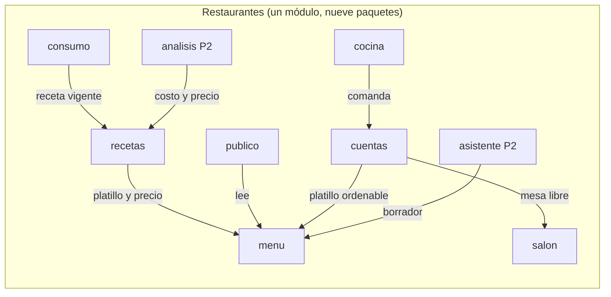

Los paquetes se revisan a mano: **sin prueba de arquitectura interna** (respuesta 10). Regla de capas dentro de cada paquete (igual que Clientes e Inventario): `dominio` (Java puro, sin Spring), `aplicacion` (casos de uso y puertos), `infraestructura` (JDBC, adaptadores), `web` (resolvedores GraphQL), `eventos`, `contratos` (lectores tolerantes de eventos ajenos).

### 2.3 Diagrama de dependencias entre módulos

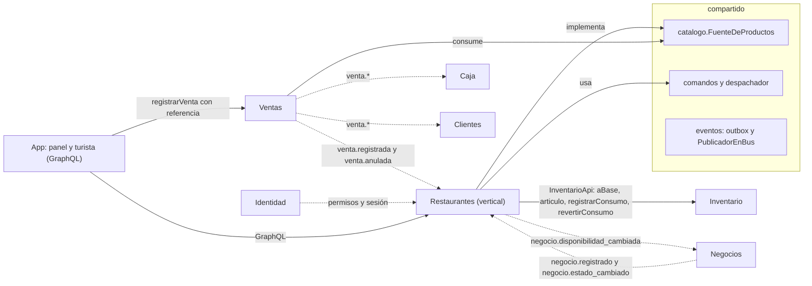

Línea sólida: llamada síncrona permitida. Línea punteada: evento por el bus. **Restaurantes no escribe ventas** (plan de integración §11.4): la app cobra llamando a Ventas por GraphQL.

---

## 3. Alcance

### 3.1 Cortes

| Corte | Qué entrega | Estimado |
|---|---|---|
| **P1a · Restaurante en el panel y en la app** | Menú con precios, etiquetas, temporada y agotado. Recetas con costo teórico y margen. Descuento de insumos al vender y reversa al anular. Menú público para el turista. | ≈ 4.75 d-p |
| **P1b · Servicio en salón** | Zonas y mesas, abrir servicio, cuentas con líneas, comandas por estación (cocina y barra) con tablero, **QR en cada mesa: los comensales piden desde la web o la app y el pedido va directo a cocina**, pedir cuenta, cobro por GraphQL, mesas libres publicadas. | ≈ 6.75 d-p |
| Persistencia y cierre | Migraciones, RLS forzada, siembra demo, revisión. | ≈ 3 d-p |
| **P2** | Análisis de platillos (ingeniería de menú), borrador de menú desde foto o voz con IA, traducción rotulada, combos y comida corrida, propina, reintento de consumo fallido, reabrir cuenta anulada, reinicio diario de agotados, plano visual de mesas, **código de mesa rotatorio opcional para el QR** (D-192). | por estimar |
| **P3** | Reservaciones, pronóstico de demanda por platillo, sugerencia de insumos con IA, dividir cuenta, pago desde el QR, modificadores con precio, stock comprometido, precios por horario. | |
| **Fuera** | Facturación electrónica, cálculo de impuestos, nómina, integración con apps de reparto. | |

Total P1 del servidor ≈ **14.5 días-persona** (4.75 + 6.75 + 3), más ≈ 2.5 de la página web pública (frontend, estimación por confirmar). Supuesto: una persona en la pista C con el contrato de Inventario y Ventas congelado.

### 3.2 Orden de recorte

De abajo hacia arriba: **pedido por QR** (el QR queda con la carta, el restaurante y las reseñas) → **estaciones con estado propio** (vuelve el tablero único) → **tablero de cocina** → **disponibilidad de mesas** → **persistencia JDBC** (se queda en memoria, como Ventas y Caja) → **cuentas y salón**. Con solo P1a un restaurante ya vende por mostrador con Ventas, descuenta insumos por receta y publica su menú. Es el piso que no se recorta.

### 3.3 Camino dorado propuesto para la demo

1. El dueño abre el servicio. La ficha del turista muestra «Mesas libres 12 de 12».
2. Un comensal escanea el **QR de la mesa 5** (sin la app: se abre la web con la carta, el restaurante y sus reseñas) y pide 2 cemitas y 1 agua de horchata. **El pedido va directo a cocina y a barra** y el mesero recibe la alerta. La mesa pasa a ocupada: libres 11 de 12.
3. Los chiles en nogada aparecen «Agotado» porque el restaurante los marcó; otro comensal pide mole, y cocina avisa que ya no hay. El mesero **cancela la línea con el motivo «Agotado»** y el comensal lo ve en su pantalla.
4. Cocina y barra marcan lista su comanda cada una; el mesero entrega.
5. El comensal toca **Pedir la cuenta**; mesero y caja reciben el aviso. El cajero cobra con `registrarVenta`, la cuenta queda pagada y la mesa libre. Si alguien escanea otra vez, se abre una cuenta nueva.
6. En Inventario se ven los insumos descontados (pan, milanesa, quesillo…) y una alerta de bajo mínimo.
7. En el panel: costo teórico y margen de cada platillo.

### 3.4 Calendario

Hoy (2026-10-16) cae dentro del evento (15 al 17 de octubre). Este diseño es para el trabajo posterior. Si el equipo quiere algo mostrable en el stand de inmediato, lo único que cabe es el menú público en memoria (≈ 1 d-p de R1), con su QR de solo menú si sobra tiempo; el resto sigue como mockup.

## 4. Cómo funciona

### 4.1 Menú y venta por mostrador (P1a)
El dueño crea platillos. **El id del platillo es el `producto_id`** que Ventas conoce (D-162): Ventas llama a `FuenteDeProductos.preciosParaVenta` y recibe nombre, unidad `pieza`, precio y `admiteFraccion = false`. La app cobra con `registrarVenta`; Ventas publica `venta.registrada`; Restaurantes lo escucha y descuenta los insumos de la receta.

### 4.2 Receta y costo teórico (P1a)
La receta es una lista de insumos (artículos de Inventario) con cantidad, unidad y merma, por `rendimiento` porciones. Guardar es **preparar → confirmar**: el servidor valida unidades con `aBase`, calcula costo teórico y margen con el CPP de Inventario y los muestra antes de confirmar. Cada guardado crea una versión nueva e inmutable.

Ejemplo con cifras **simuladas**: cemita poblana, precio 85.00.

| Insumo | Neto | Merma | Bruto | CPP | Costo |
|---|---:|---:|---:|---:|---:|
| Pan de cemita | 1 pieza | 0 % | 1 | 6.00 | 6.00 |
| Milanesa | 120 g | 5 % | 126 g | 0.18 | 22.68 |
| Quesillo | 50 g | 0 % | 50 g | 0.16 | 8.00 |
| Aguacate | 60 g | 10 % | 66 g | 0.07 | 4.62 |
| Chipotle | 10 g | 0 % | 10 g | 0.12 | 1.20 |
| Papalo | 3 g | 0 % | 3 g | 0.05 | 0.15 |
| Cebolla | 20 g | 0 % | 20 g | 0.03 | 0.60 |
| **Costo teórico** | | | | | **43.25** |

Margen = 85.00 − 43.25 = **41.75** (49.12 % del precio; costo de ingredientes 50.88 %). Si a un insumo le falta CPP, el costo se marca **incompleto** y se listan los insumos sin costo; nunca se estima (RC-05).

### 4.3 Servicio en salón (P1b)
La **cuenta abierta vive en Restaurantes**. Ventas registra una venta de un solo golpe, así que una cuenta que dura una hora no cabe en ella (H-R2). El mesero abre la cuenta, agrega líneas, envía a cocina (cada envío crea **una comanda por estación**: cocina y barra, según la categoría de cada platillo) y pide la cuenta. Quien tiene Caja la cobra: la app pide `cuentaParaCobro`, que devuelve las líneas agregadas y una **referencia** opaca `restaurantes:cuenta:<id>`; luego llama a `registrarVenta` con esa referencia. Al llegar `venta.registrada`, Restaurantes marca la cuenta como pagada y libera la mesa.

### 4.4 Consumo de insumos
Al llegar `venta.registrada`, por cada línea cuyo producto sea un platillo con modo `RECETA`: toma la **versión de receta vigente en el `ocurrido_en` de la venta**, calcula `cantidad × (1 + merma/100) × cantidadVendida ÷ rendimiento`, suma por artículo y llama **una vez** a `registrarConsumo` con `consumidor = "restaurantes"` y `causaId = venta_id`. Inventario lo hace atómico e idempotente. Un fallo permanente se guarda en `consumo_fallido` y avisa; **la venta nunca se bloquea** (A-01 de Inventario).

### 4.5 Disponibilidad de mesas
Restaurantes calcula `libres`, `total` y `abierto` y publica `negocio.disponibilidad_cambiada` (evento genérico C-01, D-33) solo cuando algo cambia. Negocios lo consume y lo muestra en la ficha (D-107). Restaurantes **no** tiene WebSocket público propio.

### 4.6 QR en cada mesa (P1b)
Cada mesa tiene un QR con un enlace opaco y rotable. Quien lo escanea abre la **app** si la tiene, o una **página web** si no, con la carta, el restaurante y sus reseñas; no necesita cuenta. Si el restaurante tiene el servicio abierto, puede **pedir**: el pedido va **de inmediato** a cocina y barra y alerta a los meseros, sin aceptación previa. El primer pedido de una mesa libre abre su cuenta. El comensal sigue su pedido en pantalla y ve si algo se cancela y por qué.

El control es posterior: el restaurante marca los platillos agotados, el mesero cancela la línea con un motivo y el comensal lo ve. Cuando el comensal (o el personal) **pide la cuenta**, la cuenta pasa a por cobrar y avisa a meseros y caja; mesero o caja cobran con Ventas y la mesa se libera. El siguiente escaneo abre una cuenta nueva. Pagar desde el QR es P3. Reglas en la sección 5.8.

## 5. Reglas de dominio

Cada regla es comprobable y tiene su prueba de aceptación. Prioridad entre corchetes cuando no es P1.

### 5.1 Menú (MN)

| ID | Regla | Prueba |
|---|---|---|
| MN-01 | Platillo: nombre de 2 a 80 caracteres, único entre activos del negocio sin distinguir mayúsculas; precio mayor que 0, máximo 99,999.99, dos decimales. | Precio 0 falla con `PRECIO_INVALIDO`; nombre repetido con `NOMBRE_DUPLICADO`. |
| MN-02 | El id del platillo es el `producto_id` que ve Ventas. Unidad `pieza`, `admiteFraccion = false`. | `ContratoDeFuenteDeProductosTest` (kit de contrato) pasa. |
| MN-03 | La fuente de productos solo responde por platillos **del negocio del contexto**. Un id de otro negocio no aparece. | Dos negocios, mismo id pedido: respuesta vacía. |
| MN-04 | Modo de inventario del platillo: `NINGUNO` (por omisión), `RECETA` o `VINCULO_DIRECTO`. Son excluyentes (K-05). `RECETA` exige receta activa (`RECETA_REQUERIDA`). | Poner `RECETA` sin receta falla; pasar a `VINCULO_DIRECTO` con receta activa falla con `MODO_INVENTARIO_CONFLICTO`. |
| MN-05 | **Agotado:** marca manual. Un platillo agotado no se puede agregar a una línea nueva (`PLATILLO_AGOTADO`); las líneas ya pedidas siguen. La puede marcar quien tenga `restaurantes.menu.agotar` (incluye al cocinero). | Cocinero marca agotado; el mesero recibe el error al agregarlo. |
| MN-06 | **Temporada:** rango opcional mes-día (puede cruzar el fin de año), evaluado en la zona horaria del negocio. Fuera de temporada no se puede ordenar y no sale en el menú público; el panel lo muestra «fuera de temporada». | Chiles en nogada con rango 1 ago a 30 sep: pedirlo el 1 de octubre falla con `FUERA_DE_TEMPORADA`. El rango del ejemplo es dato del dueño. |
| MN-07 | Categoría de menú: nombre, orden y **estación** (`COCINA` o `BARRA`, por omisión `COCINA`). Máximo 30 por negocio. Un platillo tiene una categoría o ninguna. | La 31 falla con `LIMITE_EXCEDIDO`. |
| MN-08 | Etiquetas de un catálogo global (`VEGETARIANO`, `VEGANO`, `SIN_GLUTEN`, `SIN_LACTOSA`, `SIN_FRUTOS_SECOS`, `PICANTE`, `TIPICO_POBLANO`, `DE_TEMPORADA`, `CONTIENE_ALCOHOL`). Máximo 8 por platillo. Son **declaradas, no verificadas** (D-106). | Una etiqueta inexistente falla con `ETIQUETA_INVALIDA`; la app las rotula «declarado por el negocio». |
| MN-09 | `publicado` solo gobierna el **menú público**. Un platillo no publicado se puede vender en salón (D-175). | Platillo no publicado: no sale en `menuPublico`, sí se agrega a una cuenta. |
| MN-10 | Baja lógica con preparar → confirmar. Falla si el platillo está en una cuenta abierta o por cobrar (`PLATILLO_EN_CUENTA_ABIERTA`). `buscar` ya no lo devuelve; `preciosParaVenta` lo devuelve con `activo = false`. | Baja con cuenta abierta falla; tras la baja Ventas rechaza venderlo. |
| MN-11 | Cambiar un precio no toca ventas registradas. Si hay cuentas por cobrar con ese platillo, la respuesta incluye `cuentas_afectadas` y el cobro usa el precio vigente (H-R4). | Cambiar precio con una cuenta por cobrar devuelve su id. |
| MN-12 | Límite de 200 platillos por negocio, como regla versionada. | El 201 falla con `LIMITE_EXCEDIDO`. |
| MN-13 | Ediciones con `version` (bloqueo optimista). | Dos ediciones con la misma versión: la segunda falla con `CONCURRENCIA`. |
| MN-14 | **Agotado, fuera de temporada y publicado gobiernan el pedido en el salón y el menú público, no el cobro** (D-175). Para Ventas, «activo» es solo no estar dado de baja: una cuenta ordenada antes de agotarse se cobra igual. La búsqueda del cajero sí ofrece solo lo que se puede pedir hoy. | `PlatillosParaVentaTest`: un platillo agotado y uno fuera de temporada siguen activos para Ventas; la búsqueda no los devuelve. |

### 5.2 Recetas (RC)

| ID | Regla | Prueba |
|---|---|---|
| RC-01 | Una receta por platillo. Cada guardado crea una **versión nueva inmutable** (`numero + 1`) y cierra la anterior (`vigente_hasta = ahora`). | Guardar dos veces deja dos versiones; solo una sin `vigente_hasta`. |
| RC-02 | De 1 a 30 insumos; un artículo no se repite en la misma versión (`INSUMO_REPETIDO`); cantidad mayor que 0; la unidad debe convertirse a la base del artículo (validada con `aBase`); merma de 0 a 100. | Gramos de un artículo en piezas falla con `UNIDAD_NO_CONVERTIBLE`. |
| RC-03 | Un artículo con rastreo `SERIE` o inactivo no puede ser insumo (S-05, D-27): `SERIE_EN_RECETA`, `ARTICULO_INACTIVO`. | Requiere `rastreo` y `activo` en la respuesta de `aBase` (R-I1). |
| RC-04 | `rendimiento` entero de 1 a 500, **por versión** (así una venta vieja conserva las porciones de su versión). Las cantidades son para esas porciones. | Mole de 40 porciones: una venta de 1 descuenta 1/40 de cada insumo. |
| RC-05 | **Costo teórico** = Σ (cantidad base × (1 + merma/100) × CPP) ÷ rendimiento, HALF_UP a 2 decimales (D-20). Si un insumo no tiene CPP, el costo es `INCOMPLETO` y lista los insumos sin costo. Nunca se estima. | Ejemplo de la sección 4.2: 43.25. Sin CPP: `INCOMPLETO`. |
| RC-06 | Margen = precio − costo; porcentaje = margen ÷ precio. Con costo incompleto no hay margen. Los precios se entienden como precio final al público; Restaurantes no calcula impuestos. | 85.00 y 43.25: 41.75 y 49.12 %. |
| RC-07 | Una venta usa la **versión vigente en su `ocurrido_en`**, no en el momento de procesarla. | Venta de las 13:00, receta cambiada a las 13:05, evento procesado a las 13:10: usa la versión anterior. |
| RC-08 | Guardar receta es preparar → confirmar. El resumen trae costo, margen y avisos; confirmar vuelve a validar (`COMANDO_CAMBIO` si cambió un precio o una unidad). | Cambiar el precio entre los pasos da `COMANDO_CAMBIO`. |
| RC-09 | Desactivar la receta de un platillo en modo `RECETA` falla (`RECETA_REQUERIDA`) hasta cambiar su modo. | |
| RC-10 | Costo y margen solo los ve quien tenga `restaurantes.costo.ver`. Sin ese permiso la receta se ve sin costos. | Un cocinero ve insumos y cantidades, no costos. |

### 5.3 Consumo (CM)

| ID | Regla | Prueba |
|---|---|---|
| CM-01 | Con `venta.registrada` procesa solo las líneas cuyo `producto_id` es un platillo de **este negocio** en modo `RECETA`. Ignora las demás (de otro vertical o con vínculo directo). | Venta mixta con una cemita y un producto ajeno: solo descuenta la cemita. |
| CM-02 | Suma por artículo todas las líneas de la venta y hace **una** llamada `registrarConsumo(consumidor = "restaurantes", causaId = venta_id, ocurridoEn, lineas)`. | Dos cemitas en líneas distintas: una llamada con la suma. |
| CM-03 | Idempotente: `evento_procesado (consumidor, evento_id)` y, en Inventario, `(negocio, causaId, consumidor)` (K-01). | El mismo evento dos veces deja un solo descuento. |
| CM-04 | `venta.anulada` llama a `revertirConsumo("restaurantes", venta_id)` aunque Restaurantes nunca haya visto la venta. Si llegó antes, Inventario guarda la marca `ANULADO_PREVIO` (K-04). | Anulada antes que registrada: el consumo posterior devuelve `OMITIDO_ANULADO_PREVIO`. |
| CM-05 | Redondeo: se calcula con escala 8 y se redondea **una vez** por artículo, HALF_UP a 4 decimales (D-20). | |
| CM-06 | Error **permanente** (artículo inactivo, unidad no convertible, receta ausente): se guarda en `consumo_fallido` con las líneas, se publica `restaurantes.consumo_fallido`, se marca el evento procesado y **no se reintenta**. Error **reintentable** (`CONCURRENCIA`, `ERROR_TEMPORAL`): no se marca procesado y el bus reintenta (D-122). | Artículo dado de baja: una fila en `consumo_fallido`, una alerta, la venta intacta. |
| CM-07 | El stock negativo se permite; las alertas las da Inventario (A-01). | |
| CM-08 | El aviso de fallo guarda tipo e id, nunca los datos de la venta en el registro del servidor. | |
| CM-09 | **[P2]** `reintentarConsumo(ventaId)` vuelve a intentar con las líneas guardadas y la receta vigente en el `ocurrido_en` original. | |

### 5.4 Salón y disponibilidad (MS)

| ID | Regla | Prueba |
|---|---|---|
| MS-01 | Hasta 10 zonas y 60 mesas por negocio. Mesa: etiqueta única en el negocio, capacidad de 1 a 20. | La mesa 61 falla con `LIMITE_EXCEDIDO`. |
| MS-02 | **Estado derivado**, no guardado: `BLOQUEADA` (marca manual), `OCUPADA` (tiene cuenta abierta o por cobrar) o `LIBRE`. | Abrir y pagar una cuenta cambia el estado sin otra escritura. |
| MS-03 | Una mesa tiene a lo más una cuenta no pagada (índice único parcial). | Abrir otra cuenta falla con `MESA_OCUPADA`, también con dos peticiones simultáneas. |
| MS-04 | `libres` = mesas activas, no bloqueadas y sin cuenta. `total` = mesas activas no bloqueadas. `abierto` = servicio abierto. | Bloquear una mesa libre baja `libres` y `total` en 1. |
| MS-05 | `abrirServicio` y `cerrarServicio` (manuales). Cerrar con cuentas abiertas exige permiso de gerente y motivo. Sin servicio abierto no se abren cuentas (`SERVICIO_CERRADO`). | |
| MS-06 | Publica `negocio.disponibilidad_cambiada` **solo cuando cambia** `(libres, total, abierto)` respecto de lo último publicado (`disponibilidad_publicada`), en la misma transacción del cambio. Cada evento trae el estado completo y `actualizado_en`, así que un reordenamiento no daña. | Cerrar y abrir una cuenta deja dos eventos; repetir `bloquearMesa` sobre una ya bloqueada, ninguno. |
| MS-07 | Baja lógica de mesas y zonas; no se borra lo que tiene cuentas históricas. | |
| MS-08 | Modo de servicio del restaurante: `MESAS`, `MOSTRADOR` o `AMBOS`. En `MOSTRADOR` la cuenta no lleva mesa (para llevar). | |
| MS-09 | Cada mesa activa tiene un QR (sección 5.8). Dar de baja la mesa invalida su QR. | Mesa dada de baja: `mesaPorQr` responde `null`. |

### 5.5 Cuentas y líneas (CT)

| ID | Regla | Prueba |
|---|---|---|
| CT-01 | Abrir cuenta: servicio abierto, mesa libre (o sin mesa en mostrador), comensales de 1 a 50 (superar la capacidad solo avisa). Estado `ABIERTA`, número consecutivo por negocio. La abre el personal con `abrirCuenta` o **el primer pedido por QR** (QR-05), que no lleva comensales ni `abierta_por`. | Una cuenta abierta por QR queda con `origen = QR` y sin comensales. |
| CT-02 | Agregar línea: cuenta `ABIERTA`; platillo **ordenable** (activo, en temporada, no agotado); cantidad entera de 1 a 99; nota de hasta 80 caracteres; bandera `marca_alergia` opcional. | Agregar a una cuenta por cobrar falla con `CUENTA_NO_ABIERTA`. |
| CT-03 | Estados de línea: `PENDIENTE` (solo del personal; se quita libremente) → `ENVIADA` → `ANULADA`. Las líneas del QR **nacen `ENVIADA`**. Anular exige **motivo** (QR-10): con `restaurantes.linea.anular` (el mesero la tiene) mientras su comanda no esté `LISTA`; después, con `linea.anular_preparada` (gerente en adelante) y preparar → confirmar, porque ya hay merma. Queda registrada. | Un mesero anula una línea en `NUEVA` y no una en `LISTA`. Sin motivo falla con `MOTIVO_REQUERIDO`. |
| CT-04 | `enviarACocina` crea **una comanda por estación** (cocina y barra, según la categoría de cada platillo; sin categoría, cocina) con las líneas `PENDIENTE` (al menos una) y las pasa a `ENVIADA`. Publica `restaurantes.comanda_enviada` por cada comanda. | Un envío con una cemita y una bebida crea dos comandas. Enviar sin líneas pendientes falla con `SIN_LINEAS_PENDIENTES`. |
| CT-05 | `pedirCuenta`: `ABIERTA` → `POR_COBRAR`. Lo pide el personal o el comensal por QR (QR-13). Exige al menos una línea no anulada y ninguna `PENDIENTE` (`LINEAS_SIN_ENVIAR`). Guarda `total_calculado` con los precios vigentes y publica `restaurantes.cuenta_solicitada`. | |
| CT-06 | `reabrirCuenta`: `POR_COBRAR` → `ABIERTA`, antes del cobro. | |
| CT-07 | `cuentaParaCobro` (cuenta `POR_COBRAR`) devuelve las líneas **agregadas por platillo**, el total calculado y la `referencia`. Es de solo lectura: Restaurantes no escribe la venta. | |
| CT-08 | **Vínculo con la venta:** al llegar `venta.registrada` con `referencia = restaurantes:cuenta:<id>` de una cuenta del mismo negocio, la cuenta pasa a `PAGADA` con su `venta_id`. Idempotente por `venta_id`. Si las líneas vendidas difieren de las de la cuenta, queda `discrepancia = true` y se avisa. | Evento repetido: una cuenta pagada. |
| CT-09 | **La venta gana:** una venta registrada sobre una cuenta `ABIERTA` (alguien cobró mientras se reabría) también la marca `PAGADA`, con discrepancia. | Carrera entre reabrir y cobrar: la cuenta termina pagada. |
| CT-10 | `venta.anulada` de una venta vinculada deja la cuenta `PAGADA` con `venta_anulada = true`; la mesa no se reocupa. **[P2]** reabrir. | |
| CT-11 | `cancelarCuenta` con motivo (el mesero tiene `restaurantes.cuenta.cancelar`): directa si ninguna línea llegó a `LISTA`; si alguna está `LISTA` o `ENTREGADA`, exige `linea.anular_preparada` y preparar → confirmar. Anula las líneas y libera la mesa. | Una cuenta por QR sin comensales se cancela con motivo `SIN_COMENSALES`. |
| CT-12 | La cuenta **no guarda datos personales** del cliente. Si hay cliente, lo pasa la app a Ventas (`cliente_id`). La nota de línea y el hash del dispositivo (QR-12) se borran a los 30 días (D-172). | Una tarea diaria vacía las notas y los hashes viejos. |
| CT-13 | El precio que cobra Ventas es el vigente al confirmar la venta. La cuenta muestra el vigente al pedirla. Limitación conocida (H-R4). | |
| CT-14 | `Idempotency-Key` en `abrirCuenta` y `agregarLinea`: reintentar la misma petición no duplica. | Mismo `Idempotency-Key` dos veces: una línea. |
| CT-15 | `liberarMesa` (gerente en adelante, con motivo): cierra una cuenta que se cobró fuera del flujo (sin `referencia`) y libera la mesa sin vincular venta. Queda auditado. | Una cuenta `POR_COBRAR` cobrada a mano se cierra sin `venta_id`. |

### 5.6 Cocina (CD)

| ID | Regla | Prueba |
|---|---|---|
| CD-01 | Estados: `NUEVA` → `EN_PREPARACION` → `LISTA` → `ENTREGADA`; solo se permite devolver `LISTA` → `EN_PREPARACION`. Cada cambio guarda actor y hora. | `NUEVA` → `LISTA` falla con `TRANSICION_INVALIDA`. |
| CD-02 | `restaurantes.comanda.preparar` avanza hasta `LISTA`; `restaurantes.comanda.entregar` marca `ENTREGADA`. | El mesero no puede marcar `LISTA`. |
| CD-03 | **Estaciones con estado propio** (D-179): cada comanda pertenece a una estación (`COCINA` o `BARRA`, la de la categoría de sus platillos) y tiene su propio estado. El tablero de cada estación muestra sus comandas no entregadas, de la más antigua a la más nueva. | Una cemita lista en cocina no cambia el estado de la comanda de bebidas. |
| CD-04 | Tiempo de preparación = `LISTA` − `enviada_en`, calculado por el código. Se resalta si pasa un umbral (regla versionada, 15 min por omisión). | |
| CD-05 | Anular una línea enviada actualiza la comanda (`comanda_actualizada`) y el tablero la muestra tachada. | |
| CD-06 | Las líneas con `marca_alergia` se resaltan en el tablero. No se guarda detalle médico. | |
| CD-07 | Las suscripciones solo entregan eventos del negocio de la sesión (SG-16). | Dos negocios conectados: ninguno recibe avisos del otro. |
| CD-08 | Las comandas de un mismo envío comparten un `envio_id`, así que el mesero ve «mesa 5: cocina lista, barra en preparación». Anular una línea enviada actualiza solo la comanda de su estación. | Anular una bebida no toca la comanda de cocina. |
| CD-09 | Quien trabaja en barra usa el rol `COCINERO` y ve las dos estaciones; el filtro es de pantalla, no de permiso (D-191). | |

### 5.7 Menú público (PB)

| ID | Regla | Prueba |
|---|---|---|
| PB-01 | `menuPublico` responde solo si el negocio está **visible**: `ACTIVO` y publicado (R-N2). Si no, responde `null`. | Negocio pausado: `null`; al reanudar, vuelve. |
| PB-02 | Idioma `es-MX` por omisión. Con `en`, un platillo sin traducción sale en español con `traducido = false`. Una traducción automática se rotula (D-43). | |
| PB-03 | **Lista permitida de campos:** id, nombre, descripción, precio, categoría, etiquetas, agotado, foto con URL firmada, `actualizado_en`. Nunca costos, recetas, insumos, margen, notas, ni estados internos (PU-03). | Ninguna consulta pública devuelve esos campos, ni con alias. |
| PB-04 | Sin sesión. Tope de 200 platillos, tasa limitada, sin paginación. | |
| PB-05 | Muestra el precio vigente (el mismo que cobra Ventas) y la leyenda «Precios y disponibilidad sujetos a cambio». | |
| PB-06 | Lee de una **vista de solo lectura** (`v_menu_publico`), igual que `v_negocio_publico`. | La aplicación no tiene `SELECT` sobre las tablas base en la ruta pública. |

### 5.8 Mesa por QR (QR)

Un QR por mesa, definido en P1 (D-180). **Qué es:** un enlace opaco a la mesa. El comensal ve la carta, el restaurante y sus reseñas y puede pedir; **el pedido va directo a cocina**, sin aceptación del personal (D-181). **Qué no es:** no abre sesión, no identifica a la persona y no cobra.

| ID | Regla | Prueba |
|---|---|---|
| QR-01 | Cada mesa activa tiene un `qr_token` aleatorio de 128 bits en base64url, único. El QR codifica `https://<dominio>/m/<token>`. El token no contiene el id de la mesa ni del negocio. | Dos mesas dan tokens distintos; el token no contiene el id. |
| QR-02 | `regenerarQrDeMesa` genera un token nuevo e invalida el anterior de inmediato. Exige `restaurantes.salon.configurar`. | Con el token viejo, `mesaPorQr` responde `null`. |
| QR-03 | `mesaPorQr(token)`, **sin sesión**, devuelve solo: nombre y `negocio_id` del negocio, etiqueta de la mesa, `servicio_abierto`, `acepta_pedidos` y `estado_cuenta` (`SIN_CUENTA`, `ABIERTA`, `SOLICITADA`). Nunca ids de cuenta, comensales, totales ni líneas. Un token inexistente, rotado o de una mesa dada de baja responde igual: `null`. | Ninguna respuesta pública trae datos de la cuenta, ni con alias. |
| QR-04 | **La página pública** (web o app) muestra tres cosas, todas con consultas públicas que ya existen o están diseñadas: la carta (`menuPublico`, PB-01 a PB-06), el restaurante (`negocioPublico`) y sus reseñas (`resenasDeNegocio`). No pide cuenta ni registro. Con el negocio no visible no hay nada que mostrar. | Negocio pausado: el QR responde `null`. |
| QR-05 | `acepta_pedidos` es verdadero si el negocio es visible, el restaurante tiene el QR habilitado (`qr_habilitado`), el servicio está abierto, la mesa no está bloqueada ni pausada y su cuenta no fue solicitada. Si la mesa **no tiene cuenta, el primer pedido la abre** (`origen = QR`). Dos primeros pedidos simultáneos dejan **una** cuenta (índice único, MS-03). | Dos `pedirPorQr` simultáneos sobre una mesa libre: una cuenta, dos pedidos. |
| QR-06 | Las líneas del QR nacen `ENVIADA` y el pedido crea **de inmediato una comanda por estación** (CT-04). No hay aceptación previa del personal. Un platillo agotado, fuera de temporada o inactivo se rechaza con su código (`PLATILLO_AGOTADO`, `FUERA_DE_TEMPORADA`, `PLATILLO_NO_ORDENABLE`). | Un pedido por QR aparece en el tablero de cocina sin ninguna acción del mesero. |
| QR-07 | **Alerta a los meseros:** cada pedido publica `restaurantes.pedido_qr_recibido` (mesa, número de líneas y si abrió la cuenta). Llega por `salonActualizado` a quien tenga `restaurantes.salon.ver`. | |
| QR-08 | `confirmarPresencia(cuentaId)` (`restaurantes.cuenta.abrir`) marca que un mesero ya está con la mesa. Es solo informativo: no cambia cocina ni cobro. Sirve para distinguir cuentas por QR todavía no atendidas. | Una cuenta por QR nace sin presencia confirmada. |
| QR-09 | **El restaurante es responsable de marcar lo que no hay** (`menu.agotar`, MN-05). Un platillo agotado sale deshabilitado en la página y el servidor lo rechaza. Nada se marca solo. | |
| QR-10 | **El mesero cancela y avisa.** `anularLinea(lineaId, motivo)` exige un código: `AGOTADO`, `ERROR_DEL_PEDIDO`, `SIN_COMENSALES`, `COCINA_NO_PUEDE` u `OTRO` (con texto de hasta 80 caracteres). El servidor compone el mensaje que ve el comensal a partir del código; el texto libre solo acompaña a `OTRO`. | Cancelar con `AGOTADO`: el comensal ve «Cancelado: agotado». |
| QR-11 | `estadoDePedidoQr(token, dispositivoId)`, **sin sesión**, devuelve las líneas pedidas **desde ese dispositivo** con su estado (`EN_COCINA`, `PREPARANDO`, `LISTO`, `ENTREGADO`, `CANCELADO` con su motivo) y el estado de la cuenta. La página lo consulta cada ~10 segundos. Nunca devuelve líneas de otros dispositivos ni totales de la mesa. En P1 no hay WebSocket público (D-186). | Dos dispositivos en la misma mesa: cada uno ve solo lo suyo. |
| QR-12 | La página genera un id aleatorio de dispositivo y lo guarda en el navegador. El servidor guarda solo su **hash con clave** (`linea_cuenta.dispositivo_hash`), nunca el id. Se borra a los 30 días (CT-12). | |
| QR-13 | `pedirCuentaPorQr(token)` y `pedirCuenta` del personal hacen lo mismo: la cuenta pasa a `POR_COBRAR` y se publica `restaurantes.cuenta_solicitada` para meseros y caja. Desde entonces `pedirPorQr` falla con `CUENTA_SOLICITADA` («pide al mesero»); el personal puede reabrirla (CT-06). | Después de pedir la cuenta, un pedido nuevo por QR falla. |
| QR-14 | **Cobro y liberación:** mesero con caja (`MESERO_CAJA`) o cajero cobran con `registrarVenta` (CT-07); al llegar `venta.registrada` la cuenta pasa a `PAGADA` y la mesa se libera (CT-08). **El siguiente escaneo abre una cuenta nueva** con otro número; la pagada no recibe más líneas. | Tras el pago, `acepta_pedidos` vuelve a ser verdadero y un pedido abre una cuenta distinta. |
| QR-15 | **Límites del pedido y de la cuenta:** hasta 20 líneas por pedido, cantidad de 1 a 10 por línea, 60 líneas por cuenta de QR y un monto estimado máximo por cuenta (regla versionada, 3,000.00 por omisión). Al pasarlos, `LIMITE_QR_EXCEDIDO` («pide al mesero»); el personal puede seguir agregando. Todo `pedirPorQr` lleva `Idempotency-Key`. | El pedido de 21 líneas falla; repetir la llave no duplica. |
| QR-16 | **Límite de tasa** por token, por dispositivo y por IP (5 pedidos por minuto por token por omisión), además del tope global de la puerta (SG-10). Excederlo responde `TASA_EXCEDIDA`. | Seis pedidos en un minuto con el mismo token: el sexto se rechaza. |
| QR-17 | **Defensa contra bromas:** tres cuentas por QR canceladas con motivo `SIN_COMENSALES` en la misma mesa dentro de una hora **pausan el QR de esa mesa** (`qr_pausado_hasta`, una hora) y avisan a quien tenga `servicio.operar`. El restaurante puede apagar los pedidos por QR de todo el local (`qr_habilitado = false`) y volver a encenderlos. | La tercera cancelación por `SIN_COMENSALES` pausa la mesa; `mesaPorQr` devuelve `acepta_pedidos = false`. |
| QR-18 | Sin datos personales de quien pide: no hay cuenta, nombre ni teléfono. La nota (80 caracteres) y la bandera de alergia siguen CT-12. | |
| QR-19 | Contra QR suplantados: la página muestra el nombre del negocio y la mesa, y el QR impreso lleva el enlace en texto. Un token de la mesa A no puede pedir en la mesa B ni en otro negocio. | Dos negocios: el token de uno no crea líneas en el otro. |
| QR-20 | Todo pedido va a la **cuenta de la mesa**. No hay cuenta por comensal (dividir es P3) ni pago desde el QR (P3). Quienes están en la misma mesa comparten la cuenta. | `cuentaParaCobro` suma las líneas no anuladas de todos los orígenes. |
| QR-21 | El enlace abre la app si está instalada y, si no, una **web pública** (D-185). El servidor entrega la URL (`qrDeMesa`); el cliente dibuja el QR. La web exige CORS acotado a su origen para las consultas públicas (R-F2). | |

### 5.9 Seguridad y consistencia (SR)

| ID | Regla | Prueba |
|---|---|---|
| SR-01 | `negocio_id` sale siempre del contexto de la sesión, nunca de un argumento (SG-02). La única excepción es `menuPublico`, cuyo objeto es el negocio consultado. | |
| SR-02 | Seguridad por fila forzada en todas las tablas (`app.negocio_id`). | Un negocio no ve ni escribe filas de otro (prueba contra Postgres real). |
| SR-03 | Cada operación GraphQL está declarada en la tabla de operaciones con su permiso (SG-21), y el permiso se exige también al confirmar un comando antes de gastar el token (D-126). | Quitar el rol entre los dos pasos da `PERMISO_DENEGADO` sin gastar el token. |
| SR-04 | Cada caso de uso es una sola transacción y publica sus eventos por el outbox (D-103, `FronteraTransaccional`). | Una falla a la mitad no deja evento ni cambio. |
| SR-05 | Los costos y márgenes exigen `restaurantes.costo.ver`. | |
| SR-06 | Auditoría de la plataforma para: cambio de precio, anular línea enviada, cancelar cuenta, cerrar servicio con cuentas, guardar receta. | |
| SR-07 | Los errores se enmascaran; cada código tiene plantilla en español de México; el servidor no improvisa texto. | |

### 5.10 Demostración (DM)

| ID | Regla | Prueba |
|---|---|---|
| DM-01 | Al llegar `negocio.registrado` de un negocio **simulado** con giro `RESTAURANTE`, se crea su extensión y, con el perfil `demo`, un menú sembrado y rotulado «de demostración». | |
| DM-02 | La siembra crea sus artículos en Inventario por su API pública, no por tablas. | |
| DM-03 | `restablecer` borra cuentas, comandas y consumos fallidos de los negocios simulados y deja la siembra como estaba. No toca negocios reales. | |
| DM-04 | Prohibido con el perfil `produccion`: la aplicación no arranca si la bandera de demo está encendida. | |

### 5.11 IA (IA) — P2

| ID | Regla |
|---|---|
| IA-01 | El modelo **interpreta, el código decide**: el borrador de menú es una propuesta; nada se guarda sin que la persona lo confirme (preparar → confirmar). |
| IA-02 | Un precio leído de una foto se muestra tal cual se leyó y se confirma uno por uno. El modelo no inventa, completa ni «corrige» precios. |
| IA-03 | La traducción automática se rotula como tal y el dueño puede editarla (D-43). |
| IA-04 | El modelo solo recibe la imagen o el texto que la persona subió. Nunca recibe cuentas, ventas, clientes ni recetas. |
| IA-05 | Si el modelo falla o no responde, la captura manual sigue funcionando. |

---

## 6. Datos

Llaves UUIDv7. Toda tabla lleva `negocio_id` con seguridad por fila forzada. Dinero `NUMERIC(14,2)`, cantidades `NUMERIC(14,4)`, factores `NUMERIC(18,8)`. Migraciones Flyway: `V037` (permisos) y `V060` a `V069`.

### 6.1 Tablas

| Tabla | Columnas principales | Restricciones y notas | Migración |
|---|---|---|---|
| `restaurante` | `negocio_id` PK, `modo_servicio`, `servicio_abierto`, `qr_habilitado`, `visible`, `version`, `creado_en` | Se crea al escuchar `negocio.registrado` con giro `RESTAURANTE`. `visible` se alimenta de eventos de Negocios. `qr_habilitado` apaga o enciende los pedidos por QR de todo el local (QR-17) | V060 |
| `categoria_menu` | `id`, `negocio_id`, `nombre`, `orden`, `estacion`, `activa` | Único `(negocio_id, lower(nombre))` entre activas. Máx. 30 | V060 |
| `platillo` | `id` (= `producto_id`), `negocio_id`, `categoria_id` (nulo), `nombre`, `descripcion`, `precio`, `modo_inventario`, `agotado`, `temporada_desde`, `temporada_hasta`, `publicado`, `activo`, `foto_clave`, `nombre_en`, `descripcion_en`, `traduccion_origen`, `version`, `creado_en`, `actualizado_en` | Único `(negocio_id, lower(nombre))` entre activos. `CHECK (precio > 0)`. Las columnas `*_en` y `traduccion_origen` son P2 | V060 |
| `etiqueta_platillo` (global) | `codigo` PK, `nombre`, `orden` | Siembra del MN-08 | V060 |
| `platillo_etiqueta` | `platillo_id`, `etiqueta` | PK `(platillo_id, etiqueta)`. Máx. 8 | V060 |
| `receta` | `id`, `negocio_id`, `producto_id`, `version`, `creada_en`, `actualizada_en` | Único `(negocio_id, producto_id)`. Está activa si tiene una versión abierta (no se guarda). Nombre de columna igual al contrato de `inventario.md` §5.2 | V061 |
| `receta_version` | `id`, `receta_id`, `numero`, `rendimiento`, `vigente_desde`, `vigente_hasta` (nulo), `creada_por` | **Solo inserción**; `vigente_hasta` es la única columna que se actualiza, una vez. El `rendimiento` es de cada versión | V061 |
| `receta_insumo` | `receta_version_id`, `articulo_id` (opaco), `cantidad`, `unidad`, `merma_pct` | PK `(receta_version_id, articulo_id)`. `merma_pct` entre 0 y 100 | V061 |
| `zona` | `id`, `negocio_id`, `nombre`, `orden`, `activa` | Máx. 10 | V062 |
| `mesa` | `id`, `negocio_id`, `zona_id`, `etiqueta`, `capacidad`, `bloqueada`, `activa`, `qr_token`, `qr_generado_en`, `qr_pausado_hasta`, `version` | Único `(negocio_id, lower(etiqueta))` entre activas. Máx. 60. `qr_token` único en toda la base (la ruta pública entra por él sin negocio) | V062 |
| `cuenta` | `id`, `negocio_id`, `numero`, `mesa_id` (nulo), `estado`, `origen` (`PERSONAL` o `QR`), `comensales` (nulo), `abierta_por` (nulo si es QR), `presencia_confirmada`, `solicitada_por` (`PERSONAL` o `QR`), `abierta_en`, `pedida_en`, `cerrada_en`, `total_calculado`, `venta_id` (opaco, nulo), `discrepancia`, `venta_anulada`, `version` | Índice único parcial `(negocio_id, mesa_id)` donde `estado IN ('ABIERTA','POR_COBRAR')`. Único `(negocio_id, venta_id)` si no es nulo | V062 |
| `linea_cuenta` | `id`, `negocio_id`, `cuenta_id`, `comanda_id` (nulo), `platillo_id`, `cantidad`, `precio_referencia`, `nota`, `marca_alergia`, `estado`, `origen` (`PERSONAL` o `QR`), `dispositivo_hash` (nulo), `agregada_por` (nulo si es QR), `agregada_en`, `anulada_por`, `anulada_motivo_codigo`, `anulada_motivo_texto` | `precio_referencia` es informativo; cobra Ventas. `CHECK (cantidad BETWEEN 1 AND 99)`. `dispositivo_hash` y `nota` se vacían a los 30 días | V062 |
| `comanda` | `id`, `negocio_id`, `cuenta_id`, `envio_id`, `estacion`, `numero`, `estado`, `enviada_en`, `lista_en`, `entregada_en`, `version` | `envio_id` agrupa las comandas de un mismo envío. Índice por `(negocio_id, estacion, estado)` para cada tablero | V062 |
| `consumo_fallido` | `id`, `negocio_id`, `venta_id`, `codigo`, `detalle`, `lineas` (jsonb), `creado_en`, `resuelto_en` | Las líneas permiten el reintento P2 (CM-09) | V063 |
| `disponibilidad_publicada` | `negocio_id` PK, `libres`, `total`, `abierto`, `publicado_en` | Para publicar solo los cambios (MS-06) | V063 |
| `evento_procesado` | `consumidor`, `evento_id`, `procesado_en` | PK `(consumidor, evento_id)`. Se purga a los 90 días | V063 |
| `preparacion` | `token_hash` PK, `negocio_id`, `actor`, `comando_tipo`, `comando_hash`, `comando`, `resumen`, `expira_en`, `usado_en` | Patrón de `compartido.comandos`. `comando` y `resumen` son `TEXT` (D-112) | V063 |
| `venta_platillo` **[P2]** | `venta_id`, `linea`, `negocio_id`, `producto_id`, `cantidad`, `importe`, `costo_teorico`, `ocurrido_en`, `anulada` | Alimenta el análisis. Escrita por el mismo consumidor | V066 |

Vista pública `v_menu_publico` (V064) y seguridad por fila forzada de todas las tablas (V065).

### 6.2 Diagrama entidad-relación

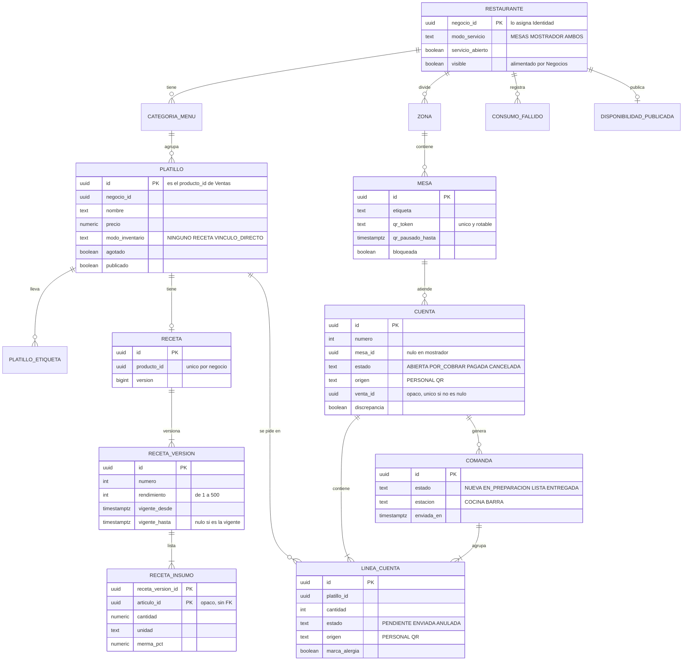

### 6.3 Estados

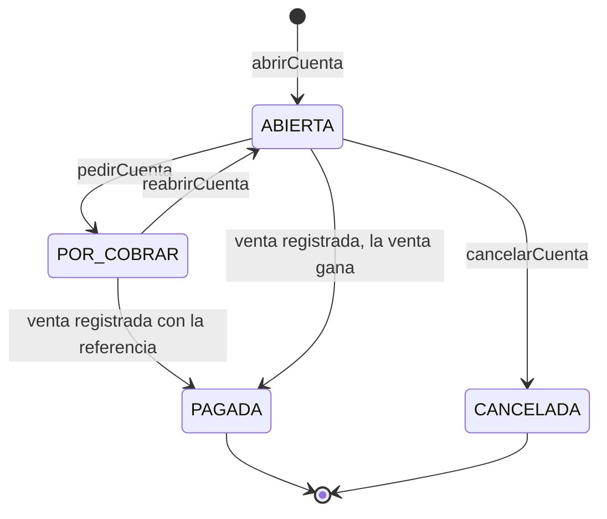

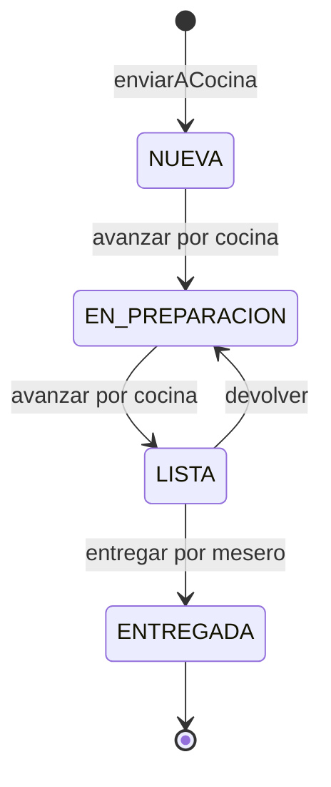

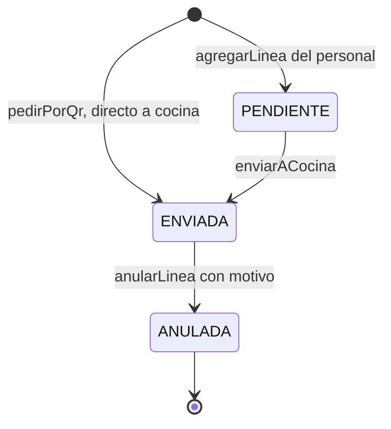

La mesa no tiene estado propio: se deriva de su cuenta (MS-02).

---

## 7. API interna en Java

Restaurantes no ofrece API Java a otros módulos (R4: nadie depende de él). Sus casos de uso los llaman los resolvedores GraphQL de `restaurantes.web`. Lo único que otros módulos ven de él es la implementación de `FuenteDeProductos` (interfaz de `compartido`).

| Paquete | Casos de uso (todos con `ContextoNegocio`, sin `negocioId` como parámetro) |
|---|---|
| `menu` | `crearCategoria`, `editarCategoria`, `crearPlatillo`, `editarPlatillo`, `marcarAgotado`, `publicarPlatillo`, `darDeBajaPlatillo` (comando), `platillos`, `platillo`, `categorias`, `resumenDeMenu` |
| `recetas` | `guardarReceta` (comando), `receta`, `costoDeReceta` |
| `consumo` | `aplicarVenta(evento)`, `revertirVenta(evento)`, `consumosFallidos` |
| `salon` | `crearZona`, `crearMesa`, `editarMesa`, `bloquearMesa`, `abrirServicio`, `cerrarServicio`, `salon`, `recalcularDisponibilidad`, `qrDeMesa`, `regenerarQr`, `pausarQr`, `habilitarQr` |
| `cuentas` | `abrirCuenta`, `agregarLinea`, `quitarLineaPendiente`, `enviarACocina`, `pedirCuenta`, `reabrirCuenta`, `confirmarPresencia`, `anularLinea`, `cancelarCuenta`, `liberarMesa`, `pedirPorQr`, `pedirCuentaPorQr`, `anularLineaPreparada` (comando), `cancelarCuentaPreparada` (comando), `cuenta`, `cuentasAbiertas`, `cuentaParaCobro`, `vincularVenta(evento)` |
| `cocina` | `comandas`, `avanzarComanda`, `devolverComanda` |
| `publico` | `menuPublico`, `mesaPorQr`, `estadoDePedidoQr` |

**Puerto hacia Inventario** (interfaz propia `InventarioPuerto`, con adaptador sobre `InventarioApi` y un doble en pruebas, para poder programar sin esperar a Inventario): `aBase`, `articulo`, `registrarConsumo`, `revertirConsumo`.

**Códigos de error** (cada uno con plantilla en español): `PRECIO_INVALIDO`, `NOMBRE_DUPLICADO`, `RECETA_REQUERIDA`, `MODO_INVENTARIO_CONFLICTO`, `PLATILLO_AGOTADO`, `FUERA_DE_TEMPORADA`, `PLATILLO_NO_ORDENABLE`, `PLATILLO_EN_CUENTA_ABIERTA`, `ETIQUETA_INVALIDA`, `LIMITE_EXCEDIDO`, `INSUMO_REPETIDO`, `UNIDAD_NO_CONVERTIBLE`, `SERIE_EN_RECETA`, `ARTICULO_INACTIVO`, `MESA_OCUPADA`, `SERVICIO_CERRADO`, `CUENTA_NO_ABIERTA`, `SIN_LINEAS_PENDIENTES`, `LINEAS_SIN_ENVIAR`, `MOTIVO_REQUERIDO`, `CUENTA_SOLICITADA`, `QR_INVALIDO`, `QR_PAUSADO`, `QR_DESHABILITADO`, `LIMITE_QR_EXCEDIDO`, `TASA_EXCEDIDA`, `TRANSICION_INVALIDA`, `PERMISO_DENEGADO`, `CONCURRENCIA`, `TOKEN_INVALIDO`, `TOKEN_EXPIRADO`, `TOKEN_USADO`, `COMANDO_CAMBIO`.

---

## 8. GraphQL (propuesta)

Tipos con prefijo `Rest` (D-130): `Cuenta`, `Mesa` y `Platillo` chocarían con Identidad y con el resto del esquema. El negocio sale del contexto y no es argumento (SG-02), salvo en `menuPublico`. Las operaciones se registran en `OperacionesDeRestaurantes` (SG-21). Paginación por cursor, 20 por omisión y 100 como máximo (D-131).

### 8.1 Consultas

| Operación | Permiso | Devuelve |
|---|---|---|
| `categoriasDeMenu` | `restaurantes.menu.ver` | `[RestCategoria!]!` |
| `platillos(filtro, primeros, despues)` | `restaurantes.menu.ver` | `RestPlatilloConexion!` (filtros: texto, categoría, sin receta, agotados, fuera de temporada) |
| `platillo(id)` | `restaurantes.menu.ver` | `RestPlatillo` |
| `resumenDeMenu` | `restaurantes.menu.ver` | Conteos y **cobertura de recetas** (platillos con receta sobre total) |
| `receta(platilloId)` | `restaurantes.receta.ver` | `RestReceta` (sin costos si no tiene `costo.ver`) |
| `costoDeReceta(platilloId)` | `restaurantes.costo.ver` | `RestCostoReceta` (costo, margen, `incompleto`, insumos sin costo) |
| `salon` | `restaurantes.salon.ver` | `RestSalon!` (zonas, mesas con estado derivado, cuenta resumida, disponibilidad) |
| `cuenta(id)` | `restaurantes.cuenta.ver` | `RestCuenta` |
| `cuentasAbiertas(mesaId)` | `restaurantes.cuenta.ver` | `[RestCuenta!]!` |
| `cuentaParaCobro(cuentaId)` | `restaurantes.cuenta.ver` | `RestCuentaParaCobro` (líneas agregadas, total, `referencia`) |
| `comandas(estacion, estados, primeros)` | `restaurantes.comanda.ver` | `RestComandaConexion!` (filtra por estación `COCINA` o `BARRA`) |
| `consumosFallidos(primeros, despues)` | `restaurantes.consumo.ver` | `RestConsumoFallidoConexion!` |
| `menuPublico(negocioId, idioma = "es-MX")` | **ninguno (público)** | `RestMenuPublico` o `null` |
| `mesaPorQr(token)` | **ninguno (público)** | `RestMesaPublica` (negocio, mesa, `servicioAbierto`, `aceptaPedidos`, `estadoCuenta`) o `null` |
| `estadoDePedidoQr(token, dispositivoId)` | **ninguno (público)** | `RestEstadoPedidoQr` (líneas pedidas desde ese dispositivo con su estado y su motivo si se cancelaron, y el estado de la cuenta) |
| `qrDeMesa(mesaId)` | `restaurantes.salon.configurar` | URL del QR de la mesa |
| *P2* `analisisDePlatillos(desde, hasta)` | `restaurantes.analisis.ver` | Margen, ventas y clase de ingeniería de menú |

### 8.2 Mutaciones directas (con `version` o `Idempotency-Key`)

`crearCategoria`, `editarCategoria`, `crearPlatillo`, `editarPlatillo`, `marcarAgotado`, `publicarPlatillo`, `crearZona`, `crearMesa`, `editarMesa`, `bloquearMesa`, `abrirServicio`, `cerrarServicio`, `abrirCuenta`, `agregarLinea`, `quitarLineaPendiente`, `enviarACocina`, `pedirCuenta`, `reabrirCuenta`, `avanzarComanda`, `devolverComanda`, `regenerarQrDeMesa`, `pausarQrDeMesa`, `habilitarQr`, `confirmarPresencia`, `anularLinea` (con motivo), `cancelarCuenta` (con motivo), `liberarMesa`.

**Operaciones públicas** (sin sesión; las únicas de Restaurantes que escriben). El pedido es directo y no usa preparar → confirmar: no hay aceptación del personal (D-181). El control es posterior, con la cancelación con motivo (QR-10). Llevan límite de tasa por token, dispositivo e IP (QR-16):

```graphql
extend type Query {
  mesaPorQr(token: String!): RestMesaPublica
  # Sondeo cada ~10 s. Solo devuelve lo pedido desde ese dispositivo (QR-11).
  estadoDePedidoQr(token: String!, dispositivoId: String!): RestEstadoPedidoQr
}
extend type Mutation {
  # Exige Idempotency-Key. Abre la cuenta si la mesa no tenía (QR-05). Va directo a cocina (QR-06).
  pedirPorQr(input: PedirPorQrInput!): RestResultadoPedidoQr!
  # La cuenta pasa a POR_COBRAR y avisa a meseros y caja (QR-13).
  pedirCuentaPorQr(token: String!, dispositivoId: String!): RestEstadoPedidoQr!
}
input PedirPorQrInput {
  token: String!
  dispositivoId: String!               # el servidor guarda solo su hash (QR-12)
  lineas: [PedidoPorQrLineaInput!]!    # hasta 20
}
input PedidoPorQrLineaInput {
  platilloId: ID!
  cantidad: Int!                       # 1 a 10
  nota: String                         # hasta 80 caracteres
  marcaAlergia: Boolean! = false
}
input AnularLineaInput {               # del personal
  lineaId: ID!
  motivo: MotivoDeAnulacion!           # AGOTADO ERROR_DEL_PEDIDO SIN_COMENSALES COCINA_NO_PUEDE OTRO
  texto: String                        # solo con OTRO, hasta 80 caracteres
}
```

### 8.3 Comandos por `prepararComando` y `confirmarComando` (D-55, D-125)

Se agregan variantes a `ComandoInput` con el prefijo `restaurantes.`:

```graphql
extend input ComandoInput {
  guardarReceta: GuardarRecetaInput        # restaurantes.receta.editar
  darDeBajaPlatillo: BajaPlatilloInput     # restaurantes.menu.editar
  cancelarCuentaPreparada: CancelarCuentaPreparadaInput  # restaurantes.linea.anular_preparada
  anularLineaPreparada: AnularLineaPreparadaInput        # restaurantes.linea.anular_preparada
}

input GuardarRecetaInput {
  platilloId: ID!
  rendimiento: Int! = 1
  insumos: [RecetaInsumoInput!]!
}
input RecetaInsumoInput {
  articuloId: ID!
  cantidad: Decimal!
  unidad: String!
  mermaPct: Decimal! = 0
}
```

### 8.4 Suscripciones (WebSocket en el mismo endpoint)

| Suscripción | Permiso | Fuente |
|---|---|---|
| `comandasDeCocina(estacion)` | `restaurantes.comanda.ver` | `restaurantes.comanda_enviada` y `restaurantes.comanda_actualizada`, filtradas por estación |
| `salonActualizado` | `restaurantes.salon.ver` | Cambios de mesas y cuentas del negocio, `restaurantes.pedido_qr_recibido` y `restaurantes.cuenta_solicitada` (alertas a meseros y caja) |
| `alertasRestaurante` | `restaurantes.consumo.ver` | `restaurantes.consumo_fallido` |

Los avisos de «platillo listo» para el mesero salen por `comandasDeCocina` filtrado a `LISTA`. Las suscripciones no cambian estado y llevan consulta de respaldo (`comandas`, `salon`).

### 8.5 Ejemplo de cobro de una cuenta

```graphql
query { cuentaParaCobro(cuentaId: "0192c1…") {
  referencia total
  lineas { productoId descripcion cantidad } } }
```
```graphql
mutation { prepararComando(input: { registrarVenta: {
  turnoId: "0192a3…"
  referencia: "restaurantes:cuenta:0192c1…"
  lineas: [ { productoId: "0192f3…", cantidad: "2" } ]
  pagos: [ { metodo: EFECTIVO, monto: "200.00", recibido: "200.00" } ] } }) { token resumen } }
```
`referencia` es el campo nuevo que se pide a Ventas (R-V1).

---

## 9. Eventos

Sobre común `SobreEvento` (`id` UUIDv7, `tipo`, `version`, `negocio_id`, `origen = "restaurantes"`, `ocurrido_en`, `correlacion_id`, `causa_id`, `datos`). Sin datos personales. Solo se agregan campos opcionales (R5). Salen por el outbox en la misma transacción (D-132).

### 9.1 Publica

| Evento | Cuándo | `datos` | Consumidores | Corte |
|---|---|---|---|---|
| `negocio.disponibilidad_cambiada` v1 (C-01, definido en `compartido`) | Cambia `(libres, total, abierto)` | `tipo = "MESAS"`, `libres`, `total`, `abierto`, `actualizado_en` | Negocios (P2 hoy; se pide P1) | P1b |
| `restaurantes.comanda_enviada` v1 | `enviarACocina`, una por comanda | `comanda_id`, `envio_id`, `estacion`, `cuenta_id`, `numero`, `mesa`, `lineas[]` (`platillo`, `cantidad`, `nota?`, `marca_alergia`) | Suscripción `comandasDeCocina` | P1b |
| `restaurantes.comanda_actualizada` v1 | Cambia el estado o se anula una línea | `comanda_id`, `envio_id`, `estacion`, `estado`, `lineas_anuladas[]?` | Suscripción `comandasDeCocina` | P1b |
| `restaurantes.pedido_qr_recibido` v1 | `pedirPorQr` | `cuenta_id`, `mesa`, `lineas` (número de líneas), `abrio_la_cuenta` | Suscripción `salonActualizado` (alerta a los meseros) | P1b |
| `restaurantes.cuenta_solicitada` v1 | La cuenta pasa a `POR_COBRAR` | `cuenta_id`, `mesa`, `solicitada_por` | Suscripción `salonActualizado` (alerta a meseros y caja) | P1b |
| `restaurantes.consumo_fallido` v1 | CM-06 | `venta_id`, `codigo` | Suscripción `alertasRestaurante` | P1a |
| `restaurantes.cuenta_pagada` v1 | La cuenta pasa a `PAGADA` | `cuenta_id`, `venta_id`, `abierta_en`, `cerrada_en`, `comensales`, `total` | Futuro módulo de afluencia (horas pico) | P2 |
| `restaurantes.menu_actualizado` v1 | Cambia el menú publicado | `platillos_publicados`, `precio_mediano_principales?` | Negocios (sugerir costo medio) | P2 |

Los cinco de uso propio (`comanda_enviada`, `comanda_actualizada`, `pedido_qr_recibido`, `cuenta_solicitada`, `consumo_fallido`) no tienen consumidor fuera del módulo; se publican por el bus para alimentar las suscripciones con aislamiento por negocio (`EventosPorNegocio`).

### 9.2 Consume

| Evento | De | Qué hace | Lector |
|---|---|---|---|
| `venta.registrada` v1 | Ventas | CM-01 a CM-06 y CT-08, CT-09 | `restaurantes/contratos/VentaRegistradaV1`, tolerante: ignora campos que no conoce, tolera opcionales ausentes |
| `venta.anulada` v1 | Ventas | CM-04 y CT-10 | `restaurantes/contratos/VentaAnuladaV1` |
| `negocio.registrado` v1 | Negocios | Crea la extensión si el giro es `RESTAURANTE` (DM-01) | |
| `negocio.estado_cambiado` v1 | Negocios | Actualiza `visible` (PB-01) | |
| `negocio.actualizado` v1 | Negocios | Actualiza `visible` si trae la publicación (R-N2) | |

Reglas para quien consume (plan de integración §10.4): lector propio sin importar tipos de `ventas`; idempotente por `(consumidor, evento_id)`; un evento que no se pudo aplicar **no** se marca como procesado; prueba de contrato con el evento real.

---

## 10. Qué necesita de otros módulos

| # | De quién | Qué | Estado | Pedido |
|---|---|---|---|---|
| R-I1 | Inventario | `aBase` devuelve también `rastreo` y `activo` (D-27) | **Hecho (2026-10-16)**: `InventarioApi.articulosPorId` devuelve `id`, `nombre`, `unidadBase`, `cpp`, `activo` y `rastreo`; `aBase` no cambió (D-190) | RC-03 se cumple |
| R-I2 | Inventario | `registrarConsumo` y `revertirConsumo` (inventario.md §6.4) | **Hecho (2026-10-16)**: `registrarConsumo` y `revertirConsumo` en `InventarioApi`, sin lotes ni series | La atomicidad real (K-02) llega con la transacción de PostgreSQL |
| R-I3 | Inventario | CPP de varios artículos en una llamada | **Hecho (2026-10-16)**: `articulosPorId` trae el CPP de hasta 100 artículos por llamada | El adaptador pide por tandas de 100 |
| R-I4 | Inventario | `@NamedInterface` para los tipos de `InventarioApi` (M6) | **Hecho (2026-10-16)**: `@NamedInterface("api")` en los tipos expuestos (D-193) | `verify()` pasa |
| R-I5 | Inventario | Evento o consulta cuando se da de baja un artículo usado en recetas | No existe | Opcional (H-R12) |
| R-V1 | Ventas (Pista A) | Campo opcional `referencia` (texto de hasta 80) en `registrarVenta`, guardado y devuelto en `venta.registrada` v1 | Aceptado (respuesta 3). **Falta** pedirlo y congelarlo con la Pista A antes del hito H-0 | **Bloqueante** de P1b (H-R1) |
| R-V2 | Plataforma (Pista A) | `FuenteDeProductos` con método opcional `modoInventario(negocioId, productoId)` (por omisión `NINGUNO`) para que Inventario valide K-05 sin conocer verticales | **Falta** | H-R5 |
| R-V3 | Plataforma (Pista A) | `FuenteDeProductos`, `ProductoParaVenta`, `CatalogoCompuesto`, despachador de comandos, kit de contrato | Planeado (F3 y F4) | Dependencia de P1a |
| R-N1 | Negocios | Consumir `negocio.disponibilidad_cambiada` desde P1 (hoy P2) | Aceptado (respuesta 9). Es un cambio en Negocios y su responsable es el autor de este diseño | Para mostrar mesas libres en el stand |
| R-N2 | Negocios | Que `negocio.actualizado` lleve `publicado` | **Cumplido**: ya trae `giro` y `publicado`. Falta que Negocios publique `negocio.estado_cambiado`, que hoy no se emite (cambio del mismo responsable) | PB-01 |
| R-N3 | Negocios | `negocio.registrado` con `giro` | **Cumplido**: trae `giro` | DM-01 |
| R-ID1 | Identidad | Permisos `restaurantes.*` y el rol base `MESERO_CAJA` en `RolesBase`, con migración `V037` | Por hacer (archivo compartido, serializado) | Sección 11 |
| R-C1 | Caja | **[P2]** Propina: tipo de movimiento o método | No existe | H-R3 |
| R-N4 | Negocios | ~~Puesto `BARTENDER`~~ | **Retirado** (D-191): la barra usa `COCINERO` | |
| R-F1 | Plataforma (Pista A) | Límite de tasa por **token y por dispositivo** para operaciones públicas **con escritura** (`pedirPorQr`, `pedirCuentaPorQr`); hoy la puerta limita por cuenta y por IP | **Falta** | QR-16, SG-10 |
| R-F2 | Plataforma (Pista A) | CORS acotado al origen de la web pública para las consultas y mutaciones públicas, y que `X-Dispositivo-Id` o `dispositivoId` no se registre en los avisos | **Falta** | QR-21, D-185 |
| R-N5 | Negocios | La web pública usa `negocioPublico` y `resenasDeNegocio` sin cambios | Existen | QR-04 |

---

## 11. Permisos y roles

Formato `modulo.recurso.accion` (D-70). Ninguno marcado como sensible por ahora. El **dueño del comercio** (rol `DUENO`: quien lo registró y lo administra) tiene todos.

| Permiso | Para qué |
|---|---|
| `restaurantes.menu.ver` · `.editar` · `.agotar` | Ver el menú · crear, editar, publicar y dar de baja platillos · marcar agotado |
| `restaurantes.receta.ver` · `.editar` | Ver recetas · guardar recetas |
| `restaurantes.costo.ver` | Costos y márgenes |
| `restaurantes.salon.ver` · `.configurar` | Ver mesas y alertas · crear zonas y mesas y regenerar el QR |
| `restaurantes.servicio.operar` | Abrir y cerrar servicio, bloquear mesas, pausar y reanudar el QR, liberar una mesa |
| `restaurantes.cuenta.ver` · `.abrir` · `.cancelar` | Ver cuentas · abrir, agregar, enviar, pedir cuenta y confirmar presencia · cancelar con motivo |
| `restaurantes.linea.anular` | Anular una línea **con motivo** mientras su comanda no esté lista |
| `restaurantes.linea.anular_preparada` | Anular una línea ya lista o entregada (hay merma); usa preparar → confirmar |
| `restaurantes.comanda.ver` · `.preparar` · `.entregar` | Ver el tablero · avanzar hasta lista · entregar |
| `restaurantes.consumo.ver` | Ver consumos fallidos |
| `restaurantes.analisis.ver` | **[P2]** Análisis de platillos |

Son 18 permisos en P1.

| Rol | Permisos |
|---|---|
| DUENO, ADMINISTRADOR | Todos |
| GERENTE | Todos menos `salon.configurar` |
| CAJERO | `menu.ver`, `salon.ver`, `cuenta.ver`, `comanda.ver` (cobra con los permisos de Ventas y Caja) |
| MESERO | `menu.ver`, `salon.ver`, `cuenta.ver`, `cuenta.abrir`, `cuenta.cancelar`, `linea.anular`, `comanda.ver`, `comanda.entregar` |
| COCINERO | `menu.ver`, `menu.agotar`, `receta.ver`, `comanda.ver`, `comanda.preparar` (cocina y barra) |
| **MESERO_CAJA** (nuevo, D-171) | Los de MESERO, más `ventas.venta.ver`, `ventas.venta.registrar` y `caja.turno.ver`. Quien lo tiene atiende y cobra; el turno lo abre un cajero o gerente |
| TAQUILLERO, GUIA | Ninguno (no existen en este giro) |

**Cobro configurable (D-171, aceptada).** Por omisión el mesero no cobra (matriz del plan de integración §8.2). Si el dueño quiere que alguien atienda y cobre, le asigna el rol `MESERO_CAJA`: es una configuración **por persona**. Los permisos sueltos por persona esperan a los roles personalizados de Identidad (D-74, P2).

**Estado (R0 programada, 2026-10-16).** `MESERO_CAJA` existe en `RolesBase` y en la `V037`, en la plantilla del giro RESTAURANTE entre `MESERO` y `COCINERO`, pero hoy solo tiene los permisos del mesero: `ventas.venta.ver`, `ventas.venta.registrar` y `caja.turno.ver` se agregan en una migración posterior (propuesta `V039`) cuando la Pista A los declare. Evidencia en `docs/pruebas/restaurantes-r0.tdd.md`.

## 12. Componentes de IA

Ninguno es necesario para el piso de P1; el producto funciona sin IA. El equipo aprobó los de P2 (respuesta 12); el modelo, Gemini o ChatGPT, sigue por decidir.

| Componente | Función | Entrada y salida | Límite | Cómo se mide | Corte |
|---|---|---|---|---|---|
| **Borrador de menú desde foto o voz** | Ayuda a digitalizar un menú en minutos (objetivo 1 de `CLAUDE.md`) | Foto o nota de voz → JSON de esquema fijo: platillos, precios, categorías | Puede leer mal un precio o un nombre. Nada se guarda sin confirmar (IA-01, IA-02) | Porcentaje de platillos y precios exactos sobre un conjunto de menús fotografiados (por reunir) | P2 |
| **Traducción del menú** | Que el turista extranjero lo lea | Texto → texto | Traducción automática, rotulada y editable (IA-03) | Revisión manual de una muestra | P2 |
| **Sugerencia de insumos de una receta** | Acelera armar recetas | Nombre del platillo → artículos **existentes** de Inventario, por texto | Solo propone coincidencias; las cantidades las escribe la persona | Porcentaje de sugerencias aceptadas | P3 |
| **Pronóstico de demanda por platillo** | Compras sugeridas | Historial de `venta_platillo`, calendario, temporada → unidades esperadas | Necesita historial; con datos simulados se rotula así. Baseline: promedio del mismo día de la semana | Error contra el baseline | P3 |

**No es IA y se presenta como tal:** margen y costo teórico (RC-05, RC-06), ingeniería de menú y cobertura de recetas. La ingeniería de menú (método de Kasavana y Smith) clasifica cada platillo por popularidad y margen en estrella, caballo, rompecabezas o perro; los umbrales son reglas versionadas, **por verificar** contra la fuente antes de citarlos.

Aplicación del principio rector: el modelo interpreta una foto y propone; el código valida tipos y rangos, calcula cifras y escribe tras la confirmación.

---

## 13. Datos y fuentes (20 % de la rúbrica)

| Fuente | Para qué | Estado |
|---|---|---|
| Datos propios del piloto: platillos, precios, recetas, ventas por platillo | Núcleo de P1 y base del pronóstico | Se generan al operar |
| DENUE (INEGI), establecimientos de preparación de alimentos y bebidas (SCIAN subsector 722, versión por verificar) | Contexto: cuántos restaurantes y dónde (Centro, Analco, Barrio del Artista, Cholula) | Candidata, por verificar |
| OpenStreetMap | Cruce de ubicación con DENUE | Candidata |
| Precios de insumos (SNIIM u otra serie pública) | Sembrar CPP realistas en la demo | Candidata, **por verificar** |
| Calendario de temporadas y eventos | Platillos de temporada, demanda | Por reunir |
| **Datos simulados** | Menú, recetas, cuentas y costos de la demo | Siempre rotulados «de demostración» (`es_simulado`) |

Los números de la sección 4.2 son simulados. Por convención de `CLAUDE.md`, ninguna cifra oficial se carga de memoria: se verifica contra la fuente.

---

## 14. Diagramas de secuencia

### 14.1 Alta del restaurante

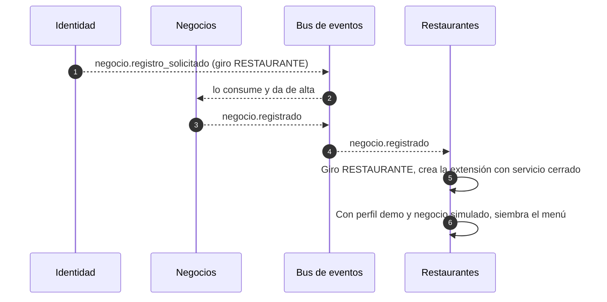

### 14.2 Tomar una orden hasta entregarla

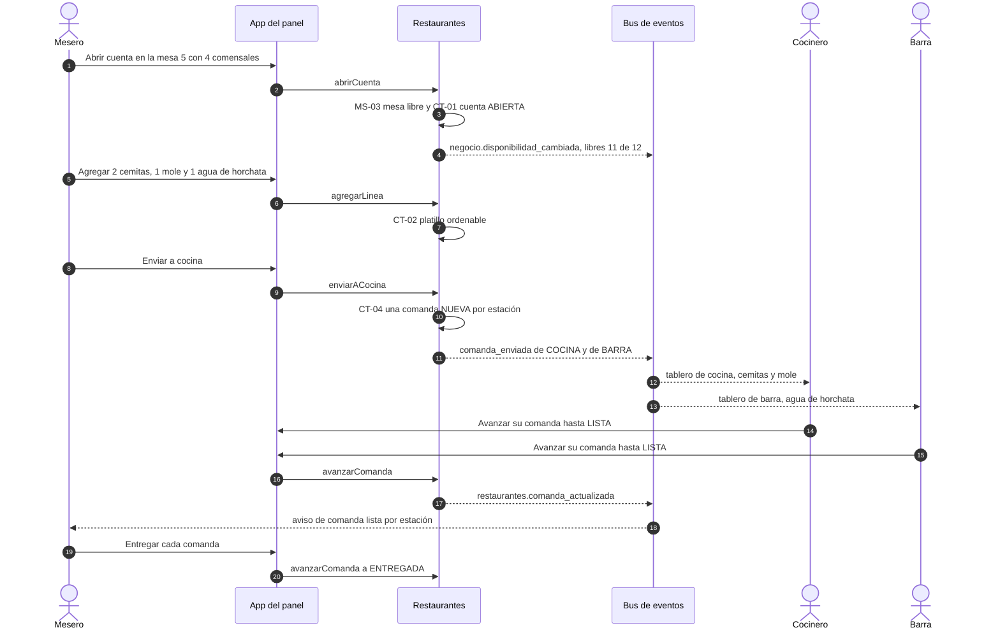

### 14.3 Cobro, venta y descuento de insumos

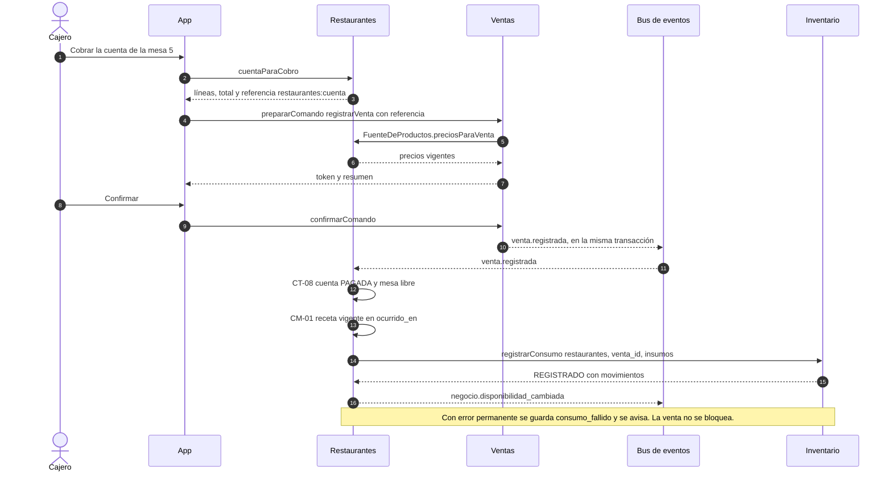

### 14.4 Anulación que llega antes que la venta

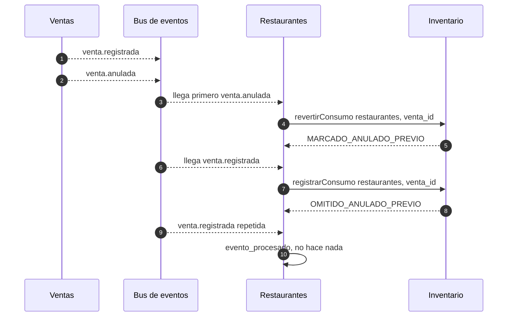

### 14.5 Guardar una receta

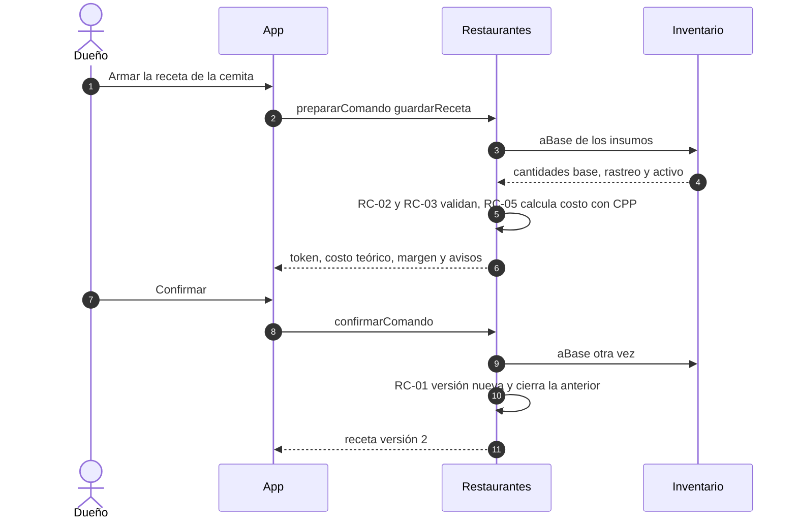

### 14.6 El turista abre la ficha

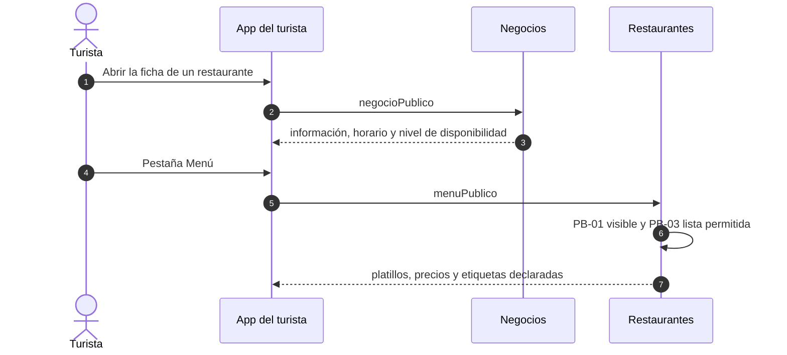

---

### 14.7 Pedido desde el QR de la mesa

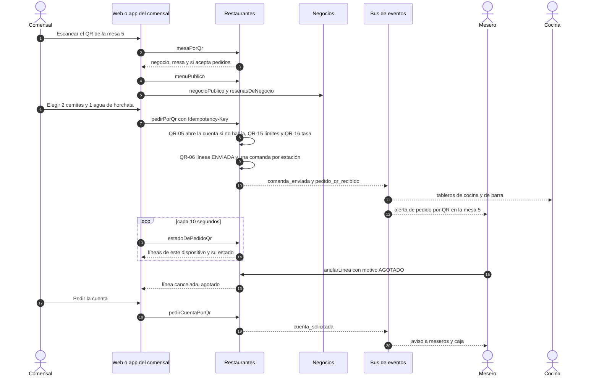

## 15. Criterios de aceptación

Una prueba por regla (columna «Prueba» de la sección 5), más estos recorridos de punta a punta:

| # | Recorrido | Reglas |
|---|---|---|
| A-1 | Crear platillo con receta, venderlo por mostrador y ver el descuento en Inventario | MN-01, MN-02, RC-01, CM-01, CM-02 |
| A-2 | Cobrar la misma venta dos veces (evento repetido): un solo descuento | CM-03 |
| A-3 | Anular una venta: los insumos regresan al costo original; anulada antes de registrada: se omite | CM-04 |
| A-4 | Artículo dado de baja: el fallo queda registrado, hay alerta y la venta sigue | CM-06 |
| A-5 | Abrir cuenta, pedir, enviar, entregar, cobrar y ver la mesa libre | CT-01 a CT-08, CD-01 |
| A-6 | Dos peticiones simultáneas de abrir cuenta en la misma mesa: una gana | MS-03 |
| A-7 | El negocio B no ve nada del negocio A, ni en GraphQL ni en SQL | SR-01, SR-02 |
| A-8 | Menú público: sin costos ni recetas; negocio pausado, sin menú | PB-01, PB-03 |
| A-9 | Receta de la versión vigente en el momento de la venta, aunque el evento llegue tarde | RC-07 |
| A-10 | Pruebas de contrato: el lector entiende `venta.registrada` real, con y sin opcionales | Kit de contrato |
| A-11 | Un comensal escanea el QR de una mesa libre y pide: se abre la cuenta, el pedido aparece en cocina sin acción del mesero y el mesero recibe la alerta | QR-03, QR-05, QR-06, QR-07 |
| A-12 | Un pedido con cemita y bebida crea dos comandas; cada estación avanza la suya sin afectar a la otra | CT-04, CD-03, CD-08 |
| A-13 | Un platillo agotado no se puede pedir; si se agota después, el mesero cancela con motivo y el dispositivo del comensal ve «cancelado» con el motivo | QR-09, QR-10, QR-11 |
| A-14 | Pedir la cuenta por QR, cobrar y liberar la mesa: el siguiente escaneo abre una cuenta nueva y el pedido anterior no se mezcla | QR-13, QR-14, CT-08 |
| A-15 | Spam al QR: el sexto pedido por minuto se rechaza, tres cuentas por `SIN_COMENSALES` pausan la mesa y un token de otra mesa no sirve | QR-16, QR-17, QR-19 |

Estructura de pruebas: `ContratoDeFuenteDeProductosTest` (extiende la clase abstracta de Pista A), `ContratoVentaRegistradaV1Test`, `ConsumidorIdempotenteTest`, `EstructuraModulosTest` y pruebas contra Postgres real para seguridad por fila e índices parciales. Mutaciones sobre los puntos críticos: versión de receta por `ocurrido_en`, suma por artículo, índice de mesa, permiso al confirmar.

---

## 16. Fases y reparto (TDD)

Cada fase: pruebas primero (RED con el motivo correcto), código mínimo (GREEN), `mvn clean verify`, y una entrada en la Bitácora. **Ninguna empieza sin autorización escrita.** Sigue el plan de integración: R1 y R2 pueden empezar con el contrato congelado (hito H-0) y un doble de Ventas.

**Qué es la pista C.** El plan de integración (§13.1) reparte el trabajo en tres pistas que avanzan en paralelo: **A** integra Ventas y Caja (la sesión de `julio`), **B** construye Misceláneos (el equipo del usuario) y **C** construye Restaurantes, que es este documento. Cada pista tiene sus archivos, un rango de decisiones y un rango de migraciones (sección 13 de ese plan). La pista C la lleva quien pidió este diseño; la B ya la lleva su equipo.

| Fase | Entregable | Depende de | Estimado |
|---|---|---|---|
| R0 | Esqueleto del módulo, `EstructuraModulosTest`, 18 permisos `restaurantes.*`, rol `MESERO_CAJA` y `V037` | F1 de la Pista A (RolesBase) | 0.75 d |
| **R1** | **Menú**: dominio, `FuenteDeProductos` y su contrato, GraphQL del panel, `menuPublico` (en memoria) | R-V3 | 1.5 d |
| **R2** | **Recetas**: versiones, validación con `aBase`, costo y margen, comando `guardarReceta` | R-I1 (doble hasta entonces) | 1.5 d |
| **R3** | **Consumo**: lectores tolerantes, consumidor idempotente, `consumo_fallido`, alerta | R-I2 (doble hasta entonces) | 1 d |
| R4 | **Salón y cuentas**: mesas, servicio, cuentas, líneas, anular y cancelar con motivo, `cuentaParaCobro`, vínculo con la venta, liberar mesa, disponibilidad | **R-V1** | 2.75 d |
| R5 | **Cocina con estaciones**: una comanda por estación, tableros de cocina y barra, suscripciones | R4 | 1.5 d |
| R6 | **Mesa por QR**: token, `mesaPorQr`, `pedirPorQr` que abre la cuenta y va directo a cocina, `estadoDePedidoQr`, `pedirCuentaPorQr`, alertas, límites, tasa, pausa automática e interruptor | R4, R-F1, R-F2 | 2.5 d |
| R7 | **Persistencia**: `V060` a `V065`, repositorios JDBC, seguridad por fila forzada | F6 de la Pista A | 1.5 d |
| R8 | **Demo y cierre**: siembra, restablecer, mutaciones, revisión de seguridad y calidad, documento de evidencia | R1 a R7 | 1.5 d |

**Estado:** R0 a R3 programadas el 2026-10-16 (ver «Estado de la implementación»). Total P1 del servidor ≈ **14.5 d-p**: P1a (R0 a R3) 4.75, P1b (R4 a R6) 6.75, persistencia y cierre (R7 y R8) 3. **No incluye la página web pública** (carta, restaurante, reseñas, pedido y seguimiento), que es frontend: ≈ 2.5 d-p a cargo del equipo (D-190).

Propiedad de archivos (plan de integración §13.3): `restaurantes/**` y `restaurantes.graphqls` son de la Pista C; `RolesBase` es compartido y serializado; la Bitácora solo se agrega al final.

## 17. Riesgos

| Riesgo | Prob. | Efecto | Mitigación |
|---|---|---|---|
| Ventas no acepta `referencia` a tiempo | Media | P1b sin vínculo cuenta-venta | Plan B: la app llama a `cerrarCuenta(cuentaId, ventaId)` tras cobrar y Restaurantes verifica contra `venta.registrada`; es más frágil |
| Inventario no tiene `registrarConsumo` | Alta (hoy falta) | P1a sin descuento real | Doble en pruebas; el módulo se prueba completo y se conecta después |
| `aBase` sin `rastreo` | Alta | RC-03 sin cumplirse | Pedir R-I1; sin él, una serie en receta pasaría hasta fallar en consumo |
| Alcance mayor al tiempo | Alta | No cabe P1b | Orden de recorte de la sección 3.2; P1a solo ya es un producto |
| Costos de receta engañosos por CPP vacío | Media | Margen falso | `INCOMPLETO` y nunca estimar (RC-05) |
| Alergias mal declaradas | Media | Daño al comensal | Etiquetas rotuladas «declarado por el negocio»; la plataforma no las verifica ni las garantiza |
| Comentarios libres en notas con datos de salud | Media | Dato sensible | Bandera `marca_alergia` sin detalle, nota de 80 caracteres, borrado a los 30 días |
| Pedidos falsos por QR (una broma, o alguien lejos con una foto del QR): sin aceptación previa, cocina prepara comida que nadie pidió | Media | Pérdida de insumos y de tiempo de cocina | Alerta inmediata al mesero, que verifica y cancela con `SIN_COMENSALES`; tasa y límites; pausa automática de la mesa y interruptor del local (QR-15 a QR-17). Opción en P2: un código de mesa que rota al liberarla (D-192) |
| QR impreso sustituido por uno falso pegado encima | Baja | El comensal llega a un sitio ajeno | La app muestra negocio y mesa al escanear y el QR lleva el enlace en texto; tinta o laminado que no se pueda despegar sin dejar rastro (QR-12) |
| La web pública todavía no existe | Alta | Sin ella el QR no sirve a quien no tiene la app, y es el camino principal | Pantalla de frontend de ≈ 2.5 d-p y CORS (R-F2); el pedido por QR depende de ella |
| Un comensal sigue esperando algo que ya se canceló | Media | Mala experiencia y disputa | El estado se sondea cada 10 segundos y el motivo de la cancelación se muestra en su pantalla (QR-10, QR-11); el mesero además avisa en persona |

---

## 18. Hallazgos

| ID | Hallazgo | Gravedad | Propuesta |
|---|---|---|---|
| H-R1 | `venta.registrada` v1 no trae ninguna referencia: no hay forma de saber qué cuenta pagó una venta | Alta | R-V1: campo opcional `referencia` |
| H-R2 | Ventas registra una venta de un solo golpe y no conoce cuentas abiertas ni mesas | Media | La cuenta abierta vive en Restaurantes (D-164) |
| H-R3 | Ventas y Caja no tienen propina. Si la propina va por tarjeta, la caja no cuadra | Media | Fuera del MVP; en P2 se pide un movimiento o método de Caja |
| H-R4 | El precio de la cuenta puede diferir del que cobra Ventas si cambió entre pedir y cobrar | Media | MN-11 y CT-13: se avisa; el precio vigente manda |
| H-R5 | El modo de inventario (D-17) lo llevaría Catálogo, que no existe. Sin dueño, nadie impide `RECETA` y vínculo directo a la vez | Alta | D-163 y R-V2 |
| H-R6 | `merma_pct` de 0 a 100 está ambiguo: ¿pérdida sobre el bruto o desperdicio sobre el neto? Con pérdida sobre el bruto, 100 % divide entre cero | Media | D-167: desperdicio sobre el neto, `× (1 + merma/100)` |
| H-R7 | Negocios consume `negocio.disponibilidad_cambiada` hasta P2; la ficha del stand necesita mesas libres | Media | R-N1 |
| H-R8 | Los eventos de Negocios no dicen con certeza si el negocio está publicado | Media | R-N2 |
| H-R9 | D-42 dice que el menú lo sirve Catálogo (`catalogoPublico`), que no existe; y el plan de integración elimina el canal que componía la ficha | Media | D-170: Restaurantes sirve `menuPublico` y la app compone la ficha |
| H-R10 | El consumo ocurre al cobrar, no al enviar a cocina: el stock «comprometido» por cuentas abiertas no se ve | Baja | Aceptado (D-166); stock comprometido es P3 |
| H-R11 | `clientes.md` C-8 ya advierte que las alergias en notas son dato sensible | Media | D-172 |
| H-R12 | Dar de baja un artículo usado en una receta rompe el descuento sin aviso previo | Baja | R-I5; mientras tanto `consumo_fallido` lo atrapa |
| H-R13 | Con rendimiento alto y cantidades pequeñas, el redondeo a 4 decimales acumula diferencia | Baja | CM-05: se redondea una vez por artículo |
| H-R14 | `RolesBase.java` lo editan varias pistas | Baja | Serializado (plan §13.3) |
| H-R15 | El enlace del QR necesita una página para quien no tiene la app | Media | Resuelto en el diseño (D-185, D-190); falta construir la web (la hace el equipo) y el CORS (R-F2) |
| H-R16 | Dibujar el QR necesita una librería (en el cliente Flutter o en el servidor): es una dependencia nueva | Baja | El servidor solo entrega la URL (QR-13); la librería se decide con el equipo del frontend |
| H-R17 | La plantilla de puestos de `RESTAURANTE` no tiene barra; quien atienda la barra usa `COCINERO` | Baja | Resuelto: D-191 |
| H-R18 | «Cobro configurable» choca con roles base fijos (D-69) y permisos por persona en P2 (D-74) | Media | D-171: rol `MESERO_CAJA` por persona; pregunta 19 |
| H-R19 | La puerta pública limita por IP y por cuenta; `pedirPorQr` es una **escritura anónima** y necesita límite por token y por dispositivo | Media | R-F1 y QR-16 |
| H-R20 | Un pedido por QR sin aceptación previa va directo a cocina: quien tenga una foto del QR puede pedir comida sin estar en el local | Alta | Defensas posteriores y no bloqueantes (D-187); es el costo de la decisión del equipo |
| H-R21 | «Dueño» se usó para dos cosas: el dueño del comercio (rol `DUENO`) y el responsable de programar un módulo (quien mantiene Negocios) | Baja | En este documento «dueño» es siempre el del comercio; la otra figura se llama «responsable del módulo» |
| H-R22 | Si se cobra sin la `referencia` (a mano en Caja), la cuenta no se cierra y la mesa queda ocupada | Media | CT-15, `liberarMesa` con motivo |

---

## 19. Decisiones

Rango de la Pista C: `D-160` a `D-199` (ampliado dos veces; `D-180` en adelante no estaba asignado en este repositorio). El estado refleja las respuestas del equipo del 2026-10-16: **ACEPTADA** lo que el equipo confirmó; **PROPUESTA** lo que sigue siendo mío y falta confirmar.

| ID | Decisión | Estado |
|---|---|---|
| **D-160** | Restaurantes es un módulo **vertical** con esquema `restaurantes`. Depende de `compartido` e `inventario`; nadie depende de él (R4) | PROPUESTA |
| **D-161** | Los «submódulos» son paquetes internos (`menu`, `recetas`, `consumo`, `publico`, `salon`, `cuentas`, `cocina`, `analisis`, `asistente`), no módulos Modulith. Sin ciclos entre ellos y **sin prueba de arquitectura interna**: revisión manual | ACEPTADA (respuesta 10) |
| **D-162** | El id del platillo es el `producto_id` de Ventas. Unidad `pieza`, sin fracción (D-80) | PROPUESTA |
| **D-163** | Mientras no exista Catálogo, el **modo de inventario** de un platillo lo lleva Restaurantes. Se pide a la plataforma `modoInventario` en `FuenteDeProductos`. Precisa D-17 | ACEPTADA (respuesta 8) |
| **D-164** | La **cuenta abierta vive en Restaurantes**. Ventas registra solo al cobrar; el cobro es por GraphQL con `referencia`. Si una venta llega, **la venta gana** | ACEPTADA (respuesta 3) |
| **D-165** | Excepción a preparar → confirmar (como D-92): las operaciones de salón y menú son mutaciones directas con `version` o `Idempotency-Key`. Receta, baja de platillo y anular o cancelar algo **ya preparado** sí lo usan. Anular una línea antes de que esté lista es directo, con motivo (D-188) | ACEPTADA (respuesta 4); precisada por D-188 |
| **D-166** | El consumo ocurre con `venta.registrada`, con la versión de receta vigente en `ocurrido_en` (D-09, D-18) | PROPUESTA |
| **D-167** | `merma_pct` es desperdicio sobre el neto: consumo = cantidad × (1 + merma/100). `rendimiento` entero de 1 a 500 | ACEPTADA (respuesta 5) |
| **D-168** | Costo teórico `INCOMPLETO` si falta un CPP; nunca se estima | PROPUESTA |
| **D-169** | Restaurantes calcula y publica `libres`, `total`, `abierto` por C-01; no tiene WebSocket público de mesas. Negocios lo consume desde P1 (R-N1) | ACEPTADA (respuesta 9); falta el acuerdo del responsable del módulo Negocios |
| **D-170** | `menuPublico` es de Restaurantes hasta que exista Catálogo; vista de solo lectura, sin sesión, lista permitida (D-42, D-99) | PROPUESTA |
| **D-171** | **El cobro del mesero es configurable por persona.** Por omisión el mesero no cobra; quien deba atender y cobrar recibe el rol base `MESERO_CAJA` (permisos de MESERO más `ventas.venta.ver`, `ventas.venta.registrar` y `caja.turno.ver`). La configuración por permiso suelto espera a Identidad P2 (D-74) | ACEPTADA (delegada, «como veas más óptimo») |
| **D-172** | Alergia como bandera sin detalle; nota de línea de 80 caracteres que se borra a los 30 días | ACEPTADA (respuesta 11) |
| **D-173** | La propina queda fuera del MVP | ACEPTADA (respuesta 7) |
| **D-174** | La IA entra en P2 (menú desde foto o voz, traducción rotulada). El modelo propone y la persona confirma. Falta elegir el modelo | ACEPTADA (respuesta 12) |
| **D-175** | `publicado` solo gobierna el menú público | PROPUESTA |
| **D-176** | Las etiquetas de platillo son un catálogo propio, con códigos alineados a los de dieta de Negocios, sin llave foránea | PROPUESTA |
| **D-177** | La temporada es un rango mes-día en la zona horaria del negocio | PROPUESTA |
| **D-178** | **Giro de la demo:** Restaurantes (lo construye el autor de este diseño) y Misceláneos (su equipo) son verticales reales. **Museos queda como mockup**, supuesto mío porque no se mencionó | ACEPTADA (Restaurantes y Misceláneos); Museos es supuesto |
| **D-179** | **Estaciones con estado propio desde P1:** cada envío crea una comanda por estación (`COCINA` o `BARRA`, según la categoría del platillo) y cada una tiene su estado | ACEPTADA (respuesta 14) |
| **D-180** | **QR por mesa en P1:** token opaco, aleatorio y rotable. El QR abre la carta, el restaurante y sus reseñas, y permite **pedir sin aceptación del personal**; el primer pedido abre la cuenta de la mesa | ACEPTADA (la pidió el usuario) |
| **D-181** | `pedirPorQr` es una **mutación pública directa**: la línea nace `ENVIADA`, va a cocina de inmediato y alerta a los meseros. El control es posterior: el restaurante marca lo agotado y el mesero cancela con motivo, visible al comensal | ACEPTADA (la forma); las defensas son D-187 |
| **D-182** | Combos y comida corrida en P2: un combo es un platillo que se expande a las recetas de sus componentes, un solo nivel | ACEPTADA (respuesta 15) |
| **D-183** | Orden de trabajo: P1a antes que P1b; los dos son P1 | ACEPTADA (delegada, respuesta 2) |
| **D-184** | La cuenta de la mesa acumula los pedidos hasta que el comensal o el personal **solicita la cuenta**; entonces pasa a `POR_COBRAR` y avisa a meseros y caja. La venta se registra en Ventas al cobrar; el cobro libera la mesa y el siguiente escaneo abre una cuenta nueva | **ACEPTADA** (confirmada en la pregunta 22) |
| **D-185** | **Página web pública de la mesa** para quien no tiene la app: la carta, el restaurante y sus reseñas, con pedido y seguimiento; sin cuenta. Con la app instalada, el enlace abre la app | ACEPTADA (respuesta 2) |
| **D-186** | El comensal sigue su pedido por **sondeo** (`estadoDePedidoQr`, cada ~10 s), sin WebSocket público en P1. Ve solo lo pedido desde su dispositivo, con el motivo de cada cancelación | PROPUESTA |
| **D-187** | **Defensas del QR sin aceptación previa:** tasa por token, dispositivo e IP (5 pedidos por minuto por token); 20 líneas por pedido, 60 y 3,000.00 por cuenta de QR; bandera de presencia; pausa automática tras tres cuentas canceladas por `SIN_COMENSALES` en una hora; interruptor `qr_habilitado` | **ACEPTADA** (pregunta 23). Los números son reglas versionadas y se pueden ajustar |
| **D-188** | Los **meseros cancelan líneas con motivo** (`linea.anular`). Cancelar una línea ya lista o entregada es de gerente en adelante y usa preparar → confirmar | ACEPTADA (que los meseros cancelen); el corte en «lista» es PROPUESTA |
| **D-189** | **El restaurante es responsable de marcar lo agotado**; nada se marca solo. En P2 se sugerirá marcarlo a partir de las alertas de Inventario | ACEPTADA (lo dijo el usuario) |
| **D-190** | **La web pública es la misma app de Flutter compilada para web** (`frontend/`), servida en el mismo origen que la app, con la ruta `/m/<token>`. La construye el equipo (≈ 2.5 d-p). El servidor acepta CORS solo de ese origen. En desarrollo corre en `localhost`; el dominio real se decide con la base de la demo (D-16) | ACEPTADA (que la construye el equipo); lo demás, delegada |
| **D-191** | La barra usa el rol `COCINERO` en P1; no se agrega el puesto `BARTENDER` | ACEPTADA (pregunta 18) |
| **D-192** | **Código de mesa rotatorio opcional** (P2): un código corto que el personal entrega a la mesa y que cambia al liberarla; si el restaurante lo activa, `pedirPorQr` lo exige. Es la defensa fuerte contra pedidos desde lejos | ACEPTADA (para P2) |

## 20. Respuestas del equipo y preguntas abiertas

### 20.1 Respuestas del 2026-10-16

| # | Pregunta de la v0.1 | Respuesta | Dónde quedó |
|---|---|---|---|
| 1 | ¿Restaurantes es el giro real de la demo? | «Restaurantes es uno de los que yo voy a hacer, mi equipo ya trabaja en Misceláneos» | D-178 |
| 2 | ¿P1 incluye salón, cuentas y cocina? | «Lo que recomiendes» | D-183: P1a antes que P1b, ambos P1 |
| 3 | ¿La cuenta abierta vive en Restaurantes con `referencia` en Ventas? | Sí | D-164, R-V1 |
| 4 | ¿Excepción de preparar → confirmar para el salón? | Sí | D-165 |
| 5 | ¿`merma_pct` es desperdicio sobre el neto? | Sí | D-167 |
| 6 | ¿El mesero no cobra? | Configurable | D-171, pregunta 19 |
| 7 | ¿Propina fuera del MVP? | Sí | D-173 |
| 8 | ¿Restaurantes lleva el modo de inventario? | Sí | D-163, R-V2 |
| 9 | ¿Negocios adelanta la disponibilidad a P1? | Sí | D-169, R-N1 |
| 10 | ¿Prueba de arquitectura interna? | No, revisión manual | D-161 |
| 11 | ¿Alergia sin detalle y notas a 30 días? | Sí | D-172 |
| 12 | ¿IA de P2 (menú desde foto y traducción)? | Sí | D-174; falta el modelo |
| 13 | ¿Quién toma la pista C? | «¿Qué es la pista C?» | Aclarado en la sección 16 |
| 14 | ¿Estaciones con estado propio? | Desde P1 | D-179 |
| 15 | ¿Combos y comida corrida en P2? | Sí | D-182 |
| + | «Los QR en las mesas quedan definidos en P1» | | D-180, D-181, sección 5.8 |

### 20.2 Segunda ronda (2026-10-16)

| # | Pregunta de la v0.2 | Respuesta | Dónde quedó |
|---|---|---|---|
| 16 | ¿El QR requiere aceptación del mesero? | No: el comensal pide, va directo a cocina y alerta a los meseros. El restaurante marca lo agotado; los meseros cancelan y avisan el motivo. Los pedidos se registran hasta que se solicita la cuenta; mesero o caja cobran y liberan la mesa | D-180, D-181, D-184, D-188, D-189, sección 5.8 |
| 17 | ¿Qué ve quien no tiene la app? | Una web con la carta, el restaurante y sus reseñas, y puede pedir desde ahí | D-185, QR-04, QR-21 |
| 19 | ¿Rol `MESERO_CAJA` o esperar a Identidad P2? | «Como veas más óptimo» | D-171 (el rol) |
| 21 | ¿Quién es el dueño de Negocios? | «¿A qué te refieres?». Entendió el dueño del comercio | Aclarado: era el **responsable del módulo** Negocios. Pregunta 21 reformulada (respondida en la tercera ronda) |

### 20.3 Tercera ronda (2026-10-16)

| # | Pregunta | Respuesta | Dónde quedó |
|---|---|---|---|
| 18 | ¿La barra usa `COCINERO` o se agrega `BARTENDER`? | «Que los use cocinero por el momento» | D-191 |
| 21 | ¿Quién es el responsable del módulo Negocios? | «Soy yo» | R-N1 y R-N2 son cambios del mismo autor |
| 22 | ¿Es correcta mi lectura de «se registran hasta que se solicita la cuenta»? | «Sí es correcto lo que solicité» | D-184 |
| 23 | ¿Les parecen bien las defensas y sus números? ¿Código de mesa? | «Sí estaría bien, pero eso en P2» | D-187, D-192 |
| 24 | ¿Quién construye la web y en qué dominio? | «La construimos nosotros»; el dominio, «como veas más óptimo» | D-190 |

### 20.4 Preguntas abiertas

| # | Pregunta |
|---|---|
| 20 | Modelo de IA para P2: ¿Gemini o ChatGPT? Sigue abierto desde el diseño original. No bloquea P1 |

Quedan además los **pedidos a otras pistas** sin hacer (sección 10): R-V1 (`referencia` en Ventas, bloquea P1b), R-V2, R-I1 a R-I4, R-F1 y R-F2. Y la autorización escrita para programar.

## Anexo A. Siembra de demostración (todo «de demostración», simulado)

**Fonda Doña Chela** (Centro, 12 mesas en tres zonas: Salón, Terraza, Barra):

| Categoría | Platillo | Precio | Modo | Etiquetas |
|---|---|---:|---|---|
| Antojitos | Cemita poblana | 85.00 | `RECETA` | `TIPICO_POBLANO`, `PICANTE` |
| Antojitos | Chalupas (orden de 5) | 70.00 | `RECETA` | `TIPICO_POBLANO` |
| Platos fuertes | Mole poblano con pollo | 120.00 | `RECETA` (rendimiento 40) | `TIPICO_POBLANO` |
| Platos fuertes | Tacos árabes (orden) | 95.00 | `RECETA` | `TIPICO_POBLANO` |
| Platos fuertes | Chiles en nogada | 260.00 | `RECETA` | `TIPICO_POBLANO`, `DE_TEMPORADA`, `CONTIENE_ALCOHOL` |
| Bebidas | Agua de horchata | 35.00 | `RECETA` | `VEGETARIANO` |
| Bebidas | Refresco embotellado | 30.00 | `VINCULO_DIRECTO` | |
| Postres | Arroz con leche | 45.00 | `NINGUNO` | `SIN_GLUTEN` |

La categoría **Bebidas** va a la estación `BARRA` y las demás a `COCINA`. Las 12 mesas se siembran con su QR.

Los otros cuatro restaurantes simulados de Negocios (DM-xx) reciben de 3 a 6 platillos sin receta. Los artículos de Doña Chela (pan de cemita, milanesa, quesillo, aguacate, chipotle, papalo, cebolla…) se crean en Inventario por su API pública (DM-02). Precios, CPP y temporada son datos de ejemplo.
