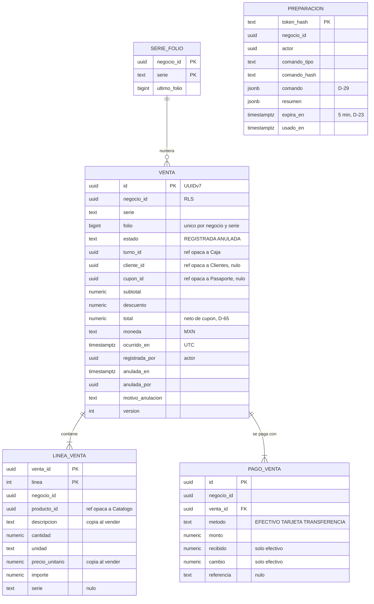
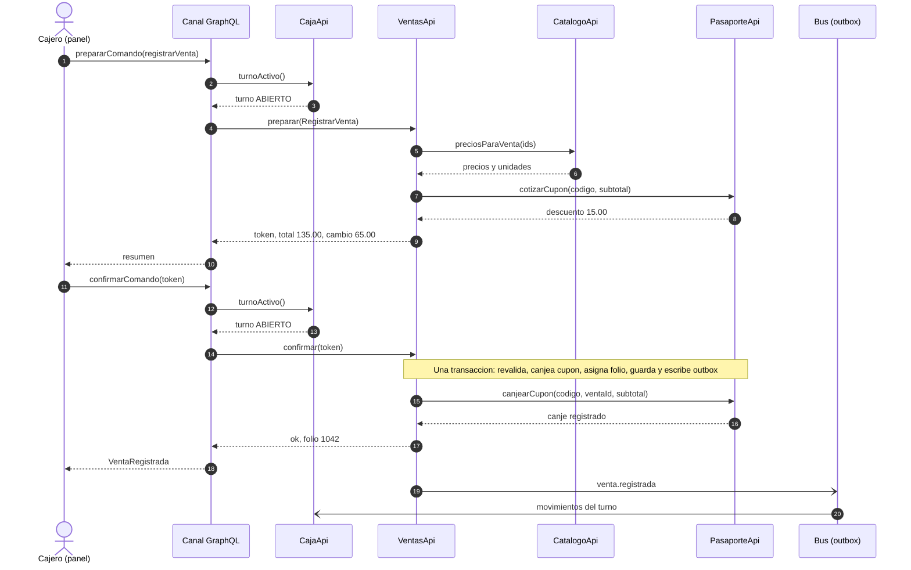
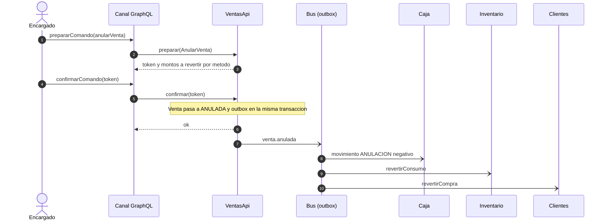
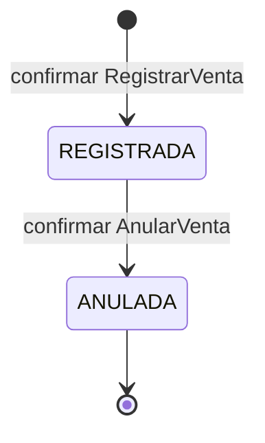

# Diseño del módulo de Ventas

**Versión:** 0.1 (borrador para revisión del equipo)
**Fecha:** 2026-10-14
**Estado:** solo diseño. No hay autorización escrita para programar Ventas. Nadie debe programar contra este documento hasta que el equipo lo apruebe (sección 13).
**Contexto de decisiones:** `docs/BITACORA.md` (los identificadores `D-xx` remiten a ahí). Las decisiones nuevas de este documento son D-76 a D-83, todas **PROPUESTA** salvo D-83.
**Módulo hermano:** `docs/diseno/caja.md`. **Plan:** `docs/planes/ventas-caja-v1.md`.

Convención de estado: **[A]** aceptado por el equipo, **[P]** propuesto y vigente salvo objeción, **[?]** abierto. Prioridades: **P1** = MVP y demo, **P2** = si alcanza, **P3** = fuera del MVP. Todos los datos de ejemplo son **simulados**.

---

## 1. Qué es y para qué sirve

Ventas es un módulo **horizontal**: registra qué se vendió, a qué precio, con qué descuento y cómo se pagó. Sirve igual a la tienda de un museo, a un misceláneo o a una fonda. No sabe qué es un boleto, un platillo ni una receta: solo conoce `producto_id` (de Catálogo), cantidades, unidades y dinero.

Qué **no** es de Ventas:

| Cosa | Dueño |
|---|---|
| Productos, precios, unidades y si un producto admite fracciones | Catálogo |
| Dinero físico, turnos, retiros y corte | Caja (`docs/diseno/caja.md`) |
| Existencias y costo | Inventario |
| Cupones y sellos | Pasaporte |
| Datos del cliente y su resumen de compras | Clientes |
| Asientos contables | Contabilidad |
| Boletos, aforo y recorridos de museo | Museos (vertical) |

---

## 2. Arquitectura

### 2.1 Reglas R1 a R6 aplicadas a Ventas

| Regla | Cómo se aplica |
|---|---|
| R1 | Ventas es dueño del esquema `ventas`. Los demás entran por `VentasApi` o por sus eventos. Sin joins ni llaves foráneas hacia otros esquemas. |
| R2 y R6 | Ventas llama de forma síncrona a `CatalogoApi` (precios) y a `PasaporteApi` (cupón, D-34). Publica `venta.registrada` y `venta.anulada`. **No llama** a Caja, Clientes, Inventario ni Contabilidad. |
| R3 | Todo evento lleva UUIDv7. Ventas no consume eventos en P1. |
| R4 | Ventas es horizontal y no conoce a ningún vertical. Lo propio del museo (boletos) y del misceláneo (venta a granel) se resuelve con datos de Catálogo, no con tipos en Ventas (D-80). |
| R5 | `venta.registrada` v1 y `venta.anulada` v1 ya los consume Clientes con lector tolerante. Este documento los congela agregando solo campos (D-77). |

### 2.2 Dependencias

| Módulo | Llama a la API de | Escucha eventos de | Publica |
|---|---|---|---|
| Ventas (horizontal) | Catálogo, Pasaporte | Ninguno (P1) | `venta.*` |
| Caja (horizontal) | Ventas (`resumenTurno`) | `venta.*` | `caja.*` |

Ventas y Caja no forman ciclo: Caja depende de Ventas y Ventas no conoce a Caja (D-76). El turno lo obtiene el **canal** (resolvedor GraphQL) con `CajaApi.turnoActivo` y lo pasa como dato. El canal no es un módulo, así que puede llamar a ambos (mismo criterio que D-42).

Spring Modulith lo verifica: `ventas` solo puede depender de `compartido`, `catalogo` y `pasaporte` (`allowedDependencies`). Prueba `ApplicationModules.verify()` en verde desde la primera fase.

---

## 3. Modelo de datos

Llaves UUIDv7. Toda tabla lleva `negocio_id` con seguridad por fila sobre `app.negocio_id` (igual que Clientes, `V020`). Dinero `NUMERIC(14,2)`, cantidades `NUMERIC(14,4)`, precio unitario `NUMERIC(14,4)`. Redondeo HALF_UP con la utilidad de `compartido` (D-20). Sin `float` ni `double`.

### 3.1 Diagrama entidad-relación



### 3.2 Tablas

| Tabla | Columnas principales | Restricciones y notas |
|---|---|---|
| `venta` | ver diagrama | Único `(negocio_id, serie, folio)`. Índice `(negocio_id, turno_id)` para `resumenTurno`. Solo se actualizan las columnas de anulación (VT-11) |
| `linea_venta` | ver diagrama | PK `(venta_id, linea)`. Solo inserción |
| `pago_venta` | ver diagrama | Solo inserción. `recibido` y `cambio` solo con `EFECTIVO` |
| `serie_folio` | ver diagrama | Se incrementa con bloqueo de fila dentro de la transacción de confirmar (VT-06) |
| `preparacion` | ver diagrama | Mismo patrón que Inventario y Clientes: solo se guarda el hash del token |

No hay estado «preparada» en `venta`: `preparar` no escribe en tablas de negocio (igual que Inventario §6.2). Una venta existe cuando se confirma.

---

## 4. Reglas de dominio

| ID | Regla | Prioridad |
|---|---|---|
| VT-01 | Toda venta lleva `turno_id`. El canal lo obtiene de `CajaApi.turnoActivo` y verifica que el turno esté `ABIERTO` antes de preparar y antes de confirmar. Ventas lo guarda como referencia opaca. Además, Ventas pregunta por la interfaz `VerificadorDeTurno` (en su API pública) si el turno sigue abierto, al preparar y al confirmar; Caja la implementa, así Ventas no depende de Caja (D-76). [P] D-86 | P1 |
| VT-02 | El precio, la descripción y la unidad de cada línea se toman de Catálogo al preparar y se copian a la línea. Un cambio de precio posterior no afecta la venta. | P1 |
| VT-03 | La cantidad es mayor que 0. Solo admite decimales si Catálogo dice que el producto admite fracción (venta a granel del misceláneo, D-80); si no, es entera. | P1 |
| VT-04 | Al confirmar, la suma de pagos es igual al total. En efectivo, `recibido ≥ monto` y `cambio = recibido − monto`. Se permiten varios pagos (mixto). | P1 |
| VT-05 | `confirmar` vuelve a validar todo; si una línea, un precio o el cupón cambiaron desde `preparar`, responde `COMANDO_CAMBIO` y no escribe. El resumen lleva cada línea con su precio, para que dos cambios que se compensan en el subtotal también se detecten. | P1 |
| VT-06 | El folio es consecutivo y sin huecos por negocio y serie, y se asigna en la transacción de confirmar (D-79). | P1 |
| VT-07 | Máximo un cupón por venta [?]. Al preparar se cotiza con `PasaporteApi` (solo lectura). Al confirmar se canjea con `PasaporteApi.canjearCupon` dentro de la misma transacción (D-34, D-78). Si el canje falla, la venta no se registra. El canje recibe el descuento que vio el cajero; si Pasaporte calcula otro, rechaza con `COMANDO_CAMBIO` sin canjear ([P] D-87). | P1 |
| VT-08 | `descuento ≤ subtotal` y `total = subtotal − descuento`. El `total` de `venta.registrada` es neto del cupón (D-65). | P1 |
| VT-09 | Solo se anula una venta `REGISTRADA`, con motivo y con el permiso de anular de Identidad [?]. La anulación usa preparar → confirmar. El límite de tiempo para anular está abierto [?]. | P1 |
| VT-10 | Anular una venta con cupón llama a `PasaporteApi` para revertir el canje [?] (operación por acordar con Pasaporte, D-78). | P2 |
| VT-11 | Una venta registrada no cambia salvo su anulación. Cualquier otra corrección es anular y volver a vender. | P1 |
| VT-12 | Los precios se tratan como finales al público. El desglose de impuestos queda fuera del MVP; los temas fiscales solo salen de una base curada con fuente y fecha [?]. | P1 |
| VT-13 | `cliente_id` es opcional y opaco. El canal lo elige con `sugerirClientes` de Clientes; Ventas no llama a Clientes (D-48). | P1 |

Redondeo y escalas: los de D-20. Importe de línea = `cantidad × precio_unitario` redondeado a 2.

---

## 5. Contrato de la API pública (`VentasApi`)

Reglas generales (iguales a Inventario y Clientes):
- `negocio_id` **nunca** es parámetro. Sale de `ContextoNegocio`.
- Respuesta: `{ ok, codigo, datos, mensaje_plantilla }`.
- Salidas como records inmutables (`VentaVista`, `ResumenTurnoVista`). Listas paginadas por cursor, máximo 100.

### 5.1 Consultas

| ID | Operación | Entrada | Salida | La usa | Prioridad |
|---|---|---|---|---|---|
| VF-01 | `venta` | `ventaId` | `VentaVista` con líneas y pagos | Panel | P1 |
| VF-02 | `ventas` | rango de fechas, estado, `turnoId?`, folio?, cursor | página de `VentaVista` resumida | Panel | P1 |
| VF-03 | `resumenTurno` | `turnoId` | número de ventas registradas y anuladas, totales por método de pago y número de preparaciones vigentes | Caja (corte, CJ-06) | P1 |
| VF-04 | `resumenDia` | fecha local de México | totales del día por método | Panel (inicio) | P2 |

### 5.2 Comandos (preparar → confirmar)

Viajan por el par de plataforma `prepararComando` / `confirmarComando` (D-55) como variantes de `ComandoInput`.

| ID | Comando | Campos | Reglas | Eventos |
|---|---|---|---|---|
| VF-10 | `RegistrarVenta` | `turnoId`, `lineas[{productoId, cantidad, serie?}]`, `pagos[{metodo, monto, recibido?, referencia?}]`, `codigoCupon?`, `clienteId?` | VT-01 a VT-08, VT-12, VT-13 | `venta.registrada` |
| VF-11 | `AnularVenta` | `ventaId`, `motivo` | VT-09 a VT-11 | `venta.anulada` |

`preparar` devuelve el resumen: líneas con precio de Catálogo, subtotal, descuento del cupón, total, cambio y `expiraEn`. No escribe nada salvo la fila de `preparacion`.

### 5.3 Códigos de error

| Grupo | Códigos |
|---|---|
| Datos de la venta | `VENTA_SIN_LINEAS`, `CANTIDAD_INVALIDA`, `CANTIDAD_NO_FRACCIONABLE`, `PRODUCTO_NO_ENCONTRADO`, `PRODUCTO_INACTIVO` |
| Límites de entrada (agregados el 2026-10-15 tras la revisión) | `DEMASIADAS_LINEAS` (más de 100), `DEMASIADOS_PAGOS` (más de 10), `TEXTO_DEMASIADO_LARGO` (serie o referencia de más de 60 caracteres). Un código de cupón de más de 40 caracteres es `CUPON_INVALIDO` sin consultar a Pasaporte; un monto de más de 999,999,999,999.99 es `METODO_PAGO_INVALIDO` |
| Pagos | `PAGOS_NO_CUADRAN`, `EFECTIVO_INSUFICIENTE`, `METODO_PAGO_INVALIDO` |
| Cupón | `CUPON_INVALIDO`, `CUPON_YA_CANJEADO`, `CUPON_NO_APLICA`, `DESCUENTO_MAYOR_AL_SUBTOTAL` |
| Turno (los devuelve el canal y Ventas, D-86) | `TURNO_NO_ABIERTO` |
| Anulación | `VENTA_NO_ENCONTRADA`, `VENTA_YA_ANULADA`, `MOTIVO_REQUERIDO`, `SIN_PERMISO_ANULAR` |
| Preparar y confirmar | `TOKEN_INVALIDO`, `TOKEN_EXPIRADO`, `TOKEN_USADO`, `COMANDO_CAMBIO` |
| Reintentables | `CONCURRENCIA`, `ERROR_TEMPORAL` |

Cada código tiene un texto fijo en español de México en la tabla de plantillas.

---

## 6. Eventos

Sobre común: el de `compartido` (`SobreEvento`): `id` UUIDv7, `tipo`, `version`, `negocio_id`, `origen = "ventas"`, `ocurrido_en` en UTC, `correlacion_id = venta_id`, `causa_id`, `datos`. Se publican en la misma transacción que la escritura (outbox, tabla `event_publication`). Dinero y cantidades como cadena decimal. Un opcional que no aplica se omite (no va en `null`).

### 6.1 `venta.registrada` v1 (congelar, D-77)

Une lo que ya piden Inventario (§7.2), Clientes (D-48, D-65) y lo que necesita Caja.

| Campo | Tipo | Obligatorio | Lo usa |
|---|---|---|---|
| `venta_id` | UUID | Sí | Todos |
| `folio` | entero | Sí | Panel, Contabilidad |
| `serie` | texto | Sí | Contabilidad |
| `turno_id` | UUID | Sí | Caja |
| `cliente_id` | UUID | No | Clientes (D-48) |
| `cupon_id` | UUID | No | Contabilidad, tablero |
| `subtotal` | decimal | Sí | Contabilidad |
| `descuento` | decimal | Sí | Contabilidad |
| `total` | decimal | Sí | Clientes, Caja (neto de cupón, D-65) |
| `lineas[]` | lista | Sí | `linea` (entero), `producto_id`, `cantidad`, `unidad`, `precio_unitario`, `importe`, `serie?` — Inventario, Restaurantes, Museos |
| `pagos[]` | lista | Sí | `metodo`, `monto` — Caja |

### 6.2 `venta.anulada` v1 (congelar, D-77)

| Campo | Tipo | Obligatorio | Lo usa |
|---|---|---|---|
| `venta_id` | UUID | Sí | Todos |
| `turno_id` | UUID | Sí | Caja |
| `motivo` | texto | No | Panel |
| `lineas[]` | lista | Sí | `linea`, `producto_id` — Inventario (D-25) |
| `pagos[]` | lista | Sí | `metodo`, `monto` — Caja |

### 6.3 Consumidores

| Evento | Consumidor | Qué hace |
|---|---|---|
| `venta.registrada` | Caja | Registra movimientos por método en el turno (CJ-03) |
| `venta.registrada` | Inventario | Descuenta productos con vínculo directo (Inventario §7.2) |
| `venta.registrada` | Restaurantes | Descuenta recetas (Inventario §7.4) |
| `venta.registrada` | Clientes | Aplica la compra si trae `cliente_id` (H-01 a H-06) |
| `venta.registrada` | Contabilidad | Póliza de ingreso [?] |
| `venta.anulada` | los mismos | Revierten. Si llega antes que `venta.registrada`, dejan marca `ANULADO_PREVIO` (D-19) |

Pasaporte **no** consume eventos de Ventas (D-34).

### 6.4 Ejemplo (datos simulados)

Tienda de un museo ficticio («Museo Talavera Viva»): 2 boletos generales y medio kilo de camote, con cupón de 10 %.

```json
{
  "id": "0192a4c1-3f20-7b11-8a4e-5d2f61c0a901",
  "tipo": "venta.registrada",
  "version": 1,
  "negocio_id": "0191f0aa-11b2-7c3d-9e4f-a1b2c3d4e5f6",
  "origen": "ventas",
  "ocurrido_en": "2026-10-15T23:42:08Z",
  "correlacion_id": "0192a4c0-e8b0-7a55-9c10-7788990011aa",
  "datos": {
    "venta_id": "0192a4c0-e8b0-7a55-9c10-7788990011aa",
    "folio": 1042,
    "serie": "A",
    "turno_id": "0192a39f-0c11-7d20-8e31-abcdefabcdef",
    "cupon_id": "0192a4c0-d001-7e00-8f00-000000000abc",
    "subtotal": "150.00",
    "descuento": "15.00",
    "total": "135.00",
    "lineas": [
      { "linea": 1, "producto_id": "0191f1b0-0001-7000-8000-000000000001",
        "cantidad": "2", "unidad": "pieza", "precio_unitario": "45.0000", "importe": "90.00" },
      { "linea": 2, "producto_id": "0191f1b0-0002-7000-8000-000000000002",
        "cantidad": "0.5000", "unidad": "kg", "precio_unitario": "120.0000", "importe": "60.00" }
    ],
    "pagos": [ { "metodo": "EFECTIVO", "monto": "135.00" } ]
  }
}
```

`causa_id` y `cliente_id` se omiten porque no aplican.

---

## 7. Comunicación con la API

| ID | Protocolo | Operación | Quién llama | Entrada → salida | Caso | Prioridad |
|---|---|---|---|---|---|---|
| G1 | GraphQL (consulta) | `productosParaVenta(texto)` | Panel (cajero) | texto → productos con precio, unidad y si admite fracción | Buscar qué vender. El resolvedor llama a `CatalogoApi` | P1 |
| G2 | GraphQL (mutación) | `prepararComando(input: {registrarVenta})` | Panel (cajero) | comando → token, resumen y `expiraEn` | Ver total, descuento y cambio antes de cobrar | P1 |
| G3 | GraphQL (mutación) | `confirmarComando(token)` | Panel (cajero) | token → `{ok, codigo, datos, mensajePlantilla}` con folio y cambio | Cobrar | P1 |
| G4 | GraphQL (mutación) | `prepararComando(input: {anularVenta})` / `confirmarComando` | Panel (encargado) | venta y motivo → resultado | Anular una venta cobrada por error | P1 |
| G5 | GraphQL (consulta) | `venta(id)` | Panel | id → venta con líneas y pagos | Ver un ticket | P1 |
| G6 | GraphQL (consulta) | `ventas(desde, hasta, estado, folio, primeros, despues)` | Panel (dueño) | filtro → página | Buscar ventas | P1 |
| G7 | GraphQL (suscripción, WebSocket) | `ventaRegistrada` | Panel (dueño) | — → resumen de cada venta del negocio | Tablero en vivo | P2 |
| J1 | Java | `CatalogoApi.preciosParaVenta(ids)` | Ventas | ids → precio, unidad, fracción, activo | VT-02, VT-03 | P1 |
| J2 | Java | `PasaporteApi.cotizarCupon(codigo, subtotal)` [?] | Ventas | código → cupón y descuento, sin canjear | VT-07 al preparar | P1 |
| J3 | Java | `PasaporteApi.canjearCupon(codigo, ventaId, subtotal, descuentoEsperado)` | Ventas | → canje, o `COMANDO_CAMBIO` sin canjear si el descuento ya no es el esperado | VT-07 al confirmar (D-34, [P] D-87) | P1 |
| J4 | Java | `VentasApi.resumenTurno(turnoId)` | Caja | → `ResumenTurnoVista` | Corte (CJ-06) | P1 |
| B1 | Bus | `venta.registrada` | Ventas → Caja, Inventario, Restaurantes, Clientes, Contabilidad | | | P1 |
| B2 | Bus | `venta.anulada` | Ventas → los mismos | | | P1 |

Sin REST en P1: el bot no continúa (D-63). Comprobante en PDF y webhooks de proveedores de pago: P3.

La app del turista no llama a Ventas. Ve su cupón canjeado por la suscripción `cuponActualizado` de Pasaporte (mockup, E-07).

---

## 8. Flujos

### 8.1 Cobrar una venta con cupón



### 8.2 Anular una venta



### 8.3 Estados



---

## 9. Seguridad

Se heredan SG-01 a SG-21 (D-45). Propias de Ventas:
- `negocio_id` y actor solo del contexto; `turnoId` y `clienteId` que manda el canal se tratan como referencias opacas y nunca dan acceso a datos de otro negocio (RLS).
- El token de `preparar` queda ligado a negocio, actor y hash del comando; se guarda solo el hash.
- `datos` de los eventos sin datos personales: `cliente_id` es un id, no un nombre.
- Anular exige permiso de Identidad [?]. Cada anulación queda con actor, fecha y motivo.

---

## 10. Criterios de aceptación

Cada fila es una prueba que nombra su regla. Se escriben antes que la implementación (TDD), con Testcontainers.

| Prueba | Reglas |
|---|---|
| `ApplicationModules.verify()` en verde: Ventas no depende de Caja, Clientes ni verticales | R1, R4, D-76 |
| Precio copiado al preparar; cambio de precio entre preparar y confirmar da `COMANDO_CAMBIO` | VT-02, VT-05 |
| Fracción rechazada en producto por pieza; aceptada a granel | VT-03 |
| Pagos que no cuadran, efectivo insuficiente, pago mixto correcto | VT-04 |
| Dos confirmaciones simultáneas no repiten ni saltan folio | VT-06 |
| Cupón canjeado dentro de la transacción; si Pasaporte falla, no hay venta | VT-07 |
| Total neto de cupón en el evento | VT-08, D-65 |
| Anulación con y sin permiso; segunda anulación da `VENTA_YA_ANULADA` | VT-09 |
| El evento sale en la misma transacción y sin `double` | §6 |
| Token expirado, reutilizado, de otro negocio, comando alterado | §5.2 |
| Aislamiento: un negocio no ve ventas de otro (RLS) | §9 |

Cobertura mínima: 80 %.

---

## 11. Convención de documentación del código (D-83)

Todo el código de Ventas se documenta con **JavaDoc** para encontrar errores rápido:
1. Cada clase, record e interfaz pública dice qué representa y, si es agregado, su ciclo de estados.
2. Cada método público de `VentasApi` lleva descripción, `@param`, `@return` y un `@throws` (o el `codigo` de error) por cada fallo de dominio.
3. Cada método cita su ID de función (`VF-10`) y las reglas que aplica (`VT-04`); cada código de error cita la regla que lo produce. Un error en el registro lleva directo a la tabla de reglas.
4. Los records de eventos documentan cada campo de `datos` y cuándo se publican.
5. Todo campo o parámetro de dinero indica escala y redondeo.
6. `mvn javadoc:javadoc` sin advertencias forma parte de la verificación.

---

## 12. Contratos que Ventas necesita de otros módulos

| De | Qué | Estado |
|---|---|---|
| Catálogo | `preciosParaVenta(ids)` con precio, unidad, si admite fracción y si está activo | Por definir con el dueño de Catálogo [?] |
| Pasaporte | `cotizarCupon` (nuevo, solo lectura), `canjearCupon` (D-34) y una forma de revertir el canje (VT-10) | Por definir [?] |
| Caja | `turnoActivo()` (la usa el canal, no Ventas) | `docs/diseno/caja.md` |
| Identidad | Permiso de anular venta | Por definir [?] |
| Plataforma | `ContextoNegocio`, `SobreEvento`, `UuidV7`, `DecimalPlano`, `prepararComando` / `confirmarComando` | Existen en `compartido` salvo el par de comandos |

---

## 13. Pendientes para aprobar este documento

| # | Pregunta | Propuesta |
|---|---|---|
| 1 | ¿Aceptan que Ventas no conozca a Caja y que el canal pase el `turno_id` (D-76)? | Sí [P] |
| 2 | ¿Aceptan el contrato de `venta.registrada` y `venta.anulada` de §6 (D-77)? | Sí [P] |
| 3 | ¿Cotizar el cupón al preparar y canjearlo al confirmar, en la misma transacción (D-78)? | Sí [P] |
| 4 | ¿Quién puede anular, y hasta cuándo? | Encargado o dueño, solo con el turno abierto [?] |
| 5 | ¿Precios finales sin desglose de IVA en el MVP (VT-12)? | Sí [P] |
| 6 | ¿Quién es dueño de Catálogo y de Pasaporte para acordar J1 a J3? | Abierta [?] |
